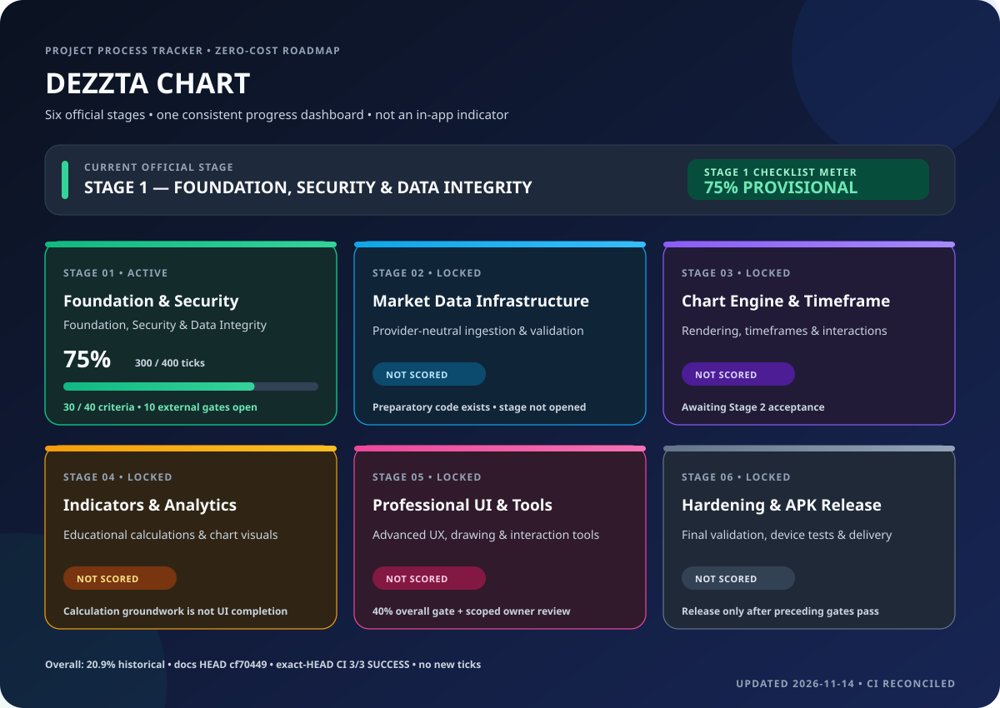

# DEZZTA CHART — Project Progress Indicator

Status: **operational project-tracking specification**  
Last audited: 2026-11-14  
Repository: https://github.com/deszztagd377-pixel/dezzta-chart  
Official working branch: `phase-2/market-data-foundation`  
Official current stage: **Stage 1 — Foundation, Security & Data Integrity**

> This document defines the **project-process progress indicator**. It is not an in-app technical indicator, chart overlay, or APK feature. Technical indicators such as SMA, EMA, RSI, MACD and Bollinger Bands are separate product work governed by Stage 4.

## Visual presentation standard — permanent through Stage 6

The project-process indicator uses the same six-card dashboard layout in every progress report and documentation snapshot. The visual reference is embedded below:

### Fixed visual rules

- Always show all six official stages together, in the official order.
- Each stage keeps its own colored card and progress bar; do not redesign the layout between stages.
- Stage 1: emerald/green. Stage 2: cyan/blue. Stage 3: violet. Stage 4: amber. Stage 5: pink. Stage 6: slate.
- Status colors: green = verified/active; amber = in progress or provisional; red = blocked/failed; slate = not opened/not scored. Color is always accompanied by readable status text.
- Only show a numeric percentage and filled progress bar when that stage has an approved, evidence-backed scoring model. For stages not yet audited, show **NOT SCORED** and an empty/neutral bar, never a guessed 0% or an invented completion percentage.
- Show the active official stage prominently, and retain the same card geometry, typography hierarchy, spacing, and color mapping from Stage 1 through Stage 6.
- Keep the overall-project historical checkpoint in a separate footer/summary. It must never be confused with an individual stage percentage.
- This is a documentation/project-management visual. It must not be inserted into the APK or treated as an in-app technical indicator.

## 1. Six-stage dashboard

| Stage | Official scope | Current official state | Progress display |
|---:|---|---|---|
| 1 | Foundation, Security & Data Integrity | Active; 30/40 provisional criteria accepted; 10 external criteria open | **75% provisional** |
| 2 | Market Data Infrastructure | Not officially opened; preparatory code exists on the branch | Not scored |
| 3 | Chart Engine & Timeframe | Not officially opened | Not scored |
| 4 | Indicators & Analytics | Not officially opened; calculation groundwork exists | Not scored |
| 5 | Professional UI & Interactive Tools | Not officially opened; expansion gate applies | Not scored |
| 6 | Hardening, Validation & APK Release | Not officially opened | Not scored |

A stage is not opened until all preceding stage acceptance requirements are met and the transition is explicitly recorded. Branch names, code already present, documentation, or CI success cannot silently advance the official stage.

## 2. Stage 1 progress meter

The Stage 1 acceptance matrix contains 40 criteria. For the display meter, each fully accepted criterion earns 10 ticks.

| Metric | Value |
|---|---:|
| Total criteria | 40 |
| Ticks per criterion | 10 |
| Total available ticks | 400 |
| Provisionally accepted criteria | 30 |
| Earned ticks | 300 |
| Remaining criteria | 10 |
| Remaining ticks | 100 |
| Stage 1 meter | **300 / 400 = 75% provisional** |

Calculation:

`Stage 1 progress = (accepted criteria × 10) ÷ 400 × 100`

One tick represents 0.25 percentage points of Stage 1. A criterion earns all 10 ticks only when its complete acceptance boundary and evidence are satisfied. Otherwise it earns zero. No fractional credit is awarded.

**Important accounting distinction:** 75% is a provisional Stage 1 checklist meter, not production acceptance. Stage 1 is not production-accepted.

## 3. Ten open Stage 1 acceptance criteria

| Criterion | Required evidence / blocker | Safe handling |
|---:|---|---|
| 8 | Owner-controlled no-billing host secret injection and secret absence checks | Repository scans help but cannot prove host configuration |
| 20 | Firebase sign-in, expiry/revocation, entitlement denial and browser/Android flows | Keep production integration disabled unless no-billing configuration is verified |
| 25 | Self-hosted Redis TLS, ACL, private binding, persistence and failure behavior | Requires existing owner-controlled hardware; no paid Redis |
| 30 | Restore a production-like backup into a fresh database and verify application records | CI restore regression is supporting evidence, not the target-environment drill |
| 31 | Encrypted off-host backup, separately stored key, retention/access policy and recovery drill | Keep blocked while compatible authenticated encryption tooling is unresolved |
| 34 | Persistent volume mount, ownership, permissions, restart durability and disk-pressure recovery | Requires target host/device evidence |
| 35 | HTTPS health checks, startup failure and backend-only secrets | Local/LAN is acceptable while public exposure would create cost |
| 36 | Authenticated WSS from supported web and Android clients through reverse proxy | Requires target environment/client evidence |
| 38 | Self-hosted metrics/logs, bounded retention, dashboard and access control | Defer rather than introduce paid observability |
| 39 | No-incremental-cost alert route and documented incident ownership/escalation/recovery | Do not assume email/SMS/push is free |

These are external or target-environment acceptance gates. A repository-only change cannot close them.

## 4. Overall project percentage — separate meter

Historical checkpoints preserved from the owner-approved conversation:

- 20.3% first.
- 20.9% later and most recent owner-confirmed historical checkpoint.
- 19.60% is an older formally recorded estimate, not evidence of regression.
- 19.9% has no reproducible calculation located.

**Fresh overall percentage: not established.**

The proposed M1–M8 weighted ledger totals 100%, but remains unapproved and unscored criterion-by-criterion. Therefore no new overall percentage may be published until:
1. The owner approves or revises the eight milestone weights.
2. Every deliverable is mapped to one primary milestone.
3. Each acceptance criterion is classified using verified evidence.
4. Partial completion is justified and duplicate credit is excluded.
5. The arithmetic is independently checked and recorded against an exact branch HEAD.

Formula after approval:

`Overall progress = Σ (milestone weight × verified completion fraction)`

Do not substitute Stage 1's 75% for overall project progress. Do not award progress merely for commits, file count, code volume, documentation, or unrelated green CI.

## 5. Milestone mapping and anti-double-counting

The proposed ledger groups are:

| ID | Group | Proposed weight | Scoring state |
|---|---|---:|---|
| M1 | Application shell and core chart rendering | 15% | Pending owner approval and audit |
| M2 | Data contracts, validation and persistence foundation | 20% | Pending owner approval and audit |
| M3 | Authentication and application security foundation | 10% | Pending owner approval and audit |
| M4 | Chart interaction and educational drawing/measurement tools | 15% | Pending owner approval and audit |
| M5 | Educational indicator and mathematical visualization layer | 15% | Pending owner approval and audit |
| M6 | Responsive UX, accessibility and visual design | 10% | Pending owner approval and audit |
| M7 | Watchlist, settings and user preference persistence | 5% | Pending owner approval and audit |
| M8 | Quality engineering, reproducible builds and release readiness | 10% | Pending owner approval and audit |
| | **Total** | **100%** | **Not yet an approved scoring model** |

One capability receives one primary milestone credit. Tests validate that capability; they are not a second feature. A calculation helper is not counted as visible indicator UI. A design document is not counted as implemented functionality. DEMO data is never counted as live provider delivery.

## 6. Work-cycle status vocabulary

Every cycle uses these states consistently:

- **Verified complete:** acceptance boundary passed with reproducible evidence.
- **Implemented, not fully verified:** code exists but acceptance evidence is incomplete.
- **In progress:** an active task with a defined next validation.
- **Blocked — internal:** repository-side issue that can be resolved without owner-side access; remediation should be performed in the same work cycle where safe.
- **Blocked — external:** requires owner-controlled host/device, provider, credentials, or owner decision. State the exact dependency and safe alternatives.
- **Deferred by zero-cost/security constraint:** no paid service, trial that may bill, insecure bypass, or weakened security is permitted.
- **Not started / not scored:** future stage or unapproved scope.

A blocker report must state: finding, impact, evidence, remediation attempted/applied, remaining dependency, and the acceptance test that will close it. Do not repeatedly describe the same blocker without taking an available remediation step.

## 7. Per-cycle mandatory report

Each project work cycle must record:

1. Official stage and branch.
2. Exact starting and ending HEAD.
3. Stage meter and formula.
4. Overall historical checkpoint separately from any approved fresh calculation.
5. Acceptance criteria changed and their before/after states.
6. Problems found and concrete fixes applied.
7. Files created/changed and why.
8. Commands or scripts executed by the development environment, if any.
9. Test/build/security results tied to the exact commit.
10. CI run links and final conclusions; queued/running workflows must not be called passed.
11. New commit SHA.
12. Termux/device action only when a specific test requires it, with the reason and verified compatibility. Never hand over a known failing command or ask the owner to repair generated files.

## 8. Termux and zero-cost constraints

- Product direction remains zero incremental cost.
- Do not introduce paid hosting, market-data subscriptions, paid APIs, managed Redis, paid backups/monitoring, paid runners, or trials that can bill.
- Do not switch the owner's Google Play Termux installation to an incompatible repository or bypass APT signature verification.
- The documented Google Play Termux keyring/repository mismatch remains an open external tooling constraint for the encrypted-backup gate. Keep the working source intact; do not import unverified keys, bypass signatures, or weaken the cryptography requirement.
- No Termux command is required for this project-process indicator documentation.
- Google Play publication remains deferred; the target is an installable APK on the owner's device when Stage 6 acceptance is reached.

## 9. Stage gates and expansion rules

- Stage 1 must be accepted before official transition to Stage 2.
- Each subsequent stage must satisfy its own documented acceptance gate before moving forward.
- The 40% overall-project gate is for major UI/feature expansion planning. It requires a reconciled approved ledger, scoped blueprint, and owner review. It does not bypass stage order.
- Visible technical indicator controls and overlays belong to Stage 4, not the project-process progress meter.
- Footprint, Heatmap and Liquidation Maps remain gated by owner-provided visual references, a scoped blueprint and owner review. Footprint remains explicitly SIMULATED unless a separately validated real-data source is implemented.

## 10. Current evidence snapshot — 2026-11-14

- Repository: `deszztagd377-pixel/dezzta-chart`
- Working branch: `phase-2/market-data-foundation`
- Source HEAD audited before the project-meter documentation commit: `10046851065e41fa73bdcf757eb87b02e5a12b6d`
- Automated Tests: [run #43567126816](https://github.com/deszztagd377-pixel/dezzta-chart/actions/runs/43567126816) — success on that exact source HEAD.
- CodeQL: [run #43567126843](https://github.com/deszztagd377-pixel/dezzta-chart/actions/runs/43567126843) — success on that exact source HEAD.
- Full Git History Secret Audit: [run #43567126815](https://github.com/deszztagd377-pixel/dezzta-chart/actions/runs/43567126815) — success on that exact source HEAD.
- The project-meter documentation commit is separate from the tested source commit. Its own Automated Tests workflow was still running at the time of this snapshot; do not treat it as passed until its exact-HEAD run concludes successfully.
- CI success does not close external criteria 8, 20, 25, 30, 31, 34, 35, 36, 38 or 39.
- Stage 1 remains 300/400 ticks = 75% provisional and not production-accepted.
- No fresh overall percentage is calculated.

## 11. Change log

| Date | Change |
|---|---|
| 2026-11-14 | Added explicit project-process progress indicator specification, six-stage dashboard, Stage 1 tick calculation, external blocker register, overall-percentage safeguards, work-cycle reporting contract and Termux/zero-cost constraints. |

## Latest work-cycle evidence update — 2026-11-14

### Criterion 30 — repository-side restore coverage audited

The existing test `backend/tests/test_sqlite_backup.py::test_full_application_database_restore_preserves_all_shared_sqlite_domains` already exercises a full shared-application SQLite snapshot and fresh-path restore. It reopens and verifies representative instrument-registry, entitlement, price-alert, coverage, OHLCV, and durable outbox/replay records, then confirms a post-restore write advances the outbox sequence.

This is meaningful repository/CI evidence and identifies the correct next phone-only restore-report target. It does **not** close criterion 30: the matrix still requires a timestamped owner-device restore report and application-level verification on the actual owner environment. No tick is added; Stage 1 remains 300/400 = 75% provisional.

### Latest exact-HEAD CI update

At HEAD `21eabf46bf51f076f074e8fc6c2eb55723111956`:
- Full Git History Secret Audit — success.
- CodeQL — success.
- Automated Tests — still running; frontend tests/build, backend tests, bounded synthetic SQLite outbox benchmark, dependency audit, backend image build, and shared-Redis/persistent-volume container smoke test had completed successfully. Backend container image scan was still running at the last check.

Do not mark the complete workflow successful until the image scan, report export/upload, and final job conclusion are complete.

### Termux dependency gate

A fresh check of the matching Google Play Termux issue tracker found the signing-key mismatch reports still open, including issues [#1642](https://github.com/termux-play-store/termux-issues/issues/1642) and [#1648](https://github.com/termux-play-store/termux-issues/issues/1648). The missing key is the upstream `termux-autobuilds` signing key, which is not included in the Play build's installed keyring. This confirms that the previously documented refusal to switch repositories or bypass signature checks remains correct.

No Termux command is required for this cycle. Preserve the original working repository configuration and the `cryptography>=50,<51` security requirement.

### CI completion reconciliation — 2026-11-14

The prior Automated Tests run `43568430935` later reached a **cancelled** workflow conclusion. Its recorded frontend checks, backend tests, synthetic outbox benchmark, dependency audit, container build, Redis/persistent-volume smoke test, Trivy image scan, vulnerability report export, and artifact upload steps all show success; however, the enclosing job/run conclusion is cancelled, so it is not counted as a fully green workflow.

The documentation-only follow-up HEAD `c63560ebf16bd16ab3de482df35c35b381fa009e` has fresh Automated Tests and CodeQL runs in progress and Full Git History Secret Audit pending. Their final conclusions must be checked on the exact latest HEAD before reporting full CI acceptance.

## Authoritative exact-HEAD CI and external-gate entry — 2026-11-14

This section supersedes earlier pending/in-progress CI snapshots above.

- Audited branch: `phase-2/market-data-foundation`.
- Exact HEAD: `d64ad3fa1620f75b363b4f32e3df01b06a62c2d2`.
- Automated Tests #43568751544: **SUCCESS** on this exact HEAD. The completed workflow includes frontend tests/build and bundle-secret checks, backend tests, dependency audits, bounded SQLite outbox benchmark, backend container build, Redis/shared-guard and persistent-volume smoke test, Trivy image scan, report export/upload, and cleanup.
- CodeQL #43568751559: **SUCCESS** on this exact HEAD for JavaScript/TypeScript and Python.
- Full Git History Secret Audit #43568751546: **SUCCESS** on this exact HEAD.
- Earlier cancelled runs on superseded commits are not treated as failures of this HEAD and are not used as proof.

### Entry decision: ten external gates

Repository/CI prerequisites for beginning the external-gate work are now green. Work may proceed against the ten open criteria without changing the official stage. **Stage 1 remains 300/400 ticks = 75% provisional; none of the ten external criteria has been awarded a tick.**

The first viable phone-only evidence target is criterion 30 (fresh SQLite restore and application-record verification). Its local restore path uses Python/SQLite standard-library functionality and does not require the blocked `cryptography` package. The successful CI restore regression is supporting evidence only; the owner-device report remains outstanding.

Criteria 8, 20, 25, 31, 34, 35, 36, 38 and 39 retain their distinct owner-host, provider, storage, operator or no-billing dependencies. Local/CI subtests must not be mislabeled as production acceptance.

### Current dashboard snapshot

- Stage 1 — emerald: **75% provisional**, 300/400 ticks, 30/40 criteria; 10 external gates open.
- Stage 2 — cyan: **NOT SCORED**.
- Stage 3 — violet: **NOT SCORED**.
- Stage 4 — amber: **NOT SCORED**.
- Stage 5 — pink: **NOT SCORED**.
- Stage 6 — slate: **NOT SCORED**.
- Overall project: **20.9% historical owner-confirmed checkpoint**; fresh weighted total remains unestablished.

## Gate 10 authorization and execution checkpoint — 2026-11-14

The owner explicitly authorized opening the ten external acceptance gates. This is an execution authorization, not an acceptance waiver and not a stage transition.

- Official stage remains Stage 1.
- Stage 1 remains 300/400 ticks = 75% provisional.
- The ten external criteria remain open until their individual evidence packages are reviewed.
- First active workstream: criterion 30, fresh SQLite restore and application-level verification.
- The restore helper now has a no-overwrite publication design, integrity and foreign-key checks, private POSIX permissions, and failure-cleanup tests. It is still repository implementation until the exact-HEAD CI passes and the owner-device restore report is produced.
- The process indicator is documentation-only; it is not an APK technical indicator.

### Current exact HEAD before this implementation batch

`a6fa0d68691bdf943101e71c5be70df0ba30d591` — all three workflows passed on this exact HEAD:
- Automated Tests #43569290818 — success.
- CodeQL #43569290707 — success.
- Full Git History Secret Audit #43569290886 — success.

The next implementation commit must receive its own fresh CI results before any code acceptance is claimed.

## Gate 10 execution batch 2 — exact-HEAD CI reconciliation — 2026-11-14

**Authoritative exact HEAD:** `13f489aebffa193affcb8eae619503e78e512b29` on `phase-2/market-data-foundation`.

All three workflows completed successfully on this exact commit:
- Automated Tests #43569886961 — SUCCESS (frontend checks/build, backend tests including the new restore helper tests, benchmark, dependency audit, backend image build, Redis/persistent-volume smoke, Trivy scan/report and cleanup).
- CodeQL #43569886954 — SUCCESS (Python and JavaScript/TypeScript).
- Full Git History Secret Audit #43569886911 — SUCCESS.

This clears the repository CI prerequisite for the restore implementation. It is not an owner-device restore drill and does not close criterion 30.

### Batch 2 additional hardening

Three further restore failure-path tests are now being added:
- POSIX owner-only permission failure must not publish a destination and must clean the temporary file.
- Restored-file flush failure must not publish a destination and must clean the temporary file.
- Atomic hard-link publication failure must fail closed, preserve absence of the destination, and clean the temporary file.

These tests are not accepted until the next exact-HEAD Automated Tests workflow succeeds.

### Current acceptance boundary

Criterion 30 remains OPEN until the actual application database on the target device/environment is backed up and restored to a fresh path, then validated with SQLite integrity/foreign-key checks, durable-domain readback and a post-restore write on the restored copy. The original database must remain untouched.

### Stage accounting

- Stage 1: 30/40 criteria; 300/400 ticks; 75% provisional.
- External gates: 10 open; no gate tick awarded by CI or documentation alone.
- Stage 2–6: NOT SCORED.
- Overall project: 20.9% historical checkpoint only; no new weighted calculation.

## Exact-HEAD work-cycle reconciliation — 2026-11-14

- Exact audited source HEAD: `4e741f10d5c27dba7994742a45d08f2d1c590415`.
- Automated Tests [#43570345495](https://github.com/deszztagd377-pixel/dezzta-chart/actions/runs/43570345495): **SUCCESS**.
- CodeQL [#43570345625](https://github.com/deszztagd377-pixel/dezzta-chart/actions/runs/43570345625): **SUCCESS** for Python and JavaScript/TypeScript.
- Full Git History Secret Audit [#43570345516](https://github.com/deszztagd377-pixel/dezzta-chart/actions/runs/43570345516): **SUCCESS**.
- The automated workflow completed backend tests, frontend tests/build and scans, container smoke test with shared Redis guard and persistent volume, image scan/report, and cleanup. This is exact-commit CI evidence, not owner-host production evidence.
- The restore implementation now has eight focused restore tests: five baseline tests plus permission-setting failure, restored-file flush failure, and atomic-publication-unavailable failure paths. The expanded failure tests passed as part of the exact-HEAD Automated Tests workflow.
- No external criterion was closed by this CI result. Criterion 30 still requires the owner-device application-database restore report; criteria 8, 20, 25, 31, 34, 35, 36, 38 and 39 retain their external evidence boundaries.

### Dashboard values at this checkpoint

| Official stage | Status | Display |
|---|---|---|
| Stage 1 — Foundation, Security & Data Integrity | Active; provisional evidence meter | **75% provisional — 300/400 ticks** |
| Stage 2 — Market Data Infrastructure | Not officially opened | **NOT SCORED** |
| Stage 3 — Chart Engine & Timeframe | Not officially opened | **NOT SCORED** |
| Stage 4 — Indicators & Analytics | Not officially opened | **NOT SCORED** |
| Stage 5 — Professional UI & Interactive Tools | Not officially opened | **NOT SCORED** |
| Stage 6 — Hardening, Validation & APK Release | Not officially opened | **NOT SCORED** |

Stage 1 formula remains: `30 × 10 = 300`; `40 × 10 = 400`; `(300 ÷ 400) × 100 = 75%`. Each fully accepted criterion is worth 10 ticks; no partial ticks are awarded.

The overall-project figure remains the historical owner-confirmed checkpoint **20.90%**, not a fresh weighted calculation. The M1–M8 weighted ledger remains unapproved/unscored. No progress increase is awarded for documentation or green CI alone.

The six-stage card layout, stage colors, status vocabulary, empty NOT SCORED bars, and separate overall checkpoint footer remain unchanged. This tracker remains documentation-only and is not an APK feature.

## Gate 10 batch 3 — restore helper integration tests — 2026-11-14

The full shared-application-database restore regression now calls `restore_consistent_sqlite_backup()` itself instead of manually copying the snapshot with SQLite's Backup API. It verifies both integrity and foreign-key checks before reopening registry, entitlement, alert, coverage, OHLCV and outbox stores and performing a post-restore write.

Two additional regression cases cover (1) directory-flush failure after atomic publication, where the valid destination remains visible but durability uncertainty is reported, and (2) a competing process creating the destination immediately before hard-link publication, where the competing file must remain untouched.

These are repository-side test improvements only. The exact-HEAD CI result is pending at this snapshot. Stage 1 remains **300/400 = 75% provisional**, all ten external criteria remain open, and Stage 2–6 remain NOT SCORED. No tick is awarded by test additions alone.

## Exact-HEAD reconciliation — Gate 10 batch 3 — 2026-11-14

- Exact branch HEAD: `ba01807b043de1f446b0630002ff607ac48a069a`.
- Automated Tests [#43571145976](https://github.com/deszztagd377-pixel/dezzta-chart/actions/runs/43571145976): **SUCCESS**.
- CodeQL [#43571145954](https://github.com/deszztagd377-pixel/dezzta-chart/actions/runs/43571145954): **SUCCESS**.
- Full Git History Secret Audit [#43571145944](https://github.com/deszztagd377-pixel/dezzta-chart/actions/runs/43571145944): **SUCCESS**.
- All three workflow runs target the exact same HEAD. Automated Tests job, both CodeQL language jobs, and the full reachable-history scan completed successfully.
- Batch 3 changes the shared-application-database regression to call `restore_consistent_sqlite_backup()` directly, verifies integrity/foreign keys and durable domains, checks a post-restore write, and covers post-publication directory-fsync uncertainty plus a competing destination race.
- Criterion 30 remains **OPEN**: repository CI is not the owner's actual application database restore report. No tick is added.

### Current official meter

Stage 1 remains **300/400 ticks = 75% provisional**, with 30/40 criteria provisionally accepted and ten external criteria open: **8, 20, 25, 30, 31, 34, 35, 36, 38, 39**. Stages 2–6 remain **NOT SCORED**. Overall project remains **20.9% historical owner-confirmed checkpoint**; no new weighted total has been approved. No stage transition is made.

### Criterion 30 path boundary

Repository inspection identifies `INSTRUMENT_REGISTRY_DB_PATH` as the shared SQLite path setting, defaulting in code to `./data/instrument_registry.sqlite3`. This is not proof of the resolved live path on Android. The actual process environment and working directory must be confirmed before any device restore. Source DB must remain untouched; restore only to a fresh destination.

## Latest exact-HEAD reconciliation — documentation indicator refresh — 2026-11-14

**Authoritative branch HEAD before this documentation-only refresh:** `cf7044922df3cac0d2e9a52679509ea0aa957a81`.

All three workflows on that exact HEAD are now complete and successful:
- Automated Tests [#43571570406](https://github.com/deszztagd377-pixel/dezzta-chart/actions/runs/43571570406) — **SUCCESS**.
- CodeQL [#43571570477](https://github.com/deszztagd377-pixel/dezzta-chart/actions/runs/43571570477) — **SUCCESS**.
- Full Git History Secret Audit [#43571570418](https://github.com/deszztagd377-pixel/dezzta-chart/actions/runs/43571570418) — **SUCCESS**.

This resolves the previously pending documentation-commit CI. It does not create new Stage 1 acceptance evidence and awards no ticks. Stage 1 remains 30/40 criteria = 300/400 ticks = **75% provisional**. External criteria **8, 20, 25, 30, 31, 34, 35, 36, 38, 39** remain OPEN. Stages 2–6 remain NOT SCORED. Overall project remains the historical 20.90% checkpoint; no new weighted total has been approved.

The visual dashboard asset is refreshed to match this exact-HEAD result. It remains a project-process indicator in documentation, not an in-app feature. Termux remains unchanged; no device command is required.

## Gate 10 batch 4 — exact-HEAD CI and database-path audit — 2026-11-14

**Audited branch HEAD:** `38309c377dc8ff9f800461a7890965ac7c46b958` (`phase-2/market-data-foundation`; `main` untouched).

All three workflows for this exact HEAD are now complete:
- Automated Tests [#43571964355](https://github.com/deszztagd377-pixel/dezzta-chart/actions/runs/43571964355) — **SUCCESS**.
- CodeQL [#43571964368](https://github.com/deszztagd377-pixel/dezzta-chart/actions/runs/43571964368) — **SUCCESS**.
- Full Git History Secret Audit [#43571964397](https://github.com/deszztagd377-pixel/dezzta-chart/actions/runs/43571964397) — **SUCCESS**.

The repository audit confirmed that the backend's shared SQLite path is configured by `INSTRUMENT_REGISTRY_DB_PATH`, defaulting to `./data/instrument_registry.sqlite3`. `create_app()` passes that same configured path to the instrument registry, price-alert store, entitlement store, OHLCV store, coverage tracker, and provider-definition synchronizer. This is the backend process's configured path, not proof of the resolved path of a running Android service.

The installable APK workflow generates a temporary Capacitor wrapper and packages the frontend. The repository has no checked-in Android host project that bundles or supervises the Python backend/Redis. Therefore, the APK installation does not by itself establish that this backend database exists on the phone. Criterion 30 still requires identifying the actual running backend process and its effective working directory/environment before any owner-device restore drill.

### Repository regression added in this batch

- `backend/tests/test_api.py`: verifies the five durable adapters exposed by `create_app()` share the exact configured SQLite path and that the database file is initialized.
- `backend/tests/test_config_security.py`: verifies `INSTRUMENT_REGISTRY_DB_PATH` is read from the backend environment.

These tests make the repository's path contract explicit. They do not prove a live Android database location and award no Stage 1 ticks by themselves.

### Acceptance and safety disposition

- Criterion 30: **OPEN** — target-device/live-backend restore report not yet available.
- Criterion 31: **OPEN / BLOCKED** — Termux Google Play repository signing-key mismatch and no verified off-host target/key-custody path.
- Termux: keep the existing working repository configuration; no package command, repository switch, key import, signature bypass, crypto downgrade, or app migration is authorized or required.
- Stage 1: **300/400 ticks = 75% provisional**; 30/40 criteria provisionally accepted; open criteria remain **8, 20, 25, 30, 31, 34, 35, 36, 38, 39**.
- Stage 2–6: **NOT SCORED**. Overall project: historical owner-confirmed **20.90%** only; no newly approved weighted calculation.

No external acceptance gate is closed by this repository work or green CI alone.

## Gate 10 work-cycle snapshot — 2026-11-14

- Exact starting HEAD: `cabf637bf2e48cb54983a98bd854416975272df5`.
- Exact-HEAD CI: Automated Tests #43572423301, CodeQL #43572423236, and Full Git History Secret Audit #43572423268 all completed **SUCCESS**.
- Repository regression scope added in this cycle: reject a corrupt/non-SQLite restore source without publishing a destination and without leaving temporary files.
- Stage 1 accounting is unchanged: **30/40 criteria, 300/400 ticks, 75% provisional**. The 10 open external criteria remain **8, 20, 25, 30, 31, 34, 35, 36, 38, 39**.
- Stages 2–6 remain **NOT SCORED** and officially unopened. Stage 1 remains not production-accepted.
- Overall project progress remains **20.9% historical checkpoint only**; no fresh weighted calculation is approved. This CI/test batch earns no additional stage or overall ticks.
- Termux: no action required. Keep the known-good Google Play source and package verification intact.

## Gate 10 batch 6 — exact-HEAD CI reconciliation and documentation link repair (2026-11-14)

**Exact source/test HEAD:** `8a159274eaa35339b8f68a1948f0bab002bc998c` on `phase-2/market-data-foundation`.

All three workflows completed successfully against this exact commit:
- Automated Tests [#43582913692](https://github.com/deszztagd377-pixel/dezzta-chart/actions/runs/43582913692) — **SUCCESS**.
- CodeQL [#43582913713](https://github.com/deszztagd377-pixel/dezzta-chart/actions/runs/43582913713) — **SUCCESS**.
- Full Git History Secret Audit [#43582913733](https://github.com/deszztagd377-pixel/dezzta-chart/actions/runs/43582913733) — **SUCCESS**.

Automated Tests passed frontend tests/build and secret scanning, Android host preflight, backend tests (including corrupt SQLite restore rejection), synthetic outbox benchmark, dependency audits, backend container build, Redis/persistent-volume smoke test, backend image scan and vulnerability-report export. No workflow failure was reported.

Documentation repair: corrected the malformed CodeQL run URL in this batch's earlier Gate 10 references. This is a documentation integrity correction, not a change to application behavior.

Acceptance accounting is unchanged:
- Stage 1: **30/40 provisional criteria = 300/400 ticks = 75% provisional**.
- External criteria still open: **8, 20, 25, 30, 31, 34, 35, 36, 38, 39**.
- Criteria 8, 20, 25, 30, 31, 34, 35, 36, 38 and 39 are not closed by CI alone. Criterion 30 still needs an owner-device restore report; criterion 31 remains blocked by the unverified Termux-compatible encrypted off-host/key-custody path.
- Stages 2–6 remain **NOT SCORED** and officially unopened.
- Overall project remains the historical **20.90%** checkpoint; no new weighted score is approved.

Termux disposition: no action required in this batch. Keep the known-good Google Play repository and signature verification unchanged. No device command, repository switch, key import, or crypto downgrade is authorized or needed.

## Owner-confirmed delivery target — manual APK installation

- Target: install and run DEZZTA CHART on the owner's Infinix GT20 using a directly supplied APK (manual sideload).
- Google Play Store: **DEFERRED / NOT IN SCOPE NOW**. No Play Console, store publication, listing, or publication fee is part of the current delivery path.
- Current Android workflow: debug APK build from a temporary Capacitor wrapper; frontend bundle only; artifact retention 7 days.
- APK packaging does not prove Python backend or Redis is bundled or running. Track build, actual-device installation/launch, and backend-connected runtime as separate checks.
- This clarification does not alter stage scoring, stage order, or the Stage 1 acceptance matrix.

## Gate 10 batch 8 — APK publisher correction, Android diagnostics, and criterion 30 drill (2026-11-14)

- The APK workflow now uses valid GitHub Actions expression syntax and relies on runner-provided GITHUB_OUTPUT/GITHUB_STEP_SUMMARY paths. A regression test guards these expressions and the opt-in-only release condition.
- Added read-only Python/SQLite/OpenSSL and installed dependency version inventory to Android host preflight.
- Added a reusable actual-database restore-drill module and tests covering application-domain readback, hashes, integrity, foreign keys, no-overwrite behavior, and a write/read/cleanup probe on the restored copy.
- APK packaging remains frontend-only; actual phone installation and backend hosting are still unverified. No public release was published.
- Stage 1 remains **300/400 ticks = 75% provisional**; open criteria remain **8, 20, 25, 30, 31, 34, 35, 36, 38, 39**. Stages 2–6 remain **NOT SCORED**. Overall project remains **20.90% historical**. No ticks are awarded by this batch.

## Gate 10 batch 9 — restore report hash and exact-HEAD CI reconciliation (2026-11-14)

- The restore drill now assigns a unique drill ID and a SHA-256 hash to its canonical redacted JSON report. It records passed checks and an empty failed-check list; no application row values, account identifiers, or absolute paths are included.
- The earlier CI ordering issue was corrected: the restore drill is discovered by the full backend pytest run after backend dependencies are installed.
- Exact HEAD: 86cc42f8d67d7ed808dc65008e7c191dd2fa2a76. Automated Tests [#43586542356](https://github.com/deszztagd377-pixel/dezzta-chart/actions/runs/43586542356), CodeQL [#43586542325](https://github.com/deszztagd377-pixel/dezzta-chart/actions/runs/43586542325), and Full Git History Secret Audit [#43586542296](https://github.com/deszztagd377-pixel/dezzta-chart/actions/runs/43586542296) all completed SUCCESS.
- Automated Tests recorded 211 frontend tests and 819 backend tests passing, including both owner-device restore-drill tests; backend container build, Redis ACL/persistent-volume smoke, dependency audit, and Trivy scan also passed.
- The latest APK build remains run [#43585923763](https://github.com/deszztagd377-pixel/dezzta-chart/actions/runs/43585923763) on commit 89239fd009a43924cc64762b48ed6f76ec690633. Its frontend-only APK artifact is available until 2026-11-21. It is not a permanent download release and has not been installed/verified on the actual phone.
- No GitHub preview/final release has been published. Final official download link remains gated on device installation and backend integration acceptance.
- Criterion 30 remains OPEN pending the actual owner-controlled Android database drill. Termux preflight remains unexecuted; no package or repository change is requested.
- Stage 1 remains 300/400 ticks = 75% provisional; open criteria remain 8, 20, 25, 30, 31, 34, 35, 36, 38, 39. Stages 2–6 remain NOT SCORED. Overall 20.90% remains historical only. No progress ticks are awarded.

## Gate 10 batch 10 — content-addressed SQLite restore verification (2026-11-14)

- Updated `backend/app/sqlite_restore_drill.py` to calculate deterministic SHA-256 digests for every application table's typed row content, independent of physical row order, and a separate schema digest covering tables, indexes, triggers and views.
- The restore drill now requires backup and fresh-restore row digests and schema digests to match; its redacted report records aggregate content identity without exposing row values or account identifiers.
- Added regressions proving the inventory detects a same-row-count record mutation and a schema-only change.
- Exact HEAD `06532f8e40bd73b4e909d78a098366dd7774af5b`: Automated Tests [#43587550807](https://github.com/deszztagd377-pixel/dezzta-chart/actions/runs/43587550807), CodeQL [#43587550837](https://github.com/deszztagd377-pixel/dezzta-chart/actions/runs/43587550837), and Full Git History Secret Audit [#43587550748](https://github.com/deszztagd377-pixel/dezzta-chart/actions/runs/43587550748) all completed SUCCESS.
- Validation: 211 frontend tests and 821 backend tests passed; frontend production build, dependency audits, backend container build, Redis ACL/shared-guard and persistent-volume smoke, backend health checks, image scan, and full-history secret audit passed. Trivy reported zero HIGH/CRITICAL vulnerabilities in the scanned backend image.
- This remains repository/CI evidence only. Criterion 30 stays OPEN until the actual owner-controlled Android backend database is identified and the restore drill is run and reviewed on that environment. Do not infer a live database path from the repository default.
- No Termux packages, repositories, signing keys, or cryptography versions were changed. No APK preview/final release was published.
- Stage 1 remains `300/400 ticks = 75% provisional`; open criteria remain `8, 20, 25, 30, 31, 34, 35, 36, 38, 39`. Stages 2–6 remain NOT SCORED. Overall `20.90%` remains a historical checkpoint only. No Stage 1 ticks are awarded by this repository work.

## Gate 10 batch 11 — atomic no-overwrite SQLite backup publication (2026-11-14)

- Identified a time-of-check/time-of-use race in the restore-drill backup path: the drill checked that the backup destination did not exist, but the generic backup helper published with `os.replace()`, which could overwrite a file created by another process between the check and publication.
- Added an explicit `overwrite` option to `create_consistent_sqlite_backup`. The default remains `True` to preserve existing helper behavior for current callers. The owner-device restore drill now explicitly uses `overwrite=False`.
- No-overwrite publication uses a same-directory atomic hard link. If a competing destination appears, link publication fails with `FileExistsError`; it never replaces the competing file. Unsupported hard-link filesystems fail closed. Temporary files are cleaned up.
- Added regression tests for an already-existing destination and a simulated concurrent destination creation. The first CI run exposed a missing `Path` import in the new test; it was corrected in follow-up commit `5ca037f4ef95e9b576ddfa180251a781678c11fe`. No user action was required.
- Exact tested HEAD: `5ca037f4ef95e9b576ddfa180251a781678c11fe`. Automated Tests [#43588568079](https://github.com/deszztagd377-pixel/dezzta-chart/actions/runs/43588568079), CodeQL [#43588568068](https://github.com/deszztagd377-pixel/dezzta-chart/actions/runs/43588568068), and Full Git History Secret Audit [#43588568078](https://github.com/deszztagd377-pixel/dezzta-chart/actions/runs/43588568078) all completed SUCCESS.
- Validation: 211 frontend tests and 823 backend tests passed; frontend production build, backend container build, Redis ACL/shared-guard and persistent-volume smoke, backend health checks, dependency audits, and full-history secret scan passed. Trivy reported zero vulnerabilities in the scanned backend image.
- This is repository/CI evidence only. Criterion 30 remains OPEN until the actual owner-controlled Android backend database is identified and the restore drill is run and reviewed on that environment.
- No Termux packages, repositories, signing keys, or cryptography versions were changed. No APK preview/final release was published.
- Stage 1 remains `300/400 ticks = 75% provisional`; open criteria remain `8, 20, 25, 30, 31, 34, 35, 36, 38, 39`. Stages 2–6 remain NOT SCORED. Overall `20.90%` remains a historical checkpoint only. No Stage 1 ticks are awarded by this batch.

## Gate 10 batch 12 — Android backend host architecture audit (2026-11-14)

- Audited the temporary Capacitor APK workflow, FastAPI packaging, frontend backend-origin configuration, authenticated WebSocket transport, production Redis/Firebase requirements, SQLite paths, and single-device Termux proposal.
- Confirmed the APK packages frontend `dist` only; it does not bundle, start, supervise, or persist FastAPI or Redis. APK packaging, device installation, and backend-connected acceptance are separate proofs.
- A manually started loopback-only Termux backend is the only candidate consistent with the one-phone/ZERO COST constraint, but remains unapproved and unproven: Python/Bionic imports, required cryptography, Redis TLS/ACL/persistence, Android TLS trust, Firebase lifecycle, SQLite durability, and Android process recovery need actual-device evidence.
- Existing Termux signature/keyring mismatch remains a hard stop. No package/repository/key changes, dependency downgrade, encryption change, or Termux command was performed.
- Added [Android Backend Host Architecture Audit](ANDROID_BACKEND_HOST_AUDIT.md) with blocker matrix and safe proof sequence. Documentation-only; no backend URL, secret, host, APK integration, or production security setting changed.
- Criteria 8, 20, 25, 30, 31, 34, 35, 36, 38, and 39 remain OPEN. Stage 1 remains 300/400 ticks = 75% provisional; no tick awarded. Stages 2–6 NOT SCORED; overall 20.90% historical only.
