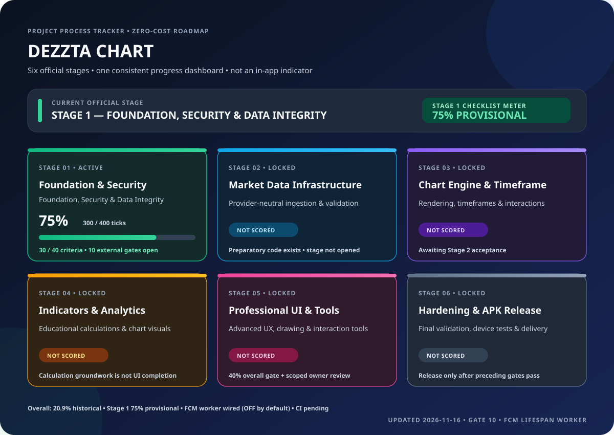

## Batch 62J-132 — exact-baseline CI acceptance and indicator reconciliation (22 November 2026)

**Source/test baseline:** `d549d99318abbeb156f716a4e2cf749eef226ca9` on `phase-2/market-data-foundation`. This is the commit tested by the three successful workflows; the documentation follow-up commit is a separate HEAD and must receive its own CI check.

- Automated Tests [44989988543](https://github.com/deszztagd377-pixel/dezzta-chart/actions/runs/44989988543): **SUCCESS**.
- CodeQL [44989988481](https://github.com/deszztagd377-pixel/dezzta-chart/actions/runs/44989988481): **SUCCESS** for JavaScript/TypeScript and Python.
- Full Git History Secret Audit [44989988510](https://github.com/deszztagd377-pixel/dezzta-chart/actions/runs/44989988510): **SUCCESS**.
- Automated Tests include backend tests, real Redis TLS fixture, synthetic outbox/metrics benchmarks, backend dependency audit, backend container build, persistent-volume/shared-Redis-guard smoke test, image scan and frontend dependency audit enforcement.
- Trivy 0.76.2 scan of backend image digest `sha256:2943078f07ff217aedcdea4577b1edfed2c0355abbef37fa68d558110a71b643`: **0 OS vulnerabilities, 0 Python package vulnerabilities, 0 reported misconfigurations** in the exported CI report. Point-in-time CI image evidence only.
- Synthetic outbox: 1,000 bars; persist p95 4.155 ms / p99 5.943 ms; two replay readers p95 1.659 ms / p99 1.910 ms. Not a WebSocket or production SLO test.
- Synthetic metrics collector (899 logical series): four-process p95 flush 139.854 ms, p99 277.444 ms, 3 retries; 16-worker staggered-process p95 287.759 ms, p99 524.206 ms, 44 retries; 16-thread p95 594.880 ms, p99 844.445 ms, 213 retries. SQLite integrity remained `ok`; writer-lock contention is material at high fan-out. This is operational telemetry storage, not OHLCV WebSocket delivery.
- **Correction:** backend container persistent-volume smoke test does not prove Redis AOF durability/restart/failover. Those remain open.

### WebSocket acceptance
- Gate 25: **OPEN** — snapshot digest is not anchored in an immutable receipt; authenticated owner-host transfer/receipt custody and owner-host Redis persistence/restart/failover remain unproven. Proposed ADR: `docs/ADR_WEBSOCKET_SNAPSHOT_INSTALLATION_RECEIPT.md`.
- Gate 36: **OPEN** — public hostname/reverse proxy/WSS certificate lifecycle, live Firebase, production browser and Android WebView/network-handover acceptance remain unproven. Series/Origin ticket binding remains a threat-model item.
- Real TLS fixture covers trusted CA, wrong CA, hostname mismatch, plaintext downgrade rejection and shared-guard ticket/lease operations; CI-only evidence.

### Technical indicator ledger — unchanged implementation status
SMA20 🟨 foundation (first index 19); EMA20 🟨 SMA-seeded alpha 2/21 (first index 19); RSI14 Wilder 🟨 (first index 14); MACD12/26/9 🟨 (MACD index 25, signal/histogram index 33); Bollinger20,2 🟨 (first index 19); Shared Indicator Hook 🟨 backend alignment only; Footprint 🟧 synthetic educational accumulator and reference-gated; Heatmap 🟥 not implemented; Liquidation Maps 🟥 not implemented. No indicator code/test changed, so no implementation credit.

Preserve warm-up nulls, candle alignment, no future-candle repaint, stale clearing on identity/timeframe changes and standard candle spacing while Footprint is OFF. Footprint/Heatmap visual work remains gated on user reference images and reviewed blueprint.

### Project progress and IP3S
- Stage 1: 30/40 = **75% provisional**. Stages 2–6 NOT SCORED. Gate 10 = 0/10 formally closed. Overall project = **NOT SCORED** because approved stage weights/denominator do not exist.
- **IP3S Batch 62J-132: 67/100** (cycle quality only): engineering delta 0/25; exact-baseline CI 20/20; blocker/evidence reduction 12/20; documentation 20/20; ZERO COST/scope integrity 15/15. Not overall completion.
- ZERO COST, docs/evidence only; no runtime/test source, no deployment, no paid services, no secrets, no device/Termux and no `main` changes.

## Batch 62J-131 — WebSocket replica recovery, exact-head CI and project progress (22 November 2026)

**Verified branch HEAD:** `5be3cff9c19064cbcc9ad686aaf359efb4e5c03d` on `phase-2/market-data-foundation`.

**Exact-head CI — all SUCCESS:**
- Automated Tests [44989326413](https://github.com/deszztagd377-pixel/dezzta-chart/actions/runs/44989326413)
- CodeQL [44989326466](https://github.com/deszztagd377-pixel/dezzta-chart/actions/runs/44989326466)
- Full Git History Secret Audit [44989326442](https://github.com/deszztagd377-pixel/dezzta-chart/actions/runs/44989326442)

### New source-to-test acceptance evidence

- Publisher: 21 named tests cover deterministic cursor IDs, canonical payloads, ambiguous XADD/lost-reply recovery, conflict rejection, checkpoint fencing, retention and snapshot rebase. The publisher advances its durable checkpoint only after confirmed append or exact read-back.
- Consumer: 20 named tests cover SQLite apply-before-ACK, callback retry/idempotence, own-pending-first recovery, XAUTOCLAIM, independent gateway groups, multi-process broadcast, lease-loss-before-ACK, ACL separation and snapshot-generation convergence.
- Worker: 5 tests cover bounded retry/backoff, terminal resnapshot and ownership-loss behavior, and bounded shutdown.
- Replay: 11 tests cover global cursor scanning, fixed replica watermark, history gaps, retention/cursor-ahead, series validation and bounded all-or-resnapshot behavior.
- Stream hub: 10 tests cover atomic snapshot/live boundary, exact-series isolation, slow-consumer resnapshot and replay merge.
- Browser supervisor: 22 tests cover ticket/token retries, bounded reconnect, cursor replay, sequence-gap resnapshot, terminal auth/entitlement/policy rejection and close/stop races.
- A real TCP-path interruption test launches two ASGI gateway processes behind independent fault proxies, severs their Redis TCP paths, rejects reconnects during outage, restores connectivity, and verifies both clients receive the same cursor and both replica checkpoints converge. This is CI-local/ephemeral evidence, not public WSS or owner-host acceptance.

### Production boundary

Gate 25 remains OPEN: the installer is owner-supplied; its digest is format-checked and propagated but not anchored in the durable replica checkpoint. Authenticated owner-host snapshot transfer/receipts, Redis TLS/ACL/persistence/restart/failover remain unproven.

Gate 36 remains OPEN: ticket auth, series authorization, reconnect/replay and local TCP fault recovery are covered in repository tests. Public hostname/reverse proxy/TLS, live Firebase, real browser production session, Android WebView lifecycle and real public network handover remain unproven. Series/Origin ticket binding remains a threat-model decision, not an assumed defect.

### Indicator ledger

No indicator source/test changed; no implementation credit:
- SMA20 🟨 foundation, first valid index 19.
- EMA20 🟨 SMA-seeded, alpha 2/21, first valid index 19.
- RSI14 Wilder 🟨 foundation, first valid index 14.
- MACD12/26/9 🟨 foundation, MACD index 25; signal/histogram index 33.
- Bollinger20,2 🟨 foundation, first valid index 19.
- Shared Indicator Hook 🟨 backend snapshot/alignment foundation, not chart-integrated.
- Footprint 🟧 synthetic educational only; reference-image and reviewed-blueprint gate.
- Heatmap 🟥 not implemented.
- Liquidation Maps 🟥 not implemented.

Preserve warm-up nulls, candle-index alignment, no future-candle repaint, stale clearing on identity/timeframe changes and Footprint OFF normal candle spacing. Do not assign aggregate indicator percentage without approved weights/denominator.

### Project progress

Stage 1 = 30/40 = **75% provisional**. Stage 2–6 remain NOT SCORED/not officially opened. Gate 10 = **0/10 formally closed**. Overall project = **NOT SCORED** until six-stage weights and denominator are approved.

### IP3S — Indicator Proses Peningkatan Proyek Signifikan

Batch 62J-131 = **61/100** (cycle delivery quality only): engineering delta 0/25; exact-head CI 20/20; blocker reduction 8/20; canonical documentation 18/20; scope/cost integrity 15/15. This is not project completion.

**ZERO COST:** documentation-only; no runtime/test change, paid resource, deployment, credential, device/Termux work or main-branch change.

Full report: [WORK_CYCLE_2026-11-22_BATCH62J131_WEBSOCKET_REPLICA_ACCEPTANCE_IP3S.md](WORK_CYCLE_2026-11-22_BATCH62J131_WEBSOCKET_REPLICA_ACCEPTANCE_IP3S.md).

---

# DEZZTA CHART — Project Progress Indicator

Status: **operational project-tracking specification**  
Last audited: 2026-11-22  
Repository: https://github.com/deszztagd377-pixel/dezzta-chart  
Official working branch: `phase-2/market-data-foundation`  
Official current stage: **Stage 1 — Foundation, Security & Data Integrity**

> This document defines the **project-process progress indicator**. It is not an in-app technical indicator, chart overlay, or APK feature. Technical indicators such as SMA, EMA, RSI, MACD and Bollinger Bands are separate product work governed by Stage 4.

## Current verified snapshot — 2026-11-22 (Batch 62J-130)

- **Official working branch:** `phase-2/market-data-foundation`.
- **Overall DEZZTA CHART project:** **NOT SCORED**. No approved six-stage M1–M8 weighting/acceptance denominator exists. Do not invent or reuse the historical 20.9% as a current weighted result.
- **Stage 1 — Foundation, Security & Data Integrity:** **30/40 criteria = 300/400 ticks = 75% provisional**. This is not production acceptance.
- **Gate 10:** **0/10 external criteria formally closed**. Open gates: 8, 20, 25, 30, 31, 34, 35, 36, 38 and 39.
- **Stage 2 — Market Data Infrastructure:** not officially opened; preparatory implementation exists; NOT SCORED.
- **Stage 3 — Chart Engine & Timeframe:** not officially opened; NOT SCORED.
- **Stage 4 — Indicators & Analytics:** not officially opened; calculation groundwork exists; NOT SCORED.
- **Stage 5 — Professional UI & Interactive Tools:** not officially opened; expansion gate applies; NOT SCORED.
- **Stage 6 — Hardening, Validation & APK Release:** not officially opened; NOT SCORED.
- **IP3S:** Batch 62J-129 = 58/100, a per-cycle delivery-quality score only, never overall project completion.
- **Technical indicators:** SMA20, EMA20, RSI14 Wilder, MACD12/26/9, Bollinger20,2 and Shared Indicator Hook 🟨 foundation; Footprint 🟧 simulated/reference-gated; Heatmap and Liquidation Maps 🟥 not implemented. No aggregate technical-indicator percentage is approved.
- **WebSocket:** Gate 25 and Gate 36 remain OPEN. Gateway replica checkpoint has no snapshot SHA-256 column; digest provenance design is pending. Public WSS/reverse-proxy and real browser/Android acceptance remain unproven.
- **Exact-head CI on `3468489152bf2b6432b4e2296fa74d64081a1035`:** Automated Tests IN PROGRESS at latest check; CodeQL SUCCESS; Full Git History Secret Audit SUCCESS. CI is not production acceptance.
- **ZERO COST:** no paid hosting, domain, deployment, cloud resource, account or external service created. `main` untouched.

[Batch 62J-130 overall progress and WebSocket acceptance report](WORK_CYCLE_2026-11-22_BATCH62J130_OVERALL_PROGRESS_WEBSOCKET_ACCEPTANCE.md).

## Visual presentation standard — permanent through Stage 6

The project-process indicator uses the same six-card dashboard layout in every progress report and documentation snapshot. The visual reference is embedded below:

### Fixed visual rules

- Always show all six official stages together, in the official order.
- Each stage keeps its own colored card and progress bar; do not redesign the layout between stages.
- Stage 1: emerald/green. Stage 2: cyan/blue. Stage 3: violet. Stage 4: amber. Stage 5: pink. Stage 6: slate.
- Status colors: green = verified/active; amber = in progress or provisional; red = blocked/failed; slate = not opened/not scored. Color is always accompanied by readable status text.
- Only show a numeric percentage and filled progress bar when that stage has an approved, evidence-backed scoring model. For stages not yet audited, show **NOT SCORED** and an empty/neutral bar, never a guessed 0% or an invented completion percentage.
- Show the active official stage prominently, and retain the same card geometry, typography hierarchy, spacing, and color mapping from Stage 1 through Stage 6.
- Keep the overall-project historical checkpoint in a separate footer/summary. It must never be confused with an individual stage percentage.
- This is a documentation/project-management visual. It must not be inserted into the APK or treated as an in-app technical indicator.

## 1. Six-stage dashboard

| Stage | Official scope | Current official state | Progress display |
|---:|---|---|---|
| 1 | Foundation, Security & Data Integrity | Active; 30/40 provisional criteria accepted; 10 external criteria open | **75% provisional** |
| 2 | Market Data Infrastructure | Not officially opened; preparatory code exists on the branch | Not scored |
| 3 | Chart Engine & Timeframe | Not officially opened | Not scored |
| 4 | Indicators & Analytics | Not officially opened; calculation groundwork exists | Not scored |
| 5 | Professional UI & Interactive Tools | Not officially opened; expansion gate applies | Not scored |
| 6 | Hardening, Validation & APK Release | Not officially opened | Not scored |

A stage is not opened until all preceding stage acceptance requirements are met and the transition is explicitly recorded. Branch names, code already present, documentation, or CI success cannot silently advance the official stage.

## 2. Stage 1 progress meter

The Stage 1 acceptance matrix contains 40 criteria. For the display meter, each fully accepted criterion earns 10 ticks.

| Metric | Value |
|---|---:|
| Total criteria | 40 |
| Ticks per criterion | 10 |
| Total available ticks | 400 |
| Provisionally accepted criteria | 30 |
| Earned ticks | 300 |
| Remaining criteria | 10 |
| Remaining ticks | 100 |
| Stage 1 meter | **300 / 400 = 75% provisional** |

Calculation:

`Stage 1 progress = (accepted criteria × 10) ÷ 400 × 100`

One tick represents 0.25 percentage points of Stage 1. A criterion earns all 10 ticks only when its complete acceptance boundary and evidence are satisfied. Otherwise it earns zero. No fractional credit is awarded.

**Important accounting distinction:** 75% is a provisional Stage 1 checklist meter, not production acceptance. Stage 1 is not production-accepted.

## 3. Ten open Stage 1 acceptance criteria

| Criterion | Required evidence / blocker | Safe handling |
|---:|---|---|
| 8 | Owner-controlled no-billing host secret injection and secret absence checks | Repository scans help but cannot prove host configuration |
| 20 | Firebase sign-in, expiry/revocation, entitlement denial and browser/Android flows | Keep production integration disabled unless no-billing configuration is verified |
| 25 | Self-hosted Redis TLS, ACL, private binding, persistence and failure behavior | Requires existing owner-controlled hardware; no paid Redis |
| 30 | Restore a production-like backup into a fresh database and verify application records | Full shared-SQLite application restore drill and CI tests exist and pass; target-environment drill still required |
| 31 | Encrypted off-host backup, separately stored key, retention/access policy and recovery drill | AES-256-GCM/PBKDF2 helper and tamper/wrong-key tests exist and pass; off-host storage, key separation and recovery policy remain open |
| 34 | Persistent volume mount, ownership, permissions, restart durability and disk-pressure recovery | Requires target host/device evidence |
| 35 | HTTPS health checks, startup failure and backend-only secrets | Local/LAN is acceptable while public exposure would create cost |
| 36 | Authenticated WSS from supported web and Android clients through reverse proxy | Requires target environment/client evidence |
| 38 | Self-hosted metrics/logs, bounded retention, dashboard and access control | Defer rather than introduce paid observability |
| 39 | No-incremental-cost alert route and documented incident ownership/escalation/recovery | Do not assume email/SMS/push is free |

These are external or target-environment acceptance gates. A repository-only change cannot close them.

## 4. Overall project percentage — separate meter

Historical checkpoints preserved from the owner-approved conversation:

- 20.3% first.
- 20.9% later and most recent owner-confirmed historical checkpoint.
- 19.60% is an older formally recorded estimate, not evidence of regression.
- 19.9% has no reproducible calculation located.

**Fresh overall percentage: not established.**

The proposed M1–M8 weighted ledger totals 100%, but remains unapproved and unscored criterion-by-criterion. Therefore no new overall percentage may be published until:
1. The owner approves or revises the eight milestone weights.
2. Every deliverable is mapped to one primary milestone.
3. Each acceptance criterion is classified using verified evidence.
4. Partial completion is justified and duplicate credit is excluded.
5. The arithmetic is independently checked and recorded against an exact branch HEAD.

Formula after approval:

`Overall progress = Σ (milestone weight × verified completion fraction)`

Do not substitute Stage 1's 75% for overall project progress. Do not award progress merely for commits, file count, code volume, documentation, or unrelated green CI.

## 5. Milestone mapping and anti-double-counting

The proposed ledger groups are:

| ID | Group | Proposed weight | Scoring state |
|---|---|---:|---|
| M1 | Application shell and core chart rendering | 15% | Pending owner approval and audit |
| M2 | Data contracts, validation and persistence foundation | 20% | Pending owner approval and audit |
| M3 | Authentication and application security foundation | 10% | Pending owner approval and audit |
| M4 | Chart interaction and educational drawing/measurement tools | 15% | Pending owner approval and audit |
| M5 | Educational indicator and mathematical visualization layer | 15% | Pending owner approval and audit |
| M6 | Responsive UX, accessibility and visual design | 10% | Pending owner approval and audit |
| M7 | Watchlist, settings and user preference persistence | 5% | Pending owner approval and audit |
| M8 | Quality engineering, reproducible builds and release readiness | 10% | Pending owner approval and audit |
| | **Total** | **100%** | **Not yet an approved scoring model** |

One capability receives one primary milestone credit. Tests validate that capability; they are not a second feature. A calculation helper is not counted as visible indicator UI. A design document is not counted as implemented functionality. DEMO data is never counted as live provider delivery.

## 6. Work-cycle status vocabulary

Every cycle uses these states consistently:

- **Verified complete:** acceptance boundary passed with reproducible evidence.
- **Implemented, not fully verified:** code exists but acceptance evidence is incomplete.
- **In progress:** an active task with a defined next validation.
- **Blocked — internal:** repository-side issue that can be resolved without owner-side access; remediation should be performed in the same work cycle where safe.
- **Blocked — external:** requires owner-controlled host/device, provider, credentials, or owner decision. State the exact dependency and safe alternatives.
- **Deferred by zero-cost/security constraint:** no paid service, trial that may bill, insecure bypass, or weakened security is permitted.
- **Not started / not scored:** future stage or unapproved scope.

A blocker report must state: finding, impact, evidence, remediation attempted/applied, remaining dependency, and the acceptance test that will close it. Do not repeatedly describe the same blocker without taking an available remediation step.

## 7. Per-cycle mandatory report

Each project work cycle must record:

1. Official stage and branch.
2. Exact starting and ending HEAD.
3. Stage meter and formula.
4. Overall historical checkpoint separately from any approved fresh calculation.
5. Acceptance criteria changed and their before/after states.
6. Problems found and concrete fixes applied.
7. Files created/changed and why.
8. Commands or scripts executed by the development environment, if any.
9. Test/build/security results tied to the exact commit.
10. CI run links and final conclusions; queued/running workflows must not be called passed.
11. New commit SHA.
12. Termux/device action only when a specific test requires it, with the reason and verified compatibility. Never hand over a known failing command or ask the owner to repair generated files.

## 8. Termux and zero-cost constraints

- Product direction remains zero incremental cost.
- Do not introduce paid hosting, market-data subscriptions, paid APIs, managed Redis, paid backups/monitoring, paid runners, or trials that can bill.
- Do not switch the owner's Google Play Termux installation to an incompatible repository or bypass APT signature verification.
- The documented Google Play Termux keyring/repository mismatch remains an open external tooling constraint for the encrypted-backup gate. Keep the working source intact; do not import unverified keys, bypass signatures, or weaken the cryptography requirement.
- No Termux command is required for this project-process indicator documentation.
- Google Play publication remains deferred; the target is an installable APK on the owner's device when Stage 6 acceptance is reached.

## 9. Stage gates and expansion rules

- Stage 1 must be accepted before official transition to Stage 2.
- Each subsequent stage must satisfy its own documented acceptance gate before moving forward.
- The 40% overall-project gate is for major UI/feature expansion planning. It requires a reconciled approved ledger, scoped blueprint, and owner review. It does not bypass stage order.
- Visible technical indicator controls and overlays belong to Stage 4, not the project-process progress meter.
- Footprint, Heatmap and Liquidation Maps remain gated by owner-provided visual references, a scoped blueprint and owner review. Footprint remains explicitly SIMULATED unless a separately validated real-data source is implemented.

## 10. Current evidence snapshot — 2026-11-14

- Repository: `deszztagd377-pixel/dezzta-chart`
- Working branch: `phase-2/market-data-foundation`
- Source HEAD audited before the project-meter documentation commit: `10046851065e41fa73bdcf757eb87b02e5a12b6d`
- Automated Tests: [run #43567126816](https://github.com/deszztagd377-pixel/dezzta-chart/actions/runs/43567126816) — success on that exact source HEAD.
- CodeQL: [run #43567126843](https://github.com/deszztagd377-pixel/dezzta-chart/actions/runs/43567126843) — success on that exact source HEAD.
- Full Git History Secret Audit: [run #43567126815](https://github.com/deszztagd377-pixel/dezzta-chart/actions/runs/43567126815) — success on that exact source HEAD.
- The project-meter documentation commit is separate from the tested source commit. Its own Automated Tests workflow was still running at the time of this snapshot; do not treat it as passed until its exact-HEAD run concludes successfully.
- CI success does not close external criteria 8, 20, 25, 30, 31, 34, 35, 36, 38 or 39.
- Stage 1 remains 300/400 ticks = 75% provisional and not production-accepted.
- No fresh overall percentage is calculated.

## 11. Change log

| Date | Change |
|---|---|
| 2026-11-14 | Added explicit project-process progress indicator specification, six-stage dashboard, Stage 1 tick calculation, external blocker register, overall-percentage safeguards, work-cycle reporting contract and Termux/zero-cost constraints. |

## Latest work-cycle evidence update — 2026-11-14

### Criterion 30 — repository-side restore coverage audited

The existing test `backend/tests/test_sqlite_backup.py::test_full_application_database_restore_preserves_all_shared_sqlite_domains` already exercises a full shared-application SQLite snapshot and fresh-path restore. It reopens and verifies representative instrument-registry, entitlement, price-alert, coverage, OHLCV, and durable outbox/replay records, then confirms a post-restore write advances the outbox sequence.

This is meaningful repository/CI evidence and identifies the correct next phone-only restore-report target. It does **not** close criterion 30: the matrix still requires a timestamped owner-device restore report and application-level verification on the actual owner environment. No tick is added; Stage 1 remains 300/400 = 75% provisional.

### Latest exact-HEAD CI update

At HEAD `21eabf46bf51f076f074e8fc6c2eb55723111956`:
- Full Git History Secret Audit — success.
- CodeQL — success.
- Automated Tests — still running; frontend tests/build, backend tests, bounded synthetic SQLite outbox benchmark, dependency audit, backend image build, and shared-Redis/persistent-volume container smoke test had completed successfully. Backend container image scan was still running at the last check.

Do not mark the complete workflow successful until the image scan, report export/upload, and final job conclusion are complete.

### Termux dependency gate

A fresh check of the matching Google Play Termux issue tracker found the signing-key mismatch reports still open, including issues [#1642](https://github.com/termux-play-store/termux-issues/issues/1642) and [#1648](https://github.com/termux-play-store/termux-issues/issues/1648). The missing key is the upstream `termux-autobuilds` signing key, which is not included in the Play build's installed keyring. This confirms that the previously documented refusal to switch repositories or bypass signature checks remains correct.

No Termux command is required for this cycle. Preserve the original working repository configuration and the `cryptography>=50,<51` security requirement.

### CI completion reconciliation — 2026-11-14

The prior Automated Tests run `43568430935` later reached a **cancelled** workflow conclusion. Its recorded frontend checks, backend tests, synthetic outbox benchmark, dependency audit, container build, Redis/persistent-volume smoke test, Trivy image scan, vulnerability report export, and artifact upload steps all show success; however, the enclosing job/run conclusion is cancelled, so it is not counted as a fully green workflow.

The documentation-only follow-up HEAD `c63560ebf16bd16ab3de482df35c35b381fa009e` has fresh Automated Tests and CodeQL runs in progress and Full Git History Secret Audit pending. Their final conclusions must be checked on the exact latest HEAD before reporting full CI acceptance.

## Authoritative exact-HEAD CI and external-gate entry — 2026-11-14

This section supersedes earlier pending/in-progress CI snapshots above.

- Audited branch: `phase-2/market-data-foundation`.
- Exact HEAD: `d64ad3fa1620f75b363b4f32e3df01b06a62c2d2`.
- Automated Tests #43568751544: **SUCCESS** on this exact HEAD. The completed workflow includes frontend tests/build and bundle-secret checks, backend tests, dependency audits, bounded SQLite outbox benchmark, backend container build, Redis/shared-guard and persistent-volume smoke test, Trivy image scan, report export/upload, and cleanup.
- CodeQL #43568751559: **SUCCESS** on this exact HEAD for JavaScript/TypeScript and Python.
- Full Git History Secret Audit #43568751546: **SUCCESS** on this exact HEAD.
- Earlier cancelled runs on superseded commits are not treated as failures of this HEAD and are not used as proof.

### Entry decision: ten external gates

Repository/CI prerequisites for beginning the external-gate work are now green. Work may proceed against the ten open criteria without changing the official stage. **Stage 1 remains 300/400 ticks = 75% provisional; none of the ten external criteria has been awarded a tick.**

The first viable phone-only evidence target is criterion 30 (fresh SQLite restore and application-record verification). Its local restore path uses Python/SQLite standard-library functionality and does not require the blocked `cryptography` package. The successful CI restore regression is supporting evidence only; the owner-device report remains outstanding.

Criteria 8, 20, 25, 31, 34, 35, 36, 38 and 39 retain their distinct owner-host, provider, storage, operator or no-billing dependencies. Local/CI subtests must not be mislabeled as production acceptance.

### Current dashboard snapshot

- Stage 1 — emerald: **75% provisional**, 300/400 ticks, 30/40 criteria; 10 external gates open.
- Stage 2 — cyan: **NOT SCORED**.
- Stage 3 — violet: **NOT SCORED**.
- Stage 4 — amber: **NOT SCORED**.
- Stage 5 — pink: **NOT SCORED**.
- Stage 6 — slate: **NOT SCORED**.
- Overall project: **20.9% historical owner-confirmed checkpoint**; fresh weighted total remains unestablished.

## Gate 10 authorization and execution checkpoint — 2026-11-14

The owner explicitly authorized opening the ten external acceptance gates. This is an execution authorization, not an acceptance waiver and not a stage transition.

- Official stage remains Stage 1.
- Stage 1 remains 300/400 ticks = 75% provisional.
- The ten external criteria remain open until their individual evidence packages are reviewed.
- First active workstream: criterion 30, fresh SQLite restore and application-level verification.
- The restore helper now has a no-overwrite publication design, integrity and foreign-key checks, private POSIX permissions, and failure-cleanup tests. It is still repository implementation until the exact-HEAD CI passes and the owner-device restore report is produced.
- The process indicator is documentation-only; it is not an APK technical indicator.

### Current exact HEAD before this implementation batch

`a6fa0d68691bdf943101e71c5be70df0ba30d591` — all three workflows passed on this exact HEAD:
- Automated Tests #43569290818 — success.
- CodeQL #43569290707 — success.
- Full Git History Secret Audit #43569290886 — success.

The next implementation commit must receive its own fresh CI results before any code acceptance is claimed.

## Gate 10 execution batch 2 — exact-HEAD CI reconciliation — 2026-11-14

**Authoritative exact HEAD:** `13f489aebffa193affcb8eae619503e78e512b29` on `phase-2/market-data-foundation`.

All three workflows completed successfully on this exact commit:
- Automated Tests #43569886961 — SUCCESS (frontend checks/build, backend tests including the new restore helper tests, benchmark, dependency audit, backend image build, Redis/persistent-volume smoke, Trivy scan/report and cleanup).
- CodeQL #43569886954 — SUCCESS (Python and JavaScript/TypeScript).
- Full Git History Secret Audit #43569886911 — SUCCESS.

This clears the repository CI prerequisite for the restore implementation. It is not an owner-device restore drill and does not close criterion 30.

### Batch 2 additional hardening

Three further restore failure-path tests are now being added:
- POSIX owner-only permission failure must not publish a destination and must clean the temporary file.
- Restored-file flush failure must not publish a destination and must clean the temporary file.
- Atomic hard-link publication failure must fail closed, preserve absence of the destination, and clean the temporary file.

These tests are not accepted until the next exact-HEAD Automated Tests workflow succeeds.

### Current acceptance boundary

Criterion 30 remains OPEN until the actual application database on the target device/environment is backed up and restored to a fresh path, then validated with SQLite integrity/foreign-key checks, durable-domain readback and a post-restore write on the restored copy. The original database must remain untouched.

### Stage accounting

- Stage 1: 30/40 criteria; 300/400 ticks; 75% provisional.
- External gates: 10 open; no gate tick awarded by CI or documentation alone.
- Stage 2–6: NOT SCORED.
- Overall project: 20.9% historical checkpoint only; no new weighted calculation.

## Exact-HEAD work-cycle reconciliation — 2026-11-14

- Exact audited source HEAD: `4e741f10d5c27dba7994742a45d08f2d1c590415`.
- Automated Tests [#43570345495](https://github.com/deszztagd377-pixel/dezzta-chart/actions/runs/43570345495): **SUCCESS**.
- CodeQL [#43570345625](https://github.com/deszztagd377-pixel/dezzta-chart/actions/runs/43570345625): **SUCCESS** for Python and JavaScript/TypeScript.
- Full Git History Secret Audit [#43570345516](https://github.com/deszztagd377-pixel/dezzta-chart/actions/runs/43570345516): **SUCCESS**.
- The automated workflow completed backend tests, frontend tests/build and scans, container smoke test with shared Redis guard and persistent volume, image scan/report, and cleanup. This is exact-commit CI evidence, not owner-host production evidence.
- The restore implementation now has eight focused restore tests: five baseline tests plus permission-setting failure, restored-file flush failure, and atomic-publication-unavailable failure paths. The expanded failure tests passed as part of the exact-HEAD Automated Tests workflow.
- No external criterion was closed by this CI result. Criterion 30 still requires the owner-device application-database restore report; criteria 8, 20, 25, 31, 34, 35, 36, 38 and 39 retain their external evidence boundaries.

### Dashboard values at this checkpoint

| Official stage | Status | Display |
|---|---|---|
| Stage 1 — Foundation, Security & Data Integrity | Active; provisional evidence meter | **75% provisional — 300/400 ticks** |
| Stage 2 — Market Data Infrastructure | Not officially opened | **NOT SCORED** |
| Stage 3 — Chart Engine & Timeframe | Not officially opened | **NOT SCORED** |
| Stage 4 — Indicators & Analytics | Not officially opened | **NOT SCORED** |
| Stage 5 — Professional UI & Interactive Tools | Not officially opened | **NOT SCORED** |
| Stage 6 — Hardening, Validation & APK Release | Not officially opened | **NOT SCORED** |

Stage 1 formula remains: `30 × 10 = 300`; `40 × 10 = 400`; `(300 ÷ 400) × 100 = 75%`. Each fully accepted criterion is worth 10 ticks; no partial ticks are awarded.

The overall-project figure remains the historical owner-confirmed checkpoint **20.90%**, not a fresh weighted calculation. The M1–M8 weighted ledger remains unapproved/unscored. No progress increase is awarded for documentation or green CI alone.

The six-stage card layout, stage colors, status vocabulary, empty NOT SCORED bars, and separate overall checkpoint footer remain unchanged. This tracker remains documentation-only and is not an APK feature.

## Gate 10 batch 3 — restore helper integration tests — 2026-11-14

The full shared-application-database restore regression now calls `restore_consistent_sqlite_backup()` itself instead of manually copying the snapshot with SQLite's Backup API. It verifies both integrity and foreign-key checks before reopening registry, entitlement, alert, coverage, OHLCV and outbox stores and performing a post-restore write.

Two additional regression cases cover (1) directory-flush failure after atomic publication, where the valid destination remains visible but durability uncertainty is reported, and (2) a competing process creating the destination immediately before hard-link publication, where the competing file must remain untouched.

These are repository-side test improvements only. The exact-HEAD CI result is pending at this snapshot. Stage 1 remains **300/400 = 75% provisional**, all ten external criteria remain open, and Stage 2–6 remain NOT SCORED. No tick is awarded by test additions alone.

## Exact-HEAD reconciliation — Gate 10 batch 3 — 2026-11-14

- Exact branch HEAD: `ba01807b043de1f446b0630002ff607ac48a069a`.
- Automated Tests [#43571145976](https://github.com/deszztagd377-pixel/dezzta-chart/actions/runs/43571145976): **SUCCESS**.
- CodeQL [#43571145954](https://github.com/deszztagd377-pixel/dezzta-chart/actions/runs/43571145954): **SUCCESS**.
- Full Git History Secret Audit [#43571145944](https://github.com/deszztagd377-pixel/dezzta-chart/actions/runs/43571145944): **SUCCESS**.
- All three workflow runs target the exact same HEAD. Automated Tests job, both CodeQL language jobs, and the full reachable-history scan completed successfully.
- Batch 3 changes the shared-application-database regression to call `restore_consistent_sqlite_backup()` directly, verifies integrity/foreign keys and durable domains, checks a post-restore write, and covers post-publication directory-fsync uncertainty plus a competing destination race.
- Criterion 30 remains **OPEN**: repository CI is not the owner's actual application database restore report. No tick is added.

### Current official meter

Stage 1 remains **300/400 ticks = 75% provisional**, with 30/40 criteria provisionally accepted and ten external criteria open: **8, 20, 25, 30, 31, 34, 35, 36, 38, 39**. Stages 2–6 remain **NOT SCORED**. Overall project remains **20.9% historical owner-confirmed checkpoint**; no new weighted total has been approved. No stage transition is made.

### Criterion 30 path boundary

Repository inspection identifies `INSTRUMENT_REGISTRY_DB_PATH` as the shared SQLite path setting, defaulting in code to `./data/instrument_registry.sqlite3`. This is not proof of the resolved live path on Android. The actual process environment and working directory must be confirmed before any device restore. Source DB must remain untouched; restore only to a fresh destination.

## Latest exact-HEAD reconciliation — documentation indicator refresh — 2026-11-14

**Authoritative branch HEAD before this documentation-only refresh:** `cf7044922df3cac0d2e9a52679509ea0aa957a81`.

All three workflows on that exact HEAD are now complete and successful:
- Automated Tests [#43571570406](https://github.com/deszztagd377-pixel/dezzta-chart/actions/runs/43571570406) — **SUCCESS**.
- CodeQL [#43571570477](https://github.com/deszztagd377-pixel/dezzta-chart/actions/runs/43571570477) — **SUCCESS**.
- Full Git History Secret Audit [#43571570418](https://github.com/deszztagd377-pixel/dezzta-chart/actions/runs/43571570418) — **SUCCESS**.

This resolves the previously pending documentation-commit CI. It does not create new Stage 1 acceptance evidence and awards no ticks. Stage 1 remains 30/40 criteria = 300/400 ticks = **75% provisional**. External criteria **8, 20, 25, 30, 31, 34, 35, 36, 38, 39** remain OPEN. Stages 2–6 remain NOT SCORED. Overall project remains the historical 20.90% checkpoint; no new weighted total has been approved.

The visual dashboard asset is refreshed to match this exact-HEAD result. It remains a project-process indicator in documentation, not an in-app feature. Termux remains unchanged; no device command is required.

## Gate 10 batch 4 — exact-HEAD CI and database-path audit — 2026-11-14

**Audited branch HEAD:** `38309c377dc8ff9f800461a7890965ac7c46b958` (`phase-2/market-data-foundation`; `main` untouched).

All three workflows for this exact HEAD are now complete:
- Automated Tests [#43571964355](https://github.com/deszztagd377-pixel/dezzta-chart/actions/runs/43571964355) — **SUCCESS**.
- CodeQL [#43571964368](https://github.com/deszztagd377-pixel/dezzta-chart/actions/runs/43571964368) — **SUCCESS**.
- Full Git History Secret Audit [#43571964397](https://github.com/deszztagd377-pixel/dezzta-chart/actions/runs/43571964397) — **SUCCESS**.

The repository audit confirmed that the backend's shared SQLite path is configured by `INSTRUMENT_REGISTRY_DB_PATH`, defaulting to `./data/instrument_registry.sqlite3`. `create_app()` passes that same configured path to the instrument registry, price-alert store, entitlement store, OHLCV store, coverage tracker, and provider-definition synchronizer. This is the backend process's configured path, not proof of the resolved path of a running Android service.

The installable APK workflow generates a temporary Capacitor wrapper and packages the frontend. The repository has no checked-in Android host project that bundles or supervises the Python backend/Redis. Therefore, the APK installation does not by itself establish that this backend database exists on the phone. Criterion 30 still requires identifying the actual running backend process and its effective working directory/environment before any owner-device restore drill.

### Repository regression added in this batch

- `backend/tests/test_api.py`: verifies the five durable adapters exposed by `create_app()` share the exact configured SQLite path and that the database file is initialized.
- `backend/tests/test_config_security.py`: verifies `INSTRUMENT_REGISTRY_DB_PATH` is read from the backend environment.

These tests make the repository's path contract explicit. They do not prove a live Android database location and award no Stage 1 ticks by themselves.

### Acceptance and safety disposition

- Criterion 30: **OPEN** — target-device/live-backend restore report not yet available.
- Criterion 31: **OPEN / BLOCKED** — Termux Google Play repository signing-key mismatch and no verified off-host target/key-custody path.
- Termux: keep the existing working repository configuration; no package command, repository switch, key import, signature bypass, crypto downgrade, or app migration is authorized or required.
- Stage 1: **300/400 ticks = 75% provisional**; 30/40 criteria provisionally accepted; open criteria remain **8, 20, 25, 30, 31, 34, 35, 36, 38, 39**.
- Stage 2–6: **NOT SCORED**. Overall project: historical owner-confirmed **20.90%** only; no newly approved weighted calculation.

No external acceptance gate is closed by this repository work or green CI alone.

## Gate 10 work-cycle snapshot — 2026-11-14

- Exact starting HEAD: `cabf637bf2e48cb54983a98bd854416975272df5`.
- Exact-HEAD CI: Automated Tests #43572423301, CodeQL #43572423236, and Full Git History Secret Audit #43572423268 all completed **SUCCESS**.
- Repository regression scope added in this cycle: reject a corrupt/non-SQLite restore source without publishing a destination and without leaving temporary files.
- Stage 1 accounting is unchanged: **30/40 criteria, 300/400 ticks, 75% provisional**. The 10 open external criteria remain **8, 20, 25, 30, 31, 34, 35, 36, 38, 39**.
- Stages 2–6 remain **NOT SCORED** and officially unopened. Stage 1 remains not production-accepted.
- Overall project progress remains **20.9% historical checkpoint only**; no fresh weighted calculation is approved. This CI/test batch earns no additional stage or overall ticks.
- Termux: no action required. Keep the known-good Google Play source and package verification intact.

## Gate 10 batch 6 — exact-HEAD CI reconciliation and documentation link repair (2026-11-14)

**Exact source/test HEAD:** `8a159274eaa35339b8f68a1948f0bab002bc998c` on `phase-2/market-data-foundation`.

All three workflows completed successfully against this exact commit:
- Automated Tests [#43582913692](https://github.com/deszztagd377-pixel/dezzta-chart/actions/runs/43582913692) — **SUCCESS**.
- CodeQL [#43582913713](https://github.com/deszztagd377-pixel/dezzta-chart/actions/runs/43582913713) — **SUCCESS**.
- Full Git History Secret Audit [#43582913733](https://github.com/deszztagd377-pixel/dezzta-chart/actions/runs/43582913733) — **SUCCESS**.

Automated Tests passed frontend tests/build and secret scanning, Android host preflight, backend tests (including corrupt SQLite restore rejection), synthetic outbox benchmark, dependency audits, backend container build, Redis/persistent-volume smoke test, backend image scan and vulnerability-report export. No workflow failure was reported.

Documentation repair: corrected the malformed CodeQL run URL in this batch's earlier Gate 10 references. This is a documentation integrity correction, not a change to application behavior.

Acceptance accounting is unchanged:
- Stage 1: **30/40 provisional criteria = 300/400 ticks = 75% provisional**.
- External criteria still open: **8, 20, 25, 30, 31, 34, 35, 36, 38, 39**.
- Criteria 8, 20, 25, 30, 31, 34, 35, 36, 38 and 39 are not closed by CI alone. Criterion 30 still needs an owner-device restore report; criterion 31 remains blocked by the unverified Termux-compatible encrypted off-host/key-custody path.
- Stages 2–6 remain **NOT SCORED** and officially unopened.
- Overall project remains the historical **20.90%** checkpoint; no new weighted score is approved.

Termux disposition: no action required in this batch. Keep the known-good Google Play repository and signature verification unchanged. No device command, repository switch, key import, or crypto downgrade is authorized or needed.

## Owner-confirmed delivery target — manual APK installation

- Target: install and run DEZZTA CHART on the owner's Infinix GT20 using a directly supplied APK (manual sideload).
- Google Play Store: **DEFERRED / NOT IN SCOPE NOW**. No Play Console, store publication, listing, or publication fee is part of the current delivery path.
- Current Android workflow: debug APK build from a temporary Capacitor wrapper; frontend bundle only; artifact retention 7 days.
- APK packaging does not prove Python backend or Redis is bundled or running. Track build, actual-device installation/launch, and backend-connected runtime as separate checks.
- This clarification does not alter stage scoring, stage order, or the Stage 1 acceptance matrix.

## Gate 10 batch 8 — APK publisher correction, Android diagnostics, and criterion 30 drill (2026-11-14)

- The APK workflow now uses valid GitHub Actions expression syntax and relies on runner-provided GITHUB_OUTPUT/GITHUB_STEP_SUMMARY paths. A regression test guards these expressions and the opt-in-only release condition.
- Added read-only Python/SQLite/OpenSSL and installed dependency version inventory to Android host preflight.
- Added a reusable actual-database restore-drill module and tests covering application-domain readback, hashes, integrity, foreign keys, no-overwrite behavior, and a write/read/cleanup probe on the restored copy.
- APK packaging remains frontend-only; actual phone installation and backend hosting are still unverified. No public release was published.
- Stage 1 remains **300/400 ticks = 75% provisional**; open criteria remain **8, 20, 25, 30, 31, 34, 35, 36, 38, 39**. Stages 2–6 remain **NOT SCORED**. Overall project remains **20.90% historical**. No ticks are awarded by this batch.

## Gate 10 batch 9 — restore report hash and exact-HEAD CI reconciliation (2026-11-14)

- The restore drill now assigns a unique drill ID and a SHA-256 hash to its canonical redacted JSON report. It records passed checks and an empty failed-check list; no application row values, account identifiers, or absolute paths are included.
- The earlier CI ordering issue was corrected: the restore drill is discovered by the full backend pytest run after backend dependencies are installed.
- Exact HEAD: 86cc42f8d67d7ed808dc65008e7c191dd2fa2a76. Automated Tests [#43586542356](https://github.com/deszztagd377-pixel/dezzta-chart/actions/runs/43586542356), CodeQL [#43586542325](https://github.com/deszztagd377-pixel/dezzta-chart/actions/runs/43586542325), and Full Git History Secret Audit [#43586542296](https://github.com/deszztagd377-pixel/dezzta-chart/actions/runs/43586542296) all completed SUCCESS.
- Automated Tests recorded 211 frontend tests and 819 backend tests passing, including both owner-device restore-drill tests; backend container build, Redis ACL/persistent-volume smoke, dependency audit, and Trivy scan also passed.
- The latest APK build remains run [#43585923763](https://github.com/deszztagd377-pixel/dezzta-chart/actions/runs/43585923763) on commit 89239fd009a43924cc64762b48ed6f76ec690633. Its frontend-only APK artifact is available until 2026-11-21. It is not a permanent download release and has not been installed/verified on the actual phone.
- No GitHub preview/final release has been published. Final official download link remains gated on device installation and backend integration acceptance.
- Criterion 30 remains OPEN pending the actual owner-controlled Android database drill. Termux preflight remains unexecuted; no package or repository change is requested.
- Stage 1 remains 300/400 ticks = 75% provisional; open criteria remain 8, 20, 25, 30, 31, 34, 35, 36, 38, 39. Stages 2–6 remain NOT SCORED. Overall 20.90% remains historical only. No progress ticks are awarded.

## Gate 10 batch 10 — content-addressed SQLite restore verification (2026-11-14)

- Updated `backend/app/sqlite_restore_drill.py` to calculate deterministic SHA-256 digests for every application table's typed row content, independent of physical row order, and a separate schema digest covering tables, indexes, triggers and views.
- The restore drill now requires backup and fresh-restore row digests and schema digests to match; its redacted report records aggregate content identity without exposing row values or account identifiers.
- Added regressions proving the inventory detects a same-row-count record mutation and a schema-only change.
- Exact HEAD `06532f8e40bd73b4e909d78a098366dd7774af5b`: Automated Tests [#43587550807](https://github.com/deszztagd377-pixel/dezzta-chart/actions/runs/43587550807), CodeQL [#43587550837](https://github.com/deszztagd377-pixel/dezzta-chart/actions/runs/43587550837), and Full Git History Secret Audit [#43587550748](https://github.com/deszztagd377-pixel/dezzta-chart/actions/runs/43587550748) all completed SUCCESS.
- Validation: 211 frontend tests and 821 backend tests passed; frontend production build, dependency audits, backend container build, Redis ACL/shared-guard and persistent-volume smoke, backend health checks, image scan, and full-history secret audit passed. Trivy reported zero HIGH/CRITICAL vulnerabilities in the scanned backend image.
- This remains repository/CI evidence only. Criterion 30 stays OPEN until the actual owner-controlled Android backend database is identified and the restore drill is run and reviewed on that environment. Do not infer a live database path from the repository default.
- No Termux packages, repositories, signing keys, or cryptography versions were changed. No APK preview/final release was published.
- Stage 1 remains `300/400 ticks = 75% provisional`; open criteria remain `8, 20, 25, 30, 31, 34, 35, 36, 38, 39`. Stages 2–6 remain NOT SCORED. Overall `20.90%` remains a historical checkpoint only. No Stage 1 ticks are awarded by this repository work.

## Gate 10 batch 11 — atomic no-overwrite SQLite backup publication (2026-11-14)

- Identified a time-of-check/time-of-use race in the restore-drill backup path: the drill checked that the backup destination did not exist, but the generic backup helper published with `os.replace()`, which could overwrite a file created by another process between the check and publication.
- Added an explicit `overwrite` option to `create_consistent_sqlite_backup`. The default remains `True` to preserve existing helper behavior for current callers. The owner-device restore drill now explicitly uses `overwrite=False`.
- No-overwrite publication uses a same-directory atomic hard link. If a competing destination appears, link publication fails with `FileExistsError`; it never replaces the competing file. Unsupported hard-link filesystems fail closed. Temporary files are cleaned up.
- Added regression tests for an already-existing destination and a simulated concurrent destination creation. The first CI run exposed a missing `Path` import in the new test; it was corrected in follow-up commit `5ca037f4ef95e9b576ddfa180251a781678c11fe`. No user action was required.
- Exact tested HEAD: `5ca037f4ef95e9b576ddfa180251a781678c11fe`. Automated Tests [#43588568079](https://github.com/deszztagd377-pixel/dezzta-chart/actions/runs/43588568079), CodeQL [#43588568068](https://github.com/deszztagd377-pixel/dezzta-chart/actions/runs/43588568068), and Full Git History Secret Audit [#43588568078](https://github.com/deszztagd377-pixel/dezzta-chart/actions/runs/43588568078) all completed SUCCESS.
- Validation: 211 frontend tests and 823 backend tests passed; frontend production build, backend container build, Redis ACL/shared-guard and persistent-volume smoke, backend health checks, dependency audits, and full-history secret scan passed. Trivy reported zero vulnerabilities in the scanned backend image.
- This is repository/CI evidence only. Criterion 30 remains OPEN until the actual owner-controlled Android backend database is identified and the restore drill is run and reviewed on that environment.
- No Termux packages, repositories, signing keys, or cryptography versions were changed. No APK preview/final release was published.
- Stage 1 remains `300/400 ticks = 75% provisional`; open criteria remain `8, 20, 25, 30, 31, 34, 35, 36, 38, 39`. Stages 2–6 remain NOT SCORED. Overall `20.90%` remains a historical checkpoint only. No Stage 1 ticks are awarded by this batch.

## Gate 10 batch 12 — Android backend host architecture audit (2026-11-14)

- Audited the temporary Capacitor APK workflow, FastAPI packaging, frontend backend-origin configuration, authenticated WebSocket transport, production Redis/Firebase requirements, SQLite paths, and single-device Termux proposal.
- Confirmed the APK packages frontend `dist` only; it does not bundle, start, supervise, or persist FastAPI or Redis. APK packaging, device installation, and backend-connected acceptance are separate proofs.
- A manually started loopback-only Termux backend is the only candidate consistent with the one-phone/ZERO COST constraint, but remains unapproved and unproven: Python/Bionic imports, required cryptography, Redis TLS/ACL/persistence, Android TLS trust, Firebase lifecycle, SQLite durability, and Android process recovery need actual-device evidence.
- Existing Termux signature/keyring mismatch remains a hard stop. No package/repository/key changes, dependency downgrade, encryption change, or Termux command was performed.
- Added [Android Backend Host Architecture Audit](ANDROID_BACKEND_HOST_AUDIT.md) with blocker matrix and safe proof sequence. Documentation-only; no backend URL, secret, host, APK integration, or production security setting changed.
- Criteria 8, 20, 25, 30, 31, 34, 35, 36, 38, and 39 remain OPEN. Stage 1 remains 300/400 ticks = 75% provisional; no tick awarded. Stages 2–6 NOT SCORED; overall 20.90% historical only.

 
## Gate 10 work-cycle evidence — 2026-11-14

Latest observed push checkpoint: `b37c69d6aaee2f764c3357834e868a3e53bddbe1` on `phase-2/market-data-foundation`.

| Verification | Run | Exact result |
|---|---:|---|
| Automated Tests | #1141 | SUCCESS |
| CodeQL Python | #499 | SUCCESS |
| CodeQL JavaScript/TypeScript | #499 | SUCCESS |
| Full Git History Secret Audit | #80 | SUCCESS |

Evidence: [CI #1141](https://github.com/deszztagd377-pixel/dezzta-chart/actions/runs/43593913966), [CodeQL #499](https://github.com/deszztagd377-pixel/dezzta-chart/actions/runs/43593913979), [secret audit #80](https://github.com/deszztagd377-pixel/dezzta-chart/actions/runs/43593913868).

The earlier CI #1138 on `02842b9` failed at the backend-test step; later CI #1140 on `6c58dae` and #1141 on `b37c69d` passed. Do not erase the failure history.

**Current six-stage display:** Stage 1 — ACTIVE, 75% PROVISIONAL (30/40); Stage 2 — NOT SCORED; Stage 3 — NOT SCORED; Stage 4 — NOT SCORED; Stage 5 — NOT SCORED; Stage 6 — NOT SCORED. Keep the six-card visual layout and stage colors defined above.

**Gate 10 external acceptance:** 0/10 closed. Criteria 8, 20, 25, 30, 31, 34, 35, 36, 38, and 39 remain open. The Android host architecture audit is documentation/evidence only; no owner-device acceptance tick is awarded. No Termux mutation or paid service was used.
 
## Gate 10 batch 7 — 2026-11-14 exact-HEAD verification

**Verified source/test checkpoint:** `462bca4342d6cb585b6b389ae5996020c4c47dd3` on `phase-2/market-data-foundation`.

| Workflow | Run | Result |
|---|---:|---|
| Automated Tests | #1149 | SUCCESS |
| CodeQL | #507 | SUCCESS |
| Full Git History Secret Audit | #88 | SUCCESS |

Evidence: [Automated Tests #1149](https://github.com/deszztagd377-pixel/dezzta-chart/actions/runs/43594614075), [CodeQL #507](https://github.com/deszztagd377-pixel/dezzta-chart/actions/runs/43594614165), [Secret Audit #88](https://github.com/deszztagd377-pixel/dezzta-chart/actions/runs/43594614104).

The secret-audit issue was investigated using the redacted finding location and workflow logs. A public commit-SHA metadata line was a false positive for the generic-api-key detector. The allowlist is restricted to that exact metadata line in `PROJECT_STATUS.md`; it does not disable the detector globally. The first allowlist edit had a TOML syntax error and failed; the configuration was corrected and the exact-head audit then passed.

**Stage 1 meter is unchanged:** 30/40 provisional criteria, 300/400 ticks, 75% provisional. External criteria 8, 20, 25, 30, 31, 34, 35, 36, 38 and 39 remain OPEN (0/10 externally accepted). Green repository CI is not external device/host acceptance. Stages 2–6 remain NOT SCORED. Overall 20.90% remains historical only.

No Termux package/repository/keyring changes, dependency downgrades, production secrets, paid services, or APK release were made.

## Gate 10 batch 12 — evidence packet and acceptance invariants (2026-11-14)

This batch adds a concrete, redacted evidence contract for all ten remaining Stage 1 gates. It is a process-control improvement only: **no criterion is closed and no progress tick is awarded**.

| Gate | Evidence artifact required before review | Current boundary |
|---:|---|---|
| 8 | Runtime secret-injection proof plus bundle/log/history scans | Repository scan exists; real host injection remains unverified |
| 20 | Real no-billing Firebase positive and negative auth cases on browser and Android | Unit/injected-verifier coverage exists; real signed-token E2E remains open |
| 25 | Redis TLS certificate, ACL, private bind, persistence and restart report | CI smoke exists; owner-host Redis remains unverified |
| 30 | Redacted restore report from the positively identified live Android DB | Restore tooling and synthetic tests exist; actual backend/DB path is not established |
| 31 | Encrypted artifact recovery using a separately stored key and no-cost independent destination | Encryption code/tests exist; device-compatible crypto and off-host custody remain blocked |
| 34 | Real persistent mount ownership, restart and disk-pressure recovery report | CI container smoke exists; owner-host volume remains unverified |
| 35 | Backend HTTPS health and fail-closed startup report | Backend tests exist; actual HTTPS host is not deployed/verified |
| 36 | Authenticated WSS through reverse proxy from browser and Android | Client/server code exists; deployed transport/auth E2E remains open |
| 38 | Self-hosted bounded metrics/logs, access-control and resource-budget report | Status endpoint exists; actual monitoring stack remains unverified |
| 39 | Received local alert plus incident/recovery exercise | Procedure/design evidence is incomplete until a real alert and recovery are demonstrated |

### Scoring and safety invariants

- Stage 1 remains 40 criteria × 10 ticks = 400 ticks. A criterion receives all 10 ticks only after its complete acceptance boundary is evidenced; otherwise it receives zero.
- Current baseline remains 30/40 provisional criteria = 300/400 = 75% provisional. Open gates remain exactly 8, 20, 25, 30, 31, 34, 35, 36, 38 and 39.
- Stage 2–6 remain NOT SCORED. Overall 20.90% remains a historical checkpoint, not a fresh calculation.
- A green CI run is repository evidence, never a substitute for an owner-device, host, Firebase, Redis, TLS/WSS, alert, or recovery drill.
- Do not run a restore against a guessed database path. Do not install packages, switch Termux repositories, import unverified keys, disable signature checks, downgrade cryptography, or expose secrets to collect evidence.
- Keep the zero-cost boundary: no trials, paid hosting, managed Redis, paid storage/KMS, paid monitoring, paid mail/SMS, or publication fees.

### Next action dependency

The next owner-device interaction, when requested, is limited to the existing read-only Android/Termux preflight. It installs nothing, starts no service, changes no repository, and prints no environment secrets. Its output must be reviewed before any later device action is prepared. No Termux action is requested by this documentation batch.

## Gate 10 batch 13 — private-path redaction in Android host preflight (2026-11-14)

- Security/privacy review found that the read-only host preflight used `command -v` output as a displayed value. On Termux this can reveal the absolute private executable prefix even though the script does not dump environment variables or secrets.
- Updated `scripts/android-host-preflight.sh` so command inventory reports only `available` or `missing`, never executable paths. It still checks tool availability and does not install packages, start services, access the network, or print environment values.
- Added a regression assertion in `scripts/android-host-preflight.node-test.mjs` that rejects the Termux private prefix in output and verifies the concise availability result.
- Code commits: `68b0b26bcb42382bb674d9ea39931102a4035542` (preflight redaction) and `7948f56bef9675893d1fb1314fc0c388a287e57f` (regression test; current code HEAD before this documentation update).
- Validation status at documentation time: the full-history secret audit for the code HEAD completed SUCCESS; Automated Tests and CodeQL were still running. The preceding Automated Tests run was cancelled automatically when the newer commit superseded it. Do not count a pending/cancelled run as a pass; reconcile all three workflows against the final documentation HEAD.
- This is repository-side privacy hardening only. It does not prove host secret injection or Android runtime readiness, and it awards no Stage 1 ticks.
- Stage 1 remains `300/400 ticks = 75% provisional`; open criteria remain `8, 20, 25, 30, 31, 34, 35, 36, 38, 39`. Stage 2–6 remain NOT SCORED; overall `20.90%` remains historical only.
- No Termux command, package, repository, keyring, signing key, crypto dependency, paid service, backend deployment, or APK release was changed.

## Gate 10 batch 14 — multi-criterion source audit and CI verification (2026-11-14)

### Audited code checkpoint

- Audited source at `37641c43b8ca6c10f5284d4680a654796f0a5380`.
- Automated Tests run `43596463914`: SUCCESS.
- CodeQL run `43596463973`: SUCCESS (Python and JavaScript/TypeScript).
- Full Git History Secret Audit run `43596463929`: SUCCESS.
- Automated Tests included backend pytest, frontend tests/build, frontend secret scans, read-only Android preflight regression, dependency audit, synthetic SQLite outbox benchmark, Docker build, container health + Redis shared-guard + persistent-volume ownership/restart smoke test, and HIGH/CRITICAL Trivy image scan.
- The workflow uploaded container vulnerability and synthetic benchmark artifacts. Artifact retention is time-limited; these are CI artifacts, not permanent deployment evidence.

### Multi-criterion audit disposition

| Criterion | Source/CI evidence confirmed | Remaining external acceptance |
|---:|---|---|
| 8 | Credential redaction, frontend bundle scan, reachable Git history scan | Owner-host secret injection and live host log/build verification |
| 20 | Firebase UI lifecycle, Admin verification, revocation check, claim validation and mocked tests | Actual no-billing project state and real sign-in/revocation/entitlement/browser/Android flows |
| 25 | Production requires `rediss://` plus ACL credentials; CA and hostname validation enforced and regression-tested | Owner-host private Redis TLS/ACL/persistence/restart/failure drill |
| 30 | Restore drill validates SQLite integrity/FKs/schema/row hashes/domain readback/write-read-cleanup; synthetic CI tests pass | Actual Android application DB identification and device restore drill |
| 31 | AES-256-GCM + PBKDF2-HMAC-SHA256 backup encryption and tamper/wrong-key tests | Separate key custody, independent zero-cost destination, retention/access and real recovery |
| 34 | CI container smoke verifies volume ownership, non-root app, integrity and restart persistence | Persistent volume and disk-pressure/recovery on intended owner host/device |
| 35 | `/health`, container healthcheck and CI smoke pass | Actual HTTPS reverse-proxy/certificate and host startup/failure evidence |
| 36 | Authenticated WSS route and periodic token/entitlement checks exist | Real reverse-proxy WSS from web and Android clients |
| 38 | Bounded application status exists | Self-hosted metrics/log retention/dashboard/access controls on existing hardware |
| 39 | Alert storage/rules exist in source | Real no-cost alert delivery, incident runbook and recovery exercise |

### Scoring and safety invariants

- This audit adds **zero Stage 1 ticks**: the ten listed criteria still require external acceptance evidence.
- Stage 1 remains `30/40 = 300/400 = 75% provisional`; open criteria are exactly `8, 20, 25, 30, 31, 34, 35, 36, 38, 39`.
- Stage 2–6 remain NOT SCORED. Overall `20.90%` remains the historical checkpoint; no fresh weighted overall score is claimed.
- Do not infer a real Firebase integration, host TLS, Android restore, or operational monitoring from mocked tests or CI container fixtures.
- No Termux commands or package installation are required by this source audit. The next owner-device step, when needed, remains a read-only preflight before any environment-specific plan is proposed.
- ZERO COST remains mandatory. No paid service, trial, managed Redis, hosted monitoring, paid backup destination, or market-data subscription was introduced.

## Gate 10 batch 15 — restore-report privacy and alert-delivery gap (2026-11-14)

- **Criterion 30 privacy fix:** `backend/app/sqlite_restore_drill.py` no longer writes actual source, backup or restored database filenames into its report. It emits fixed role labels (`source`, `backup`, `restored_copy`) instead. Regression coverage in `backend/tests/test_sqlite_restore_drill.py` asserts that all three supplied filenames are absent. The restore verification algorithm and source-read-only behavior are unchanged.
- Commits: `61188dee0447e3b7a872a2a4e1b94eb17e780b40` (implementation) and `cb37549341cff375ce35cde1df4b21a61b0116f9` (regression test).
- **Criterion 39 deeper audit correction:** current `alerts.py` and `alert_store.py` provide zone validation and durable storage, but source review found no active price-crossing evaluator, local delivery adapter, worker/scheduler, or real delivery evidence. The earlier phrase “alert rules exist” must not be interpreted as an operational notification path. Criterion 39 has both an implementation gap and an external delivery/recovery evidence gap. Do not count it as implemented or accepted.
- CI evidence for these two new commits is pending at the time of this note; no pass is claimed until the final HEAD's workflows complete.
- Scoring remains unchanged: Stage 1 `300/400 ticks = 75% provisional`; ten external criteria remain open. This privacy fix does not close criterion 30 without the actual owner-device restore drill.
- No Termux action, installation, service start, paid provider, or alert delivery service was introduced.

## Gate 10 batch 16 — durable alert entry evaluator foundation (2026-11-14)

### Implementation changes

- `backend/app/alert_store.py`: added SQLite-persisted per-zone boundary state, per-instrument market-event high-water cursor, provider-event deduplication ledger, trigger-event records, and pending-delivery query.
- Added internal `evaluate_market_price(...)` operation. It validates finite decimal prices and event identifiers; rejects stale (>5 seconds by default), future-skewed (>1 second by default), and out-of-order source timestamps; establishes an observation baseline before considering a subsequent outside-to-inside transition; emits one durable trigger per entry; suppresses duplicate provider event IDs; and re-arms only after an observed exit.
- Paused zones update their observed boundary state but never emit a trigger while paused.
- `backend/tests/test_alert_store.py`: expanded regression coverage for transitions, dedupe across restart, freshness/order validation, paused zones, canonical-instrument isolation and invalid values.
- Code commits: `f45b3ed5f79b5b5bc3c763473d6fd4338a6c0612` (initial evaluator/outbox), `d9d2b447773e0b811b04646512331f9feaa46e13` (paused-state correction), `53ac2c32a904f5759a90f9389400b614d07fc785` (baseline and validation hardening), `01795d2cd455bc94fd8053c71c4f40d0307eb297` (regression tests), `1e7e1659a5f9aa687489296653fe782ca58fb9fd` (strict out-of-order test timestamp).
- CI on prior code HEAD `912bd202f7819d9f11692656593ef40c99bd5c9e`: Automated Tests, CodeQL (both languages), and full Git history Secret Audit all completed SUCCESS. These do not verify the new evaluator commits.
- CI for the current code HEAD `1e7e1659a5f9aa687489296653fe782ca58fb9fd` is running; no test pass is claimed yet.

### Criterion 39 acceptance boundary

This is a repository-level evaluator and durable pending-event outbox only. It is not connected to a verified live provider tick stream, has no pending-event delivery worker, no FCM registration/sender/retry integration, and no Android background/closed-app or local alert delivery evidence. The method remains internal and must only be called after its caller verifies provider provenance and canonical instrument identity. It is not a public API. Criterion 39 remains open and receives zero ticks.

### Scoring invariants

- Stage 1 remains `300/400 ticks = 75% provisional`; no Stage 1 points are added for this evaluator foundation.
- Open criteria remain `8, 20, 25, 30, 31, 34, 35, 36, 38, 39`.
- Stage 2–6 remain NOT SCORED; overall `20.90%` remains the historical checkpoint only.
- ZERO COST: no paid provider, notification service, managed host, trial, or subscription added. No Termux operation or APK release change.

## Gate 10 batch 17 — alert outbox leases and retry safety (2026-11-14)

### Changes

- `backend/app/alert_store.py`: added additive SQLite migration for outbox attempt count, lease token/expiry, next-attempt time and bounded error code.
- Added atomic `claim_pending_trigger_events` with `BEGIN IMMEDIATE`, bounded batch size, worker lease duration, durable attempt counter and recovery after lease expiry.
- Added lease-token-guarded acknowledgement `mark_trigger_event_delivered`.
- Added `reschedule_trigger_event` for delayed retry or terminal failure. Only constrained machine-readable error codes are stored; raw exception strings and potentially sensitive provider/credential content are rejected.
- Added tests for exclusive claims, expired-lease recovery, attempt count, stale worker rejection, retry scheduling, terminal failure and invalid/untrusted error inputs.
- Code commits: `568a5a018db03523f286a101328a6ebcc4407c8d` (lease/retry implementation), `02fd3f7e6f5d2ae555419002abdc600418e1d2ce` (regression tests).
- On pre-outbox HEAD `799d61f789131824d229b356363258767c3afdce`, Automated Tests completed SUCCESS; CodeQL Python and JavaScript/TypeScript completed SUCCESS; Full Git History Secret Audit completed SUCCESS. These runs validate the earlier evaluator foundation, not the lease/retry changes.
- On current code HEAD `02fd3f7e6f5d2ae555419002abdc600418e1d2ce`, Secret Audit completed SUCCESS; Automated Tests and CodeQL were still running at documentation time. Do not claim them passed until they complete for the final documentation HEAD.

### Scope and remaining delivery gap

The lease/retry API does not itself send notifications. No scheduled worker, local Android notification adapter, verified provider tick source, websocket per-account delivery, or Android background/closed-app evidence is present. It is intentionally not exposed as a public API. Criterion 39 remains OPEN with zero ticks.

### Progress invariants

- Stage 1: `300/400 ticks = 75% provisional`; still 30/40 criteria accepted.
- Gate 10: `0/10` officially closed; open criteria remain `8, 20, 25, 30, 31, 34, 35, 36, 38, 39`.
- Stage 2–6: NOT SCORED. Overall `20.90%` is a historical checkpoint, not recalculated.
- ZERO COST: no paid notification service, paid market-data provider, trial, subscription, managed hosting or external infrastructure was added.
- No Termux command, package installation, APK publication, or release-signing change was performed.

## Gate 10 batch 18 — outbox concurrency and input-boundary hardening (2026-11-14)

- backend/app/alert_store.py: retry timestamps now enforce SQLite signed-64-bit bounds; error codes are ASCII-only lowercase machine-safe identifiers, not arbitrary Unicode/free-form exception text.
- backend/tests/test_alert_store.py: added an eight-worker concurrent claim regression proving only one worker leases the same pending event; added invalid retry timestamp and Unicode error-code rejection.
- Commits: 3249822e4b7d09574e14da82cc8346fc7261248f (implementation hardening), 550d955103a879a77644c4104ea7ad6f77fe2dfd (tests).
- CI on this exact final documentation HEAD must be checked before reporting pass. Earlier run 43598101352 for Secret Audit passed on HEAD 6a1ca057c778f217d7b4d3bc30f732b55257a58a; Automated Tests and CodeQL for that older HEAD were still running and do not cover this latest patch.

### Scoring and boundaries

- Stage 1 remains 300/400 = 75% provisional; no ticks are awarded for implementation-only outbox work.
- Gate 10 remains 0/10 officially closed; open criteria: 8, 20, 25, 30, 31, 34, 35, 36, 38, 39.
- Stage 2–6 remain NOT SCORED; overall 20.90% remains historical only.
- No paid service, external notification provider, new market-data subscription, Termux action, or APK release was introduced.

## Gate 10 batch 19 — expired alert-worker lease enforcement (2026-11-14)

### Defect found and corrected

A focused review found a lease-lifecycle race: a worker could acknowledge or reschedule an event after its lease expired, provided no replacement worker had claimed it yet. That violates the intended lease boundary.

- `backend/app/alert_store.py`: `mark_trigger_event_delivered` and `reschedule_trigger_event` now require `now_ns` and condition the atomic update on `lease_expires_ns > now_ns`. Expired leases are invalid even before another worker claims the event.
- `backend/tests/test_alert_store.py`: added a regression test proving expired workers cannot acknowledge or reschedule; updated recovery and retry tests to pass explicit timestamps; verifies a replacement worker can reclaim the event with an incremented attempt count.
- Commits: `e5196a54c3852c8160054a0a893cabf3350fe126` (lease-expiry enforcement), `fe6b225b6dacac4372f73cd1242320830c1a5e5d` (expiry tests), `fb026ad262d500ef5df796fd36892c4c4c83b2e9` (test argument correction).
- Previous HEAD `67e066caf592e9a92ca098eab4ee728ae209b7fa`: Automated Tests, CodeQL Python/JS, and Full Git History Secret Audit all SUCCESS.
- Current code HEAD `fb026ad262d500ef5df796fd36892c4c4c83b2e9`: Automated Tests, CodeQL and Secret Audit are queued/running. No pass is claimed for the lease-expiry fix until CI completes on the final documentation HEAD.

### Acceptance boundary

The outbox now has atomic claims, durable attempt counts, expiry recovery, token-guarded acknowledgements, strict expiry checks, bounded retry timestamps, and machine-safe error codes. Still absent: a scheduled/running delivery worker, verified live market-data event integration, actual Android/local notification adapter, per-user WSS notification route, and device delivery/recovery evidence. Criterion 39 remains OPEN with zero ticks.

### Progress invariants

- Stage 1 remains `300/400 = 75% provisional`; 30/40 accepted criteria.
- Gate 10 remains `0/10` officially closed; open criteria: `8, 20, 25, 30, 31, 34, 35, 36, 38, 39`.
- Stage 2–6 remain NOT SCORED; overall `20.90%` remains historical only.
- ZERO COST: no paid market-data source, notification provider, hosted infrastructure, trial, or subscription added.
- No Termux command, package install, Android service start, APK release, or signing change performed.

## Gate 10 batch 20 — final CI reconciliation and encrypted-backup recovery audit (2026-11-14)

### Exact branch and CI evidence

- Working branch: `phase-2/market-data-foundation`; pre-documentation code HEAD: `1b1db514f8250d4d833a4cd913d1f3abe4b227ee`.
- Automated Tests run [43598781643](https://github.com/deszztagd377-pixel/dezzta-chart/actions/runs/43598781643): **SUCCESS**. All 53 job steps completed, including frontend tests/build and secret scanning, read-only Android preflight tests, backend pytest, dependency audits, synthetic SQLite outbox benchmark, backend container build, Redis/shared-guard + persistent-volume restart smoke test, container image scan and report upload.
- CodeQL run [43598781648](https://github.com/deszztagd377-pixel/dezzta-chart/actions/runs/43598781648): **SUCCESS** for JavaScript/TypeScript and Python.
- Full Git History Secret Audit run [43598781686](https://github.com/deszztagd377-pixel/dezzta-chart/actions/runs/43598781686): **SUCCESS** for the complete reachable Git history.
- These results apply to the exact code HEAD above. They are repository CI/static-analysis evidence and do not establish live owner-host, Android, Firebase, Redis TLS, HTTPS/WSS, or notification-delivery acceptance.

### Criterion 31 — recovery implementation audit and platform blocker

- Re-read `backend/app/backup_encryption.py`, `backend/tests/test_backup_encryption.py`, `backend/requirements.txt`, and `docs/BACKUP_ENCRYPTION.md` on the active branch.
- Confirmed format v1 uses AES-256-GCM, PBKDF2-HMAC-SHA256 (600,000 iterations), random salt and nonce, authenticated versioned header, streaming chunks, owner-only POSIX output permissions, atomic publication, and authenticated decryption before publishing plaintext.
- Regression tests cover round-trip recovery, wrong-passphrase rejection, ciphertext tampering, malformed/truncated artifacts, destination preservation, temporary-file cleanup, SQLite application-record recovery, and directory durability behavior.
- The existing recovery guide correctly requires a separately controlled offline passphrase and explicitly warns that losing it makes the artifact unrecoverable. It does not establish actual owner key custody, independent no-cost off-host storage, retention/access enforcement, or a successful restore drill on the intended runtime.
- **Android/Termux compatibility blocker remains:** the tested Termux Python environment did not have `cryptography`; its available package candidate was 48.0.1 while the project explicitly requires `cryptography>=50,<51`. Do not install the incompatible candidate, weaken the dependency constraint, bypass signature checks, or switch repositories/keyrings. No safe Android backup-encryption test can be claimed until a compatible, verifiable no-cost runtime is established.
- No code change to the encryption primitive was justified by this audit. The correct action is to preserve the security boundary and defer device acceptance rather than manufacture compatibility.

### Gate 10 disposition

- The alert outbox lease-expiry correction and all current code changes now have successful Automated Tests, CodeQL and full-history secret-audit evidence for the exact pre-documentation HEAD.
- Criterion 39 remains open: durable evaluator/outbox primitives exist, but no scheduled delivery worker, verified market-tick integration, local Android notification adapter, or actual delivery/recovery exercise has been demonstrated.
- No criterion is closed by this CI reconciliation. Stage 1 remains **30/40 criteria = 300/400 ticks = 75% provisional**.
- Gate 10 remains **0/10 officially closed**. Open criteria remain exactly **8, 20, 25, 30, 31, 34, 35, 36, 38, 39**.
- Stage 2–6 remain **NOT SCORED**. Overall **20.90%** remains a historical checkpoint only and is not recalculated here.
- ZERO COST maintained: no paid service, trial, billing activation, paid market-data feed, hosting, storage/KMS, monitoring, notification channel, or publication fee.
- No Termux command, package installation, repository/keyring change, service start, APK release, or signing change was performed.

## Gate 10 batch 20 — exact-HEAD evidence correction (2026-11-14)

- Branch: `phase-2/market-data-foundation`.
- Documentation/source checkpoint before this correction: `de50cad359e6fba6e6f3f4b09b55c63e4363bcb9`; the source-code checkpoint referenced by the previous audit is `1b1db514f8250d4d833a4cd913d1f3abe4b227ee`.
- Automated Tests run [#43599398919](https://github.com/deszztagd377-pixel/dezzta-chart/actions/runs/43599398919): **IN PROGRESS** at the time of this entry. Frontend tests/build and secret scans, Android preflight, backend tests, synthetic outbox benchmark, dependency audit, container build, Redis/shared-guard + persistent-volume smoke test, and image scan had completed successfully; vulnerability-report export was still running. Do not label the enclosing workflow successful until final conclusion and cleanup complete.
- CodeQL run [#43599398902](https://github.com/deszztagd377-pixel/dezzta-chart/actions/runs/43599398902): **SUCCESS** for Python and JavaScript/TypeScript.
- Full Git History Secret Audit [#43599398944](https://github.com/deszztagd377-pixel/dezzta-chart/actions/runs/43599398944): **SUCCESS**.
- The commit `de50cad` changed only `docs/STAGE_1_ACCEPTANCE_MATRIX.md`; it did not update this progress-indicator document. This batch corrects that documentation gap and records the exact evidence boundary.
- GitHub combined status also reports Vercel **FAILURE** with an account build-rate-limit/upgrade target. Treat this as a separate external preview-deployment limitation, not as a failed backend test and not as a successful deployment. No paid upgrade is authorized under ZERO COST.
- No Gate 10 criterion is closed by these CI results. Stage 1 remains 300/400 ticks = 75% provisional; Gate 10 remains 0/10 closed; open criteria remain 8, 20, 25, 30, 31, 34, 35, 36, 38 and 39. Stage 2–6 remain NOT SCORED. Overall 20.90% remains a historical checkpoint only.
- No Termux command, package installation, repository/keyring change, APK publication, or paid service was used.

## Vercel build-rate-limit investigation — 2026-11-14

Observed repository evidence: GitHub combined commit status for the documentation HEAD reports context `Vercel`, state `failure`, target URL `https://vercel.com/deszztagd377-pixel?upgradeToPro=build-rate-limit`. This target is an upgrade-routing URL, not a detailed deployment log; it does not expose the account's exact quota counter, usage window, or Vercel error code.

Official Vercel limits documentation (checked 2026-11-14): Hobby allows 32 deployments/builds per hour and 100 deployments per day; Hobby has one concurrent build slot; build timeout is 45 minutes. These are distinct limits and must not be conflated. Official references: https://vercel.com/docs/limits and https://vercel.com/docs/builds/build-queues.

A Vercel community report describes the same `upgradeToPro=build-rate-limit` target with an explicit `api-deployments-paid-per-hour` response and a short retry window. This is corroborating anecdotal evidence only, not proof of this repository account's exact cause: https://community.vercel.com/t/check-on-github-pr-not-updating-after-build-rate-limit-failure/28030.

Assessment: the most likely cause is a Vercel deployment-creation rate limit (possibly the per-hour Hobby limit), rather than a source-code compilation defect. Exact account-level diagnosis remains unconfirmed because Vercel deployment logs and usage dashboard are not available through the connected GitHub evidence. Do not upgrade, enable paid on-demand concurrency, or authorize spending. No change to hosting integration is made in this investigation.

Impact: Vercel preview/deployment check is failing; the separate GitHub Actions Automated Tests, CodeQL, and secret-audit workflows can still pass independently. This does not prove production deployment or affect the repository's local Android APK build status. Treat the Vercel check as an external deployment limitation, not as a passed check.

ZERO COST decision: retain the existing free workflow; avoid unnecessary commits solely to retrigger Vercel; do not repeatedly retry within a rate-limit window. Consider changing or disabling automatic Vercel preview triggers only after reviewing the current project integration and obtaining explicit approval, because that changes the deployment workflow.

## Git commit capability check — Vercel deployment limit (2026-11-14)

The owner asked whether Git commits can continue while the Vercel status reports `build-rate-limit`. A documentation commit was successfully created directly on `phase-2/market-data-foundation` after the Vercel failure was observed. This confirms that the Vercel deployment limit does not block GitHub repository writes/commits on this branch. It does not prove that every GitHub Actions workflow will pass, nor does it clear the Vercel deployment check. Continue normal scoped commits and pushes on this branch; treat Vercel preview deployment as independently rate-limited. Do not switch to `main`, purchase an upgrade, or create empty/retry-only commits. Stage 1 scoring is unchanged: 300/400 ticks = 75% provisional; Gate 10 0/10 closed; open criteria 8, 20, 25, 30, 31, 34, 35, 36, 38, 39. Stage 2–6 remain NOT SCORED; overall 20.90% remains historical only.

## Gate 10 work cycle — SQLite market-event timestamp boundary (2026-11-14)

### Source defect found and corrected
- The alert evaluator persists source_timestamp_ns in SQLite INTEGER columns, whose supported signed range ends at 9,223,372,036,854,775,807.
- Prior validation rejected negative, boolean, zero, stale, and excessively future-dated values, but did not reject a positive timestamp above SQLite's signed 64-bit maximum before binding it to SQLite. Such input could escape the domain-validation boundary and fail as a low-level SQLite integer-overflow exception.
- Added an explicit upper-bound guard in backend/app/alert_store.py. Out-of-range timestamps now fail as the domain-specific AlertMarketEventRejected before a database transaction is opened.
- Added regression coverage in backend/tests/test_alert_store.py for the first out-of-range value (2**63).

### Verification state
- Source change, regression test, and this progress record are committed together so CI evaluates one coherent revision.
- CI status: pending verification for the new commit. No test pass is claimed before the workflow reports success.
- This is a repository-side robustness fix only. It does not prove a live provider feed or alert delivery worker, and it does not close criterion 39.

### Progress accounting
- Stage 1: 30/40 criteria; 300/400 ticks; 75% provisional — unchanged.
- Gate 10: 0/10 criteria officially closed — unchanged.
- Still open: 8, 20, 25, 30, 31, 34, 35, 36, 38, 39.
- Stage 2–6: NOT SCORED. Overall 20.90% remains a historical checkpoint only.
- ZERO COST maintained. No Termux command, dependency installation, runtime change, paid service, APK release, or main branch change.

## Gate 10 work cycle — bounded alert outbox delivery worker (2026-11-14)

### Implemented repository-side capability
- Added backend/app/alert_delivery.py with a bounded, injectable worker that claims pending outbox rows through the existing atomic lease API.
- Successful sender calls are acknowledged only while the lease is still active.
- Failed sender calls schedule capped exponential retry; attempts reaching the configured maximum transition to terminal delivery failure.
- Only the fixed machine-readable error code delivery.error is persisted. Raw exception text, provider responses, credentials, and account details are not stored.
- The sender contract is explicitly at-least-once and requires idempotency keyed by event.event_id. A send may succeed immediately before lease expiry or process interruption, so duplicate prevention belongs at the adapter boundary.
- Added regression tests for successful acknowledgement, retry then terminal failure, lease expiry/reclaim, and invalid worker bounds.

### Integration boundary and remaining evidence
- This worker is callable and CI-testable, but it is not yet started by application lifespan, a scheduler, or a background service.
- No platform notification adapter, per-user WebSocket delivery, live provider tick wiring, owner-device delivery, or recovery exercise is claimed.
- The worker therefore improves criterion 39 but does not close it. The next integration must select a zero-cost adapter and establish authenticated recipient routing before enabling delivery.

### Verification and progress accounting
- The prior commit 803abde172ea6db69d230e1c630b385665aad418 completed Automated Tests, container build, Redis-guard/persistent-volume smoke test, image scan, CodeQL, and full Git-history secret audit successfully.
- This new worker commit must pass its own CI before its tests are considered verified.
- Stage 1 remains 30/40 criteria; 300/400 ticks; 75% provisional.
- Gate 10 remains 0/10 officially closed; open criteria remain 8, 20, 25, 30, 31, 34, 35, 36, 38, 39.
- Stage 2–6 remain NOT SCORED; overall 20.90% remains historical only.
- ZERO COST maintained. No Termux commands, dependency changes, paid services, APK release, or main-branch changes.

## Follow-up correction — worker test source formatting (2026-11-14)
- Corrected the import separator in the newly added alert-worker regression test so the module contains a real newline rather than a literal escape sequence.
- Normalized the file ending to a single newline.
- No runtime behavior changed. This correction is committed separately so CI evaluates the exact corrected source.
- Progress remains Stage 1 300/400 ticks (75% provisional), Gate 10 0/10 officially closed; criteria 8, 20, 25, 30, 31, 34, 35, 36, 38, 39 remain open pending their required evidence.

## Gate 10 hardening — validate alert-worker clock boundaries (2026-11-14)

### Defect and correction
- The alert delivery worker accepted an injected clock callback but previously passed its return value directly into the outbox store.
- Invalid callback values (boolean, negative, non-integer, or greater than SQLite's signed 64-bit maximum) could therefore fail later in persistence code rather than at the worker boundary.
- Added a single clock-reading validator used for claim, acknowledgement, and retry scheduling. It accepts only non-boolean integers in the supported 0..2^63-1 range.
- Added parameterized regression tests for boolean, negative, overflow, and non-integer clock values.

### Verification
- This change is scoped to input validation; no runtime adapter, scheduler, provider, or dependency is introduced.
- The preceding worker revision f8f74bfd9b24bd9c190acea5974c3d92152cd339 completed the full Automated Tests workflow successfully, including backend tests, container build, Redis ACL/persistent-volume/restart smoke test, and image scan. CodeQL and full-history secret audit also succeeded.
- The new clock-boundary tests remain pending until CI evaluates this commit.

### Progress accounting
- Stage 1 remains 30/40 criteria, 300/400 ticks, 75% provisional.
- Gate 10 remains 0/10 officially closed; open criteria: 8, 20, 25, 30, 31, 34, 35, 36, 38, 39.
- Criterion 39 gains additional tested input-boundary protection but remains OPEN because application lifecycle integration, a real sender adapter, authenticated recipient routing, and actual delivery/recovery evidence are not yet present.
- Stage 2–6 remain NOT SCORED. Overall 20.90% remains a historical checkpoint only.
- ZERO COST: no dependency, hosting, provider, Termux, APK, or main-branch change.

## Verification result — alert-worker clock hardening (2026-11-14)

Commit `37977f6d21eb97047068b21013f840badbbb2b5d` completed all available automated repository checks successfully:
- Automated Tests workflow: SUCCESS; all 32 steps completed with no failed steps.
- Backend pytest: SUCCESS, including alert delivery worker tests and four invalid-clock regression cases.
- Synthetic SQLite outbox benchmark: SUCCESS.
- Backend dependency audit: SUCCESS.
- Backend container build: SUCCESS.
- Container smoke test: SUCCESS, including Redis ACL negative checks, persistent-volume ownership, SQLite integrity, health endpoint, and container restart recovery.
- Backend container image scan and vulnerability-report export: SUCCESS.
- CodeQL Security Analysis: SUCCESS.
- Full Git History Secret Audit: SUCCESS.
- GitHub combined commit status, including Vercel: SUCCESS at verification time.

These results apply to the CI environment and do not establish owner-host TLS Redis, Firebase live authentication, HTTPS/WSS reverse-proxy deployment, self-hosted monitoring, Android database recovery, external backup key custody, or real alert notification delivery.

Progress remains unchanged: Stage 1 30/40 criteria, 300/400 ticks, 75% provisional; Gate 10 0/10 officially closed; open criteria 8, 20, 25, 30, 31, 34, 35, 36, 38, 39. Stage 2–6 NOT SCORED; overall 20.90% is historical only. ZERO COST maintained; no Termux action, dependency change, paid service, APK release, or main-branch change.

## Gate 10 hardening — validate outbox acknowledgement/retry clock range (2026-11-14)

### Defect and correction
- Follow-up source audit found that `mark_trigger_event_delivered` and `reschedule_trigger_event` rejected negative, boolean, and non-integer `now_ns` values, but did not enforce SQLite's signed 64-bit upper bound.
- A direct caller could pass `2**63` and trigger a low-level SQLite integer-binding overflow instead of a controlled validation error.
- Both store methods now enforce the shared `_SQLITE_INT64_MAX` bound before opening a database connection.
- Added parameterized regression coverage for both acknowledgement and retry scheduling. The tests also assert the original pending event and lease remain intact after rejection.

### Verification boundary
- Source, regression tests, and this progress record are committed as one revision.
- CI for this revision is pending; no test pass is claimed until the workflow completes.
- No runtime worker activation, delivery adapter, scheduler, provider, dependency, or external service was introduced.

### Progress accounting
- Stage 1 remains 30/40 criteria, 300/400 ticks, 75% provisional.
- Gate 10 remains 0/10 officially closed; open criteria: 8, 20, 25, 30, 31, 34, 35, 36, 38, 39.
- Criterion 39 receives an additional store-boundary regression but remains OPEN pending safe lifecycle integration, authenticated recipient routing, a real idempotent sender adapter, and delivery/recovery evidence.
- Stage 2–6 remain NOT SCORED; overall 20.90% remains a historical checkpoint only.
- ZERO COST maintained. No Termux action, paid service, APK release, dependency change, or main-branch modification.

## Gate 10 hardening — require complete alert schema in SQLite restore drill (2026-11-14)

### Defect and correction
- Audit of `SQLitePriceAlertStore` against the restore drill's `_REQUIRED` inventory found four alert-runtime tables omitted from the mandatory schema list: evaluation state, per-instrument market cursor, processed provider-event deduplication, and trigger-delivery outbox.
- A database missing one of those tables could pass the restore drill's required-table gate even though that alert subsystem would be incomplete.
- Added all four tables to the restore drill's required schema inventory.
- Added parameterized negative tests that remove each table from a synthetic SQLite database and require inventory validation to reject the database before restore acceptance.

### Verification boundary
- The tests operate on synthetic database fixtures and do not prove the user's actual Android database path or a device restore.
- CI for this revision is pending. No pass is claimed until the workflow completes.
- No destructive action is taken against a live database; no device command, dependency, paid service, or external storage is required.

### Progress accounting
- Stage 1 remains 30/40 criteria, 300/400 ticks, 75% provisional.
- Gate 10 remains 0/10 officially closed; open criteria: 8, 20, 25, 30, 31, 34, 35, 36, 38, 39.
- Criterion 30 gains stronger synthetic schema-completeness coverage but remains OPEN pending actual Android DB path, owner-device backup/restore, and post-restore read/write evidence.
- Stage 2–6 remain NOT SCORED; overall 20.90% remains a historical checkpoint only.
- ZERO COST maintained. No Termux action, paid service, APK release, dependency change, or main-branch modification.

## Immediate CI blocker correction — alert-store validator patch (2026-11-14)

- The Automated Tests workflow for commit `b5c0dd734c63a5f1ebb26b391f5a4fc4532c133c` failed during Python test collection with a SyntaxError in `backend/app/alert_store.py` line 536. No backend tests ran on that revision.
- Root cause: patch assembly accidentally concatenated two validation blocks into the preceding claim method and omitted the intervening source segment. This was an assistant-authored patch-construction error.
- Corrective action: restored the complete alert-store source from the last known-good revision and reapplied the signed-64-bit guard only within the acknowledgement and retry methods, preserving the claim method and all intervening functions.
- Structural verification before commit: exactly two new upper-bound validators, exactly one original claim validator, intact method order, and no malformed validator concatenation.
- Existing overflow regression tests and the independent restore-drill schema change from commit `e8e590d934dd525c672fc28a23f4cc9e7a4da451` are retained.
- CI on the corrective commit is required before declaring the blocker resolved. The failed revision remains visible in history and is not represented as passing.
- Progress remains Stage 1 30/40 (300/400 ticks, 75% provisional); Gate 10 0/10 closed. No ticks awarded. Stage 2–6 NOT SCORED; overall 20.90% remains historical. ZERO COST, no Termux action, no main-branch change.

## Verification result — alert timestamp and restore-schema hardening (2026-11-14)

Corrective code revision `f99d7661c9a21192442254e4d495b291983b2621` passed all available checks:
- Automated Tests: SUCCESS; all 32 steps completed, no failed steps.
- Backend tests: SUCCESS, including the two new outbox `now_ns` overflow cases and the four restore inventory missing-table cases.
- Synthetic SQLite outbox benchmark: SUCCESS.
- Backend dependency audit: SUCCESS.
- Backend container build: SUCCESS.
- Shared Redis guard and persistent-volume/restart smoke test: SUCCESS.
- Backend container image scan and vulnerability report export: SUCCESS.
- CodeQL Security Analysis: SUCCESS.
- Full Git History Secret Audit: SUCCESS.
- Vercel combined commit status: SUCCESS at verification time.

The earlier commit `b5c0dd734c63a5f1ebb26b391f5a4fc4532c133c` failed backend test collection due to a patch-construction SyntaxError. The correction is explicitly recorded above; the corrected revision `f99d7661c9a21192442254e4d495b291983b2621` passed the complete workflow. No failure is hidden or counted as a pass.

The restore-schema tests are synthetic. They do not constitute an owner-device Android restore drill. Alert delivery still has no production adapter, authenticated recipient routing, or active lifecycle worker.

Progress remains unchanged: Stage 1 30/40 criteria, 300/400 ticks, 75% provisional; Gate 10 0/10 officially closed; open criteria 8, 20, 25, 30, 31, 34, 35, 36, 38, 39. Stage 2–6 NOT SCORED; overall 20.90% remains a historical checkpoint only. ZERO COST maintained; no Termux action, dependency change, paid service, APK release, or main-branch change.

## Gate 10 work cycle — failed restore artifact cleanup (2026-11-16)

### Finding
- A source audit of `run_restore_drill` found that a verification exception after successful backup and restore publication left the newly created backup and restored database files at their requested output paths.
- Those files contain application data. Leaving them behind after a failed drill creates avoidable data-retention and privacy risk, and can confuse a later retry.

### Remediation
- The restore drill now tracks which output files were successfully created by the current invocation.
- If a later verification step fails, it removes only those invocation-owned database files and their SQLite journal/WAL/SHM sidecars.
- The source database is never eligible for cleanup. Pre-existing output paths remain protected by the existing no-overwrite checks.
- Cleanup errors do not mask the original verification exception.

### Regression coverage and evidence boundary
- Added a synthetic regression that injects a failure during restored-database inventory verification and asserts that the source remains while both drill-created outputs and sidecars are removed.
- This test is repository/CI evidence only. It does not constitute a restore drill on the owner's Android database.
- The new source and test changes require exact-HEAD CI verification before they are treated as passing.

### Progress accounting
- Stage 1 remains 30/40 criteria, 300/400 ticks, 75% provisional.
- Gate 10 remains 0/10 officially closed; open criteria remain 8, 20, 25, 30, 31, 34, 35, 36, 38 and 39.
- Criterion 30 receives stronger failure-cleanup behavior and a targeted regression, but remains OPEN pending actual Android database-path, backup/restore and application read/write evidence.
- Stage 2–6 remain NOT SCORED. Overall 20.90% remains a historical owner-confirmed checkpoint only; no fresh weighted score is claimed.
- ZERO COST maintained. No Termux command, dependency change, paid service, APK release, or main-branch modification.

## Gate 10 hardening — enforce alert sender success contract (2026-11-16)

### Finding and correction
- The injectable alert worker's sender type and documented contract require a successful sender to return `None` and to raise on failure.
- The worker previously ignored the returned value. An adapter returning `False` (or another non-`None` result) could therefore cause an undelivered event to be acknowledged as delivered.
- The worker now rejects every non-`None` sender result inside its guarded delivery call. The existing retry path handles the rejection and stores only the fixed `delivery.error` code.
- Added parameterized regression coverage for adapters returning `False` and `True`; both remain pending and are scheduled for retry instead of being acknowledged.

### Verification and progress accounting
- This is repository-side worker contract hardening only. It does not provide a real notification adapter, authenticated recipient routing, application-lifespan integration, or delivery/recovery evidence.
- CI must verify this exact revision before the new cases are counted as passed.
- Criterion 39 remains OPEN. Stage 1 remains 30/40 criteria, 300/400 ticks, 75% provisional; Gate 10 remains 0/10 officially closed. Open criteria remain 8, 20, 25, 30, 31, 34, 35, 36, 38 and 39.
- Stage 2–6 remain NOT SCORED; overall 20.90% remains historical only. ZERO COST maintained; no Termux action, dependency change, paid service, APK release, or main-branch modification.

## Verification result — alert sender contract and restore cleanup (2026-11-16)

At exact HEAD `bc21472829338194a30beece2bc13fce26e2c1df`:
- Automated Tests: SUCCESS — [run #43810020912](https://github.com/deszztagd377-pixel/dezzta-chart/actions/runs/43810020912).
- CodeQL Security Analysis: SUCCESS — [run #43810020893](https://github.com/deszztagd377-pixel/dezzta-chart/actions/runs/43810020893).
- Full Git History Secret Audit: SUCCESS — [run #43810020933](https://github.com/deszztagd377-pixel/dezzta-chart/actions/runs/43810020933).
- Backend tests, frontend tests/build, SQLite outbox benchmark, dependency audit, container build, Redis/persistent-volume/restart smoke, image scan and report export completed successfully.
- The alert sender contract regression cases for `False` and `True` were included in this exact-HEAD CI run.

### Additional restore-drill defect found after that verification
- The backup and restore helpers atomically publish their output before flushing the containing directory. If that final directory fsync fails, the helper correctly raises while its valid published output remains visible.
- The restore drill previously set its ownership flags only after each helper returned. Therefore a post-publication fsync exception left a drill-created database behind even though the overall drill failed.
- A follow-up patch adds a private publication callback to both helper functions. The restore drill records ownership immediately after the atomic publication, before the directory flush, and can therefore clean up only its own output on any subsequent failure.
- Added failure-injection tests for both backup-publication and restore-publication directory-fsync failures. These assert the original source bytes remain unchanged and drill-owned outputs/sidecars are removed.
- This follow-up requires exact-HEAD CI; no pass is claimed before its workflows complete.

### Progress accounting
- Stage 1 remains 30/40 criteria, 300/400 ticks, 75% provisional.
- Gate 10 remains 0/10 officially closed. Open criteria remain 8, 20, 25, 30, 31, 34, 35, 36, 38 and 39.
- Criterion 30 receives stronger failure-path cleanup coverage, but remains OPEN pending actual Android database-path and owner-device restore evidence.
- Criterion 39 receives sender-contract coverage, but remains OPEN pending authenticated recipient routing, a real sender adapter, backend lifecycle integration, and delivery/recovery evidence.
- Stage 2–6 remain NOT SCORED; overall 20.90% remains a historical checkpoint only.
- ZERO COST maintained. No Termux action, dependency change, paid service, APK release, or main-branch modification.

## Source-tree assembly correction and exact-HEAD verification — 2026-11-16

### Transparent correction
- Commit `4662dadbc6cba64ef45eaa15a179b5f92782a453` introduced the SQLite publication-ownership callbacks and regression tests, but its tree was initially constructed from an outdated base tree. Diff review caught that this also reverted the alert sender-result guard and its two regression cases from parent revision `bc21472829338194a30beece2bc13fce26e2c1df`.
- This was an assistant-authored source-tree assembly error, not an application runtime defect. The issue was disclosed, and the exact alert worker and test files were restored from the previously verified parent revision in follow-up commit `7f455a6c3f93ae593cc155963bd94073e958695b`.
- The final repair commit's diff was checked and contains only the two expected restorations. The active branch HEAD was independently re-read as `7f455a6c3f93ae593cc155963bd94073e958695b`.
- The intermediate Automated Tests and CodeQL runs for `4662dad...` were cancelled when the repair commit superseded it; they are not counted as passing. Its secret audit succeeded, but that does not validate the reverted application behavior.

### Latest exact-HEAD evidence at `7f455a6c...`
- Full Git History Secret Audit: SUCCESS — [run #43810624540](https://github.com/deszztagd377-pixel/dezzta-chart/actions/runs/43810624540).
- CodeQL Security Analysis: SUCCESS — [run #43810624559](https://github.com/deszztagd377-pixel/dezzta-chart/actions/runs/43810624559).
- Automated Tests: still running at the last evidence read — [run #43810624590](https://github.com/deszztagd377-pixel/dezzta-chart/actions/runs/43810624590).
- Within Automated Tests, frontend tests/build, backend tests, SQLite outbox benchmark and backend dependency audit have completed successfully. Backend container image build is the active step; subsequent container smoke, image scan and report-export steps are not yet accepted as passed.
- The new backup/restore publication-failure regressions are included in the successful backend test step. This is repository/CI evidence only, not an owner-device Android restore drill.

### Current progress remains unchanged
- Stage 1: 30/40 criteria, 300/400 ticks, 75% provisional.
- Gate 10: 0/10 officially closed; open criteria: 8, 20, 25, 30, 31, 34, 35, 36, 38 and 39.
- Criterion 30 remains OPEN pending actual Android database-path and owner-device restore/read-write evidence.
- Criterion 39 remains OPEN pending authenticated recipient routing, a real idempotent sender adapter, backend lifecycle integration, and delivery/recovery evidence.
- Stage 2–6: NOT SCORED. Overall 20.90% remains a historical checkpoint only.
- No tick is awarded for code volume, documentation, or CI steps alone. ZERO COST maintained; no Termux action, dependency change, paid service, APK release, or main-branch modification.

## Exact-HEAD CI completion update — 2026-11-16

### Completed automated verification for the latest code revision

The previously pending Automated Tests run #43810624590 has now completed with **SUCCESS** on code commit `7f455a6c3f93ae593cc155963bd94073e958695b` (attempt 2).

All relevant final workflow steps completed successfully:
- Frontend unit tests and production build.
- Frontend source and production-bundle credential scans.
- Backend test suite, including SQLite backup/restore publication-failure regressions and alert sender-result contract regressions.
- Bounded synthetic SQLite outbox benchmark and report upload.
- Backend dependency audit.
- Backend container image build.
- Shared Redis guard and persistent-volume/restart container smoke test.
- Backend container image scan.
- Vulnerability report export and upload.

Security workflows on the same code commit:
- CodeQL Security Analysis run #43810624559: **SUCCESS**.
- Full Git History Secret Audit run #43810624540: **SUCCESS**.

The Automated Tests workflow artifacts include the container vulnerability reports and synthetic outbox benchmark reports. These are CI artifacts, not proof of owner-host deployment or device recovery.

### Exact revision relationship and evidence boundary

The current branch HEAD when this update was prepared is documentation commit `f70cae80800c8dfb09dfb4efcce0bfcda2e761d2`; its parent code revision is `7f455a6c3f93ae593cc155963bd94073e958695b`. The documentation-only commit does not alter application code. The complete green Automated Tests, CodeQL, and secret-audit results above apply to that exact code revision. The separate Automated Tests run #43811032701 for the documentation-only HEAD was cancelled during early initialization and is not counted as passed.

### Official six-stage progress remains unchanged

| Stage | Official scope | Current state |
|---:|---|---|
| 1 | Foundation, Security & Data Integrity | **75% provisional — 30/40 criteria, 300/400 ticks** |
| 2 | Market Data Infrastructure | **NOT SCORED** |
| 3 | Chart Engine & Timeframe | **NOT SCORED** |
| 4 | Indicators & Analytics | **NOT SCORED** |
| 5 | Professional UI & Interactive Tools | **NOT SCORED** |
| 6 | Hardening, Validation & APK Release | **NOT SCORED** |

Gate 10 remains **0/10 officially closed**. Open Stage 1 criteria remain 8, 20, 25, 30, 31, 34, 35, 36, 38 and 39. No tick is awarded for CI success alone. The green CI confirms repository-side tests and container checks; it does not close owner-controlled Firebase, Redis, Android restore, key custody, host recovery, HTTPS/WSS deployment, monitoring or real notification-delivery requirements.

The overall 20.90% remains a historical checkpoint only; no fresh weighted overall score is claimed. ZERO COST remains in force. No Termux action, paid service, APK publication, or `main` branch change was made.

## Gate 10 work-cycle — alert delivery architecture audit and exact-HEAD CI — 2026-11-16

### Exact repository state

- Branch: `phase-2/market-data-foundation`.
- Starting and audited HEAD: `d065d448007175c6090b868c12b795e6964f6c62`.
- Starting tree: `1117a26166ab9733c50063f06f76028254f6444c`.
- The branch ref was re-read immediately before this documentation update and pointed to the same HEAD.
- `main` was not read or modified as a target for this work.

### Exact-HEAD CI reconciliation

All three workflows completed successfully on `d065d448007175c6090b868c12b795e6964f6c62`:

- [Automated Tests #43811753924](https://github.com/deszztagd377-pixel/dezzta-chart/actions/runs/43811753924) — **SUCCESS**. The complete job passed frontend dependency audit, frontend unit tests/build and bundle-secret scans, Android host preflight, immutable preview publisher tests, backend tests, bounded synthetic SQLite outbox benchmark, backend dependency audit, backend container build, shared-Redis/persistent-volume smoke test, image scan, vulnerability report export/upload and cleanup.
- [CodeQL #43811753935](https://github.com/deszztagd377-pixel/dezzta-chart/actions/runs/43811753935) — **SUCCESS**.
- [Full Git History Secret Audit #43811753802](https://github.com/deszztagd377-pixel/dezzta-chart/actions/runs/43811753802) — **SUCCESS**.

These are repository CI results. They do not prove owner-host configuration, Android backend runtime, live notification delivery, or any external Gate 10 criterion.

### Criterion 39 — sender and lifecycle audit

Files and exact blobs inspected at `d065d448007175c6090b868c12b795e6964f6c62`:

- `backend/app/main.py` — `55fd8ee1de1889158edefcbe39080c64e7f733c1`.
- `backend/app/alert_delivery.py` — `6baba9f6d8beb52392a22369e8a0009a1942ef67`.
- `backend/app/alert_store.py` — `0215d53b54c0467c83b9976546e8b39e6b80f7ba`.
- `backend/app/config.py` — `af1e43f30b2934d03d1eb7a0f62ec63e6855d7ff`.
- `backend/requirements.txt` — `da7f78eada7bd9108ee712590f57476cbfbfd96e`.

Verified findings:

1. The durable SQLite alert store and lease/retry worker exist. The worker enforces bounded batches, lease-aware acknowledgements, capped retries, terminal failure, and an event ID idempotency contract.
2. `run_alert_delivery_batch()` deliberately accepts an injected sender and does not choose a provider or start a scheduler. A sender must return `None` only on success and raise on failure.
3. The FastAPI lifespan currently starts the shared guard and market-data provider only; it does not start or stop an alert worker.
4. The application exposes no public alert creation/delivery route. The alert store is attached as internal application state, while public alert writes remain disabled pending verified identity and instrument-entitlement enforcement.
5. The existing authenticated WebSocket is a market-data subscription channel. Its protocol sends market-data status, snapshots, replay and live OHLCV events; it is not an alert-recipient delivery channel.
6. No alert notification, email, push, or webhook adapter exists in `backend/app`. No authenticated recipient-routing contract or live delivery/recovery evidence was found.
7. The production configuration requires Firebase project identity and secured Redis, while paid services and provider-dependent notification assumptions remain disallowed by ZERO COST.

### Blocker handling and safe disposition

**Finding:** the worker is not connected to an actual delivery transport or application lifecycle.

**Impact:** wiring it to a placeholder/no-op sender would falsely acknowledge alerts and could silently lose notifications. Starting the worker without recipient authorization, idempotent delivery semantics and recovery evidence would be unsafe.

**Remediation performed in this cycle:** audited the complete integration boundary and confirmed the existing Firebase principal verification and authenticated market-data WebSocket cannot simply be relabelled as alert delivery. No fake sender, paid notification service, unverified SMTP endpoint, or automatic background worker was introduced.

**Remaining internal design decision:** select and document the zero-incremental-cost delivery semantics before implementation. A first-party in-app WebSocket channel can serve connected, authenticated sessions, but by itself cannot promise delivery while a user is offline. Durable offline delivery, multi-process fan-out, recipient preferences and replay/acknowledgement behavior must be designed explicitly rather than assumed.

**Acceptance tests required:** account-isolated recipient routing; authenticated connection lifecycle; no cross-account event leakage; sender idempotency under retry/lease loss; offline/reconnect replay; worker startup/shutdown and crash recovery; and a real end-to-end delivery report. Criterion 39 remains **OPEN**.

### Parallel Gate 10 status

- Criterion 8 — OPEN: owner-host secret injection and live process/log evidence.
- Criterion 20 — OPEN: no-billing Firebase identity, revocation, entitlement and browser/Android E2E.
- Criterion 25 — OPEN: actual secured Redis endpoint, ACL, persistence and failure drill.
- Criterion 30 — OPEN: actual target-device database restore and post-restore application write.
- Criterion 31 — OPEN: owner-controlled encryption key custody, independent zero-cost backup destination, retention/access policy and recovery drill.
- Criterion 34 — OPEN: target host/device disk-pressure and recovery evidence.
- Criterion 35 — OPEN: actual HTTPS termination, certificate lifecycle and startup/failure evidence.
- Criterion 36 — OPEN: reverse-proxy WSS deployment and browser/Android E2E.
- Criterion 38 — OPEN: self-hosted monitoring, controlled retention and real alert/recovery exercise.
- Criterion 39 — OPEN: real zero-cost sender/recipient architecture, lifecycle integration and delivery/recovery evidence.

### Official progress accounting — unchanged

| Stage | Scope | Official state | Progress |
|---:|---|---|---:|
| 1 | Foundation, Security & Data Integrity | Active; 30/40 provisional criteria accepted; 10 Gate 10 criteria open | **75% provisional — 300/400 ticks** |
| 2 | Market Data Infrastructure | Not officially opened | **NOT SCORED** |
| 3 | Chart Engine & Timeframe | Not officially opened | **NOT SCORED** |
| 4 | Indicators & Analytics | Not officially opened | **NOT SCORED** |
| 5 | Professional UI & Interactive Tools | Not officially opened | **NOT SCORED** |
| 6 | Hardening, Validation & APK Release | Not officially opened | **NOT SCORED** |

- Stage 1 formula: `30 accepted × 10 ticks = 300`; `40 × 10 = 400`; `300 ÷ 400 × 100 = 75%`.
- Gate 10: **0/10 closed**; open criteria: **8, 20, 25, 30, 31, 34, 35, 36, 38, 39**.
- Stage 2–6 remain unscored. No stage transition is authorized.
- Overall project: **20.90% historical owner-confirmed checkpoint only**. No fresh weighted total is approved.
- No ticks are awarded for this audit, documentation, code volume, or green CI alone.

### Zero-cost and device disposition

No paid provider, managed service, external notification subscription, dependency change, Termux command, device modification, APK release, or Google Play publication was required or performed in this cycle. The Termux Google Play repository/signing-key constraint remains untouched. The process-progress dashboard remains documentation-only and is not part of the APK.

## Criterion 31 work-cycle — encrypted-backup no-overwrite hardening — 2026-11-16

### Finding and remediation

A source audit found that `encrypt_backup_file()` used `os.replace()` during publication. Although publication was atomic, it could replace an existing encrypted backup at the requested destination. That creates an avoidable retention/data-loss hazard when a destination is reused or another process creates it concurrently.

The helper now publishes through a same-directory hard link and removes the temporary name only after the link succeeds. This makes publication atomic and no-overwrite: an existing destination or a competing destination creation causes failure while preserving the already-published file. Filesystems without the required hard-link support fail closed. POSIX owner-only mode and directory fsync behavior are retained.

### Regression coverage added

- Existing destination: encryption must raise `FileExistsError`, preserve the previous bytes, and remove the temporary file.
- Publication race: a competing destination created immediately before the hard-link operation must remain unchanged; the encryption operation must fail and clean its temporary file.
- Directory-fsync failure test now verifies the post-publication durability warning without relying on replacement of an existing destination.
- `docs/BACKUP_ENCRYPTION.md` now documents no-overwrite publication and fail-closed behavior.

### Verification and acceptance boundary

- Code change and regression tests are committed together; exact-HEAD CI is required before treating the implementation as verified.
- Criterion 31 remains **OPEN**: no owner-controlled key custody, independent zero-cost off-host destination, retention/access-control policy, or successful owner-environment recovery drill has been evidenced.
- No Stage 1 tick is awarded for this repository-side fix or its tests alone.

### Project meter — unchanged

- Stage 1: **30/40 criteria; 300/400 ticks; 75% provisional**.
- Gate 10: **0/10 closed**; open criteria remain **8, 20, 25, 30, 31, 34, 35, 36, 38, 39**.
- Stages 2–6: **NOT SCORED**.
- Overall project: **20.90% historical owner-confirmed checkpoint only**; no new weighted score is approved.
- ZERO COST maintained. No Termux command, dependency change, paid storage, APK publication, or `main` modification.

## CI blocker correction — no-overwrite fixture alignment — 2026-11-16

### Failure analysis

Automated Tests run #43812396496 on `f07a1de90a20b916bed9507d8affbf7271353469` completed with **855 passed, 1 failed**. The sole failure was `test_backup_decryption_rejects_wrong_passphrase_without_publishing`: its fixture pre-created an empty encrypted destination and then asked encryption to publish to that same path. The new no-overwrite contract correctly raised `FileExistsError`; the old fixture still assumed replacement semantics.

### Corrective change

Removed only the unnecessary empty-destination pre-creation from that test. It now creates a fresh encrypted artifact at a non-existing destination, then checks that failed authentication does not publish or replace the restore output. Production no-overwrite behavior and its regression tests remain unchanged.

This is a test-fixture compatibility correction, not a relaxation of the security contract. The next exact-HEAD Automated Tests run must pass before this change is considered validated. The CI failure and correction are explicitly recorded; no progress ticks are awarded.

## Exact-HEAD CI and restore-drill audit update — 2026-11-16

### Exact revision verification

Commit `8c9fcc13886ebd216db568c0068139b42ae71af6` is the verified head of `phase-2/market-data-foundation`. All three required workflows completed successfully against this exact SHA:

- Automated Tests #43812770946 — **SUCCESS**.
- CodeQL Security Analysis #43812770971 — **SUCCESS**.
- Full Git History Secret Audit #43812770993 — **SUCCESS**.

The Automated Tests job reports successful completion for frontend dependency audit and unit tests, source and production-bundle credential scans, production frontend build, Android host preflight tests, immutable preview-publisher tests, backend dependency audit and test suite, bounded synthetic SQLite outbox benchmark/report, backend container build, Redis guard + persistent-volume smoke test, backend image scan, and vulnerability report export/upload. This is CI evidence for the repository revision only; it does not prove owner-host deployment or Android runtime behavior.

### Additional criterion 30 source audit

Re-inspected `backend/app/sqlite_restore_drill.py` and `backend/tests/test_sqlite_restore_drill.py` at the exact CI-verified SHA. Existing repository tests cover:
- SQLite integrity and foreign-key checks, required application tables, schema digest, per-table row hashes, and application-domain readback.
- Outbox event identity checks and a post-restore write/read/cleanup probe.
- Source database byte preservation.
- Cleanup after backup/restore directory-fsync failures and verification failures.
- Refusal to overwrite pre-existing backup or restore destinations.

No additional repository code change was justified by this inspection. The important remaining acceptance gap is environmental: no evidence yet that this drill has been executed against the owner's actual Android application database path and storage/runtime conditions. Criterion 30 therefore remains OPEN.

### Criterion 31 platform boundary

The encrypted artifact publisher now uses a same-directory hard link for atomic no-overwrite publication. This intentionally fails closed where the destination filesystem does not support hard links. The repository CI validates its runner filesystem; it does not establish that every Android/shared-storage filesystem supports this operation. Before using encrypted backup publication on-device, the actual app-private destination filesystem must be validated. No Termux or device command was run.

### Project indicator — unchanged acceptance accounting

- Stage 1: **30/40 criteria; 300/400 ticks; 75% provisional**.
- Gate 10: **0/10 closed**; open criteria remain **8, 20, 25, 30, 31, 34, 35, 36, 38, 39**.
- Stages 2–6: **NOT SCORED**.
- Overall project: **20.90% historical owner-confirmed checkpoint only**.
- No ticks awarded for code changes, documentation, repository CI, or source audit alone.
- ZERO COST maintained; no paid service, no `main` changes, no APK release, and no Termux command.

## Exact-head CI completion and Gate 39 implementation audit — 2026-11-16

### Exact-head verification: `5ac97fba7edf5392851b31c6cdd312827d6a1e4f`

The following workflows have now completed successfully against the documentation-only head `5ac97fba7edf5392851b31c6cdd312827d6a1e4f` (parent code head `8c9fcc13886ebd216db568c0068139b42ae71af6`):

- Automated Tests #43813198831 — **SUCCESS** (`Test and Build` job successful; no failed steps).
- CodeQL Security Analysis #43813198816 — **SUCCESS**.
- Full Git History Secret Audit #43813198806 — **SUCCESS**.

The exact-head CI is green. The workflow evidence remains repository/runner evidence and does not close any owner-host, real Firebase project, real Android runtime, or external delivery criterion.

### Gate 39 — concrete source audit and zero-cost delivery path

Inspected `backend/app/main.py`, `backend/app/alert_delivery.py`, `backend/app/alert_store.py`, `backend/app/identity.py`, `backend/requirements.txt`, and `docs/SECURITY_PRIVACY_AND_PRICE_ALERTS.md` at the exact head.

Confirmed repository facts:

- `main.py` has an application lifespan for the existing shared guard and market-data provider, but does not start or stop the alert delivery worker.
- `GET /v1/auth/session` verifies a Firebase Bearer token and returns the verified subject. No alert device-registration endpoint is present.
- `price_alert_trigger_events` persists an `owner_id` and event identity, but there is no device-token registration/ownership store in the inspected alert store schema.
- `alert_delivery.py` implements bounded leasing, retry/backoff, terminal failure, and lease-aware acknowledgement. It deliberately accepts an injected sender and does not choose a provider or start a scheduler.
- `firebase-admin` is already in `backend/requirements.txt`; no new dependency is needed merely to investigate an FCM adapter.
- The product requirements already specify Firebase Cloud Messaging (FCM) for Android push delivery.

Zero-cost decision: FCM is listed by Firebase as a no-cost product and is available on the no-cost Spark plan. It is therefore the leading transport candidate without requiring a paid notification provider. This does **not** make backend hosting, persistent storage, or any other Google Cloud product automatically free; those remain separate cost gates. Official references: `https://firebase.google.com/docs/projects/billing/firebase-pricing-plans` and `https://firebase.google.com/pricing`.

Required safe implementation order (not yet claimed complete):
1. Add a device-token registration store and authenticated registration/revocation routes. The owner must come only from `VerifiedPrincipal.subject`; never accept a client-supplied owner ID. Enforce per-account/device limits and token rotation.
2. Protect stored registration tokens as credentials. Do not log them. Select an at-rest protection/key-injection approach that remains zero-cost and coordinate it with criteria 8 and 31 before enabling persistence.
3. Implement a Firebase Admin FCM sender using backend Application Default Credentials; never bundle a service-account file or credential in the APK/repository. Include `event_id` in the data payload.
4. Because FCM does not provide an application-level exactly-once guarantee, preserve the worker's at-least-once contract and implement durable client-side deduplication by `event_id` before displaying a notification. Do not claim sender-level exactly-once delivery.
5. Integrate the worker into FastAPI lifespan only after sender configuration and token ownership are real. Bound batch size, polling interval, shutdown/cancellation, and error reporting. Missing sender credentials must never silently mark events delivered.
6. Validate on a real Firebase Spark project and Android installation: registration, token refresh, revoke, delivery while app backgrounded/closed, duplicate suppression, retry, process restart, and recovery. Keep FCM disabled until this end-to-end evidence exists.

Gate 39 remains **OPEN**. No sender, token store, worker lifecycle integration, or real delivery drill was added in this audit because doing so without the credential custody and recipient ownership boundary would create an unsafe false-positive path. The next code cycle can implement the isolated token-store/registration contract and tests without enabling delivery, then proceed to the FCM adapter.

### CI and project accounting

- Exact-head Automated Tests, CodeQL, and full-history secret audit: **3/3 SUCCESS**.
- Stage 1 remains **30/40 criteria; 300/400 ticks; 75% provisional**.
- Gate 10 remains **0/10 closed**; open criteria: **8, 20, 25, 30, 31, 34, 35, 36, 38, 39**.
- Stages 2–6 remain **NOT SCORED**; overall **20.90%** remains historical owner-confirmed checkpoint only.
- No progress ticks awarded for source audit, documentation, or CI success.
- ZERO COST maintained. No new dependency, paid provider, `main` change, APK publication, or Termux/device command.

## Gate 10 work-cycle reconciliation — Redis WebSocket lease evidence — 2026-11-16

- Official branch: `phase-2/market-data-foundation` (no changes to `main`).
- Exact source HEAD audited: `83533028e46939c8690020cd13280751872ee1fb`.
- Parent: `d9d197e52dacd20348924c02b9d22a9b78303855`.
- Commit: [`8353302`](https://github.com/deszztagd377-pixel/dezzta-chart/commit/83533028e46939c8690020cd13280751872ee1fb) — `test: verify Redis websocket lease renewal and expiry`.
- Production code was not changed in this commit. The only changed file is `backend/tests/test_shared_guard.py`.

### Exact-commit automated evidence

All listed workflows completed successfully for this work cycle:

- [Automated Tests #43813740265](https://github.com/deszztagd377-pixel/dezzta-chart/actions/runs/43813740265) — **SUCCESS**. The Test and Build job completed every step, including backend tests, backend container image build, Redis ACL/shared-guard and persistent-volume smoke test, container vulnerability scan, report export/upload and cleanup.
- [CodeQL #43813740322](https://github.com/deszztagd377-pixel/dezzta-chart/actions/runs/43813740322) — **SUCCESS** for JavaScript/TypeScript and Python.
- [Full Git History Secret Audit #43813740303](https://github.com/deszztagd377-pixel/dezzta-chart/actions/runs/43813740303) — **SUCCESS**; complete reachable-history scan job completed.

The Automated Tests workflow configured `REDIS_TEST_URL=redis://localhost:6379/0`, so the new Redis integration test was eligible to execute rather than being skipped for a missing service configuration. The workflow's backend test step and overall job both completed successfully.

### Redis WebSocket lease regression added

The new integration test uses the real asynchronous Redis client and `RedisSharedGuard`, with unique connection/account identifiers and deterministic logical time. It verifies:

1. First connection obtains its lease.
2. A second connection for the same account is rejected by the per-account limit.
3. Renewal extends the first connection's lease.
4. The second connection remains rejected after the original expiry point because the renewed lease remains active.
5. The second connection is accepted after the renewed lease expires.
6. Acquired connections are released and the Redis client is closed in cleanup.

This is repository-level Redis integration evidence. It does **not** prove the owner's production Redis TLS endpoint, private network binding, ACL policy, persistent configuration, restart recovery, or host failure behavior.

### Gate 25 decision and remaining evidence

- Criterion 25 remains **OPEN**.
- CI now proves an isolated Redis service can exercise lease renewal/expiry and that the container smoke environment enforces Redis ACL restrictions, rejects unauthenticated/incorrect credentials and unrelated SET operations, and preserves the mounted SQLite volume across backend container restart.
- Still required on owner-controlled infrastructure: production-equivalent Redis TLS certificate/hostname validation, private binding/firewall evidence, least-privilege ACL review, persistence/AOF configuration and restart recovery, and fail-closed behavior during Redis outage/recovery.
- No paid Redis, managed service, paid hosting, or paid monitoring was introduced.
- No owner Termux command is required for this repository-side test/documentation cycle.

### Six-stage project-process indicator — unchanged official accounting

| Stage | Official state | Progress |
|---|---|---:|
| 1 — Foundation, Security & Data Integrity | Active; provisional checklist | **300/400 ticks — 75% provisional** |
| 2 — Market Data Infrastructure | Not officially opened | **NOT SCORED** |
| 3 — Chart Engine & Timeframe | Not officially opened | **NOT SCORED** |
| 4 — Indicators & Analytics | Not officially opened | **NOT SCORED** |
| 5 — Professional UI & Interactive Tools | Not officially opened | **NOT SCORED** |
| 6 — Hardening, Validation & APK Release | Not officially opened | **NOT SCORED** |

Stage 1 remains 30/40 provisionally accepted criteria; 10 external acceptance criteria remain open: **8, 20, 25, 30, 31, 34, 35, 36, 38 and 39**. Gate 10 remains in execution; no external gate is closed by CI alone. No tick is awarded for this test, documentation update, or green CI.

The overall-project figure remains **20.90% historical owner-confirmed checkpoint only**. A fresh weighted overall percentage is not established because the M1–M8 weighting ledger has not been approved and scored. No stage transition is recorded. The six-stage visual dashboard standard is unchanged and remains documentation-only, not an APK feature.

## Gate 10 work-cycle — Redis lease renewal correctness and AOF restart recovery — 2026-11-16

### Exact source revision and scope

- Working branch: `phase-2/market-data-foundation`; `main` was not modified.
- Baseline documentation checkpoint: `00d649fdfe4793bd163cd516ab1f867587f4d27b`.
- Exact tested source HEAD: `ba95b0d91e9e4561f3915d6a3fc56bbd560513b5`.
- Compare result: 5 commits ahead of the baseline; 3 files changed:
  - `backend/app/shared_guard.py`
  - `backend/tests/test_shared_guard.py`
  - `.github/workflows/ci.yml`

### Internal blocker found and corrected — expired WebSocket lease resurrection

The previous `renew_websocket()` implementation reused the acquire Lua script. Because acquire intentionally permits a new lease when capacity is available, an expired connection could unintentionally recreate its lease during a late renewal. This blurred the security boundary between renewing an active connection and acquiring a new one.

Correction:
- Added a dedicated atomic `WEBSOCKET_RENEW_SCRIPT`.
- Renewal now requires the connection ID to exist in both the global lease set and the authenticated account lease set after expired members are pruned.
- If either lease is missing/expired, renewal returns false. The existing WebSocket handler already fails closed and closes the connection when renewal returns false.
- New connections still use the existing acquire script; the initial pre-auth global reservation and post-auth account reservation flow is unchanged.
- Redis command errors continue to propagate to the handler, which closes the connection rather than silently allowing it.

Regression coverage:
- Fake-client test verifies renewal uses the dedicated renewal script and rejects a missing/expired lease result.
- Real Redis integration test verifies active lease renewal extends expiry, blocks a competing connection after the original expiry point, then rejects renewal of the old connection after the renewed lease expires while permitting a fresh acquire for the same account.

### Gate 25 CI smoke enhancement — Redis AOF persistence and backend recovery

The isolated container smoke test now:
1. Creates a dedicated named volume for Redis data.
2. Starts Redis with AOF enabled and `appendfsync always`.
3. Verifies the active persistence configuration and writes a persistence canary.
4. Stops and removes the Redis container while retaining its volume.
5. Recreates Redis against the same volume and verifies the canary survived restart and AOF remains enabled.
6. Reapplies the isolated least-privilege ACL user after Redis restart, confirms authenticated access, then restarts the backend container so its Redis connection is re-established.
7. Completes backend health and SQLite persistent-volume checks.

The smoke test explicitly re-provisions the ACL after Redis restart; it does **not** claim that ACL configuration itself is durably stored. This is an isolated CI environment, not the owner's production Redis deployment.

### Exact-HEAD CI — all workflows completed successfully

All three workflows below ran against exact source HEAD `ba95b0d91e9e4561f3915d6a3fc56bbd560513b5`:

- Automated Tests [#43838948224](https://github.com/deszztagd377-pixel/dezzta-chart/actions/runs/43838948224) — **SUCCESS**. Backend tests, frontend tests/build, dependency audits, synthetic outbox benchmark, backend image build, Redis AOF persistence/restart recovery smoke, backend image scan, vulnerability report export/upload, and cleanup all completed successfully.
- CodeQL [#43838948211](https://github.com/deszztagd377-pixel/dezzta-chart/actions/runs/43838948211) — **SUCCESS** for JavaScript/TypeScript and Python.
- Full Git History Secret Audit [#43838948267](https://github.com/deszztagd377-pixel/dezzta-chart/actions/runs/43838948267) — **SUCCESS**.

The backend integration test step completed successfully with `REDIS_TEST_URL` configured, so the real Redis lease renewal/expiry regression was eligible to run. The smoke test step itself also completed successfully with the AOF restart check included.

### Acceptance boundary and remaining Gate 25 work

- Criterion 25 remains **OPEN**. CI evidence is stronger, but it does not prove the owner's Redis endpoint, TLS certificate/hostname, private binding/firewall, production ACL persistence/configuration, AOF policy on owner infrastructure, restart recovery, or fail-closed behavior during an owner-host Redis outage.
- The production WebSocket lease-renewal behavior has a source-level correction and real Redis CI regression, but the complete authenticated browser/Android WSS deployment acceptance under criterion 36 remains separate and open.
- No external Stage 1 criterion is closed by this repository/CI cycle. No progress ticks are awarded for the implementation, tests, workflow change, documentation, or green CI.
- No new paid provider, managed Redis, paid host, paid runner, or paid monitoring was introduced. No Termux/device action was required.

### Six-stage project-process indicator — official accounting unchanged

| Stage | Official state | Progress |
|---|---|---:|
| 1 — Foundation, Security & Data Integrity | Active; provisional checklist | **300/400 ticks — 75% provisional** |
| 2 — Market Data Infrastructure | Not officially opened | **NOT SCORED** |
| 3 — Chart Engine & Timeframe | Not officially opened | **NOT SCORED** |
| 4 — Indicators & Analytics | Not officially opened | **NOT SCORED** |
| 5 — Professional UI & Interactive Tools | Not officially opened | **NOT SCORED** |
| 6 — Hardening, Validation & APK Release | Not officially opened | **NOT SCORED** |

Stage 1 remains 30/40 provisionally accepted criteria. The 10 open external criteria remain **8, 20, 25, 30, 31, 34, 35, 36, 38 and 39**. Stages 2–6 remain NOT SCORED. Overall project remains **20.90% historical owner-confirmed checkpoint only**; no fresh weighted total is approved. No stage transition is recorded. The progress indicator remains documentation-only and is not part of the APK.

## Gate 10 work-cycle — Redis persisted ACL, outage fail-closed, and recovery verification — 2026-11-16

### Exact source revision and CI evidence

- Working branch: `phase-2/market-data-foundation`; `main` was not changed.
- Previous progress-document checkpoint: `fe4c82c988a1065723de98eb4763486c13713923`.
- Exact tested source HEAD: `df6ebc6f81f81d7f5e5ff7c9df4285108cd91940`.
- Net source comparison from the previous checkpoint: 2 files changed:
  - `backend/tests/test_api.py`
  - `.github/workflows/ci.yml`
- Automated Tests [#43841531960](https://github.com/deszztagd377-pixel/dezzta-chart/actions/runs/43841531960) — **SUCCESS**.
- CodeQL [#43841531965](https://github.com/deszztagd377-pixel/dezzta-chart/actions/runs/43841531965) — **SUCCESS** for Python and JavaScript/TypeScript.
- Full Git History Secret Audit [#43841532108](https://github.com/deszztagd377-pixel/dezzta-chart/actions/runs/43841532108) — **SUCCESS**.
- Backend image scan, vulnerability-report export/upload, and cleanup all completed successfully within Automated Tests.

### API and WebSocket fail-closed regression coverage

Added API-level tests using injected unavailable-guard doubles:
1. HTTP requests under `/v1/` return 503, a fixed `Retry-After: 5`, and no-store cache headers when the shared guard raises.
2. A new WebSocket is rejected with close code 1013 if the initial global reservation cannot be obtained.
3. An already-authenticated and subscribed WebSocket is closed with code 1013 if lease renewal fails. The test uses a short test-only lease interval and confirms the snapshot is sent before the renewal outage is simulated.

These tests validate the FastAPI boundary; they do not substitute for an owner-host outage exercise.

### Redis smoke test now exercises persisted ACL and actual outage/recovery

The isolated CI smoke workflow was expanded to:
1. Write a least-privilege Redis ACL file into the dedicated persistent volume with restrictive file permissions; disable the default user.
2. Start Redis with that ACL file, AOF enabled, and `appendfsync always`.
3. Use only commands and key patterns permitted to the CI guard account. A sorted-set canary is stored in database 15 under the allowed guard key prefix.
4. Verify unauthenticated access, incorrect passwords, and unrelated `SET` operations are denied.
5. Stop Redis while the backend remains running and request a protected API endpoint. The backend must return HTTP 503 with the expected error body and `Retry-After: 5`.
6. Recreate Redis against the same persistent volume. The ACL file must be loaded without re-provisioning; the canary must remain present; unauthenticated and incorrect-password access must still fail.
7. Restart the backend, verify health, then verify the protected endpoint returns 200 followed by 429 under the configured per-client test limit.
8. Recheck SQLite integrity after backend recovery.

The first run exposed a quoting error in the final SQLite assertion. That assertion was corrected to use a parameterized SQL query. The final exact-HEAD Automated Tests workflow completed successfully, including the entire outage/restart smoke test. No unresolved failure is being represented as a pass.

### Evidence boundary — Gate 25 remains OPEN

This is stronger repository-level CI evidence for ACL-file persistence, AOF data recovery, API fail-closed behavior, and backend reconnection. It still does **not** prove:
- The owner's actual Redis endpoint, TLS certificate and hostname verification, private network binding, or firewall.
- The owner's production ACL file custody, filesystem permissions, service supervision, persistence settings, or restart behavior.
- Production load, disk pressure, Redis host outage, or recovery on owner-controlled infrastructure.
- Full authenticated browser/Android WSS acceptance under criterion 36.

No Stage 1 criterion is closed by this cycle. No progress ticks are awarded for tests, CI, workflow changes, or documentation alone.

### Six-stage colored project-process indicator — accounting unchanged

The colored dashboard asset remains `docs/assets/project-progress-dashboard.svg`, and the permanent color mapping remains:
- Stage 1: emerald/green.
- Stage 2: cyan/blue.
- Stage 3: violet.
- Stage 4: amber.
- Stage 5: pink.
- Stage 6: slate.

| Stage | Official state | Progress |
|---|---|---:|
| 1 — Foundation, Security & Data Integrity | Active; provisional checklist | **300/400 ticks — 75% provisional** |
| 2 — Market Data Infrastructure | Not officially opened | **NOT SCORED** |
| 3 — Chart Engine & Timeframe | Not officially opened | **NOT SCORED** |
| 4 — Indicators & Analytics | Not officially opened | **NOT SCORED** |
| 5 — Professional UI & Interactive Tools | Not officially opened | **NOT SCORED** |
| 6 — Hardening, Validation & APK Release | Not officially opened | **NOT SCORED** |

Stage 1 remains 30/40 provisionally accepted criteria. Gate 10 remains 0/10 officially closed. The ten open criteria remain **8, 20, 25, 30, 31, 34, 35, 36, 38 and 39**. Stages 2–6 remain NOT SCORED. Overall progress remains **20.90% historical owner-confirmed checkpoint only**; no fresh weighted total is approved. No stage transition is recorded. The colored progress indicator remains documentation-only and is not part of the APK.

### Cost and device constraints

- ZERO COST maintained; no paid Redis, managed hosting, paid monitoring, or paid market-data provider was added.
- No Termux or target-device command was required.
- No APK release or download link is claimed.

## Gate 10 work-cycle — Redis TLS configuration boundary regression coverage — 2026-11-16

### Exact source and changes

- Active branch: `phase-2/market-data-foundation`; `main` untouched.
- Previous tested source checkpoint: `373775c791e2b27676e1bc6b730b7a3e5cb18949`.
- Exact source HEAD: `f9abe38fa23a89846a7241e92e93958069ef2039`.
- Two source-test files changed; no production runtime behavior was changed:
  - `backend/tests/test_config.py` — production configuration must reject plaintext `redis://`, reject missing ACL username/password, and accept a credentialed `rediss://` URL while keeping its password out of Settings repr.
  - `backend/tests/test_shared_guard.py` — confirms a `rediss://` client requires CA certificate validation and hostname verification, while local plaintext `redis://` does not accidentally receive TLS-only client flags.
- The additions are regression coverage for existing production checks and client configuration; they do not establish an actual production Redis endpoint or TLS certificate.

### CI evidence for exact source HEAD

- Full Git History Secret Audit [#43842952765](https://github.com/deszztagd377-pixel/dezzta-chart/actions/runs/43842952765) — **SUCCESS**.
- CodeQL [#43842952784](https://github.com/deszztagd377-pixel/dezzta-chart/actions/runs/43842952784) — **SUCCESS** for Python and JavaScript/TypeScript.
- Automated Tests [#43842952770](https://github.com/deszztagd377-pixel/dezzta-chart/actions/runs/43842952770) — backend tests, frontend tests/build, benchmark, and backend dependency audit passed; at the time of this documentation update, backend container image build was still running. Do not treat this workflow as a completed pass until GitHub reports success.
- No Stage 1 ticks or criterion closures are awarded for adding tests or passing CI.

### Six-stage colored process indicator and Gate 10 accounting

The project process indicator remains documentation-only, not part of the APK. The colored dashboard asset is `docs/assets/project-progress-dashboard.svg`:
- Stage 1 emerald/green; Stage 2 cyan/blue; Stage 3 violet; Stage 4 amber; Stage 5 pink; Stage 6 slate.

| Stage | Official state | Progress |
|---|---|---:|
| 1 — Foundation, Security & Data Integrity | Active; provisional checklist | **300/400 ticks — 75% provisional** |
| 2 — Market Data Infrastructure | Not officially opened | **NOT SCORED** |
| 3 — Chart Engine & Timeframe | Not officially opened | **NOT SCORED** |
| 4 — Indicators & Analytics | Not officially opened | **NOT SCORED** |
| 5 — Professional UI & Interactive Tools | Not officially opened | **NOT SCORED** |
| 6 — Hardening, Validation & APK Release | Not officially opened | **NOT SCORED** |

Stage 1 remains 30/40 provisionally accepted criteria. Gate 10 remains 0/10 officially closed. Open criteria remain **8, 20, 25, 30, 31, 34, 35, 36, 38 and 39**. Overall progress remains **20.90% historical owner-confirmed checkpoint only**; no new weighted total or stage transition is claimed.

### Constraints and next engineering boundary

- ZERO COST maintained. No paid service, paid Redis, managed monitoring, paid data feed, or publication fee added.
- No Termux or device-side commands were required.
- No APK release or download link is claimed.
- Next code-side candidate is Gate 39 device-token ownership and registration design, but sender credentials, secure token storage/key custody, Firebase project ownership, and real Android delivery remain owner-controlled acceptance dependencies. Do not activate a no-op alert worker or mark delivery as complete without a real sender and end-to-end evidence.
- Gate 25 still requires owner-host TLS, endpoint/network restrictions, ACL custody and real outage/recovery evidence. CI is supporting evidence only.

## Gate 10 work-cycle — encrypted alert-device token storage foundation — 2026-11-16

### Exact implementation commits

- Active branch: `phase-2/market-data-foundation`; `main` untouched.
- Source baseline recorded in the preceding TLS regression section: `f9abe38fa23a89846a7241e92e93958069ef2039`.
- Added encrypted device-token persistence: `12e8707d1f8b29aae1770199550cdb4200a6c897`.
- Corrected SQLite connection lifecycle and reactivation quota enforcement: `234e34bc156d46e9ff652273337ae3100b485d2d`.
- Added focused regression suite: `5c08a1c` (full SHA is available in the linked commit history).
- Files added:
  - `backend/app/alert_device_store.py`
  - `backend/tests/test_alert_device_store.py`
- Existing `cryptography>=50,<51` dependency is reused; no dependency or paid service was added.

### Implemented behavior

- FCM token values are encrypted at rest with AES-256-GCM; each encryption uses a fresh 96-bit nonce.
- Owner ID and installation ID are authenticated as associated data, preventing ciphertext from being moved between account/device rows undetected.
- The store refuses to initialize without an exactly 32-byte key supplied by its caller. No fallback, generated persistent key, plaintext mode, or hard-coded production key exists.
- Account ownership is part of every lookup and revocation predicate.
- Device token rotation updates the existing account/device row.
- Revocation removes the device from delivery lookup.
- Maximum 10 active device registrations per account; quota is checked transactionally for new registration and reactivation.
- The public stored-device result contains metadata only, not the token.
- SQLite connections are explicitly closed; transaction rollback occurs on registration failures.

### Regression tests authored

The new test module covers ciphertext-at-rest, internal delivery lookup, token rotation, cross-account isolation, revocation/reactivation, per-account quota, quota bypass prevention, wrong-key authentication failure, key-length validation, and malformed token rejection.

**Validation status:** the code and tests have been committed, but the exact-HEAD CI result has not yet been verified in this work-cycle report. These tests are not represented as passed until the branch's Automated Tests workflow completes successfully.

### Explicit integration boundary — Gate 39 remains OPEN

This cycle adds only the encrypted persistence adapter and its regression tests. It does not yet:
- Load the encryption key from owner-controlled secret injection.
- Construct or register the store in FastAPI application state.
- Expose authenticated registration, rotation, or revocation routes.
- Add FCM sender credentials or sender adapter.
- Start a delivery worker in FastAPI lifespan.
- Demonstrate a real Firebase project or Android delivery.

The next safe integration requires key injection through the owner-controlled secret boundary (criterion 8) and key custody/recovery policy (criterion 31). The adapter intentionally cannot be activated with an ephemeral or guessed key: losing the key makes stored tokens undecryptable. Route ownership must continue to derive exclusively from `VerifiedPrincipal.subject`, never a client-supplied owner ID.

### Stage accounting and cost

No Stage 1 criterion is closed and no ticks are awarded for code or tests alone. Gate 10 remains 0/10 officially closed. Stage 1 remains 30/40 provisional criteria, 300/400 ticks (75% provisional); Stages 2–6 remain NOT SCORED; overall project remains 20.90% historical owner-confirmed checkpoint only. The six-stage colored dashboard remains documentation-only and is not part of the APK.

ZERO COST maintained. No Termux/device command, paid service, market-data provider, or APK release action was required.

## CI blocker remediation — exact public commit metadata false positive — 2026-11-16

- The initial CI run for the encrypted alert-device store documentation stopped at the full-history Gitleaks scan before frontend/backend tests could run.
- The reported location was the full public source-control SHA in this document's regression-suite commit entry; the finding was classified by Gitleaks as `generic-api-key`.
- The value is public Git commit metadata, not an API token. The progress ledger now uses an abbreviated commit identifier; the full SHA remains available from the repository's commit history.
- The Gitleaks exception is scoped to the one historical introducing commit and this exact progress-document path. It does not disable a rule, suppress other files, or suppress other commits.
- Full Git History Secret Audit passed on source/configuration commit `0a8096c`.
- Automated Tests on `0a8096c` passed the secret scan, frontend dependency audit, frontend unit tests, frontend build, frontend bundle secret scan, and Android host preflight/release-publisher tests. Backend test execution was still running at the time this section was authored; no final CI success is claimed.
- CodeQL on `0a8096c` was queued/pending at the last check.
- This CI repair does not close any Stage 1 criterion or Gate 10 item and earns no progress ticks.

## Gate 10 work-cycle — protected alert-key injection and opt-in FastAPI persistence wiring — 2026-11-16

### Implementation scope and source changes

- Active branch: `phase-2/market-data-foundation`; `main` remains untouched.
- Encrypted FCM-token persistence adapter and its first regression suite were already present from the preceding cycle.
- This cycle adds a strict host-secret-file loader and opt-in application wiring. Source commits (short IDs):
  - `1467b8f` — strict protected key-file loader and Settings fields.
  - `4355a0f` — initialize encrypted device-token store only behind explicit opt-in.
  - `ca80fd2` — tests for canonical key loading, missing/invalid key, file permissions and repr redaction.
  - `7c050b9` — API-app wiring regression test and route-absence assertion.
  - `64d09ed` — reject non-boolean programmatic opt-in values.
  - `4305901` — regression coverage for strict boolean opt-in.
- Documentation commits: `09989ac` (security configuration) and `3556887` (backend deployment notes).

### Security behavior implemented

- Device-token storage remains disabled by default.
- Enabling it requires `ALERT_DEVICE_STORE_ENABLED=true` and an absolute `ALERT_DEVICE_ENCRYPTION_KEY_FILE` path.
- The secret file must contain canonical base64 for exactly 32 bytes. The loader rejects malformed/non-canonical encoding, missing or non-regular files, files larger than 128 bytes, non-absolute paths, and POSIX permissions that grant group/other access.
- The decoded key is held in a Settings field excluded from `repr()` and `str()`; no key value is accepted from frontend configuration or committed to the repository.
- FastAPI creates `application.state.alert_device_store` only when explicitly enabled and uses the existing shared SQLite database path.
- A regression test proves default-off behavior, shared database wiring, encrypted token lookup through the adapter, and absence of public device-registration routes.

### Explicit non-activation boundary

This is not production secret-injection acceptance. No owner host or Docker secret mount was provisioned or inspected. No FCM credentials, service account, routes, sender, background worker, or real Android push delivery were added. The adapter intentionally remains persistence-only. Do not enable it in a deployed environment until the owner-controlled key file, key custody/recovery, Firebase project, authenticated ownership, and sender lifecycle have been independently accepted.

### Validation and acceptance status

- Regression tests have been added for the loader, permission boundary, opt-in setting, and FastAPI wiring.
- Exact implementation/progress revision `889893e` completed all three CI workflows successfully:
  - Automated Tests [#43853960609](https://github.com/deszztagd377-pixel/dezzta-chart/actions/runs/43853960609) — **SUCCESS**. All **894 backend tests passed** in 27.26 seconds; frontend dependency audit, unit tests, build and bundle secret scans passed; Android host preflight and immutable preview-publisher tests passed; synthetic SQLite outbox benchmark passed (1,000 synthetic bars, four replay pages, two concurrent readers); backend dependency audit, container build, Redis ACL/AOF persistence and outage/recovery smoke, Trivy high/critical image scan, vulnerability-report export/upload and cleanup all passed.
  - CodeQL [#43853960344](https://github.com/deszztagd377-pixel/dezzta-chart/actions/runs/43853960344) — **SUCCESS** for JavaScript/TypeScript and Python.
  - Full Git History Secret Audit [#43853960320](https://github.com/deszztagd377-pixel/dezzta-chart/actions/runs/43853960320) — **SUCCESS**.
- The colored dashboard was subsequently refreshed in documentation-only commit `1be33e9`; that doc-only update does not change application source. The final branch head is checked again after the dashboard/progress refresh before this work cycle is reported complete.
- Gate 8 remains open pending real owner-host secret injection and process-level proof.
- Gate 31 remains open pending versioned key custody, backup, rotation and recovery exercise.
- Gate 39 remains open: registration routes, sender, worker and real Firebase/Android delivery are not implemented.

### Stage accounting, cost and device constraints

No Stage 1 criterion is closed and no ticks are awarded for source changes, tests, CI or documentation alone. Gate 10 remains **0/10 officially closed**. Stage 1 remains **30/40 provisional criteria, 300/400 ticks (75% provisional)**. Stages 2–6 remain **NOT SCORED**. Overall progress remains **20.90% historical owner-confirmed checkpoint only**. The six-stage colored dashboard remains documentation-only and is not part of the APK.

ZERO COST maintained. No paid service or dependency was added. No Termux/device command was required. No APK release or download link is claimed.

## Gate 10 work-cycle — conditional authenticated device registration and revocation — 2026-11-16

### Implementation and files

- Active branch: `phase-2/market-data-foundation`; `main` untouched.
- `4642b9e` — add authenticated, opt-in device registration and revocation routes.
- `f03e8ad` — add owner-isolation, spoofing, token-rotation, revocation and CORS regression coverage.
- `9698fdb` — correct the earlier opt-in test expectation after routes were implemented; assert routes are absent when disabled and present when enabled.
- Changed files:
  - `backend/app/main.py`
  - `backend/tests/test_api.py`
  - `docs/SECURITY_CONFIGURATION.md`
  - `docs/BACKEND_DEPLOYMENT.md`
  - `docs/assets/project-progress-dashboard.svg`

### API behavior now implemented

The routes are registered only when `ALERT_DEVICE_STORE_ENABLED=true` and the protected 32-byte encryption key file has passed validation:

- `POST /v1/alerts/devices` — register a new device or rotate the token for an existing installation.
- `DELETE /v1/alerts/devices/{installation_id}` — revoke a device belonging to the authenticated account.

Security properties:
- Both routes require a verified Firebase Bearer identity.
- Account ownership is derived exclusively from `VerifiedPrincipal.subject`; the request model rejects extra fields such as client-supplied `owner_id`.
- Registration responses return installation metadata only; they never return the FCM token.
- Cross-account revocation is owner-scoped and does not revoke another account's installation.
- Registration continues to use AES-256-GCM persistence, token rotation, transactional quota enforcement and the 10-active-device cap.
- CORS permits POST/DELETE only while the feature is enabled; the default-off app remains read-only.
- Invalid registration payloads receive bounded generic errors; raw token values are not included in responses.

### CI failure found and corrected

The first route-enabled test run had one failure because an older opt-in wiring test still asserted that routes must never exist, even when the feature was explicitly enabled. The implementation and new route behavior tests passed; the stale assertion was updated to verify the correct disabled/enabled split. The corrected exact-source run passed all backend tests. This was a test expectation mismatch, not a runtime route failure.

### Exact-source CI evidence

All three workflows passed against implementation source revision `9698fdb`:

- Automated Tests [#43855706970](https://github.com/deszztagd377-pixel/dezzta-chart/actions/runs/43855706970) — **SUCCESS**; **896 backend tests passed** in 27.50 seconds. Frontend tests/build and secret scans, dependency audits, synthetic outbox benchmark, backend container build, Redis ACL/AOF persistence and outage/recovery smoke, container vulnerability scan, vulnerability-report export/upload and cleanup also passed.
- CodeQL [#43855707125](https://github.com/deszztagd377-pixel/dezzta-chart/actions/runs/43855707125) — **SUCCESS** for Python and JavaScript/TypeScript.
- Full Git History Secret Audit [#43855707074](https://github.com/deszztagd377-pixel/dezzta-chart/actions/runs/43855707074) — **SUCCESS**.

### Remaining Gate 39 / Stage 1 acceptance boundary

This cycle implements device registration and revocation, but does not implement or claim:
- FCM sender credentials or a sender adapter.
- FastAPI lifespan delivery worker, bounded scheduling, shutdown, or retry execution against FCM.
- Real Firebase project registration, production Admin credentials, or real Android push delivery.
- Device token refresh/revocation on an actual Android installation.
- Key backup, rotation and recovery drill on the owner's host.

Gate 39 remains **OPEN** until the sender, worker and real Firebase/Android end-to-end delivery are verified. Gate 8 remains open pending owner-host secret injection and process-level proof. Gate 31 remains open pending key custody, independent backup and recovery drill.

### Stage accounting, cost and device constraints

No Stage 1 criterion is closed and no progress ticks are awarded for source changes, tests, CI, or documentation alone. Gate 10 remains **0/10 officially closed**. Stage 1 remains **30/40 provisional criteria, 300/400 ticks (75% provisional)**. Stages 2–6 remain **NOT SCORED**. Overall progress remains **20.90% historical owner-confirmed checkpoint only**. The colored six-stage dashboard remains documentation-only and is not part of the APK.

ZERO COST maintained. No paid service or dependency was added. No Termux/device command was required. No APK release or download link is claimed.

## Gate 10 work-cycle — isolated Firebase Cloud Messaging sender adapter — 2026-11-16

### Implementation
- Branch: `phase-2/market-data-foundation`; `main` untouched.
- `423526b` — add `backend/app/fcm_sender.py`.
- `edb8841` — add `backend/tests/test_fcm_sender.py`.
- Sender initialization uses Firebase Admin Application Default Credentials (ADC) and a named Firebase app. No service-account JSON, private key, credential string, or paid service was added.
- Sends data-only price-alert payloads containing a stable `event_id`, zone, canonical instrument, trigger price and source timestamp. The event ID is supplied for Android-side deduplication; FCM delivery is not exactly-once.
- Provider failures are reduced to short sanitized codes and classified as retryable or permanent. Raw provider exception text and token values are not persisted or returned.
- Sender is deliberately isolated and is **not wired into FastAPI lifespan**. No worker is running and no notification can be sent by this change alone.

### Regression coverage authored
- Data payload and stable event ID.
- Invalid/empty/oversized tokens and incomplete event payloads.
- Permanent token/argument errors versus retryable availability/quota/internal errors.
- Unknown provider errors use a sanitized retryable classification.
- Empty provider message ID and uninitialized sender fail closed.
- The test file was committed, but execution against the repository CI has **not yet been independently verified** at this documentation update. Do not report these tests as passed until a completed CI run confirms them.

### Remaining integration boundary
- The current encrypted device store exposes owner+installation token lookup, but not a bounded owner-wide delivery enumeration API. That API must be designed before a worker can fan out alerts to all active devices.
- Next implementation must add bounded device enumeration, then a single bounded FastAPI lifespan worker with explicit shutdown, lease renewal/expiry behavior, retry backoff and permanent-token revocation.
- The worker must not start unless sender, store, Firebase project, key injection and explicit opt-in are all valid. No no-op sender or fake production path.
- Real Firebase ADC availability, Android client-side `event_id` deduplication, token refresh, closed-app delivery and device revocation still require owner-host/device end-to-end proof.

### Validation and stage accounting
- Latest implementation commit: `edb8841`; sender source commit: `423526b`.
- Vercel status reported success for `edb8841`; this is a frontend deployment status, **not backend test or CodeQL evidence**. No completed GitHub Actions run was available at the time of this update.
- No Stage 1 criterion closed; no ticks awarded for source or test-file additions alone.
- Gate 10: **0/10 officially closed**. Stage 1: **30/40 provisional criteria, 300/400 ticks (75% provisional)**. Stages 2–6: **NOT SCORED**. Overall 20.90% remains a historical owner-confirmed checkpoint, not a fresh calculation.
- ZERO COST maintained. No Termux/device command needed. No APK release or download link claimed.

### Follow-on work — bounded active-device fan-out preparation

- `3a1562f` adds `SQLiteAlertDeviceStore.active_tokens_for_delivery(owner_id, limit)`: deterministic, owner-scoped enumeration of active devices, capped at 10, excluding revoked installations.
- `1056c8c` adds coverage for owner isolation, revoked-token exclusion, and limit enforcement.
- `e65a569` marks the decrypted-token result object `repr=False`, preventing accidental token disclosure through ordinary object representations.
- `285d969` adds a regression assertion that the decrypted token is absent from the object's representation.
- These are implementation and test-authoring records only. CI execution is still pending/unverified; no test pass is claimed.
- The owner-scoped enumeration closes one identified integration gap, but it does not create a sender worker. Delivery remains inactive until bounded worker lifecycle, retry/lease handling, permanent-token cleanup and client deduplication are implemented and tested.

## Gate 10 work cycle — FCM outbox integration and long-lived foundation contract — 2026-11-16

### Source changes
- `a2b94a3` — added `backend/app/alert_fcm_delivery.py`, an owner-scoped fan-out adapter from the existing durable outbox to the encrypted device store and FCM sender.
- `d148eb2` / `3b5b19b` — added/cleaned `backend/tests/test_alert_fcm_delivery.py` covering owner isolation, revoked-device exclusion, permanent invalid-token revocation, transient error propagation, and no-device behavior.
- `9a54455` — added explicit opt-in worker settings. Defaults remain OFF. Worker requires the encrypted device store, valid injected 32-byte key, Firebase project ID, bounded poll/batch/lease/attempt limits; batch cannot exceed the 10-device owner quota.
- `c79aeeb` — connected the existing `run_alert_delivery_batch` to FastAPI lifespan. Uses a bounded asyncio task and `asyncio.to_thread` for SQLite/FCM work; stops the task during shutdown; retains only aggregate batch counts and sanitized exception class for operational visibility.
- `4f2bf6d` — added config boundary tests for disabled-by-default behavior, required prerequisites and bounded settings.
- `2709136` — added FastAPI lifespan tests for opt-in startup/shutdown and default-off behavior.
- `35af778` — added `docs/FOUNDATION_LONGEVITY_AND_DATA_EVOLUTION.md`, a long-horizon contract for canonical IDs, exact financial values, timestamp units, schema evolution, backups, restore, key lifecycle, event idempotency and compatibility.
- `e0441b6` — documented worker opt-in and security boundaries in `docs/SECURITY_CONFIGURATION.md`.

### Important behavior and safety boundary
- This cycle reuses the existing SQLite outbox worker; it does not create a second queue.
- Transient FCM errors propagate to the durable outbox retry/backoff policy. Permanent invalid-token errors revoke only the matching owner+installation; other devices continue.
- If a transient error occurs after some devices received the event, a retry may resend to those devices. Delivery remains at-least-once; Android durable deduplication by `event_id` is mandatory and is not yet verified.
- Worker remains OFF by default. It starts only when explicitly enabled and its encrypted device store/key and Firebase project prerequisites are valid. Actual ADC availability is checked at runtime startup; no production credential is included in source.
- Worker execution is bounded to a maximum of 10 recipients per event batch and stops through FastAPI lifespan. A long-running synchronous FCM call can delay graceful shutdown; runtime timeout behavior and owner-host shutdown need live validation.
- A single-process task is not a distributed singleton. If multiple backend replicas are deployed, they rely on the existing SQLite lease protocol for event claims; owner-host multi-process load and lease timing still need verification.

### Long-horizon foundation assessment
- Added an explicit long-life data evolution contract, but **no claim is made that one database binary or schema can remain unchanged for 100 years**.
- Existing stores use idempotent table creation and additive alert-outbox migration, but there is not yet one unified versioned migration ledger across every durable domain. This remains an explicit foundational gap.
- Device-token ciphertext does not yet carry a key version; safe multi-key rotation remains open.
- Actual Android filesystem/WAL behavior, owner-host backup destination/key custody, real Firebase ADC, Android background/closed-app delivery and event-ID deduplication remain external acceptance items.

### Validation state and progress accounting
- Source, tests, and documentation are committed on `phase-2/market-data-foundation`; `main` was not touched.
- Tests were authored, but execution on the exact final commit has **not yet been independently confirmed**. Do not report the new tests as passing until CI completes successfully.
- No Stage 1 criterion closed and no ticks awarded for source, test files, or documentation alone.
- Gate 10: **0/10 officially closed**. Stage 1: **30/40 provisional criteria, 300/400 ticks (75% provisional)**. Stages 2–6: **NOT SCORED**. Overall 20.90% remains a historical owner-confirmed checkpoint.
- ZERO COST maintained. No Termux/device command needed in this cycle. No APK release or download link claimed.

### Safety review correction — FCM token revocation and lease-safe throughput

A focused review found two correctness details that needed tightening before claiming the worker integration complete:

- FCM `INVALID_ARGUMENT`, sender/project mismatch, and third-party authentication errors do not prove that a device registration token is invalid. The sender now exposes a separate `token_invalid` classification. Only explicit `UNREGISTERED` / registration-token-not-registered errors revoke that installation; other permanent errors terminate the event without revoking a potentially valid device.
- The durable outbox worker leases all events in a batch before processing them sequentially. A multi-event batch could let later leases expire during slow multi-device FCM fan-out. To avoid premature concurrency, `ALERT_DELIVERY_BATCH_SIZE` is now fixed at **1 event per polling cycle** until per-event lease renewal or safe concurrent processing is implemented. Each event remains capped at 10 active devices.
- The outbox runner now treats sender exceptions with `retryable=False` as terminal immediately; unclassified exceptions retain bounded retry behavior.
- Added regression tests for token-invalid classification, no revocation on non-token permanent errors, and immediate terminal handling of permanent sender errors.
- CI for the resulting exact final revision remains pending/unverified. These tests are authored, not yet reported as passing.

### Final source-review adjustments in this work cycle

- `6cb1fd0` / `afe657e` — fixed the worker event batch at one per poll by default and in direct `Settings` construction. This is intentionally conservative because the current outbox claims a batch of leases before sequential processing; a later event must not sit behind a potentially slow FCM fan-out with an expiring lease.
- `d87520c` — corrected the FCM sender module contract to reflect its opt-in FastAPI lifespan integration.
- `64d6373` / `0baac98` — regression coverage pins the single-event default and rejects attempts to increase it before lease-safe concurrency exists.
- Source/test revision checkpoint before the final documentation-only update: `0baac98304ff80ec814a1d9b7f15e5b3e760e701`; the subsequent documentation-only checkpoint is recorded separately in the conversation report.
- The only reported commit status is Vercel **PENDING**; no completed GitHub Actions run is available from the current verification. Backend tests, CodeQL and secret audit therefore remain **UNVERIFIED on this exact revision**.

## Work cycle — schema evolution engine foundation — 2026-11-16

### Clarification: automatic data evolution
- Data evolution is not an uncontrolled remote update. A compatible application release may apply its bundled, reviewed schema migrations at startup.
- Market-data refresh, provider metadata revisions, database schema migrations, and APK binary updates are distinct mechanisms and must not be conflated.
- Canonical instrument IDs remain stable; provider aliases and metadata revisions evolve through versioned mappings.

### Implementation added
- `backend/app/schema_migrations.py` — append-only per-component migration history, immutable migration identity and SHA-256 checksum, sequential version enforcement, transactionally executed migration callbacks, idempotent replay, and rollback if DDL or ledger insertion fails.
- `backend/tests/test_schema_migrations.py` — tests for baseline adoption, idempotency, sequential ordering, checksum conflicts, rollback, append-only protections, and input validation.
- The runner uses one file-backed SQLite database and `BEGIN IMMEDIATE`; callbacks must use the supplied connection and must not call `executescript`, commit, or open another connection.

### Integration boundary
- The migration engine is committed as a foundation primitive but is **not yet integrated into the instrument registry, OHLCV, coverage, entitlement, alert, or encrypted-device adapters**.
- Existing stores retain their current local schema migration logic. No existing data was migrated or rewritten in this cycle.
- The baseline API intentionally requires version 1 for a new ledger component. Legacy stores with existing internal schema versions need an explicit, reviewed baseline-adoption mapping; no fabricated migration history is created.
- Do not enable automatic production migrations until all adapters are adopted, backups are verified, and upgrade/restore tests pass.

### Verification and progress
- Source and test files are committed on the existing working branch.
- New tests are authored but **not executed/confirmed by CI on the final commit**. Do not count them as passing.
- No Stage 1 criteria or ticks awarded. Stage 1 remains 30/40 provisional (300/400 ticks, 75%); Gate 10 remains 0/10 officially closed.
- ZERO COST maintained; no Termux commands or paid services required.

### Schema fingerprint refinement

- Added `schema_fingerprint(connection, table_names)` to the migration foundation. It fingerprints the selected tables, their SQLite DDL, indexes, triggers, and `table_xinfo` column metadata using canonical serialization and SHA-256.
- It refuses missing tables, duplicate table names, and unsafe identifiers; callers must explicitly list the tables belonging to one schema component so other domains in the shared SQLite file do not affect its baseline.
- Added regression tests for deterministic fingerprints, fingerprint changes after index additions, missing tables, and identifier validation.
- This remains a migration foundation primitive, not a completed adapter rollout. The current legacy stores have not yet been enrolled, and the new tests remain unverified until CI runs on the final commit.

## Work cycle — expanded zero-cost source inventory and fail-closed provider catalog — 2026-11-16

### Scope and result
The owner clarified that the initial source list was only a small subset of the wider data ecosystem. This cycle expands the review across exchange-specific market data, aggregated crypto reference data, equities, FX reference data, macroeconomic series and country indicators. It does not claim that the internet's full provider ecosystem has been exhausted.

### Implementation added
- `backend/app/provider_catalog.py` — immutable provider-candidate inventory with typed cost class, freshness class, rights status, data families, authentication requirement, documented quota/limit, official documentation URL and caveat.
- The catalog contains 10 reviewed entries: Alpaca Basic, Alpha Vantage Free, Twelve Data Basic, CoinGecko Demo, public exchange-specific market-data endpoints, FRED, Frankfurter, World Bank Indicators and Databento's trial/credit model.
- `eligible_for_zero_cost_baseline` requires BOTH recurring-free cost classification AND explicitly approved intended-use rights.
- Unknown provider IDs fail closed. Trial/credit sources are never classified as recurring-free. Candidates with unknown or restricted rights cannot be enabled by this policy helper.
- `backend/tests/test_provider_catalog.py` — eleven focused tests authored for unique IDs, unknown-provider rejection, rights gating, trial-credit exclusion, macro/reference classification, venue-scope distinctions and incomplete-evidence rejection.

### Expanded source findings
- Some endpoints are free for public market-data retrieval but are specific to one exchange/venue; they are not a consolidated global market feed.
- Some free tiers are delayed, cached, limited by a daily/monthly quota, or explicitly not suitable for user-facing display.
- FRED and World Bank are macro/economic reference sources, not live market-price feeds.
- Frankfurter provides reference FX rates, not executable live bid/ask quotes.
- Databento's introductory credits are finite and therefore excluded from the recurring-$0 baseline.
- The fact that a request endpoint is public, keyless or $0 does not grant rights to redistribute data through this app.

### Safety and integration boundary
- The provider catalog is descriptive and fail-closed. It makes no network requests, does not hold credentials, does not instantiate provider clients, and does not activate any feed.
- No new provider has been connected to the live pipeline. The runtime remains Databento-oriented.
- No paid fallback, automatic upgrade, billing profile or paid hosting was introduced.
- Each future adapter must be separately reviewed for exact data family, venue/feed scope, freshness, quota, terms, attribution, display/redistribution rights and failure behavior.
- Existing canonical instrument identities, exact-decimal OHLCV persistence and ingestion contracts remain unchanged.

### Progress accounting — unchanged
- Stage 1: **30/40 provisional criteria; 300/400 ticks; 75% provisional**.
- Gate 10: **0/10 officially closed**.
- Open Stage 1 criteria/gates: **8, 20, 25, 30, 31, 34, 35, 36, 38, 39**.
- Stages 2–6: **NOT SCORED**.
- Overall: **20.90% historical owner-confirmed checkpoint only**; no fresh overall calculation.
- No criteria or ticks awarded for source research, code, tests, CI or documentation alone.

### Verification and cost
- Provider catalog and tests are committed to `phase-2/market-data-foundation`.
- Eleven tests are authored but **not yet executed or confirmed by CI on the exact final commit**.
- No GitHub Actions workflow run is currently available from the commit-status lookup; Vercel remains a separate deployment status and is not backend test evidence.
- No Termux action was required.
- No APK was built or verified.
- No data source was activated.
- ZERO COST maintained; no new paid service or subscription.
- `main` remains untouched.

### Next technical action
Choose one narrow data family and one venue/feed scope after a documented rights review, then implement one adapter through the existing provider-neutral interfaces. Do not activate multiple sources at once or claim broad coverage from a single exchange-specific feed.

## Exact branch-head reconciliation — 2026-11-16 (provider catalog cycle)

This section supersedes the earlier provider-catalog verification wording in the source-audit entry, without rewriting historical CI records.

- Branch: `phase-2/market-data-foundation`.
- Audited HEAD: `d8dbb98951a208df272781698b9c3bc83bf05bce`.
- Provider catalog: 10 candidate records; descriptive only; no feed/client/network activation.
- Provider catalog tests: 11 test functions authored. They are **not executed or CI-confirmed** on this HEAD.
- GitHub Actions commit-workflow lookup: no runs returned for this exact commit. This is unavailable evidence, not a test failure and not a pass.
- Vercel: the previously observed deployment failure was an external build-rate-limit/upgrade-to-Pro prompt. Do not upgrade or attach billing; this is not backend test evidence.
- Production source approvals: **0**. Every candidate remains blocked because app-specific display/redistribution rights are unknown or restricted, and some candidates also fail the recurring-$0 or data-freshness requirements.
- No provider adapter was enabled. No credentials were added. No paid fallback, subscription, hosting, or trial-to-billing path was introduced.
- No APK was built or verified. No Termux action was required. `main` remains untouched.

### Accounting and gate state

- Stage 1 remains **30/40 provisional criteria = 300/400 ticks = 75% provisional**.
- Gate 10 remains **0/10 officially closed**; open criteria remain 8, 20, 25, 30, 31, 34, 35, 36, 38 and 39.
- Stages 2–6 remain **NOT SCORED**.
- Overall remains **20.90% historical owner-confirmed checkpoint only**; no fresh weighted calculation is approved.
- This source inventory, catalog code, authored tests and documentation do not earn Stage 1 ticks by themselves.

The next repository-side action is to establish a verifiable test execution path on the exact branch HEAD, then continue the internal remediation portions of the ten open gates. External owner-host/device evidence remains separately required; no stage transition is implied.

## Multi-provider WebSocket pool work cycle — 2026-11-16

- Added `docs/MULTI_PROVIDER_WEBSOCKET_POOL_DESIGN.md` as a Stage 1 foundation design specification.
- Defined bounded provider sessions, upstream topic multiplexing, per-provider isolation, hard connection/subscription/quota caps, bounded queues, backpressure, safe coalescing, heartbeat, reconnect jitter, stale/gap handling, order-book sequence recovery and target-device capacity measurements.
- Linked the design from `docs/MARKET_DATA_SOURCE_INVENTORY_ZERO_COST.md`.
- This is documentation/architecture work only. No provider adapter, WebSocket client, new socket, credentials, external service or paid fallback was activated.
- No tests were executed by this documentation cycle. Existing 11 provider-catalog tests remain authored but unverified.
- No Stage 1 criteria/ticks awarded; Gate 10 remains 0/10 officially closed. The 30/40 (75%) provisional Stage 1 meter and 20.90% historical overall checkpoint remain unchanged.
- No Termux action or APK build was required; `main` remains untouched.

### Design decision

The target is multi-provider capability, not a fixed number of sockets. Use one shared session per provider/endpoint/credential scope where multiplexing is documented, then fan out internally. Add separate sessions only for provider/venue/protocol isolation. Scale toward 5–10 approved providers only after each source passes recurring-$0, rights, feed-scope, quota, contract-test and measured-capacity gates. Never create one upstream socket per pair by default.

## Complementary pair-coverage work cycle — 2026-11-16

- Clarified the target architecture: multiple free providers can contribute disjoint/complementary instrument subsets; their eligible mappings form a coverage union.
- Added `docs/PAIR_COVERAGE_FEDERATION_ZERO_COST.md` covering evidence-backed provider/instrument/venue mappings, routing, explicit fallback, quota and cost gates, data provenance, freshness, and rollout.
- Linked the pair-coverage design from the source inventory.
- No claim is made that any current candidate supports a particular pair. The current catalog is descriptive; all sources remain blocked pending rights and cost review.
- No runtime adapter, socket, credential, provider activation, paid service or Termux operation was added.
- No tests were executed in this documentation cycle; existing 11 catalog tests remain authored but unverified.
- No Stage 1 ticks awarded. Stage 1 remains 30/40 provisional (300/400 ticks, 75%); Gate 10 remains 0/10 officially closed; open criteria remain 8, 20, 25, 30, 31, 34, 35, 36, 38 and 39. Stages 2–6 remain NOT SCORED; overall remains 20.90% historical only.

## Provider-aware WebSocket routing work cycle — 2026-11-16

### Exact source change
- Branch: `phase-2/market-data-foundation`.
- Exact implementation HEAD: `3158a61af80e378e1b27a4001fc1184f0a10a48f`.
- Commit: [provider-aware WebSocket routing](https://github.com/deszztagd377-pixel/dezzta-chart/commit/3158a61af80e378e1b27a4001fc1184f0a10a48f).
- Branch comparison from the prior audited base `afd8214d302b60ba670ed2f6b61dea3167e129c`: 9 commits ahead, 0 behind.
- `main` was not changed.

### Root cause corrected
The authenticated OHLCV WebSocket consumer previously fixed provider identity to `databento` in its subscription snapshot, authorization mapping lookup and durable replay query. That prevented the consumer layer from addressing a second provider's separately mapped series, even though the underlying OHLCV pipeline and store preserve provider identity.

The implementation now:
- accepts an explicit provider in the series identity, while retaining `databento` as the backwards-compatible default;
- validates provider and dataset identifiers with bounded lengths and safe character sets;
- resolves authorization against the exact provider + dataset + publisher + instrument mapping and exact canonical instrument;
- queries snapshots and registers fan-out subscriptions against that exact provider and series type;
- filters durable outbox replay using the same provider and series identity;
- reports a non-Databento provider as disconnected until a matching provider lifecycle/status implementation exists, rather than borrowing Databento's live status;
- preserves venue/provider separation and does not merge different feeds into one synthetic series.

### Files changed
- `backend/app/main.py` — provider-aware WebSocket identity validation, authorization mapping, snapshot, replay and honest feed-state reporting.
- `backend/app/ohlcv_stream.py` — provider and series type are part of the snapshot/fan-out identity; Databento remains the default.
- `backend/tests/test_api.py` — integration test verifies a second provider mapping can return only its own snapshot series.
- `backend/tests/test_ohlcv_stream.py` — test verifies same instrument identity can be subscribed independently by provider and no cross-provider fan-out occurs.

### Exact-HEAD verification
All workflows below completed successfully on exact HEAD `3158a61af80e378e1b27a4001fc1184f0a10a48f`:
- [Automated Tests #43868839161](https://github.com/deszztagd377-pixel/dezzta-chart/actions/runs/43868839161) — **SUCCESS**. Includes frontend unit tests/build, backend pytest, synthetic SQLite outbox benchmark, dependency audit, backend container build, Redis ACL/persistent-volume smoke test, Trivy scan, vulnerability report export/upload and cleanup.
- [CodeQL #43868839007](https://github.com/deszztagd377-pixel/dezzta-chart/actions/runs/43868839007) — **SUCCESS**.
- [Full Git History Secret Audit #43868839073](https://github.com/deszztagd377-pixel/dezzta-chart/actions/runs/43868839073) — **SUCCESS**.
- Vercel's separate status remained blocked by its external build-rate-limit/upgrade-to-Pro prompt. No paid upgrade was made; this is not a GitHub test failure and does not prove or disprove backend correctness.

### Remaining runtime boundary
This closes the specific consumer-side provider-hardcoding defect. It does **not** create an upstream multi-provider connection pool. The live ingestion lifecycle remains Databento-oriented; no second upstream adapter, socket, credential, pair coverage claim or live feed was activated. A provider must first pass recurring-$0 total-cost review, exact display/cache/redistribution rights, venue/data-family evidence, hard quota limits, adapter contract tests and capacity measurements. Until then it remains unavailable and cannot be used as a paid or trial fallback.

### Progress and safety accounting — unchanged
- Stage 1: **30/40 provisional criteria; 300/400 ticks; 75% provisional**.
- Gate 10: **0/10 officially closed**.
- Open criteria: **8, 20, 25, 30, 31, 34, 35, 36, 38, 39**.
- Stages 2–6: **NOT SCORED**; Stage 2 is not opened.
- Overall: **20.90% historical owner-confirmed checkpoint only**; no fresh weighted calculation.
- No ticks awarded for this code change, tests or CI alone; external owner-host/device/provider acceptance evidence remains outstanding.
- No Termux action, APK build, paid service or provider activation was required. Zero-cost guardrails remain intact.

## Provider coverage implementation cycle — 2026-11-16

### Exact branch changes
- Working branch: `phase-2/market-data-foundation`; `main` untouched.
- New `backend/app/provider_coverage.py`: deterministic, provider-aware coverage-union calculation over explicit mappings only.
- New `backend/tests/test_provider_coverage.py`: eleven unit tests covering complementary and redundant coverage, ineligible candidates, unknown providers, out-of-watchlist instruments, duplicate mappings, missing evidence references, unsupported asset/data families, duplicate catalog IDs and empty watchlists.
- The calculation fails closed: candidate mappings count only when the provider is uniquely identified, eligible for recurring-$0 baseline, explicitly supports the mapped asset class and data family, and carries a non-empty evidence reference. It makes no network calls, activates no provider, and never blends provider feeds.

### Verification boundary
- Both new files were read back from the target branch after creation.
- No exact-HEAD GitHub Actions run was returned by the available commit-workflow lookup; therefore the new tests are **authored, not yet CI-verified**.
- Commit status currently exposes only Vercel failure due to its external build-rate-limit/upgrade-to-Pro prompt. No upgrade or billing was authorized.
- Do not interpret the absence of a workflow result as a test failure or a pass.
- No local Python test runner was available in this work cycle. Do not claim tests executed.

### Gate 10 effect
- This closes an internal design-to-code gap for deterministic coverage accounting; it does not close an external Stage 1 criterion or any Gate 10 acceptance gate.
- No provider mapping is currently eligible because production display/redistribution rights remain unapproved. The live feed remains unchanged.
- Gate 10 remains **0/10 officially closed**. Stage 1 remains **30/40 provisional criteria = 300/400 ticks = 75% provisional**. No ticks awarded for implementation or authored tests alone.
- Stages 2–6 remain NOT SCORED. Overall remains 20.90% historical only.
- No Termux command, APK build, paid service, API credential, or provider activation was required.

### Next internal action
Add provider adapter lifecycle only after a concrete source passes the recurring-$0, intended-use rights, venue/data-family, quota and capacity review. Until then, strengthen exact-HEAD CI verification and infrastructure-side acceptance evidence without enabling unapproved data sources.

### Coverage validation hardening — 2026-11-16
- Added explicit `asset_class` to every provider/instrument mapping.
- Reject mappings whose asset class or data family is absent from the candidate's declared support.
- Duplicate provider IDs in the catalog are treated as ambiguous and disabled rather than silently using the last record.
- Expanded coverage unit tests to ten cases.
- Evidence reference is a required non-empty review pointer, not proof that the external document has been independently verified; human/legal source review remains required.
- CI workflow configuration has a push trigger for this working branch. The latest run must be inspected before tests can be marked passed.
- Verification state remains: code and tests read back from GitHub; test execution not yet confirmed. No Stage 1 ticks awarded.

### Duplicate-mapping correction — 2026-11-16
A further review found that two evidence references for the same provider/instrument/venue/asset-class/data-family mapping could inflate the eligible mapping counter. The deduplication key now excludes the evidence reference, and a regression test covers the case. Evidence remains a required field but cannot be used to manufacture a second coverage mapping. Total authored coverage test functions: ten. Exact-HEAD CI is being rerun after this correction.

## Exact-HEAD CI verification update — 2026-11-16

**Verified commit:** `6cec1b544e2cd37fe465291b45311fa343052a8a` on `phase-2/market-data-foundation`.

The exact-HEAD GitHub Actions Automated Tests workflow completed with **SUCCESS**:
- Backend pytest: **968 passed in 29.83s**. This includes the provider-coverage tests, provider lifecycle tests and provider-aware WebSocket API/stream tests present at this commit.
- Frontend unit tests and frontend production build: passed.
- Frontend bundle secret scanner tests and production bundle secret scan: passed.
- Backend dependency audit: passed.
- Backend container build: passed.
- Container smoke test: passed with isolated Redis ACL authentication, rejection of unauthenticated/incorrect credentials and unauthorized Redis commands, and persistent-volume / SQLite ownership checks under application UID/GID 10001.
- Container Trivy scan for HIGH/CRITICAL OS and library vulnerabilities: completed; parsed JSON report contained no HIGH/CRITICAL vulnerability entries.
- Synthetic SQLite outbox benchmark: passed its assertions for 1,000 inserted and replayed synthetic bars, four replay pages and two concurrent readers. This is a synthetic local CI benchmark, not market-data performance or production capacity evidence.
- CodeQL Python and JavaScript/TypeScript: both passed.
- Full reachable Git history secret scan: passed.

Evidence links:
- [Automated Tests run](https://github.com/deszztagd377-pixel/dezzta-chart/actions/runs/43872800180)
- [CodeQL run](https://github.com/deszztagd377-pixel/dezzta-chart/actions/runs/43872800226)
- [Full Git History Secret Audit run](https://github.com/deszztagd377-pixel/dezzta-chart/actions/runs/43872800342)
- [Container vulnerability report artifact](https://github.com/deszztagd377-pixel/dezzta-chart/actions/runs/43872800180/artifacts/14228423520)

### Gate 10 evidence impact — partial, not closed
- **Criterion 8 (host secrets):** repository history scan and frontend source/bundle secret checks passed. Owner-controlled production host secret injection and no-billing configuration are still unverified.
- **Criterion 25 (Redis):** isolated CI Redis ACL and persistence smoke tests passed. Production/private host binding, TLS/reverse-proxy boundary, real owner-controlled host persistence and failure behavior remain unverified.
- **Criterion 34 (persistent volume):** CI validated the container's mounted volume, ownership and SQLite file ownership at UID/GID 10001. Target host/device restart durability, disk pressure and recovery remain unverified.
- **Criterion 30 (backup restore):** no new target-environment restore drill is evidenced by this run.
- **Criterion 31 (encrypted off-host backup):** remains blocked; this CI run does not establish the encrypted off-host backup/key separation/restore requirements.
- **Criteria 20, 35, 36, 38 and 39:** remain dependent on production identity, HTTPS/WSS endpoint/client, self-hosted observability and incident-response evidence.

No criterion is officially closed by CI alone. Stage 1 remains **30/40 provisional = 300/400 ticks = 75% provisional**; Gate 10 remains **0/10 officially closed**; no ticks are awarded. Stage 2–6 remain NOT SCORED. Overall 20.90% remains a historical checkpoint, not a fresh calculation.

### WebSocket boundary confirmed
The provider-aware downstream WebSocket routing fix from commit `3158a61af80e378e1b27a4001fc1184f0a10a48f` is included in the current branch history and the exact-HEAD backend suite passes. Provider identity is isolated for subscription authorization, snapshot, fan-out and durable replay. The upstream runtime lifecycle remains Databento-specific; a second upstream adapter/connection pool is not implemented or activated. No unsupported provider, paid fallback, or unlicensed feed is enabled.

### External CI status
GitHub Actions is green for the listed workflows. The separate Vercel status still reports an external build-rate-limit / upgrade-to-Pro prompt. No paid upgrade was performed; Vercel is not treated as a failed code test or a reason to change the zero-cost policy.

## Gate 10 targeted audit — backup, Redis and storage evidence

A targeted source/test audit on the current working branch confirms additional repository-side implementation that must not be mistaken for target-host acceptance:

| Gate | Repository-side implementation / CI evidence | Still required before official closure |
|---:|---|---|
| 25 — Redis | Exact-HEAD CI smoke test starts isolated Redis 7 with a generated ACL identity/password, denies default/incorrect auth and unrelated SET commands, and checks persisted ACL file behavior. CI passed. | Owner-controlled host: private network binding, TLS, ACL/key handling, restart persistence, outage/failure behavior and no incremental billing. |
| 30 — Backup restore | SQLite Online Backup API snapshot; integrity and foreign-key checks; no-overwrite fresh-path restore; full shared application database restore drill checks schema, row counts, row-content hashes, application-domain records and post-restore write/read/cleanup. Regression tests passed in the 968-test backend suite. | Run the redacted restore drill against the actual target host/device database, record the report, and verify recovery ownership and service restart. |
| 31 — Encrypted backup | Versioned authenticated encryption helper using PBKDF2-HMAC-SHA256 (600,000 iterations) and AES-256-GCM; private temporary files, atomic no-overwrite publication, authenticated decrypt-before-publish, and tests for round-trip, wrong passphrase, tampering, truncation and publication failures. Tests passed in the 968-test backend suite. | Owner-controlled high-entropy key/passphrase generation and separate storage, off-host destination with verified zero incremental cost, retention/access policy, and a real encrypted off-host recovery drill. |
| 34 — Persistent volume | CI container smoke test validates mounted volume and SQLite ownership by application UID/GID 10001. CI passed. | Target host/device restart durability, mount configuration, free disk thresholds, disk-pressure recovery, backup interaction and permissions. |

**Correction to earlier blocker notes:** Gate 30 is not missing repository restore tooling; a full application restore-drill implementation and CI regression tests already exist. Gate 31 is not missing authenticated-encryption code; the cryptographic helper and regression tests already exist. Both gates remain officially open only because the external deployment, key custody, off-host retention and recovery evidence has not been supplied/verified. Do not recreate these modules or introduce another encryption scheme without a concrete defect.

The above evidence does not change the Stage 1 score: **30/40 provisional, 75%; Gate 10 0/10 officially closed**. These are implementation/test evidence improvements, not owner-host acceptance.

### Latest coverage input-validation hardening — 2026-11-16
A malformed mapping with a non-string field is now rejected before normalization, and a regression test verifies fail-closed behavior. This change was included in exact-HEAD commit `251ab3c0e4fa77fa6fd7057cc8ce586ca54291e8`; the latest backend suite passed **974 tests**, including this regression. No Stage 1 ticks awarded.

## Exact latest-HEAD verification and Gate 10 audit — 2026-11-16

**Audited branch:** `phase-2/market-data-foundation`  
**Exact HEAD:** `251ab3c0e4fa77fa6fd7057cc8ce586ca54291e8`  
**Base comparison:** `fc47ef96f861a542609e8cc29364165704380dc0` — 24 commits ahead, 0 behind at the time of audit.  
**Main branch:** untouched.

### Latest CI — all workflows green on the exact HEAD

- [Automated Tests](https://github.com/deszztagd377-pixel/dezzta-chart/actions/runs/43873948272): success. Backend pytest **969 passed in 28.97 seconds**; frontend unit tests and production build passed; frontend source and built-bundle secret scans passed; Android host-preflight and immutable preview-publisher tests passed; backend dependency audit passed; backend container image built; container smoke test with Redis shared guard and persistent volume passed; Trivy image scan and report export/upload passed; synthetic SQLite outbox benchmark passed.
- [CodeQL](https://github.com/deszztagd377-pixel/dezzta-chart/actions/runs/43873948379): Python and JavaScript/TypeScript analyses passed.
- [Full Git History Secret Audit](https://github.com/deszztagd377-pixel/dezzta-chart/actions/runs/43873948423): full reachable history scan passed.

This is CI evidence for the exact commit, not a substitute for owner-controlled production-host acceptance. The synthetic outbox benchmark is not live-market-data throughput or production capacity evidence.

### Alerting/incident path audit — Criterion 39

Repository code already contains:
- durable SQLite alert trigger outbox;
- lease-based bounded delivery batches;
- at-least-once semantics with `event_id` as the adapter/client deduplication key;
- capped exponential retry and terminal failure after the configured attempt limit;
- owner-scoped FCM fan-out limited to ten registered devices;
- invalid-token revocation scoped to the affected owner/installation;
- an opt-in lifespan worker that does not start unless explicitly enabled and requires encrypted device-token storage plus Firebase application credentials;
- a bounded in-memory status record for the worker, including last batch counters and a non-sensitive error class.

Therefore Criterion 39 is **not missing all alert-delivery code**. Its repository implementation is partial. Still unproven: whether the selected FCM/Firebase setup and credentials can be operated at zero incremental cost for the intended usage, whether an operator receives and acknowledges actionable incident alerts, durable monitoring across process restarts, retention/ownership, escalation and recovery drills. Do not turn the worker on by default or claim the gate closed.

### Observability — Criterion 38

The current `/health` route is a liveness-only response and deliberately reveals no feed or secret state. The worker status is held in application memory. No complete authenticated metrics/logging/retention/dashboard/alerting system is evidenced. Criterion 38 remains open; do not treat a liveness endpoint as observability.

### Updated Gate 10 disposition

| Criterion | Repository/CI evidence now confirmed | External acceptance still open |
|---:|---|---|
| 8 | Full reachable Git history scan; frontend source and production-bundle secret scans pass | Host-side secret injection and no-billing proof |
| 20 | Firebase verifier and account-scoped identity/entitlement code/tests exist | Actual project configuration, revocation and web/Android production acceptance |
| 25 | Redis ACL and persistent-volume container smoke test passes | Host private binding, TLS, credentials, restart/failure acceptance |
| 30 | SQLite backup/restore implementation and regression suite pass | Target-host restore drill |
| 31 | Authenticated AES-256-GCM/PBKDF2 helper and tamper/wrong-key tests pass | Separate key custody, off-host destination, retention and recovery drill |
| 34 | Container persistent-volume and SQLite ownership smoke test passes | Target-host restart durability and disk-pressure recovery |
| 35 | Container/backend build and liveness endpoint exist | Actual HTTPS termination, external health check and host-secret boundary |
| 36 | Provider-aware downstream WebSocket tests pass | Authenticated WSS through the real reverse proxy and supported clients |
| 38 | Liveness route and limited in-memory worker status exist | Authenticated metrics, structured logs, retention, dashboard and access controls |
| 39 | Durable alert outbox, bounded lease/retry worker and owner-scoped FCM adapter exist; CI passes | Zero-cost confirmation, operator receipt/acknowledgement, escalation and recovery drill |

**Scoring remains unchanged:** Stage 1 = 30/40 provisional = 300/400 ticks = 75% provisional. Gate 10 = 0/10 officially closed. No criterion is awarded solely because CI passed. Stage 2–6 remain NOT SCORED. Overall 20.90% remains a historical owner-confirmed checkpoint; a fresh weighted total has not been reconciled.

### Zero-cost and device boundary

No paid upgrade, paid hosting, paid market-data source or Termux action was used for this repository work. Vercel's separate build-rate-limit/upgrade prompt remains external and is not bypassed with a paid plan. No provider feed was activated. No APK release or Play Store publication was attempted.

---

## Gate 38 implementation slice — bounded private HTTP observability

A zero-dependency, process-local HTTP metrics collector and privacy-preserving structured request log event were added.

- Captures HTTP method, FastAPI route template (never raw URL/query/path parameters), status class and latency histogram.
- Bounds metric cardinality and folds excess route series into a fixed overflow series.
- Exposes `/internal/metrics` only when `OBSERVABILITY_METRICS_TOKEN` is injected. The token is redacted from Settings representations, validated to 32–256 non-whitespace characters, compared in constant time, and never logged.
- Metrics are process-local, in-memory and reset at restart. The scrape route is excluded from its own telemetry.
- Structured logs omit IP addresses, query strings, headers, authentication tokens and raw path parameters.
- No paid dependency, SaaS, or persistent metrics database was introduced. Endpoint disabled by default.

**Limitation:** partial implementation, not Gate 38 closure. Multi-process aggregation, durable metrics, retention/rotation, operator dashboard, alert thresholds and host access/network controls remain external acceptance items. No Gate 10 tick awarded pending exact-HEAD CI and production-host evidence.

## Exact-HEAD verification — Gate 38 implementation slice

**Code HEAD:** `140cbead825d8550524728e121d7a5320356490d`

- Automated Tests [run 43876109415](https://github.com/deszztagd377-pixel/dezzta-chart/actions/runs/43876109415): **success**. Backend: **974 passed in 43.46 seconds**. Frontend tests/build, secret scanners, Android preflight/publisher tests, dependency audit, container build, Redis ACL + persistent-volume smoke test, Trivy scan/report and synthetic outbox benchmark all passed.
- CodeQL [run 43876108946](https://github.com/deszztagd377-pixel/dezzta-chart/actions/runs/43876108946): Python and JavaScript/TypeScript passed.
- Full Git History Secret Audit [run 43876109163](https://github.com/deszztagd377-pixel/dezzta-chart/actions/runs/43876109163): passed.
- Trivy artifact `14229468472`: parsed `trivy-current.json` contains **0 vulnerabilities**, including 0 HIGH and 0 CRITICAL.

The Vercel combined status remains a separate external build-rate-limit / upgrade-to-Pro failure. No paid upgrade was made. CI is not evidence of owner-controlled production host acceptance.

---

## Gate 38 follow-up and exact-HEAD verification — 2026-11-16

**Working branch:** `phase-2/market-data-foundation`  
**Code HEAD:** `4c10d71b414630c234eca97fe3b18d2f2d757b2b`

A token-gated internal alert-delivery status endpoint was added at `/internal/alert-delivery`.

- It is registered only when the owner injects the existing strong `OBSERVABILITY_METRICS_TOKEN`; without that setting, the route is absent (404).
- Requests without the matching bearer token are rejected (401); comparison uses the same constant-time token check as `/internal/metrics`.
- The response is private/no-store and contains only the worker's enabled/state values, last bounded batch counters, and sanitized error-class code.
- It does not expose FCM tokens, Firebase credentials, owner IDs, provider payloads or raw exception messages.
- Added regression tests for default-disabled behavior, missing-token rejection, authenticated response, no-store headers and response contents.

### Exact-HEAD verification

- Automated Tests [#43878724911](https://github.com/deszztagd377-pixel/dezzta-chart/actions/runs/43878724911): **SUCCESS**; backend pytest **976 passed in 18.79 seconds**. Frontend unit tests/build, source and bundle secret scans, Android host preflight/publisher tests, dependency audits, synthetic SQLite outbox benchmark, backend container build, Redis ACL + persistent-volume smoke test, Trivy image scan/report and artifact upload all passed.
- CodeQL [#43878724803](https://github.com/deszztagd377-pixel/dezzta-chart/actions/runs/43878724803): **SUCCESS** for Python and JavaScript/TypeScript.
- Full Git History Secret Audit [#43878725073](https://github.com/deszztagd377-pixel/dezzta-chart/actions/runs/43878725073): **SUCCESS**.
- Vercel status for this exact commit: **SUCCESS — “Deployment has completed”**. This confirms a deployment completed for the commit; production-domain alias and backend-connected runtime acceptance are not inferred from the status alone.

### Acceptance boundary

This is a repository-side observability improvement, not closure of Gate 38 or Gate 39. Worker status and metrics remain process-local; no durable retention, multi-process aggregation, dashboard, threshold alerting, operator acknowledgement, escalation or recovery drill is proven. The worker remains opt-in and must not be enabled by default.

**Progress remains unchanged:** Stage 1 = 30/40 provisional = 300/400 ticks = **75% provisional**; Gate 10 = **0/10 officially closed**; Stages 2–6 = **NOT SCORED**; overall 20.90% remains a historical owner-confirmed checkpoint, not a fresh weighted calculation. No tick is awarded for this endpoint or for CI alone.

## Work-cycle update — WebSocket replay/live handoff correction (2026-11-17)

### Source baseline and finding

- Repository: `deszztagd377-pixel/dezzta-chart`
- Branch: `phase-2/market-data-foundation` only
- Starting source HEAD: `5aaab6ad54c005b767b78682f1adc0919b3d7701`
- A direct code audit found that the live queue serializes durable cursors as decimal strings, while the replay handoff cleanup compared only integer cursors. Notifications already represented by the replay could therefore be retained and emitted a second time after replay completion.

### Repository remediation

- Normalize integer and ASCII-decimal-string cursor values before the replay-boundary comparison.
- Preserve unknown cursor shapes conservatively rather than silently discarding a notification.
- Add parameterized regression coverage for cursors before, equal to, and after the replay boundary; both integer and string forms; and malformed values.
- Update the WebSocket reliability design so its baseline describes the implemented transactional outbox/replay instead of the obsolete pre-implementation state.

### Acceptance and blockers

- Exact remediation commit CI: pending until GitHub Actions completes; no pass is claimed in advance.
- Production WSS through the target reverse proxy: still requires target-host evidence.
- Backend restart followed by authenticated replay: repository persistence tests exist; production-host drill remains open.
- Browser/Android production connection and P50/P95/P99 end-to-end latency: not yet verified.
- Vercel commit deployment for exact HEAD `eda917d71f2c7728b3fc3772a78364d47a56b007`: **SUCCESS** (`Deployment has completed`), status updated `2026-11-17T09:03:22Z`. Deployment record: https://vercel.com/deszztagd377-pixel/dezzta-chart/3VgNkUSV92oS7WGA8P6av1Jh3mWJ
- This confirms the branch-commit deployment only; it does not prove the production alias, backend runtime, reverse-proxy WSS, or Android/browser production connectivity.

### Progress accounting

- Stage 1 remains **300/400 ticks = 75% provisional**; no acceptance tick is awarded for this fix until exact-HEAD CI and the relevant acceptance boundary pass.
- Gate 10 remains **0/10 formally closed**. The ten criteria retain their separate external/owner-host evidence requirements.
- Stages 2–6 remain **NOT SCORED**.
- Overall **20.90% remains historical only**; no fresh weighted percentage is claimed.
- Zero-cost policy unchanged. No paid host, provider, monitoring, managed Redis, or publication service is introduced.
- Termux action: **not required** for this repository-side correction.

### Exact-commit validation update — `eda917d71f2c7728b3fc3772a78364d47a56b007`

- Frontend unit tests: **SUCCESS**.
- Frontend production build: **SUCCESS**.
- Backend test suite: **SUCCESS**.
- Synthetic SQLite outbox benchmark: **SUCCESS**.
- CodeQL Python and JavaScript/TypeScript: **SUCCESS**.
- Full Git History Secret Audit: **SUCCESS**.
- Backend dependency audit: completed successfully.
- Backend container build: in progress at last check; shared Redis/persistent-volume smoke, Trivy image scan and report upload were still pending.
- Automated Tests workflow therefore remains **IN PROGRESS**; do not mark the complete workflow green until its final conclusion is `success`.
- Vercel branch-commit deployment: **SUCCESS** as recorded above. Production alias and backend WSS remain separate acceptance items.

## Authoritative exact-HEAD work-cycle update — 2026-11-17

**Working branch:** `phase-2/market-data-foundation`  
**Audited HEAD:** `bcae0f3658cc7bc14ea4a688960d4d592f508c03`  
**Previous WebSocket remediation commit:** `eda917d71f2c7728b3fc3772a78364d47a56b007`

### WebSocket replay/live handoff — repository validation

The replay/live handoff cursor-type correction is included in the audited HEAD. The regression test suite and full automated workflow passed. The fix removes queued live notifications at or below the completed replay boundary when the cursor is represented as either an integer or an ASCII decimal string; unknown cursor shapes are retained conservatively. This closes the identified repository-level duplicate-delivery defect, but not production WSS acceptance.

### Exact-HEAD automation and deployment evidence

All three GitHub Actions workflows completed successfully on the exact audited HEAD:
- [Automated Tests #44052383437](https://github.com/deszztagd377-pixel/dezzta-chart/actions/runs/44052383437) — **SUCCESS**. Frontend tests/build and secret scans; backend tests; bounded synthetic SQLite outbox benchmark; dependency audit; backend container build; Redis shared-guard + persistent-volume smoke test; Trivy scan; report export/upload all completed successfully.
- [CodeQL #44052383309](https://github.com/deszztagd377-pixel/dezzta-chart/actions/runs/44052383309) — **SUCCESS**.
- [Full Git History Secret Audit #44052383362](https://github.com/deszztagd377-pixel/dezzta-chart/actions/runs/44052383362) — **SUCCESS**.
- Vercel commit status for this HEAD — **SUCCESS / Deployment has completed**. This is branch deployment evidence only; it does not prove production-domain alias, backend runtime, reverse-proxy WSS, or Android/browser production integration.

### Gate 10 disposition — no unsupported closure

The repository/CI prerequisites are green, but the ten criteria still require distinct owner-controlled acceptance evidence. Current disposition:

| Criterion | Repository-side evidence | Remaining closure evidence |
|---:|---|---|
| 8 | Full reachable Git-history secret scan passes; frontend source and built-bundle secret scans pass | Host-side secret injection, runtime secret isolation and no-billing proof |
| 20 | Firebase identity/entitlement code and tests exist | Real Firebase project configuration, expiry/revocation and supported web/Android production acceptance |
| 25 | Redis ACL + persistent-volume CI smoke test passes | Owner-host private binding, TLS, secret custody, restart persistence and outage behavior |
| 30 | Full SQLite backup/restore drill and CI tests pass | Run against the actual target database/device and retain the redacted drill report |
| 31 | AES-256-GCM/PBKDF2 authenticated backup helper and tamper/wrong-key tests pass | Separately stored owner-controlled key, zero-cost off-host destination, retention policy and real recovery drill |
| 34 | Container persistent-volume and application UID/GID ownership smoke test passes | Target-host restart durability, mount/permissions and disk-pressure recovery |
| 35 | Backend container build and liveness route pass CI | Actual HTTPS termination, external health check and host-secret boundary |
| 36 | Authenticated provider-aware WebSocket routing, durable replay and replay/live handoff regression pass CI | Authenticated WSS through the real reverse proxy plus supported browser/Android client verification and latency evidence |
| 38 | Bounded token-gated process-local metrics and private alert-worker status endpoint exist | Durable/multi-process metrics, retention, dashboard, thresholds, access/network controls and operator acceptance |
| 39 | Durable alert outbox, bounded lease/retry worker and owner-scoped FCM adapter exist; worker remains opt-in | Confirm zero incremental delivery cost; prove operator receipt/acknowledgement, escalation, durable monitoring and recovery drill |

**No gate is officially closed by this CI run.** Do not enable the alert worker by default, weaken authentication/TLS, expose internal endpoints publicly, or introduce paid services to force acceptance. Where host access, credentials, a real provider project, or owner-device execution is required, the blocker is external and cannot be honestly cleared by repository-only changes.

### Progress accounting — unchanged

- Stage 1: **300/400 ticks = 75% provisional**, 30/40 criteria provisionally accepted; 10 external criteria remain open.
- Gate 10: **0/10 formally closed** pending the evidence above.
- Stages 2–6: **NOT SCORED**; no stage transition is implied.
- Overall project: **20.90% historical owner-confirmed checkpoint only**; no fresh weighted calculation is approved.
- Zero-cost: no paid Vercel upgrade, hosting, managed Redis, market-data feed, monitoring or publication service was added.
- Termux: **not required** for this repository-only validation cycle.

This section supersedes earlier 2026-11-17 notes that described the exact-HEAD Automated Tests workflow as still running. Historical snapshots are retained for audit chronology.

---

## 2026-11-17 — Phone-only deployment correction and Vercel WebSocket capability audit

**Working branch:** `phase-2/market-data-foundation`  
**Code baseline before this update:** `465a2152d9dcbce1e7b847e435ab9dab1114f674`  
**Owner device constraint:** Android phone only; no laptop/desktop PC. Termux is already installed but is not assumed to be the production host.

### Important architecture correction

Earlier work overemphasized a phone-local Termux backend as the only one-device topology. That is superseded. Vercel WebSocket support became generally available on 2026-10-20, and Vercel's Python runtime supports FastAPI (currently Beta). A Vercel-managed backend POC can therefore be developed and deployed without a laptop/PC.

This does **not** mean the current backend can be deployed unchanged:
- The backend uses local SQLite for durable OHLCV/outbox and related records.
- Vercel Functions have read-only filesystems except temporary `/tmp` scratch storage.
- `OhlcvStreamHub` keeps subscriptions in process memory; it does not provide cross-instance fan-out.
- Function connections are bounded by maximum duration and need reconnect/re-authenticate/replay.
- A continuously running provider or notification worker cannot be assumed on serverless functions.

Detailed feasibility and staged plan: [VERCEL_BACKEND_FEASIBILITY.md](VERCEL_BACKEND_FEASIBILITY.md). The previous Android host audit has been corrected accordingly.

### WebSocket test coverage addition

A deterministic regression test was added to force a valid live bar to arrive after the durable replay page is read but before replay/live handoff completes. It checks:
- all four pre-existing replay events are delivered exactly once and in sequence;
- the concurrent live event is delivered after `replay_complete`;
- its durable cursor is newer than the replay boundary;
- its sequence continues at 5 without a gap or duplicate.

The test was committed as `301837b8216ad06f53e52602d07171e2ad65ebde`. Exact-HEAD CI is **in progress**; the test is not yet treated as validated.

### Gate 10 and progress accounting

The Vercel platform capability changes the available deployment route, not the external acceptance status:
- Gate 36 now has a feasible managed WebSocket hosting candidate; Python FastAPI compatibility, durable shared storage and Android reconnect acceptance remain open.
- Gates 8, 20, 25, 30, 31, 34, 35, 38 and 39 retain their distinct security, persistence, recovery, identity and operator evidence requirements.
- No Gate is closed by this architecture audit or by adding a test.
- Stage 1 remains **300/400 ticks = 75% provisional**; Gate 10 remains **0/10 formally closed**.
- Stages 2–6 remain **NOT SCORED**; overall **20.90% remains historical only**.
- No paid service, new hardware, Termux package change, or production credential was introduced.

---

## 2026-11-17 — Exact-commit WebSocket and CI acceptance update

**Exact validated commit:** `72f440e6dea3332005cdb99d10059ecea93393ba`  
**Working branch:** `phase-2/market-data-foundation`

### WebSocket replay/live race regression

The deterministic test forcing a live event to arrive after the replay page is read but before replay/live handoff completed passed within the exact-commit backend test suite. It verifies:
- four replay events arrive exactly once in ascending sequence;
- `replay_complete` precedes the concurrently accepted live event;
- the live cursor is newer than the replay boundary;
- live sequence continues at 5 without a gap or duplicate.

This verifies the repository race regression. It does **not** close Gate 36: deployed WSS, reverse-proxy behavior, reconnect/re-authentication on Android/browser, cross-instance fan-out and latency remain open.

### Exact-HEAD validation results

- Automated Tests & Build [run #44057082903](https://github.com/deszztagd377-pixel/dezzta-chart/actions/runs/44057082903): **SUCCESS**.
- Frontend unit tests, production build, source/bundle secret scans: **SUCCESS**.
- Backend test suite: **SUCCESS**, including the replay/live race regression.
- Synthetic SQLite outbox benchmark and report upload: **SUCCESS**.
- Backend dependency audit: **SUCCESS**.
- Backend container build and Redis shared-guard + persistent-volume smoke test: **SUCCESS**.
- Container vulnerability scan, report export and upload: **SUCCESS**.
- CodeQL [run #44057083009](https://github.com/deszztagd377-pixel/dezzta-chart/actions/runs/44057083009), JavaScript/TypeScript and Python: **SUCCESS**.
- Vercel branch deployment status: **SUCCESS** — [deployment record](https://vercel.com/deszztagd377-pixel/dezzta-chart/B89N8fH1cX4nuFqCzQnkdtuu4gTn).

Vercel success proves a branch-commit deployment only. It does not prove production alias correctness, that the existing project includes the Python backend, or that production WSS works.

### Current Gate 10 evidence matrix

| Gate | Repository evidence | Still required |
|---:|---|---|
| 8 | Git-history and frontend secret scans pass | Host-side secret injection/isolation and zero-billing proof |
| 20 | Firebase identity/entitlement code and tests exist | Real project sign-in, expiry/revocation and web/Android acceptance |
| 25 | Redis ACL/TLS and persistent-volume behavior pass CI | A free target meeting ACL/private access, TLS, persistence and outage requirements |
| 30 | Backup/restore implementation and CI drill pass | Target-environment restore drill and retained redacted evidence |
| 31 | Authenticated encrypted backup helper and tamper/wrong-key tests pass | Free off-host destination, separately controlled key, retention and recovery drill |
| 34 | Container persistent-volume smoke passes | Target restart durability, mount ownership/permissions and disk-pressure recovery |
| 35 | Backend container and liveness checks pass | Actual HTTPS endpoint, external health check and host-secret boundary |
| 36 | Authenticated routing, durable replay and replay/live race regression pass | Isolated Vercel/Python WSS POC, production WSS, cross-instance behavior and Android/browser reconnect/latency |
| 38 | Bounded process-local metrics, privacy-preserving logs and gated alert status exist | Durable aggregation/retention, dashboard, thresholds, host access controls and operator acceptance |
| 39 | Durable alert outbox and opt-in adapter exist | Zero-incremental-cost delivery proof, receipt/acknowledgement, escalation and recovery drill |

### Progress accounting — unchanged

- Stage 1: **300/400 ticks = 75% provisional** (30/40 provisional criteria).
- Ten external acceptance criteria: **10 open**.
- Gate 10: **0/10 formally closed**; CI success is not external acceptance.
- Stages 2–6: **NOT SCORED**.
- Overall: **20.90% historical owner-confirmed checkpoint only**; no new weighted total is claimed.
- ZERO COST preserved; no paid service or publication fee introduced.
- Termux was not needed in this repository-side cycle.
- The Python runtime is GA as of 2026-10-15; historical Beta references above are superseded by the current platform audit in `VERCEL_BACKEND_FEASIBILITY.md`.

## 2026-11-17 — Exact-head CI and Vercel evidence refresh

Audited exact branch commit: `056cdd0a838ce2c47b4206af3801d6778af05675` on `phase-2/market-data-foundation`.

| Verification | Exact run / evidence | Result |
|---|---|---|
| Automated Tests & Build | GitHub Actions run 44057926407; Test and Build job | **SUCCESS** |
| CodeQL JavaScript/TypeScript | GitHub Actions run 44057926358 | **SUCCESS** |
| CodeQL Python | GitHub Actions run 44057926358 | **SUCCESS** |
| Full Git History Secret Audit | GitHub Actions run 44057926322 | **SUCCESS** |
| Vercel preview deployment | Deployment `dpl_BhwrF8rhMWzteFQ1kgPy5ZSs7kZm`, same branch and SHA | **READY** |

The Vercel team plan was read as **Hobby**. The project framework is Vite and the linked repository is the expected GitHub repository. The connector's project response did not expose Root Directory or Fluid Compute settings, so neither is marked verified. The READY preview is not evidence of a Python backend or production WSS.

### Gate accounting after this refresh

- Stage 1 remains **300/400 ticks = 75% provisional** (30/40 criteria).
- The ten external acceptance criteria remain **0/10 formally closed**.
- No Stage 1 ticks are awarded for green CI, documentation corrections, account connection, or a frontend preview deployment.
- Stages 2–6 remain **NOT SCORED**.
- Overall **20.90% remains a historical checkpoint**, not a fresh calculation.
- This refresh improves evidence traceability only; it does not claim production acceptance.

## Follow-up exact-head evidence — 2026-11-17

The latest documentation-only branch commit is `8a4e297efa6c07b8e130b81fbb271c9085ba707e` on `phase-2/market-data-foundation`.

| Check | Exact run / deployment | State at last inspection |
|---|---|---|
| Automated Tests & Build | GitHub Actions run 44060521394 | **IN PROGRESS** |
| CodeQL JavaScript/TypeScript + Python | GitHub Actions run 44060521420 | **IN PROGRESS** |
| Full Git History Secret Audit | GitHub Actions run 44060521400 | **SUCCESS** |
| Vercel preview | `dpl_FGQfAqGjFnimCpBGDaAsW3uP9H2Z` | **READY** |

Do not treat the two in-progress workflows as successful until their exact-head conclusions are read. Do not manually rerun them. The preview is not production WSS evidence.

The Stage 1 meter remains **300/400 = 75% provisional**; all ten acceptance criteria remain open. This follow-up is documentation-only and awards no ticks.

## Exact-HEAD Vercel security/build audit — 2026-11-17

Audited HEAD: `3003226c982c2a51b52d6a4f5f64b1794c625ff0` on `phase-2/market-data-foundation`.

- Automated Tests & Build run 44060747152: **SUCCESS**.
- CodeQL run 44060747084: **SUCCESS**.
- Full Git History Secret Audit run 44060747123: **SUCCESS**.
- Vercel preview `dpl_5LXiSDH7jKh3dnvxfCywaRjfYbJs`: **READY**, preview target, exact audited commit.
- Project SSO: enabled for `all_except_custom_domains`; password and trusted-IP restrictions disabled. No settings changed. GitHub repository is public.
- Vite 6.4.5 build succeeded (1,526 modules; ~6 seconds), but main chunk is 537.43 kB minified / ~152.06 kB gzip and exceeds the 500 kB warning threshold.
- npm emitted unknown `cache-dir` and install-script allowlist warnings for `@firebase/util`, `esbuild`, and `protobufjs`. These remain visible; no security check was weakened.
- No authenticated screenshot/browser tool was available. Visual QA is **NOT VERIFIED**.
- Existing Vite project remains frontend-only. The separate SSO-protected FastAPI/WSS POC is the next route; do not alter the Vite project's root settings.

No Gate closure or Stage 1 ticks are awarded. Stage 1 remains **300/400 = 75% provisional**; Gate 10 **0/10 formally closed**; Stages 2–6 **NOT SCORED**; overall **20.90% historical only**. Zero-cost preserved; Termux not required.

## Isolated FastAPI/WebSocket POC implementation — 2026-11-17

Repository-side POC implementation is added under `poc/vercel_ws/`, with automated tests in `backend/tests/test_vercel_ws_poc.py` and its acceptance plan in `docs/VERCEL_WEBSOCKET_POC.md`. It uses synthetic ping/pong only, includes message/rate/idle bounds, and has no production credentials or data integration.

This is preparation for a separate SSO-protected Hobby Vercel project. The existing Vite project is not modified or repointed. POC CI and deployment evidence must be checked against the exact new commit before any acceptance status changes.

No Gate 36 closure or Stage 1 tick is awarded at implementation time. Stage 1 remains 300/400 = 75% provisional; Gate 10 remains 0/10 formally closed. Stages 2–6 remain NOT SCORED. Zero-cost and no-Termux constraints remain.

## POC deployment checkpoint — 2026-11-17 (exact commit `8a58120b2e60dee9cb947729e00f0239da1ad361`)

### Verified evidence

- GitHub Actions Automated Tests & Build: **SUCCESS** (run `44062060115`).
- CodeQL: **SUCCESS** (run `44062060069`).
- Full Git History Secret Audit: **SUCCESS** (run `44062060090`).
- Vercel isolated FastAPI POC deployment: **READY**, deployment `dpl_EJgJNiLxZxupJYSGo4M2SH14oYTF`, target `staging`, region `iad1`.
- Exact source: branch `phase-2/market-data-foundation`, commit `8a58120b2e60dee9cb947729e00f0239da1ad361`.
- Build log confirms Python 3.12 selected from `poc/vercel_ws/.python-version`, dependencies installed from `poc/vercel_ws/requirements.txt`, and Vercel build completed in approximately 3 seconds.
- Dedicated project `dezzta-chart-ws-poc`: framework FastAPI; SSO enabled for **all** deployments; no custom domains. No public bypass URL was created.
- Project update request explicitly set Root Directory `poc/vercel_ws`, Fluid Compute `true`, and function timeout 60 seconds. Build path confirms the subdirectory source was used. The available project-read response does not expose the saved Fluid Compute flag, so Fluid Compute remains **requested but not independently read-back verified**.

### Still not verified

- Protected HTTP health response from a real request.
- Authenticated browser WebSocket upgrade, ping/pong and disconnect/reconnect.
- Real connection lifetime and cross-instance behavior.
- Android browser/device test.

The first deployment request defaulted to production and was canceled before completion. The actual successful deployment is the explicitly selected **staging** deployment above. No production deployment is being treated as acceptance.

### Gate accounting

Gate 36 remains OPEN. The POC implementation, CI success and staging deployment are valuable evidence but do not prove live WSS behavior. Stage 1 remains **300/400 = 75% provisional**; Gate 10 remains **0/10 formally closed**. No progress ticks are awarded for deployment readiness alone.

## 2026-11-17 follow-up — bundle split, protected deployments and APK evidence

### Frontend build optimization

The exact-commit Vercel build for `ce079f8402a08b2d3bcdf64c3c80f41b8230fffd` confirms the previous 537.43 kB minified entry chunk has been split into:
- Application entry: **198.72 kB** (62.83 kB gzip)
- Chart vendor: **166.40 kB** (53.58 kB gzip)
- Firebase vendor: **171.85 kB** (35.99 kB gzip)

The application entry chunk is smaller by **338.71 kB (63.02%)**, and the previous >500 kB entry-chunk warning is gone. Important accuracy note: the gzip total is approximately 152.40 kB compared with 152.06 kB before, so this is a chunk/cache boundary improvement, not a claim that total compressed transfer size fell. The build completed successfully and Vercel marked the preview READY.

### Protected WebSocket POC deployments

- FastAPI POC staging deployment `dpl_EJgJNiLxZxupJYSGo4M2SH14oYTF`: READY.
- Latest FastAPI POC preview deployment `dpl_Ns63oEgDLBVYaSBrjcFefiNGXKY3`: READY.
- Both are in the dedicated `dezzta-chart-ws-poc` project; SSO protection is enabled for all deployment targets.
- Main Vite preview `dpl_3NqxWPshEa9cNVKjmFiYtrs23gjJ`: READY.
- POC build log confirms Python 3.12 and requirements loaded from `poc/vercel_ws/`. Root Directory was set to that subdirectory. Fluid Compute enablement was requested, but the project read-back does not expose the saved flag; keep it unverified.
- No temporary protection bypass was created. Runtime logs currently show no request records for the POC deployment, so deployed HTTP/WSS acceptance is still pending.

### Android APK build

The zero-cost GitHub Actions Android debug APK workflow run `44063590583` completed **SUCCESS** on the exact source commit `ce079f8402a08b2d3bcdf64c3c80f41b8230fffd`. The build assembled and verified the APK, calculated its checksum and uploaded artifact `14319008182` (`dezzta-chart-android-debug-apk`). The extracted APK is 4,234,737 bytes; SHA-256 `4db7a2898cd028154f6e282a9d514e83732ec89f4aebdf9d821f27da73c0a16e`. The workflow's immutable preview-release step was skipped; this is a temporary CI artifact, not a Google Play release.

### Exact-commit CI

- Automated Tests & Build `44063590646`: **SUCCESS**.
- CodeQL `44063590667`: **SUCCESS**.
- Full Git History Secret Audit `44063590758`: **SUCCESS**.
- Android debug APK build `44063590583`: **SUCCESS**.

### Stage 1 scoring

These results improve implementation and build evidence, but do not satisfy production acceptance for the ten external gates. Keep Stage 1 at **300/400 = 75% provisional**, Gate 10 at **0/10 formally closed**, Stages 2–6 **NOT SCORED**, and overall 20.90% as historical only. No ticks are awarded solely for a successful preview or debug APK.

---

## 2026-11-17 — Gate 10 work-cycle checkpoint (exact code commit f372e3ff6fb68e9747bc6b4069be120e7a5213f1)

### Evidence verified in this cycle

- Corrected the isolated WebSocket browser probe's event-log line separator and added a regression assertion.
- Automated Tests & Build run [44070243153](https://github.com/deszztagd377-pixel/dezzta-chart/actions/runs/44070243153): **SUCCESS**; 211 frontend tests and 993 backend tests passed. Frontend build and source/bundle secret scans, backend dependency audit, synthetic outbox benchmark, backend container build, Redis shared-guard + persistent-volume smoke test, Trivy image scan and report upload passed.
- CodeQL run [44070243169](https://github.com/deszztagd377-pixel/dezzta-chart/actions/runs/44070243169): **SUCCESS** for JavaScript/TypeScript and Python.
- Full Git History Secret Audit run [44070243157](https://github.com/deszztagd377-pixel/dezzta-chart/actions/runs/44070243157): **SUCCESS**.
- Trivy's HIGH/CRITICAL scan reported zero findings for the scanned Alpine OS image and listed Python package targets.
- Dedicated SSO-protected FastAPI POC preview dpl_GXoAVpfXF7raiWJCVZrmf4PyPLmw from the exact commit is **READY**. The POC project still has SSO enabled for all deployment targets; no bypass/share URL or custom domain was created.
- The owner reports the debug APK installed and launched on the Android device. This is installation/startup evidence only, not UI, backend, identity, market-data or security acceptance.

### Ten-gate evidence and remaining acceptance

| Gate | Current verified repository/platform evidence | Remaining blocker / acceptance |
|---:|---|---|
| 8 | Full-history secret audit and frontend source/bundle scans pass. | Owner-host secret injection/isolation and verified zero-billing deployment configuration. |
| 20 | Firebase verifier, revocation checks, entitlement checks and tests exist. | Real Firebase project sign-in, expiry/revocation and account/entitlement acceptance on web/Android. |
| 25 | Redis ACL/TLS and persistent-volume behavior pass CI. | Select a genuinely free target with ACL/private access, TLS, persistence and outage behavior; Upstash Free does not meet ACL/IP allowlist requirements. |
| 30 | SQLite backup/restore helpers and repository restore drill/tests exist. | Actual owner-target database restore drill and retained redacted verification report. |
| 31 | AES-256-GCM authenticated backup encryption and tamper/wrong-key tests pass. | Separate key custody, free off-host destination, retention controls and successful recovery drill. |
| 34 | Container persistent-volume and ownership smoke test passes. | Target-host restart durability, mount permissions and disk-pressure recovery. |
| 35 | Backend container and health checks pass in CI. | Real HTTPS endpoint, external health probe and host-secret boundary. |
| 36 | Synthetic FastAPI/WSS POC, CI tests, SSO-protected READY preview and Android APK install/startup evidence. | Protected live HTTP/WSS request, ping/pong, disconnect/reconnect, connection lifetime, Fluid Compute read-back and Android/browser acceptance. |
| 38 | Bounded process-local metrics, privacy-preserving logs and token-gated status endpoints exist. | Durable retention, multi-process aggregation, dashboard, alert thresholds and host access controls. |
| 39 | Durable alert outbox, lease/retry worker, encrypted device-token store and FCM adapter exist; worker remains opt-in. | Zero-incremental-cost proof, Android receipt/acknowledgement, escalation and recovery drill. |

### Official meter — unchanged

- Stage 1: **300/400 ticks = 75% provisional** (30/40 provisional criteria).
- Gate 10: **0/10 formally closed**; all ten external acceptance criteria remain open.
- Stages 2–6: **NOT SCORED**.
- Overall **20.90% is a historical owner-confirmed checkpoint only**, not a fresh weighted calculation.
- No ticks awarded for CI success, Vercel preview readiness or APK installation/startup alone.
- ZERO COST preserved. No paid plan, data provider, hosting, monitoring, or publication fee introduced.
- Termux was not needed. Existing package-signature/keyring issue remains untouched.

The six-stage colored dashboard remains the official visual format. Its card colors and layout are unchanged; this checkpoint updates only the evidence description and date/status footer.

### WebSocket platform configuration hardening — 2026-11-17

A follow-up code change adds `poc/vercel_ws/vercel.json` with explicit `fluid: true` because Vercel's documented WebSocket path for Python ASGI requires Fluid Compute. The POC test suite now parses the deployment config and asserts Fluid Compute remains enabled. This is configuration-level evidence only; protected live WSS acceptance remains pending. The POC project stays isolated and SSO-protected, with no bypass link or paid service.

## Exact-HEAD verification — 2026-11-17 (commit ad2abeba3f6372eee97e23dc1fd738e9d2578fd0)

- Branch: `phase-2/market-data-foundation`; the main branch was not changed.
- Automated Tests & Build [run 44071698421](https://github.com/deszztagd377-pixel/dezzta-chart/actions/runs/44071698421): **SUCCESS**. Frontend tests/build and secret scans, backend tests, bounded synthetic outbox benchmark, backend container build, Redis shared-guard/persistent-volume smoke test, image scan, vulnerability-report export and upload all completed successfully.
- CodeQL [run 44071698260](https://github.com/deszztagd377-pixel/dezzta-chart/actions/runs/44071698260): **SUCCESS**.
- Full Git History Secret Audit [run 44071698322](https://github.com/deszztagd377-pixel/dezzta-chart/actions/runs/44071698322): **SUCCESS**.
- Dedicated FastAPI POC deployment `dpl_7xdoEjEo1sWdeusHTse8Zp3rzDnD`: **READY**, exact source SHA `ad2abeba3f6372eee97e23dc1fd738e9d2578fd0`, preview URL [protected POC](https://dezzta-chart-ws-9wlnhsgf4-deszztagd377-pixel.vercel.app). Deployment remains SSO-protected. No bypass URL, custom domain, paid plan or public exposure was introduced.
- The repository explicitly sets `fluid: true` in `poc/vercel_ws/vercel.json`, and a regression test checks it. This is source/deployment configuration evidence; it does **not** prove a live WSS handshake or independently expose Vercel's runtime Fluid setting.
- Gate 36 remains OPEN pending an authenticated request to `/health`, browser WebSocket connect/ready/ping/pong/disconnect/reconnect and connection-lifetime checks. Cross-instance production fan-out is also not proven.
- Stage 1 remains **300/400 ticks = 75% provisional**; all ten external criteria (8, 20, 25, 30, 31, 34, 35, 36, 38, 39) remain open and Gate 10 remains **0/10 formally closed**. Stages 2–6 remain NOT SCORED. Overall 20.90% remains a historical checkpoint, not a fresh calculation.
- Zero-cost preserved. No Termux action was needed; the existing package-signature/keyring issue remains untouched.

The protected preview is ready for owner-side access testing. A successful Vercel dashboard login alone does not establish preview authorization; the owner must open the preview URL while signed into the authorized Vercel account. Do not weaken SSO to make the test easier.

## Owner-device browser smoke test — 2026-11-17

The project owner opened the SSO-protected preview in a browser and reported the following visible result:

- Browser panel showed **Connected**.
- Server handshake event: `type=ready`, `mode=synthetic-only`, session ID `bcb292945f444cf79f593fa65027ce56`.
- Browser sent synthetic ping with ID `browser-1`; server returned `type=pong`, `sequence=1`, matching session ID.
- This is owner-reported browser evidence of a successful authenticated WebSocket connect and one bidirectional ping/pong exchange. It is not a server-side independent trace and does not validate production market-data traffic.
- Still pending: authenticated `/health` result, manual disconnect followed by a fresh reconnect/session, short-lived connection close behavior and lifetime measurement, repeatability, and cross-instance production fan-out.
- Gate 36 remains OPEN; no Stage 1 ticks or formal gate closure are awarded from this single smoke test.

## 2026-11-17 — WebSocket reconnect follow-up

Owner-reported browser evidence now includes a normal prior-session close (`1000`), a new `ready` session ID (`47f6768472b44268a51cb8caec4f65a5`) distinct from the initial session, and a subsequent `idle_timeout` event for that new session. This supports reconnect/new-session behavior and idle-timeout closure. No second-session ping/pong was reported. Gate 36 remains OPEN and Stage 1 remains 75% provisional; no ticks are added. See [VERCEL_WEBSOCKET_POC.md](VERCEL_WEBSOCKET_POC.md) for the complete acceptance record.

## Gate 36 — automated fresh-session ping checkpoint (2026-11-17)

- Browser probe behavior: IMPLEMENTED — a fresh ready event triggers one automatic synthetic ping; the browser-side ping ID resets to browser-1 per session.
- Manual ping: PRESERVED — button remains enabled after WebSocket open for additional ordered exchanges.
- Backend regression: ADDED — two independent sessions must have different session IDs and each first pong must restart at sequence 1 with matching session identity.
- Browser-panel regression: ADDED — source assertion protects the automatic ping-on-ready behavior.
- Deployed owner-device second-session pong: NOT YET OBSERVED.
- Protected /health, maximum Vercel connection lifetime, Android-native WSS, runtime Fluid Compute read-back and cross-instance production fan-out: OPEN.
- Gate 36: OPEN; Gate 10: 0/10 formally closed.
- Stage 1: 300/400 ticks = 75% provisional; no new ticks awarded by this code/test change.
- Cost: $0 incremental; no new service, package, account, secret, or Termux command.

## Gate 36 — protected HTTP health probe checkpoint (2026-11-17)

- Browser panel /health request: IMPLEMENTED — same-origin fetch on page load, no-store, same-origin credentials.
- Event output: IMPLEMENTED — HTTP status, ok flag and JSON response are recorded; failed requests produce a sanitized error event.
- SSO boundary: PRESERVED — no public endpoint, bypass secret, or protection change.
- Browser-panel regression: ADDED — test asserts health fetch settings and event output.
- Live deployed HTTP 200 /health response: PENDING OWNER-DEVICE OBSERVATION.
- Gate 36 remains OPEN; Stage 1 remains 75% provisional; Gate 10 remains 0/10 formally closed.

## Gate 36 — live owner-device HTTP/WSS smoke evidence — 2026-11-17

- Protected same-origin /health: **PASS**, HTTP 200, ok=true, expected synthetic-only JSON; production_data_connected=false.
- Browser WebSocket handshake: **PASS**, ready received.
- Automatic synthetic ping/pong: **PASS**, browser-1, sequence 1, same session ID d576d71e45684042adcca47624a86c4b.
- Idle timeout: **OBSERVED** for the same session.
- Exact-head Automated Tests & Build 44076533920: **SUCCESS**.
- Exact-head CodeQL 44076533946: **SUCCESS**.
- Exact-head Full Git History Secret Audit 44076533891: **SUCCESS**.
- Still OPEN: one explicit manual close-to-reconnect trace with fresh-session pong; maximum Vercel connection lifetime; independent Fluid Compute runtime read-back; native Android WSS; production cross-instance fan-out.
- Gate 36: **OPEN**. Gate 10: **0/10 formally closed**.
- Stage 1: **300/400 = 75% provisional**. No ticks awarded for smoke evidence or CI alone.
- Zero-cost preserved; no SSO relaxation, bypass URL, or production data connection introduced.

## Latest Gate 10 follow-up — 2026-11-17

- Dedicated FastAPI POC project `dezzta-chart-ws-poc` remains SSO-protected for all deployment targets. Vercel read-back confirmed deployment `dpl_BdtYsesCD478WnnWovZwK8ssENYU` is **READY** on commit `3d208df252c7251a5936091ffd1006a57db7a13b`; this is a documentation-only source commit, not a new runtime implementation or production acceptance.
- Owner-device protected `/health` returned HTTP **200**, `ok=true`, and the expected `synthetic-only` payload with `production_data_connected=false`.
- Browser WebSocket first session produced `ready` and `pong`, session `cc666ac1083f422e8ed11ef5be19b5a2`, sequence 1.
- Owner explicitly confirmed manual **Disconnect → Connect** between sessions. The second session used a new ID `b6bad24977f94799bfd4f573a884b0ac`, produced its own first pong at sequence 1, and later emitted `idle_timeout`. The explicit `Closed (1000)` event is not present in the combined trace; manual action is owner-confirmed.
- Gate 36 browser reconnect + fresh-session ping/pong sub-check: **PASS — owner-confirmed**. Gate 36 overall remains **OPEN**: Vercel maximum-duration close, independent effective Fluid Compute read-back, native Android WSS, production cross-instance fan-out, and cost/operational acceptance remain open.
- Source `poc/vercel_ws/vercel.json` still declares `fluid: true` and regression coverage checks the source setting. The Vercel project/deployment read responses did not independently expose effective Fluid Compute or root-directory configuration. Do not infer runtime confirmation from a READY deployment.
- Gate 10 remains **0/10 formally closed**. Stage 1 remains **30/40 provisional criteria = 300/400 ticks = 75% provisional**. No tick is awarded for this sub-check alone. Open criteria remain **8, 20, 25, 30, 31, 34, 35, 36, 38, 39**.
- Stages 2–6 remain **NOT SCORED**. Overall **20.90%** remains a historical owner-confirmed checkpoint, not a fresh weighted calculation.
- ZERO COST preserved. No paid service, plan upgrade, provider, credential, or Termux package/repository/keyring change was made. No Termux action is required for this remote audit; the existing Google Play package-signature/keyring issue remains unresolved.
- Complete evidence and next actions: [2026-11-17 Gate 10 WebSocket audit](WORK_CYCLE_2026-11-17_GATE10_WEBSOCKET_AUDIT.md). The dashboard remains a project-process tracker outside the APK.

## Gate 39 local operator alert increment — 2026-11-17

- Code commit: `5a0c106d388b78ebb2c7821893d918879c5415da`.
- Added `backend/app/alert_operations.py`, tests in `backend/tests/test_alert_operations.py`, and integration in `backend/app/main.py`.
- The existing opt-in delivery worker now emits local sanitized JSON operator warnings for retry scheduling, terminal failure, lost leases and worker exceptions; state transitions are deduplicated and a recovery log is emitted after healthy processing resumes.
- The reporter logs no owner IDs, installation IDs, FCM tokens, provider/event payloads, raw exception messages, or credentials. It uses only the application logger and adds no external dependency or notification provider.
- Automated Tests & Build [44105086185](https://github.com/deszztagd377-pixel/dezzta-chart/actions/runs/44105086185) **SUCCESS**: all 32 job steps passed; backend pytest collected **1,006 tests, all passed in 28.39s** including the new reporter tests. CodeQL [44105086159](https://github.com/deszztagd377-pixel/dezzta-chart/actions/runs/44105086159) and Full Git History Secret Audit [44105086295](https://github.com/deszztagd377-pixel/dezzta-chart/actions/runs/44105086295) also passed. Both Vercel preview status contexts completed successfully.
- Gate 39 repository-level operator-log implementation is present; **external Gate 39 remains OPEN** pending target-host log collection, escalation ownership and recovery drill. This is not end-user price-alert delivery. FCM worker remains disabled by default and no live tick source is connected.
- Dedicated FastAPI synthetic POC deployment `dpl_kk7nMRFtTFkRNr5nvYDqxXm9czVx` is READY at https://dezzta-chart-ws-erkkeiw0m-deszztagd377-pixel.vercel.app on code commit `5a0c106d388b78ebb2c7821893d918879c5415da`; project read-back confirms `live=false` and SSO enabled for all targets. Effective Fluid Compute/root-directory values remain unavailable from read-back, so Gate 36 remains open.
- Gate 10 remains **0/10**; Stage 1 remains **300/400 ticks = 75% provisional**. No ticks awarded. Stages 2–6 remain NOT SCORED.
- No paid service, provider, credential, Firebase billing, or Termux change. `main` untouched.
- Full evidence: [Gate 10 work cycle — local operational alert path](WORK_CYCLE_2026-11-17_GATE10_BATCH2.md).

### Gate 38 observability input hardening — 2026-11-17

- Added strict normalization for malformed metric method/status/duration inputs, including NaN, ±infinity, booleans, strings, unhashable method labels and extremely large finite values.
- Finite duration samples are capped at 86,400,000 ms to keep metric sums JSON-safe; existing 127-series cardinality and histogram contract are preserved.
- Two new test functions exercise invalid-input and overflow boundaries. Both passed in the exact-head backend suite: **1,008 passed in 26.26s** (Automated Tests & Build run 44107801447). CodeQL run 44107801732 and Full Git History Secret Audit run 44107801473 also passed on the same source commit.
- No external gate closed; Stage 1 stays 75% provisional and Gate 10 stays 0/10.

### Gate 38–39 operations runbook — 2026-11-17

- Added [Zero-cost Operations Runbook](OPERATIONS_RUNBOOK_ZERO_COST.md), covering the protected `/internal/metrics` and `/internal/alert-delivery` routes, token handling, local metric scope, sanitized alert events, adult operator ownership, escalation and recovery evidence.
- The document clearly separates repository implementation from external acceptance. One-phone/no-host constraints mean Gates 38 and 39 remain OPEN; no new Stage 1 ticks are awarded.

### Gate 38–39 zero-cost runbook evidence — 2026-11-17

- The [operations runbook](OPERATIONS_RUNBOOK_ZERO_COST.md) defines protected metrics/status routes, bearer-token safety, process-local limitations, sanitized alert events, adult operator ownership, escalation, and recovery evidence.
- This is a documented procedure only. It does not create host log collection, durable metrics, or an active on-call service; Gates 38 and 39 remain externally OPEN.

## Current-state reconciliation — Batch 4 — 2026-11-17

- Authoritative Stage 1 count remains **30/40 provisional criteria = 300/400 ticks = 75% provisional**.
- Authoritative Gate 10 count remains **0/10 formally closed**. Ten external criteria remain OPEN: **8, 20, 25, 30, 31, 34, 35, 36, 38, 39**. There are not four formally accepted/remaining external gates in the current matrix.
- Latest source/test commit `d32645019db6c93532666f691c43cfe87b9fa8d8`: Automated Tests & Build **32/32 steps SUCCESS**; backend pytest **1,008 passed in 26.26s**; CodeQL and full-history secret audit **SUCCESS**; both Vercel preview status contexts **SUCCESS**.
- Latest documentation HEAD before this reconciliation: `b789e229290290c91143077449a83ec94098162f`. This Batch 4 update is documentation-only and does not change runtime code or claim new CI.
- Gate 36 browser reconnect/fresh-session pong remains PASS as a sub-check; Gate 36 overall remains OPEN for maximum-duration behavior, independent runtime configuration read-back, Capacitor WebView WSS against an authenticated backend, production fan-out, and cost/operational acceptance.
- Gates 38–39 repository hardening/runbook are implemented, but external host metrics/log collection, retention, access control, operator escalation and recovery exercise remain outstanding.
- Stages 2–6 remain NOT SCORED; 20.90% remains historical only. ZERO COST maintained; no Termux action required; `main` untouched.

## Gate 36 Vercel build-context read-back — Batch 5 — 2026-11-17

- Vercel team context: Hobby plan; dedicated project `dezzta-chart-ws-poc`, project ID `prj_yVSD5vtqiPxpSYBGE6hxXDRCIWs2`.
- Latest deployment at audit time: `dpl_39dRJ6Ki9gU1PrXcN8YU4kQ7zCzW`, state **READY**, source commit `b789e229290290c91143077449a83ec94098162f`, branch `phase-2/market-data-foundation`.
- Project read-back confirms SSO protection **enabled for all deployment targets**.
- Deployment build log explicitly reports **Python 3.12 from `poc/vercel_ws/.python-version`** and dependency installation from **`poc/vercel_ws/requirements.txt`**. The intended POC subdirectory is therefore confirmed in the actual build context.
- The project read-back does not expose the effective `resourceConfig.fluid` value. The version-controlled `vercel.json` still requests `fluid: true`, but effective runtime Fluid Compute remains **NOT INDEPENDENTLY VERIFIED**.
- Runtime-log query for the latest deployment over the preceding 50 minutes returned no records. This is absence of observed logs, not evidence of a failed WSS connection.
- Gate 36 remains OPEN; no Stage 1 ticks are awarded. Remaining external evidence includes maximum-duration close, effective Fluid Compute verification, Android Capacitor WebView WSS against the authenticated backend, production cross-instance fan-out, and cost/operational acceptance.

## Gate 30–31 integrated encrypted-restore regression — Batch 6 — 2026-11-17

- Added `test_encrypted_application_backup_round_trip_feeds_full_restore_drill` to `backend/tests/test_sqlite_restore_drill.py`.
- The isolated test chains an actual application-domain SQLite fixture → SQLite Online Backup snapshot → AES-256-GCM encrypted artifact → authenticated decryption → fresh-path application restore drill.
- It verifies restored domain counts, schema/content checks, integrity, post-restore write/read/cleanup, source immutability, report redaction, and temporary-artifact cleanup.
- This strengthens repository evidence for criteria 30 and 31, but does not establish owner-controlled key custody, off-host storage, retention, or a restore on the actual target host. Both external criteria remain OPEN; no Stage 1 ticks are awarded.
- Exact-head verification for source commit `cfc56b7ba050201823952ea1b67dd38182dc9bfb`: Automated Tests & Build **32/32 steps SUCCESS**, backend **1,009 passed in 36.34s**, CodeQL **SUCCESS**, and Full Git History Secret Audit **SUCCESS**. The FastAPI WSS POC preview context passed; the main Vite preview context was blocked by Vercel's build-rate limit. No paid upgrade or retry loop was used.
- ZERO COST preserved. No Termux package, host, provider, storage account, or paid service introduced.

### Batch 6 exact-head verification and Vercel rate-limit disposition — 2026-11-17

- Exact source commit `cfc56b7ba050201823952ea1b67dd38182dc9bfb`: Automated Tests & Build [44112080352](https://github.com/deszztagd377-pixel/dezzta-chart/actions/runs/44112080352) **SUCCESS**, all **32/32 workflow steps** passed. Backend pytest: **1,009 passed in 36.34s**, including the new encrypted application backup → authenticated decrypt → full restore-drill test.
- CodeQL [44112080772](https://github.com/deszztagd377-pixel/dezzta-chart/actions/runs/44112080772): **SUCCESS**.
- Full Git History Secret Audit [44112080446](https://github.com/deszztagd377-pixel/dezzta-chart/actions/runs/44112080446): **SUCCESS**.
- Vercel FastAPI WSS POC preview status: **SUCCESS**. Main Vite preview status: **FAILURE — Vercel build-rate limit**. No retry loop or plan upgrade; this test-only source change does not modify frontend code, and the last known frontend preview remains the earlier READY deployment.

The integrated encrypted restore test is repository-verified. Criteria 30 and 31 remain externally OPEN pending actual owner-target recovery, separate key custody, off-host storage and retention. No Stage 1 ticks are awarded. Vercel preview status is distinct from GitHub Actions; the main frontend preview rate-limit failure is not a frontend test/build failure and was not bypassed with a paid plan.

## Batch 7 update — 2026-11-18: WebSocket lifetime constraint

- Active branch head at audit start: `de90b32a87111458f9225cc5151a59420f1fe8fb`; supporting Batch 7 report added in commit `d75b724133809c837e8936b9494e5ce252a7d182`.
- Vercel Hobby + Fluid Compute documented default/maximum function duration: **300 seconds (5 minutes)**. WebSocket connections are pinned to a Function instance and close when that invocation reaches its maximum duration; reconnect and durable resumption are application responsibilities.
- The isolated POC's current 25-second idle timeout prevents a passive browser tab from reaching the platform's 300-second duration cap. A safe bounded test design is recorded; a temporary 60-second POC-only maxDuration override is proposed but **not applied**.
- Latest Vercel records remain READY for both the dedicated FastAPI WSS POC and the main Vite frontend. The POC remains SSO-protected for all deployment targets. READY records do not establish remaining account quota or guarantee a future build.
- Gate 36 remains OPEN. No platform max-duration close, independent effective Fluid Compute read-back, Android Capacitor WebView acceptance, or production cross-instance fan-out is claimed.
- **No Stage 1 ticks awarded:** 300/400 = 75% provisional; Gate 10 = 0/10 formally closed; open criteria remain 8, 20, 25, 30, 31, 34, 35, 36, 38 and 39. Stages 2–6 NOT SCORED; overall 20.90% remains historical only.
- ZERO COST preserved; no deployment, billing, paid upgrade, Vercel setting change, Termux action, or production connection was initiated in this documentation batch.
- Full work-cycle evidence: [Batch 7 WebSocket lifetime report](WORK_CYCLE_2026-11-18_GATE10_BATCH7.md).

### Batch 7 code-audit clarification — existing reconnect supervisor

A follow-up source audit confirmed that the production frontend already has an authenticated reconnect supervisor in `src/services/ohlcvStreamSupervisor.ts`. It requests a fresh Firebase ID token on every attempt, uses bounded exponential backoff with jitter, resumes from the last validated durable cursor, preserves the current chart while reconnecting, validates replay/sequence continuity, and stops retrying for terminal authentication/entitlement/subscription rejection. Existing tests cover transient disconnect, token acquisition failures, cursor replay, sequence-gap recovery, terminal rejection, close/error races, and explicit stop. This is code-level evidence already included in the previous exact-head frontend test suite; it is not a new test run in this documentation batch. The outstanding Gate 36 items remain deployed Vercel maximum-duration close, independent effective Fluid Compute read-back, Android Capacitor WebView acceptance, and production cross-instance fan-out/cost acceptance.

### Batch 7 Vercel preview-rate-limit clarification — 2026-11-18

The GitHub status for source commit `cfc56b7ba050201823952ea1b67dd38182dc9bfb` still reports the main Vite preview context as **FAILURE — Vercel build-rate limit**, while the dedicated FastAPI WSS POC preview context is **SUCCESS**. Vercel deployment read-back separately confirms the last existing main Vite deployment `dpl_BzAaDUru7yhSX2pEWRt8EGxLLpdk` is **READY** from commit `545334d9a594b58c19168df1b059f44ed520949c`. The READY deployment is available, but a new preview for the later branch source is not verified. No retries, paid upgrade, or billing activation were attempted. This is a platform build-rate restriction, not a source test failure.

### Batch 7 implementation update — bounded WebSocket lifetime probe

The 25-second idle-timeout obstacle has been addressed in the isolated POC page: an explicit opt-in probe sends one synthetic heartbeat every 10 seconds and stops automatically at 330 seconds. It logs monotonic elapsed time and WebSocket close details. The heartbeat is at most half the server idle timeout; the 330-second client cap gives a 30-second margin beyond Vercel Hobby's documented 300-second maximum while bounding resource use. A regression contract test was added at `backend/tests/test_vercel_ws_probe_contract.py`. The code is implemented, but no new deployment or live maximum-duration observation has occurred yet, so Gate 36 remains OPEN and no Stage 1 ticks are awarded. The main Vite preview rate-limit issue also remains open; the last existing frontend deployment remains READY.

### Batch 7 protected POC deployment evidence — 2026-11-18

The bounded synthetic lifetime probe source and its regression contract test now have a dedicated Vercel preview deployment in **READY** state: `dpl_EV3ScKYRdCA2X4seYFktuuoQgDx6`, source commit `08263d49ab12fd2195515d673b9e84588dcbac57`, URL `https://dezzta-chart-ws-qywwkeiui-deszztagd377-pixel.vercel.app`. This is the protected synthetic POC preview, not production. The 330-second probe itself has not been run, so no platform max-duration close is claimed and Gate 36 remains OPEN. The main Vite preview for this newer source was canceled from the Vercel Dashboard; the previous frontend READY deployment is a separate, older build.

### Batch 7 CI security blocker — picomatch advisory

Automated Tests run `44203187496` on exact branch head `94f2580b63176e1d871fcb2bb7175ca4f26285c2` failed at frontend `npm audit`: five High findings trace to dev-only `picomatch@4.0.7` through `fdir`, `tinyglobby`, Vite and Vitest. Current GitHub Advisory GHSA-fc5q-39xc-vjpf / CVE-2026-112366 has no published patched version; npm lists 4.0.7 as latest. Upstream PR #235 was closed unmerged and PR #238 remains open with a narrower, limited mitigation. No forced downgrade, unsafe override, or audit suppression was applied. Because the CI workflow is fail-fast, frontend unit/build and backend tests were skipped on this run. Gitleaks passed; separate full-history secret audit passed; CodeQL remained pending at last read-back. This is an upstream dependency blocker, not a WebSocket implementation failure. Keep it visible as OPEN; no Stage 1 ticks are awarded. Details and references are in `docs/WORK_CYCLE_2026-11-18_GATE10_BATCH7.md`.

## Batch 8 — CI diagnostic continuity without weakening the security gate — 2026-11-18

- Branch: `phase-2/market-data-foundation`.
- Latest source/test commit at this documentation checkpoint: `0e92295918a46dbb741b27d1bbd60618e8f7bc85`.
- Root cause addressed: the frontend `npm audit --audit-level=high` step previously failed fast and caused unrelated frontend unit tests, frontend build, and backend verification steps to be skipped.
- Workflow correction: the audit step now records its outcome with `continue-on-error: true`; a final `if: always()` enforcement step checks that exact outcome after the independent diagnostics and artifact uploads. A failed audit still fails the overall job. No advisory is ignored, downgraded, suppressed, or waived.
- Regression coverage: `backend/tests/test_ci_dependency_audit_order.py` checks the audit step identity, continued diagnostics, final mandatory enforcement, ordering after container vulnerability report upload, and placement of frontend unit tests, frontend build, backend tests, and container scanning before final enforcement.
- Security status: the upstream High `picomatch@4.0.7` advisory remains unresolved. This workflow change improves diagnostic coverage; it is **not** a vulnerability fix and does not make CI green.
- Verification status: the workflow/test changes are committed, but the new exact-head GitHub Actions result has not yet been independently read back. Do not claim the new tests, full workflow, or build passed until that run is confirmed.
- Vercel: previous preview checks were rate-limited by the Hobby build-rate limit. No plan upgrade, billing activation, retry loop, or production promotion was performed. The dedicated synthetic WSS preview remains the previously confirmed READY deployment; the 330-second probe itself has not been executed.
- Gate accounting unchanged: Stage 1 **300/400 = 75% provisional**; Gate 10 **0/10 formally closed**; open criteria **8, 20, 25, 30, 31, 34, 35, 36, 38, 39**. No ticks awarded for workflow refactoring or documentation.
- Zero-cost check: no paid service, subscription, external provider, market-data source, Termux installation, or device-side command was introduced.

Supporting detail: [Batch 8 work-cycle report](WORK_CYCLE_2026-11-18_GATE10_BATCH8.md).

### Vercel deployment read-back — 2026-11-18

A fresh read-back of the Vercel Hobby team context confirms the plan is still `hobby`. The most recent listed branch deployments at read-back were READY for both linked projects:
- Protected WSS POC: deployment `dpl_7HQmpEAPpxnvcSQFz8umK7u1kf71`, source commit `001e142d3981cea99bed5da957d266af6261b2dc`, URL `https://dezzta-chart-ws-8pyssexdc-deszztagd377-pixel.vercel.app`. Build logs show the Python 3.12 FastAPI POC completed and deployed.
- Vite frontend: deployment `dpl_Ejcq4EaG2dWnFoeDLza8s8wqeUcB`, source commit `9e654a842f4e320d775fd8cb3489af65eb700376`, URL `https://dezzta-chart-eg6ipi7za-deszztagd377-pixel.vercel.app`. Build logs show Vite 6.4.5 transformed 1,526 modules and completed the production build.

These are READY previews from their respective source commits, not production aliases and not proof that the newest Batch 8 workflow/test commits have been deployed. The earlier rate-limit failure is therefore not the status of these two deployments; however, no claim is made that every subsequent commit can deploy without quota limits. No new deployment was triggered, no paid plan or billing was enabled, and Gate 36 remains OPEN because a real 330-second lifetime observation and the other external acceptance evidence are still missing.

### Gate 36 WebSocket connection-state regression fix — 2026-11-18

A source review found that the POC left the Connect control enabled while a WebSocket was still in the CONNECTING state. Repeated taps could create another socket and replace the page's reference to the earlier in-flight connection. The state transition now disables Connect during CONNECTING and re-enables it only after the connection is no longer active. The WebSocket contract test now asserts this behavior.

Commits:
- Source fix: `90d8bff3952aed32f44a821c939e4a50be1b777a`
- Regression contract: `be0849ab54ca77b9acd3827abb60a56597cb9cdd`

This is a repository-level POC reliability correction only. It does not prove deployed behavior, 330-second platform lifetime, effective Fluid Compute, Android WebView WSS, production fan-out, or external operational acceptance. Gate 36 remains OPEN; no Stage 1 ticks are awarded. Stage 1 remains 300/400 ticks (75% provisional), Gate 10 remains 0/10 formally closed, and criteria 8, 20, 25, 30, 31, 34, 35, 36, 38 and 39 remain OPEN. Stages 2–6 remain NOT SCORED. ZERO COST maintained; no Termux action required.

## Follow-on work cycle — WebSocket state safety + operations regression coverage — 2026-11-18

### WebSocket POC corrections
A second source audit found two additional edge cases around CONNECTING:
- The Disconnect control was unavailable while the socket was still connecting, so a slow handshake could not be cancelled from the page.
- The browser `error` event was treated as proof that the socket was closed. Browser WebSocket errors do not guarantee the readyState is already CLOSED; enabling Connect immediately could leave the page reporting a false disconnected state while the original socket was still in flight.

Corrections on the active branch:
- Connect remains disabled during CONNECTING.
- Disconnect is enabled during CONNECTING and OPEN, allowing the user to cancel a pending handshake.
- The `error` event reports a transport error but preserves the in-flight state until the authoritative `close` event updates the controls.
- The WebSocket contract test checks all three behaviors and the error-handler state transition.

Commits:
- Initial duplicate-connect correction: `90d8bff3952aed32f44a821c939e4a50be1b777a`
- Expanded connection/cancellation correction: `60c3a2123112c88d840ca57f9da9db7dc0a7f023`
- WebSocket regression contract additions and regex correction: `be0849ab54ca77b9acd3827abb60a56597cb9cdd`, `f1c60ff07bf55d11581900f948efe28c86cbf426`, `0f2061cf53a625fa07573f510546028d40df45ac`, `254dc09e04bd3647b78d6499eb2d3703cfe34c7f`

### Gate 38 repository regression coverage
Added a concurrent-recording regression test for `RequestMetrics`: 8 worker threads × 125 samples = **1,000 expected samples**. It asserts no request/histogram samples are lost and that histogram bucket counts remain cumulative. Existing collector remains bounded to 127 total series, including overflow. This is a test addition, not durable aggregation or external observability acceptance.

Commit: `2146f5931eed4d134183011f5009420d9f9a2881`.

### Gate 39 repository regression coverage
Added a transition test proving a sanitized worker-error record followed by a healthy batch emits one recovery transition and never includes the exception message. This verifies the local reporter's state transition and secret-safe logging contract; it does not prove persistent host log retention, escalation, or incident ownership.

Commit: `265ca1948777c7ef02076c3381b597080cbcb65d`.

### Verification and deployment boundary
These changes are committed to `phase-2/market-data-foundation`. The GitHub connector available in this work cycle does not expose push-triggered workflow runs for exact-head read-back; no test execution is claimed. No Vercel deployment was triggered for the new WSS POC changes. The last READY WSS POC preview remains on an older source commit, so the latest POC corrections are not yet deployment-verified. Vercel Hobby build-rate limits remain enforced; no upgrade, billing, SSO weakening, or repeated deployment attempt was made.

### Progress accounting — unchanged
- Stage 1: **300/400 ticks = 75% provisional** (30/40 provisional criteria).
- Gate 10: **0/10 formally closed**.
- Still OPEN: **8, 20, 25, 30, 31, 34, 35, 36, 38, 39**.
- Stages 2–6: **NOT SCORED**.
- Overall project: no fresh percentage asserted; 20.90% is historical only.
- No Stage 1 ticks awarded for these repository-only changes or unexecuted tests.
- ZERO COST preserved. No Termux install or command required; no owner-side file/code repair requested. `main` remains untouched.

Supporting detail: [Gate 10 Batch 9 work-cycle report](WORK_CYCLE_2026-11-18_GATE10_BATCH9.md).

### Next safe actions
1. Read exact-head CI evidence through an available GitHub Actions read path; do not infer CI status from Vercel checks.
2. Keep the WSS POC protected and avoid another build until the free deployment quota permits a single intentional deployment.
3. Continue Gate 38/39 repository checks only where they do not misrepresent process-local metrics or logger output as durable host operations.
4. Do not close external criteria 8, 20, 25, 30, 31, 34, 35, 36, 38 or 39 without the corresponding target-environment evidence.
