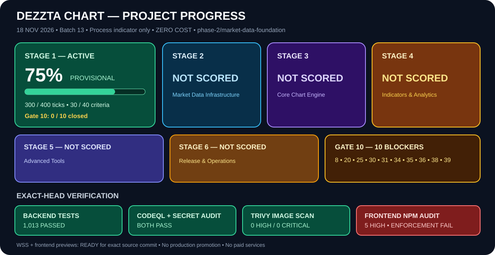

# DEZZTA CHART — Project Progress Indicator (Current Snapshot)

**Audit timestamp:** 18 November 2026  
**Repository:** https://github.com/deszztagd377-pixel/dezzta-chart  
**Active branch:** `phase-2/market-data-foundation`  
**Latest verified source commit:** `c3bcb0c6011f1f7228be17d16d227f325d7cbb29`  
**Main branch:** untouched  
**Cost policy:** ZERO COST  
**Indicator location:** project documentation/dashboard only; not an APK feature.

## Authoritative progress

| Stage | Scope | Current status | Score |
|---:|---|---|---:|
| 1 | Foundation, Security & Data Integrity | Active; provisional | **75% — 300/400 ticks** |
| 2 | Market Data Infrastructure | Not opened; not scored | — |
| 3 | Core Chart Engine | Not opened; not scored | — |
| 4 | Indicators & Analytics | Not opened; not scored | — |
| 5 | Advanced Tools | Not opened; not scored | — |
| 6 | Release & Operations | Not opened; not scored | — |

Stage 1 has **30/40 provisional criteria**. Gate 10 has **0/10 external criteria formally closed**. The ten outstanding criteria are **8, 20, 25, 30, 31, 34, 35, 36, 38, 39**. No overall-project percentage is asserted. Stages 2–6 are not scored.

> Scoring rule: code, documentation, CI success, and preview deployment are repository evidence. They do not close an external acceptance criterion unless its stated real-environment evidence and owner acceptance are present.

## Gate 10 — ten remaining blockers

| Criterion | State | Exact evidence still needed |
|---:|---|---|
| 8 | OPEN | Owner-controlled no-billing secret injection; verify absence from bundles, logs, build output, and history |
| 20 | OPEN | Zero-cost Firebase identity/revocation/entitlement and browser + Android WebSocket integration, or keep production identity disabled |
| 25 | OPEN | Existing owner-controlled Redis host with TLS certificate validation, ACL, private binding, persistence, restart and failure evidence; no paid managed Redis |
| 30 | OPEN | Owner-target restore drill into a fresh database, including application-level record checks |
| 31 | OPEN | Off-host encrypted snapshot, separate key custody, retention/access policy, and documented key-recovery restore |
| 34 | OPEN | Existing-host persistent volume mount, permissions, disk pressure, restart durability and recovery evidence |
| 35 | OPEN | Existing-host HTTPS health/startup/secret-injection evidence; public exposure only if no incremental cost |
| 36 | OPEN | Foreground 330-second WSS observation, effective runtime setting read-back, native Android WebView WSS, cross-instance fan-out and owner operational acceptance |
| 38 | OPEN | Durable aggregation, bounded retention, host access controls, self-hosted dashboard and owner acceptance |
| 39 | OPEN | Persistent alert retention, named escalation ownership and a completed recovery drill |

## Exact-head verification — Batch 12 source commit

**Source:** `c3bcb0c6011f1f7228be17d16d227f325d7cbb29`

- Automated Tests: [run 44271321142](https://github.com/deszztagd377-pixel/dezzta-chart/actions/runs/44271321142) — **FAILURE**, only at final frontend dependency-audit enforcement.
- Backend pytest: **1,013 passed in 29.73 seconds**.
- Frontend unit tests and production build: PASS.
- Frontend source and production-bundle credential scans: PASS.
- Android host preflight and immutable preview publisher contract tests: PASS.
- Synthetic SQLite outbox benchmark and report upload: PASS.
- Backend dependency audit: PASS.
- Backend container build and persistent-volume/Redis ACL smoke test: PASS.
- Trivy backend image scan: **0 HIGH / 0 CRITICAL** in the uploaded report.
- CodeQL: [run 44271321171](https://github.com/deszztagd377-pixel/dezzta-chart/actions/runs/44271321171) — PASS.
- Full Git History Secret Audit: [run 44271321225](https://github.com/deszztagd377-pixel/dezzta-chart/actions/runs/44271321225) — PASS.

### Remaining CI blocker — not waived

The final enforcement fails because `npm audit --audit-level=high` reports five High dependency paths through dev-only `picomatch@4.0.7` (GHSA-fc5q-39xc-vjpf / CVE-2026-112366), via `fdir`, `tinyglobby`, Vite and Vitest.

Verified exposure boundary:
- `picomatch`, `fdir`, `tinyglobby`, Vite and Vitest are marked `dev: true` in the lockfile.
- The application runtime `dependencies` do not directly include these packages.
- This limits the observed dependency exposure to build/test tooling; it does **not** erase the High advisory or make the audit pass.

Upstream status:
- Upstream mitigation PR [micromatch/picomatch#238](https://github.com/micromatch/picomatch/pull/238) is open and unmerged.
- Its proposed commit has no published fixed npm release and no reported passing upstream check-runs at this read-back.
- Do not vendor an unreviewed patch as a claimed upstream fix, invent a safe package version, suppress the advisory, or force a breaking Vite downgrade.
- Keep the audit enforcement active. Reassess when upstream publishes a reviewed release or a separately validated dependency replacement is available.

## WebSocket POC — current evidence

- Protected WSS preview for the exact source commit: **READY** — [open preview](https://dezzta-chart-ws-haperxrzp-deszztagd377-pixel.vercel.app).
- Frontend preview for the exact source commit: **READY** — [open preview](https://dezzta-chart-1e4eknez2-deszztagd377-pixel.vercel.app).
- WSS source config explicitly sets `fluid: true`; this proves the checked-in setting, not effective runtime entitlement.
- Synthetic probe: 10-second heartbeat; 25-second server idle timeout; bounded 330-second client observation.
- The probe now invalidates and closes if the page becomes hidden, avoiding false duration evidence from background-tab timer throttling.
- CI confirms all WebSocket protocol regression tests pass.
- **Not yet evidenced:** an actual foreground 330-second observation, a platform-originated duration close, effective Fluid Compute read-back, native Android WebView WSS, or cross-instance fan-out.
- Synthetic-only. No market data, production credentials, account identity, Redis, or production worker is connected.

## Zero-cost and execution controls

- Active branch only: `phase-2/market-data-foundation`; `main` untouched.
- No paid hosting, managed Redis, market-data subscription, billing activation, paid monitoring, or production promotion.
- No vulnerability suppression or unsafe dependency override.
- No Termux required for this work cycle.
- No code or document repair is delegated to the project owner.
- Google Play publication remains deferred unless explicitly approved.

## Next work order

1. Keep the frontend dependency audit blocking until a real, reviewed remediation exists.
2. Preserve the successful 1,013-test backend baseline and exact-head deployment state.
3. Obtain the owner-only foreground WebSocket observation and Android WebView result before attempting to close criterion 36.
4. Continue the remaining owner-hosted restore, secret, Redis, metrics and alert acceptance work only within the zero-cost boundary.

**Current disposition:** Stage 1 remains at 75% provisional and is not production-accepted. Gate 10 remains 0/10 closed.