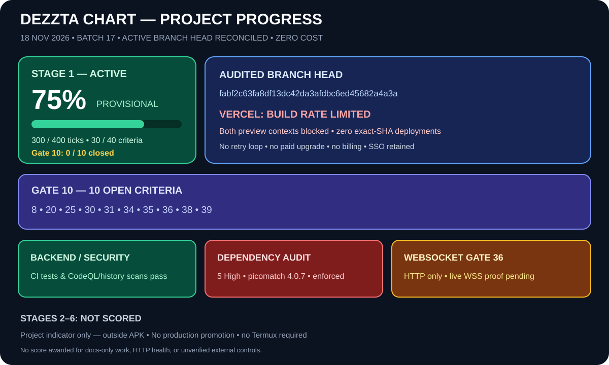

# DEZZTA CHART — Project Progress Indicator (Current Snapshot)

**Audit timestamp:** 18 November 2026, 17:36 WIB  
**Active branch:** `phase-2/market-data-foundation`  
**Verification target:** `fabf2c63fa8df13dc42da3afdbc6ed45682a4a3a`  
**Main:** untouched • **Cost:** ZERO COST  
**Indicator:** project documentation/dashboard only; NOT inside APK.

## Six-stage progress

| Stage | Scope | Status | Progress |
|---:|---|---|---:|
| 1 | Foundation, Security & Data Integrity | Active; provisional | **75% — 300/400 ticks; 30/40 criteria** |
| 2 | Market Data Infrastructure | Not opened; not scored | — |
| 3 | Core Chart Engine | Not opened; not scored | — |
| 4 | Indicators & Analytics | Not opened; not scored | — |
| 5 | Advanced Tools | Not opened; not scored | — |
| 6 | Release & Operations | Not opened; not scored | — |

**Gate 10: 0/10 formally closed.** Open criteria: **8, 20, 25, 30, 31, 34, 35, 36, 38, 39**. No overall-project percentage is asserted.

## Gate 10 — evidence and remaining blockers

| Gate | Current repository evidence | Remaining external acceptance |
|---:|---|---|
| 8 | Frontend source/bundle credential scans and full Git history secret audit pass | Owner-controlled zero-billing runtime secret injection; prove absence from logs, build outputs and runtime artifacts |
| 20 | Firebase token/revocation/entitlement and WebSocket authorization code/tests | Verified no-billing Firebase setup; real sign-in, expiry/revocation, entitlement denial, browser + Android reconnect; otherwise production identity stays disabled |
| 25 | CI Redis ACL/TLS + persistent-volume smoke test passes in test environment | Existing owner-controlled Redis host, validated TLS, least-privilege ACL, private bind, persistence/restart/failure proof |
| 30 | CI encrypted snapshot/decrypt/full-restore integration test | Owner-target restore to fresh DB; unchanged source; integrity, FK, domain records and post-restore write/read/cleanup |
| 31 | Encrypted snapshot/recovery code and tests | Off-host artifact, separately controlled recovery key, retention/access policy and successful restore; zero-cost only |
| 34 | CI persistent-volume smoke test passes | Existing-host mount identity, restrictive permissions, disk-pressure and restart durability/recovery evidence |
| 35 | Backend container build and health-related tests pass | Existing-host HTTPS/certificate chain, fail-closed startup and redacted runtime-secret source evidence |
| 36 | Synthetic WSS POC, lifecycle tests, 10s heartbeat / 25s idle timeout / bounded 330s probe; exact-head preview READY | Foreground duration observation, platform close attribution, effective Fluid setting read-back, native Android WebView WSS, cross-instance fan-out and owner cost acceptance |
| 38 | Concurrent metrics regression and input-hardening tests | Durable aggregation, bounded retention, host access controls, self-hosted dashboard and owner acceptance |
| 39 | Sanitized local alert/recovery tests and zero-cost runbook | Persistent alert evidence, named escalation owner and completed recovery drill |

## Exact-head CI — run 44278716234

<badge color="danger">Overall workflow: FAILURE</badge> The single failing step is the final **Enforce frontend dependency audit result**. This is an intentional security gate, not a test/build crash.

- Backend pytest: **1,014 passed in 30.07s**.
- Frontend unit tests and production build: PASS.
- Frontend source and built-bundle credential scans: PASS.
- Android host preflight and immutable preview publisher tests: PASS.
- Synthetic SQLite outbox benchmark and artifact upload: PASS.
- Backend dependency audit: PASS.
- Backend container build: PASS.
- Redis/persistent-volume smoke test: PASS.
- Trivy image scan/report steps: PASS.
- CodeQL [44278716261](https://github.com/deszztagd377-pixel/dezzta-chart/actions/runs/44278716261): PASS.
- Full Git History Secret Audit [44278716240](https://github.com/deszztagd377-pixel/dezzta-chart/actions/runs/44278716240): PASS.

### Active npm audit blocker

Job log confirms **five High findings** through development-only `picomatch@4.0.7`, advisory **GHSA-fc5q-39xc-vjpf**. The new dependency-exposure regression passes, proving affected glob tooling remains dev-only and absent from direct runtime dependencies. This is exposure reduction, **not remediation**. Keep final enforcement active. Do not force upgrades/downgrades, suppress, waive, or mislabel the finding as fixed.

## Exact-head Vercel read-back

Both protected previews are **READY** for source `4256c5e3ccab82255d115beaf961afd4794a3a42`:
- WSS POC [preview](https://dezzta-chart-ws-4eo7d8j18-deszztagd377-pixel.vercel.app) — `dpl_AtEV8yH6S5MwGApGaHQ8HagJTJsK`.
- Frontend [preview](https://dezzta-chart-bevptgcvw-deszztagd377-pixel.vercel.app) — `dpl_2Jc2So3HmvEQ6yeESjrXbMLorivz`.

Preview READY is not production acceptance. No production promotion.

## WebSocket status — strict interpretation

Implemented and CI-tested: correct CONNECTING/OPEN/close lifecycle, actual close event as the disconnected authority, opt-in synthetic heartbeat every 10 seconds, 25-second idle timeout, bounded 330-second browser probe, monotonic elapsed measurement, close details, and hidden-page invalidation.

Not yet evidenced: owner-observed foreground 330-second run, Vercel-originated maximum-duration close, effective Fluid Compute runtime read-back, native Android WebView WSS, cross-instance production fan-out, zero-cost operational acceptance. A client-side close at 330 seconds is not proof of platform termination. POC is synthetic-only; no production market data, credentials, identity, Redis or production worker.

## Roadmap beyond Stage 1

- Stage 2: market-data infrastructure, provider adapters, entitlement-aware ingestion, replay and durable sequencing.
- Stage 3: chart engine, timeframes, history, viewport, pan/zoom and rendering correctness.
- Stage 4: indicators and analytics; Footprint/Heatmap visuals must wait for the owner's reference images.
- Stage 5: advanced chart tools, alerts, layouts and drawing workflows.
- Stage 6: release hardening, Android packaging, performance, reliability, security and operations.

Stages 2–6 remain NOT SCORED.

## Zero-cost and owner-device controls

No paid hosting, managed Redis, market-data subscription, monitoring, storage, billing activation, paid plan upgrade, production promotion or SSO weakening. No Google Play publication unless explicitly approved. **No Termux required** for this CI/documentation cycle. If a gate requires paid infrastructure, it stays constrained/deferred. No code/document repair is delegated to the owner.

## Next engineering order

1. Keep npm audit enforcement active; accept only a reviewed, reproducible remediation.
2. Perform the owner-controlled foreground WSS observation against the exact READY protected preview; record the actual event evidence before closing any sub-check.
3. Continue existing-host Redis, restore, secrets, volume, metrics and alert acceptance only where already available at zero incremental cost.
4. Award no Stage 1 ticks until each external criterion has its required evidence and acceptance.

**Current accounting:** Stage 1 **75% provisional**; Gate 10 **0/10 closed**; Stages 2–6 **not scored**.

## Batch 15 — upstream dependency remediation review — 18 Nov 2026

The five High npm audit findings are still enforced. A fresh upstream review was performed before considering any patch:

- GitHub Advisory [GHSA-fc5q-39xc-vjpf](https://github.com/advisories/GHSA-fc5q-39xc-vjpf) remains published and identifies CVE-2026-112366. Its current page marks the record **Unreviewed** and does not list a patched version. OSV still carries the advisory record.
- Upstream issue [#247](https://github.com/micromatch/picomatch/issues/247) remains OPEN. Discussion indicates the Snyk-specific advisory was revoked, but that does not remove the GitHub advisory or the current npm audit finding.
- Upstream PR [#238](https://github.com/micromatch/picomatch/pull/238) remains OPEN. Review measurements reproduce exponential behavior for `+(*)`, `*(*)`, and `+(a*)`; a separate review also reports `+(*)` still timing out. It does not fully resolve the published advisory.
- Upstream PR [#237](https://github.com/micromatch/picomatch/pull/237) remains OPEN. Review discussion identifies uncovered multi-branch patterns (including `+(*a|*b)`) and semantic edge cases involving quoted stars and bracket classes. A single approval is not a maintainer release or comprehensive security validation.
- Upstream PR [#246](https://github.com/micromatch/picomatch/pull/246) targets the v2 branch and is not a release for this project's picomatch 4.x dependency path. Its own description scopes the fix and validation to selected patterns, not all ReDoS cases.
- Upstream PR [#235](https://github.com/micromatch/picomatch/pull/235) is CLOSED; maintainer comments dispute the vulnerability's practical exposure and recommend not allowing untrusted users to define glob/regex patterns. That disagreement does not change the active GitHub advisory or justify silently waiving npm audit.

**Decision:** do not vendor or override any of these unmerged patches. Do not claim the advisory is revoked globally. Keep the exact npm audit enforcement active and keep the vulnerable packages development-only. Reassess after a maintainer-reviewed release and independent regression validation against all relevant cases.

This upstream research does not alter Stage 1 scoring or Gate 10 closure.

## Batch 16 — exact-head CI + protected WSS HTTP read-back — 18 Nov 2026

**Branch head audited:** `a5e90f75329c937a4ef11d560bab3b434e7f24e8`.

### Exact-head automated evidence

- Automated Tests [44280286764](https://github.com/deszztagd377-pixel/dezzta-chart/actions/runs/44280286764): **FAILURE only at final frontend dependency-audit enforcement**.
- Backend pytest: **1,014 passed in 31.94s**. Alert recovery, concurrent observability metrics, dependency-exposure, WebSocket protocol, bounded-probe contract and all other backend tests passed.
- Frontend unit tests/build, source and built-bundle credential scans, Android preflight/publisher tests, synthetic outbox benchmark, backend dependency audit, container build, Redis/persistent-volume smoke test, and Trivy scan/report steps passed.
- CodeQL [44280286768](https://github.com/deszztagd377-pixel/dezzta-chart/actions/runs/44280286768): **SUCCESS**.
- Full Git History Secret Audit [44280286699](https://github.com/deszztagd377-pixel/dezzta-chart/actions/runs/44280286699): **SUCCESS**.
- The only failing enforcement is still five High npm audit findings through dev-only `picomatch@4.0.7` / GHSA-fc5q-39xc-vjpf. Do not suppress, waive, force-downgrade or call this fixed.

### WebSocket POC — protected preview read-back

- Last READY WSS preview: `dpl_C9bGENGcUpmgTFaxyyPNjg1Ehapv`, source `72a959f375f7c1e999be25e73e5fd00fdc24abb0`.
- Protected `/health` request returned **HTTP 200** with `status=ok`, `service=dezzta-ws-poc`, `mode=synthetic-only`, `production_data_connected=false`.
- Protected root page returned **HTTP 200** and contains the 330-second probe control and 10-second heartbeat configuration.
- This proves HTTP health and page delivery only. No actual WebSocket upgrade/round-trip, owner-visible foreground 330-second observation, platform-originated 300-second close, effective Fluid Compute read-back, native Android WebView WSS or cross-instance fan-out is claimed. Gate 36 remains OPEN.

### Vercel build-rate restriction

- Exact-head Vercel commit status for `a5e90f75329c937a4ef11d560bab3b434e7f24e8`: both WSS and frontend contexts **FAILURE** with the platform `build-rate-limit` link.
- Filtered deployment lookup for exact SHA returned **zero deployment records** for both projects. Do not label this commit READY.
- Previous known READY previews remain on `72a959f375f7c1e999be25e73e5fd00fdc24abb0`. Existing READY previews were not changed; no redeploy retry loop, paid upgrade, billing activation or SSO weakening was performed.
- Team usage counters and exact reset time were not exposed by the available read-back; no quota remainder or reset estimate is invented.

### Stage 1 accounting — unchanged

- Stage 1: **300/400 ticks = 75% provisional; 30/40 criteria**.
- Gate 10: **0/10 formally closed**.
- Still open: **8, 20, 25, 30, 31, 34, 35, 36, 38, 39**.
- Stages 2–6: **NOT SCORED**.
- No score awarded for a passing test suite, documentation, or HTTP-only WSS checks without the external acceptance evidence.

## Batch 17 — branch-head and provider-blocker reconciliation — 18 Nov 2026

**Audited branch head:** `fabf2c63fa8df13dc42da3afdbc6ed45682a4a3a` (commit message: `docs: consolidate Batch 16 CI and WebSocket evidence`).
**Parent:** `a5e90f75329c937a4ef11d560bab3b434e7f24e8`.
**Audit method:** GitHub branch ref, exact commit status/check-runs, workflow job logs, and Vercel deployment records filtered by exact SHA.
**Cost:** ZERO COST. No Termux, no paid plan, no billing change, no production promotion, no SSO weakening.

### Exact branch-head evidence

- GitHub Actions run [44281595750](https://github.com/deszztagd377-pixel/dezzta-chart/actions/runs/44281595750) — Test and Build: **FAILURE at final frontend dependency-audit enforcement**.
- The job reached and completed all earlier test/build/security/container steps. The final step reports `AUDIT_OUTCOME=failure` and exits 1 by design.
- CodeQL run [44281595873](https://github.com/deszztagd377-pixel/dezzta-chart/actions/runs/44281595873): both Python and JavaScript/TypeScript analysis jobs **SUCCESS**.
- Full reachable Git history scan run [44281595869](https://github.com/deszztagd377-pixel/dezzta-chart/actions/runs/44281595869): **SUCCESS**.
- The exact-head GitHub status has two Vercel contexts, both FAILURE with the provider message: **“Deployment rate limited — retry in 24 hours.”**
- Exact-SHA deployment queries returned **zero deployment records** for both WSS POC and frontend projects. Therefore `fabf2c63fa8df13dc42da3afdbc6ed45682a4a3a` is **not deployed**.

### Vercel blocker — isolated and contained

This is a provider-side deployment/build-rate restriction, not an application compile error. No retry loop was started. No paid upgrade, billing activation, or SSO bypass was attempted. The latest previously observed READY previews are tied to source `72a959f375f7c1e999be25e73e5fd00fdc24abb0`, not the audited branch head. Those preview records do not certify the branch head.

No exact usage counter or reset timestamp was available. The provider status string says retry in 24 hours; no more precise remaining-time estimate is asserted.

### Dependency audit blocker — enforcement retained

The workflow's final enforcement is the sole Test and Build failure. The audit outcome is still failure for the five High findings through development-only `picomatch@4.0.7` / GHSA-fc5q-39xc-vjpf. The development-only boundary regression is mitigation, not a fix. No unmerged patch, forced downgrade, override, suppression, waiver, or production-only audit substitution was applied.

### WebSocket acceptance — honest boundary

The latest previously recorded protected preview returned HTTP 200 for health and page delivery in synthetic-only mode. This is HTTP verification only. It is not a WebSocket upgrade, echo/round-trip, 330-second foreground observation, platform-originated duration close, Android WebView test, effective Fluid Compute read-back, or cross-instance fan-out proof. Gate 36 remains OPEN.

### Gate 10 action register

| Criterion | Immediate zero-cost work possible | Evidence still required |
|---:|---|---|
| 8 | Keep source/bundle/history scans and secret boundary tests enforced | Owner-controlled secret injection and runtime/log/artifact leakage proof |
| 20 | Preserve authorization/revocation regression tests | Real identity/revocation/entitlement acceptance on approved zero-cost setup |
| 25 | Keep Redis ACL/TLS and persistence CI tests | Owner-controlled existing Redis endpoint and real restart/failure proof |
| 30 | Keep encrypted snapshot/decrypt/restore integration tests | Restore drill against a fresh owner target and post-restore integrity/write checks |
| 31 | Keep encrypted backup/recovery controls | Off-host copy, separately controlled key, retention policy and restore drill |
| 34 | Keep persistent-volume smoke test | Existing-host mount, permissions, disk-pressure and restart durability proof |
| 35 | Keep container/health/fail-closed checks | Existing-host HTTPS/certificate and runtime secret-source evidence |
| 36 | Keep synthetic lifecycle/probe contract tests; no false duration claims | Foreground 330s run, platform close attribution, Fluid setting, Android WebView, fan-out |
| 38 | Keep concurrency/input-hardening tests | Durable aggregation, retention, host access controls and dashboard acceptance |
| 39 | Keep sanitized alert/recovery tests and runbook | Persistent alert, named escalation owner and completed recovery drill |

**Scoring unchanged:** Stage 1 **300/400 ticks = 75% provisional; 30/40 criteria**. Gate 10 **0/10 closed**. Open: **8, 20, 25, 30, 31, 34, 35, 36, 38, 39**. Stages 2–6 **NOT SCORED**. No progress credit for documentation-only work or provider-blocked deployments.
