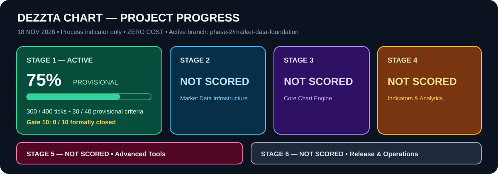

# DEZZTA CHART — Project Progress Indicator (Current Snapshot)
 
**Audit date:** 18 November 2026  
**Repository:** https://github.com/deszztagd377-pixel/dezzta-chart  
**Working branch:** `phase-2/market-data-foundation`  
**Main branch:** untouched  
**Cost policy:** ZERO COST  
**Indicator type:** project-process dashboard; not an in-app chart indicator or APK feature.

## Authoritative progress

| Stage | Scope | Status | Progress |
|---:|---|---|---:|
| 1 | Foundation, Security & Data Integrity | Active; provisional scoring only | **75% — 300/400 ticks** |
| 2 | Market Data Infrastructure | Not opened / not scored | — |
| 3 | Core Chart Engine | Not opened / not scored | — |
| 4 | Indicators & Analytics | Not opened / not scored | — |
| 5 | Advanced Tools | Not opened / not scored | — |
| 6 | Release & Operations | Not opened / not scored | — |

Stage 1 has **30/40 provisional criteria** and **10 external acceptance criteria still open**. Gate 10 is **0/10 formally closed**. No percentage is assigned to Stages 2–6. No fresh overall-project percentage is asserted.

## Gate 10 — remaining external acceptance criteria

| Criterion | Status | Evidence still required |
|---:|---|---|
| 8 | OPEN | Exact target-environment acceptance evidence recorded in the Stage 1 matrix |
| 20 | OPEN | Owner-controlled target verification |
| 25 | OPEN | Zero-cost managed Redis alternative with required ACL/TLS and owner acceptance, or equivalent accepted architecture |
| 30 | OPEN | Actual recovery drill against owner-selected restore target |
| 31 | OPEN | Off-host snapshot retention and separate key custody demonstrated |
| 34 | OPEN | Target-environment evidence per acceptance matrix |
| 35 | OPEN | Target-environment evidence per acceptance matrix |
| 36 | OPEN | Maximum-duration observation, effective Fluid Compute read-back, Android WebView WSS, fan-out and cost/operational acceptance |
| 38 | OPEN | Durable aggregation, retention, host access controls and dashboard acceptance |
| 39 | OPEN | Persistent alert retention, escalation ownership and recovery drill |

Do not close an external criterion on the basis of repository code or documentation alone.

## Batch 10 — WebSocket lifecycle correction

- `poc/vercel_ws/index.py`: after receiving `idle_timeout`, the browser now displays **“Idle timeout — waiting for close”**. The authoritative WebSocket `close` event remains responsible for transitioning controls to disconnected.
- `backend/tests/test_vercel_ws_probe_contract.py`: added a contract assertion that the idle-timeout message handler does not prematurely mark the socket closed.
- Source commit: `8e43e8f0975130a96f4858df69d4d487a5bf97d8`.
- Regression-test follow-up commits: `b804a23147316483589883d66d6cd2c1c13c7274`, `84d30fdb81e13dc16083b60346b8cdba83d2956e`, `21e76a2a2c45e0462a9c6e99d3c1c42b17b5eed7`.
- The final test source was read back from the active branch. **Execution is not yet evidenced**; do not claim pytest passed.
- No Vercel deployment of these new commits is confirmed. The latest READY WSS and frontend previews are older commits; this is not a production release.

## Verification boundary

- Previous browser-level health/reconnect/idle-timeout observations remain valid only for the older deployed POC version and do not validate this Batch 10 source change.
- The 330-second probe is implemented but has not been observed end-to-end.
- The current frontend dependency audit still has unresolved High `picomatch@4.0.7` findings; no suppression, forced upgrade, or risky override was introduced.
- The exact-head GitHub Actions result is not available through the currently exposed workflow-run connector route.
- No Stage 1 ticks are added for this code/test change until required verification and acceptance evidence exists.

## Zero-cost and safety controls

- No paid plan, paid host, paid data provider, or billing activation.
- No deployment retry was triggered during this source-only correction.
- No production promotion or SSO weakening.
- No Termux installation or command required.
- No changes to `main`.
- No code/document repair is delegated to the project owner.

See [Batch 10 work-cycle report](WORK_CYCLE_2026-11-18_GATE10_BATCH10.md) and [Stage 1 acceptance addendum](STAGE_1_GATE10_BATCH10_ACCEPTANCE_ADDENDUM.md).
