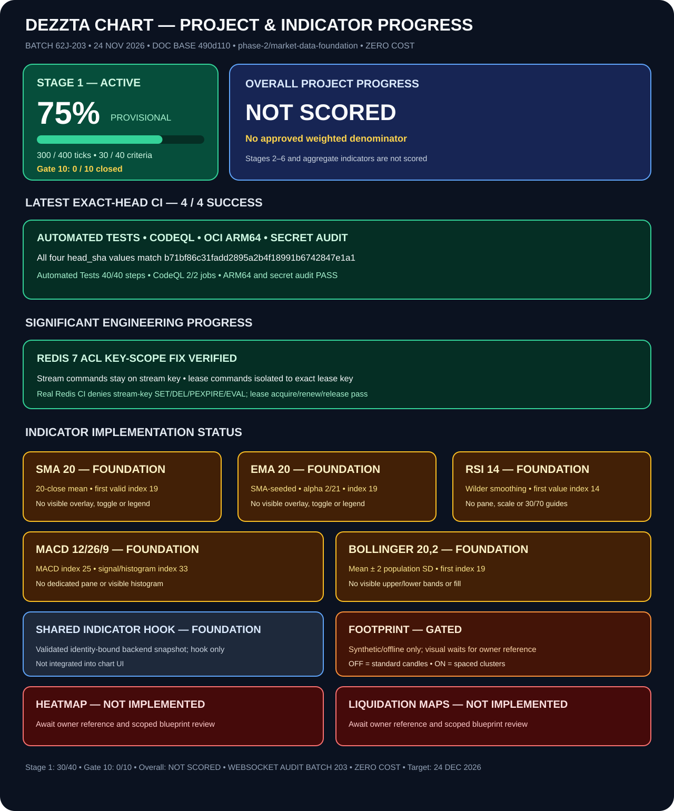

# DEZZTA CHART — Project Progress Indicator (Current Snapshot)

**Audit timestamp:** 18 November 2026 — Batch 46 source committed; exact-head CI running  
**Active branch:** `phase-2/market-data-foundation`  
**Latest source SHA under CI:** `4f746496b23cc9208804023bbb554a4e07c6480b`  
**Batch 46 CI:** CodeQL, full Git-history secret audit, Android debug APK, frontend tests/build, backend tests, synthetic outbox benchmark, backend dependency audit, backend container build, and Redis/persistent-volume smoke passed; Trivy scan still running at documentation time  
**Known dependency blocker:** picomatch GHSA-fc5q-39xc-vjpf has no published patched release; audit remains fail-closed  
**Main:** untouched • **Cost:** ZERO COST  
**Indicator:** project documentation/dashboard only; NOT inside APK.

## Latest work cycle — Batch 46 (WebSocket lifecycle observer and socket failure hardening)

**Implementation source SHA:** `4f746496b23cc9208804023bbb554a4e07c6480b`  
**Parent source SHA:** `8fecf72ece008455c82221ffbabd59ea0b945cfd`.

### Defects and correction
- Batch 45 isolated exceptions from `onError`, but the remaining lifecycle callbacks could still throw into native WebSocket event dispatch.
- `onStatus` is now best-effort and cannot interrupt the transport state transition.
- `onClose` is now best-effort and cannot prevent the connection from entering its terminal `closed` state.
- Authentication-frame `socket.send()` exceptions are converted into a controlled terminal transport failure and reported through the isolated error observer.
- Explicit `connection.close()` now reaches local `closed` state even if the platform's `socket.close()` throws.
- Added three regression tests covering throwing status observers, authentication send exceptions, and close observer/platform close exceptions.
- Existing `onError` isolation remains intact. Snapshot/update/cursor callback failures still fail the stream closed rather than silently dropping data.
- No wire protocol, server route, heartbeat cadence, replay cursor, sequence semantics, authentication policy, entitlement, retry schedule, or deployment setting changed.

### Exact-head CI status
- Source SHA: `4f746496b23cc9208804023bbb554a4e07c6480b`.
- CodeQL [44334598939](https://github.com/deszztagd377-pixel/dezzta-chart/actions/runs/44334598939): SUCCESS for JavaScript/TypeScript and Python.
- Full Git History Secret Audit [44334598934](https://github.com/deszztagd377-pixel/dezzta-chart/actions/runs/44334598934): SUCCESS.
- Automated Tests [44334598973](https://github.com/deszztagd377-pixel/dezzta-chart/actions/runs/44334598973): frontend unit tests and production build, backend tests, synthetic SQLite outbox benchmark/report upload, backend dependency audit, backend container build, and shared Redis guard + persistent-volume smoke all passed. Trivy container scan was still running at this documentation snapshot; final workflow conclusion is pending.
- Android APK [44334599093](https://github.com/deszztagd377-pixel/dezzta-chart/actions/runs/44334599093): SUCCESS; debug APK assembled, checksum verified, and uploaded as artifact [14441570921](https://github.com/deszztagd377-pixel/dezzta-chart/actions/runs/44334599093/artifacts/14441570921). Preview release was skipped; no release was published.
- The preceding source batch's frontend dependency audit remains blocked by five High picomatch findings (GHSA-fc5q-39xc-vjpf). No patched release was found in the previous upstream recheck. Do not downgrade dependencies, add speculative overrides, suppress the advisory, alter the lockfile without an upstream fix, or weaken the audit threshold.
- No deployment, preview release, paid service, or Termux use.

### Gate and progress disposition
- Gate 36 remains OPEN: public WSS roundtrip, Android WebView transport/lifecycle, host effective configuration, owner-observed 330-second session/close attribution, and cross-instance fan-out still require external acceptance evidence.
- Gate 10 remains **0/10** formally closed; open criteria remain **8, 20, 25, 30, 31, 34, 35, 36, 38, 39**.
- Stage 1 remains **75% provisional — 300/400 ticks; 30/40 criteria**. No progress tick is awarded for this source/test batch.
- Stages 2–6 remain NOT SCORED; overall project percentage remains NOT ESTABLISHED until M1–M8 weights and criterion mapping are approved.
- ZERO COST maintained. `main` untouched.

## Latest work cycle — Batch 45 (WebSocket error-observer isolation)

**Implementation source SHA:** `b1311ae469c546a60a5db3d6f744709e5586ea30`  
**Parent source SHA:** `c7e198508bdfbf4e13b727b748427baaab135147`.

### Defect and correction
- The transport's terminal `fail(error)` path invoked the caller-provided `onError` callback before closing the socket and setting terminal state.
- If application-level error reporting itself threw, that exception escaped the transport handler and could interrupt socket cleanup. This is an observer failure, not a network/protocol failure, and must not strand transport resources.
- Error notification is now isolated in a guarded best-effort call. Cleanup continues even if the observer throws.
- Socket close is also guarded so a platform implementation throwing during teardown cannot prevent local terminal-state transition.
- Added regression coverage: a deliberately throwing consumer error observer is triggered by an unexpected protocol message; the test requires no uncaught throw, exactly one error callback, terminal `closed` state, and a 1011 close request.
- No protocol message, server behavior, heartbeat interval, replay cursor, sequence semantics, auth, entitlement, retry policy, or hosting setting changed.

### Exact-head CI snapshot
- Source SHA: `b1311ae469c546a60a5db3d6f744709e5586ea30`.
- Frontend Vitest exact result: **228 passed across 28 files**; backend pytest exact result: **1,032 passed in 38.68 seconds**.
- Automated Tests [44333017089](https://github.com/deszztagd377-pixel/dezzta-chart/actions/runs/44333017089): **FAILURE only at final step 27, Enforce frontend dependency audit result**. Frontend Vitest: **228 tests across 28 files passed**. Backend pytest: **1,032 passed in 38.68 seconds**. Frontend production build, source/bundle credential scans, Android preflight/publisher tests, synthetic SQLite outbox benchmark/report, backend dependency audit, backend container build, shared Redis guard + persistent-volume smoke, and Trivy scan/report all passed.
- Trivy report: **0 HIGH/CRITICAL vulnerabilities** across the Alpine 3.24.4 base and scanned Python packages. Container report artifact [14441345073](https://github.com/deszztagd377-pixel/dezzta-chart/actions/runs/44333017089/artifacts/14441345073) uploaded successfully. Synthetic outbox benchmark artifact [14440566343](https://github.com/deszztagd377-pixel/dezzta-chart/actions/runs/44333017089/artifacts/14440566343) uploaded; synthetic only, not production market-data performance evidence.
- The only failed step is frontend `npm audit --audit-level=high`: **five High findings** for GHSA-fc5q-39xc-vjpf in `picomatch` via Vite/fdir and Vitest/tinyglobby. The package is dev-only per the passing dependency-boundary test, but this does not satisfy audit enforcement. No downgrade, override, suppression, lockfile manipulation, or threshold weakening was applied.
- CodeQL [44333017068](https://github.com/deszztagd377-pixel/dezzta-chart/actions/runs/44333017068): SUCCESS for both Python and JavaScript/TypeScript.
- Full Git History Secret Audit [44333017053](https://github.com/deszztagd377-pixel/dezzta-chart/actions/runs/44333017053): SUCCESS.
- Android APK [44333017051](https://github.com/deszztagd377-pixel/dezzta-chart/actions/runs/44333017051): SUCCESS; Android debug APK assembled, checksum verified, and short-lived artifact uploaded (artifact ID 14439198660). Preview release step was skipped; no release was published.
- **Final CI conclusion:** Automated Tests is **FAILURE only because the fail-closed frontend dependency audit remains unresolved**. Functional tests, builds, container/Redis smoke, Trivy, APK, CodeQL, and secret-history checks passed. Do not call CI all-green.
- No deployment, preview release, billing action, paid provider, or Termux use.

### Dependency blocker recheck
- npm registry still lists picomatch 4.0.7 as latest; GitHub Advisory and OSV still list versions through 4.0.7 as affected with no fixed version published. [npm versions](https://www.npmjs.com/package/picomatch?activeTab=versions) • [GitHub Advisory](https://github.com/advisories/GHSA-fc5q-39xc-vjpf) • [OSV](https://osv.dev/vulnerability/GHSA-fc5q-39xc-vjpf).
- No compatible upstream patch is available. Do not use `npm audit fix --force`, downgrade Vite/Vitest, invent an override, suppress the advisory, or lower the audit threshold. The dependency remains development-only per the existing dependency-boundary test, but that does not make CI audit green.

### Gate and progress disposition
- Gate 36 remains OPEN: public WSS transport, Android WebView lifecycle, host effective configuration, owner-observed session duration/close attribution, and cross-instance fan-out still require external acceptance evidence.
- Gate 10 remains **0/10** formally closed; open criteria remain **8, 20, 25, 30, 31, 34, 35, 36, 38, 39**.
- Stage 1 remains **75% provisional — 300/400 ticks; 30/40 criteria**. No tick is awarded for this code/test/documentation batch.
- Stages 2–6 remain NOT SCORED; overall project percentage remains NOT ESTABLISHED until M1–M8 weights and mapping are approved.
- ZERO COST maintained. `main` untouched.

## Latest work cycle — Batch 44 (reset retry backoff after cursor-replay recovery)

**Implementation source SHA:** `a1af6824d3b7b83d6c4e9af7cb81d9cde1892dc2`  
**Parent source SHA:** `689e90af890c7fe54023189bd631bff64f3ac0c3`.

### Defect and correction
- The supervisor reset its exponential reconnect-attempt counter when a fresh snapshot arrived, but not when a reconnect recovered through the cursor-replay path.
- The transport emits the same `subscribed` state after a validated replay-complete message. Before this batch, that healthy recovery left the previous failure streak intact; a later unrelated outage could therefore wait at a larger backoff interval than intended.
- The supervisor now resets `attempt` whenever the transport reports `subscribed`. This covers both validated snapshot acceptance and validated replay completion; it does not reset on mere socket-open/authentication or an unvalidated message.
- Added a deterministic regression test: initial snapshot with cursor, transport interruption, zero-event replay completion, second interruption, and assertion that the next retry uses the minimum delay rather than the doubled delay. It also verifies a fresh ID token is requested for the third connection.
- No heartbeat cadence, cursor semantics, replay count/watermark checks, sequence guard, authentication, entitlement, or server behavior changed.

### Exact-head validation
- Exact-head source SHA: `a1af6824d3b7b83d6c4e9af7cb81d9cde1892dc2`.
- GitHub Actions Automated Tests run [44329450510](https://github.com/deszztagd377-pixel/dezzta-chart/actions/runs/44329450510): **FAILURE only at final step 27, Enforce frontend dependency audit result**. Frontend Vitest: **227 tests across 28 files passed**. Backend pytest: **1,032 passed in 37.27 seconds**. Frontend production build, frontend source/bundle credential scans, Android preflight/publisher tests, synthetic SQLite outbox benchmark/report upload, backend dependency audit, backend container build, shared Redis guard + persistent-volume smoke, Trivy scan and report export/upload all passed.
- Trivy report: **0 vulnerabilities** in Alpine 3.24.4 and each scanned Python package target. Report artifact [14437399510](https://github.com/deszztagd377-pixel/dezzta-chart/actions/runs/44329450510/artifacts/14437399510) uploaded successfully. The Redis smoke also verified persistent-volume owner `10001:10001`.
- The sole failure is frontend `npm audit --audit-level=high`: **five High findings** for GHSA-fc5q-39xc-vjpf through `picomatch`, pulled by Vite/fdir and Vitest/tinyglobby. This run's npm output proposes `npm audit fix --force` that would install `vite@6.2.7`, explicitly described as a breaking change. Do not apply it. No suppression, downgrade, speculative override, lockfile manipulation, or threshold weakening was made. The dedicated dependency-boundary test passed and confirms the affected package remains development-only; this does not make the audit green.
- Full Git History Secret Audit [44329450526](https://github.com/deszztagd377-pixel/dezzta-chart/actions/runs/44329450526): SUCCESS.
- Android APK [44329450397](https://github.com/deszztagd377-pixel/dezzta-chart/actions/runs/44329450397): SUCCESS; verified artifact uploaded (artifact ID 14439470186, SHA-256 `09d51847dab2e239fda1a19846cf80c027be8742477fc76989f7da61660fe27b`). Immutable preview release step was skipped; no release was published.
- CodeQL [44329450525](https://github.com/deszztagd377-pixel/dezzta-chart/actions/runs/44329450525): SUCCESS for JavaScript/TypeScript and Python.
- **Final CI conclusion:** Automated Tests is **FAILURE only because the fail-closed frontend dependency audit remains unresolved**. All listed functional, build, backend, container, Redis, Trivy, APK, CodeQL, and secret-history checks passed. Do not call CI all-green.

### WebSocket / Gate 36 disposition
- This closes the identified client retry-backoff consistency defect at source level; exact-head CI completed with the frontend regression suite passing. Gate 36 still requires external acceptance evidence.
- Gate 36 remains OPEN. Still required: real public WSS Upgrade and ping/pong; Android WebView foreground/background acceptance; owner-observed platform close attribution around the documented function lifetime; effective host configuration read-back; and cross-instance fan-out. Repository tests cannot substitute for those external observations.
- No Vercel deployment, Cloudflare deployment/resource, production promotion, paid provider, billing action, or external credential operation was performed. No Termux required for this repository change or CI.
- No Stage 1 tick or Gate 10 closure is awarded for this source/test change.

### Progress accounting
- Stage 1 remains **75% provisional — 300/400 ticks; 30/40 criteria**.
- Gate 10 remains **0/10 formally closed**.
- Open criteria remain **8, 20, 25, 30, 31, 34, 35, 36, 38, 39**.
- Stages 2–6 remain **NOT SCORED**.
- Overall project percentage remains **NOT ESTABLISHED** until M1–M8 weights and criterion mapping are approved; 20.9% is historical only.
- ZERO COST maintained. `main` untouched.

## Latest work cycle — Batch 43 (upstream dependency advisory recheck)

**Recheck date:** 18 November 2026 • **Source SHA under validation:** `09dd096580b30bce5789d12ab09f9ee41ac4234d`.

- npm registry still lists `picomatch@4.0.7` as `latest`; its version history shows no later published release. [npm package registry](https://www.npmjs.com/package/picomatch?activeTab=versions).
- The advisory record continues to affect versions through 4.0.7 and does not list a patched version. [GitHub Advisory](https://github.com/advisories/GHSA-fc5q-39xc-vjpf) • [OSV record](https://osv.dev/vulnerability/GHSA-fc5q-39xc-vjpf).
- A same-day independent maintainer issue reports the same state: no patched release and the dependency is development-only. [Independent same-day report](https://github.com/modelcontextprotocol/servers/issues/5594).
- Upstream discussion remains disputed; no authoritative patched release was identified. Do not interpret a disputed advisory as permission to suppress CI.
- **Decision:** no source or lockfile change. Keep Vite/Vitest versions stable, preserve npm audit fail-closed, and retain the existing dev-only exposure test. Recheck when a real upstream release outside the affected range is published.
- This is a blocker status update, not a Gate closure or progress tick.

## Previous work cycle — Batch 42 (exact-head CI closure and dependency blocker triage)

**Validated source SHA:** `09dd096580b30bce5789d12ab09f9ee41ac4234d`  
**Documentation base:** `497e1344d936241dd23b7404acaebb60954f2d24`.

- **Frontend tests:** 226 tests across 28 files passed.
- **Backend tests:** 1,032 passed.
- **Frontend production build:** passed (Vite 6.4.5).
- **Credential controls:** frontend source/bundle scan passed; 77 source files checked.
- **Backend runtime checks:** backend dependencies audit passed; backend container build passed; shared Redis guard + persistent-volume smoke passed; Trivy container scan and vulnerability report export/upload passed.
- **Synthetic outbox benchmark:** passed with 1,000 inserted/replayed synthetic bars and two concurrent replay readers; explicitly not market-data performance evidence.
- **Android debug APK:** build passed.
- **CodeQL:** passed.
- **Full reachable Git-history secret audit:** passed.
- **Only CI failure:** final frontend `npm audit --audit-level=high` enforcement. It reports five High findings from the same `picomatch` advisory GHSA-fc5q-39xc-vjpf through Vite/fdir and Vitest/tinyglobby. npm proposes `--force` would install Vitest 3.1.4 (breaking downgrade). That is not accepted as a safe remediation. The advisory-bearing package is still development-only (the dedicated dependency-boundary test passed), but this does not make the audit green. No suppression, downgrade, override, lockfile manipulation, or threshold weakening was applied.
- **Result:** functional/security/build checks listed above passed, but Automated Tests workflow conclusion is **FAILURE** by design because dependency enforcement remains fail-closed. Do not call CI all-green.
- **Run references:** Automated Tests [44327851319](https://github.com/deszztagd377-pixel/dezzta-chart/actions/runs/44327851319); APK [44327851485](https://github.com/deszztagd377-pixel/dezzta-chart/actions/runs/44327851485); CodeQL [44327851364](https://github.com/deszztagd377-pixel/dezzta-chart/actions/runs/44327851364); secret audit [44327851417](https://github.com/deszztagd377-pixel/dezzta-chart/actions/runs/44327851417).
- **Stage/Gate accounting unchanged:** Stage 1 75% provisional; Gate 10 0/10; open criteria 8, 20, 25, 30, 31, 34, 35, 36, 38, 39; Stages 2–6 unscored; overall project percentage not established. CI passing is engineering evidence, not external gate acceptance.
- **No deployment or paid resources:** no Vercel/Cloudflare deployment/resource, billing, paid provider, or Termux action.

**Batch 42 conclusion:** Batch 41 WebSocket credential-state fix has passed all frontend/backend functional tests and the APK build; CI's remaining red status is isolated to the unresolved High-severity development dependency advisory. The next dependency action is to re-check upstream fixed-release availability and assess a compatible upgrade only when a real patched release exists. Do not weaken enforcement to obtain a green badge.

## Previous work cycle — Batch 41 (empty-token retry-loop prevention)

**Implementation base:** `53d166037f4d2f7f43be74da184dce57a9a4f85d`  
**Implementation commits:** `ec226b6a97d42d6bd0af19011f1043ed133775b7`, followed by regression-test correction `09dd096580b30bce5789d12ab09f9ee41ac4234d`.

- **Defect identified:** the supervisor treated an empty/whitespace Firebase ID token as a transient connection failure. It retried with exponential backoff even though the credential was still unusable, creating a pointless identity-provider retry loop.
- **Fix:** empty or whitespace ID tokens now stop the current supervisor, mark the matching market-data snapshot unavailable with a sign-in-specific reason, report one explicit error, and wait for a new authenticated session/supervisor. Transient token-provider rejections remain retryable.
- **Regression coverage:** added parameterized tests for empty and whitespace-only token values; removed the obsolete test that expected an empty token to be retried. Existing transient-token-failure retry test remains.
- **CI correction:** first exact-head run exposed the obsolete expectation (not a production-code failure); the test was corrected in a follow-up commit. The latest exact-head run is now testing the corrected state.
- **Latest SHA:** `09dd096580b30bce5789d12ab09f9ee41ac4234d`.
- **CI at documentation update:** frontend unit tests and frontend production build passed; frontend source/bundle credential scans passed; full reachable-history secret audit passed. Backend dependency installation and tests, container/Redis smoke, APK build, and CodeQL were still in progress. Do not call CI fully green until all exact-head runs complete.
- **Previous intermediate SHA:** `ec226b6a97d42d6bd0af19011f1043ed133775b7` failed because an older test still asserted that empty credentials should reconnect. That contradictory test was removed in the follow-up; no production behavior was rolled back.
- **No dependency files changed:** picomatch advisory remains unresolved; CI audit stays fail-closed.
- **Progress accounting unchanged:** Stage 1 75% provisional; Gate 10 0/10; open criteria 8, 20, 25, 30, 31, 34, 35, 36, 38, 39; Stages 2–6 unscored; overall percentage not established.
- **Cost/operations:** no Vercel deploy, Cloudflare resource, paid service, billing action, or Termux operation.

**Batch 41 conclusion:** a credential-state retry loop has been eliminated without weakening retries for transient identity-provider failures. Final acceptance is contingent on corrected exact-head CI.

## Previous work cycle — Batch 40 (cross-gate source audit and dependency blocker reassessment)

**Audit base:** `2096356c4034dc2233f6c48a04a4d7579271ff52`  
**Scope:** Gates 8, 20, 25, 30–31, 34–36, 38–39 plus the frontend dependency-audit blocker.

- **Dependency blocker reassessment:** npm registry still lists `picomatch@4.0.7` as latest; GHSA-fc5q-39xc-vjpf covers versions through 4.0.7 and publishes no patched version. The upstream fix discussion is disputed and its proposed fix was not merged. The current lockfile resolves the package only through development tooling (Vite/fdir and Vitest/tinyglobby); the project has already added a test that asserts the advisory-bearing package is development-only. No safe patched release or compatible non-breaking resolution was identified. Do not downgrade Vitest, pin an affected older release, add a speculative override, suppress the audit, or weaken the fail-closed CI policy.
- **Gate 8 source review:** backend runtime secrets are loaded from backend environment/protected files; secret-bearing Settings fields are excluded from `repr()/str()`. Alert-device key loading requires an absolute regular file, canonical base64 encoding of exactly 32 bytes, and POSIX permissions denying group/other access. Tests cover malformed keys, wrong lengths, permissive file modes, missing key files, and secret redaction. Still missing: real owner-host secret injection, bundle/log/runtime leakage evidence from the actual deployed host, and independent operator acceptance.
- **Gate 20 source review:** Firebase Admin verification calls `verify_id_token(..., check_revoked=True)`, validates project issuer/audience, identity subject, and auth_time, and normalizes SDK failures without leaking provider details. Entitlements are durable, account-scoped, canonical-instrument-scoped, default-deny, and revocable. Tests cover claim rejection, revocation-check invocation, wrong project, malformed tokens, grant isolation, revoke/regrant, and persistence. Still missing: real signed-token E2E against the approved Firebase project for valid, expired, revoked, and wrong-project tokens, plus real account/session acceptance. Mock verifier tests do not close Gate 20.
- **Gate 25:** production configuration requires TLS Redis (`rediss://`) with ACL username/password; settings diagnostics redact the URL. CI Redis/persistent-volume smoke passed. Still missing: owner-controlled production ACL/TLS verification, restart/failure recovery, and host acceptance.
- **Gates 30–31:** source and synthetic tests cover encrypted backup/restore and integrity checks (see existing backup/restore work-cycle records). Still missing: owner-target restore, separately controlled off-host backup/key custody, retention, and an independent recovery drill.
- **Gates 34–35:** source configuration enforces production HTTPS CORS origins and TLS Redis. No real host mount/ownership/disk-pressure/restart-durability or deployed HTTPS/certificate/runtime-secret-source evidence is available.
- **Gate 36:** Batch 38/39 prove browser online/visibility lifecycle policy and React effect cleanup in jsdom. They do not prove Android WebView, deployed WSS, 330-second platform lifetime, Fluid Compute read-back, or cross-instance fan-out.
- **Gates 38–39:** process-local metrics and sanitized local alert events are implemented/documented, but no actual protected host collector, bounded retention/rotation, protected dashboard, named adult operator, verified no-cost escalation channel, or isolated live recovery/acknowledgement drill exists. The runbook correctly leaves both gates open.
- **Progress accounting:** unchanged. Stage 1 remains 75% provisional (300/400 ticks; 30/40 criteria); Gate 10 remains 0/10 formally closed; open criteria remain 8, 20, 25, 30, 31, 34, 35, 36, 38, 39; Stages 2–6 are unscored; overall percentage remains not established. No test, source audit, or documentation change awards a tick or closes a gate.
- **Cost and operations:** no Vercel deployment, Cloudflare resource, billing action, paid service, or Termux operation. No branch other than `phase-2/market-data-foundation` was changed; `main` remains untouched.

**Batch 40 conclusion:** source controls are materially present for Gates 8 and 20, but their external acceptance evidence remains the critical blocker. The picomatch CI blocker has no upstream patched release at this audit; therefore the safe response is containment and monitoring, not an unsafe dependency mutation.

## Previous work cycle — Batch 39 (WebSocket lifecycle integration acceptance tests; exact-head CI completed)

- Parent exact branch HEAD: `09a81b455fb12b15515899d366bb9b2f1318fb54`; lifecycle integration source/test commit: `9c36ab295d3488500f97c20887d3e7e2ed305db3`; current exact-head CI target: `b389070bea42e84e4efba7c778a2026c51ef5545` (shared chart-layout fixture follow-up).
- Added a jsdom React integration test with mocked chart renderer and transport boundary. It verifies initial online/visible mount, offline stop, online recreation, background stop, foreground recreation, unmount cleanup, and initially offline/hidden mounts waiting until the matching event.
- Exact-head frontend tests: **225/225 passed across 28 files**. Exact-head backend tests: **1,032 passed in 52.01 seconds**. Frontend production build, source/bundle credential scans, Android preflight/publisher tests, synthetic SQLite outbox benchmark, backend dependency audit, container build, Redis/persistent-volume smoke, Trivy scan/report all completed successfully before final dependency enforcement.
- Exact-head Automated Tests [44324423988](https://github.com/deszztagd377-pixel/dezzta-chart/actions/runs/44324423988): **FAILURE only at step 27**, final frontend dependency-audit enforcement. The audit reports five High findings rooted in `picomatch@4.0.7`; a dedicated backend test confirms the advisory-bearing package remains development-only. This is not permission to suppress the advisory: no patched upstream release is listed, and no downgrade, speculative override, package patch, waiver, or audit weakening was applied.
- Exact-head Android APK [44324423899](https://github.com/deszztagd377-pixel/dezzta-chart/actions/runs/44324423899): **SUCCESS**. CodeQL [44324424075](https://github.com/deszztagd377-pixel/dezzta-chart/actions/runs/44324424075): **SUCCESS**. Full Git History Secret Audit [44324424084](https://github.com/deszztagd377-pixel/dezzta-chart/actions/runs/44324424084): **SUCCESS**.
- The React/jsdom tests prove component effect ownership and event cleanup only. They do not prove Android WebView, deployed WSS, platform close attribution, Fluid Compute read-back, or cross-instance fan-out. Gate 36 remains OPEN pending external acceptance.
- No Vercel deploy, Cloudflare resource, billing action, paid service, or Termux operation. No Stage 1 ticks or Gate 10 closures are awarded for tests alone.

## Previous work cycle — Batch 38 (browser network and visibility lifecycle; exact-head CI completed)

- Parent exact branch HEAD: `0f9c5a1d291d2d601fd63a8bc2c36b95c9ae8d14`.
- Finding: `CandlestickChart` started the authenticated stream whenever a contract was selected and the chart was ready, without gating on browser online state or document visibility. Mobile background timer throttling could cause needless heartbeat/reconnect activity.
- Added `getOhlcvStreamLifecycle`: a live supervisor is permitted only when `navigator.onLine` is true and `document.visibilityState` is `visible`.
- Added `online`, `offline`, and `visibilitychange` listeners with cleanup. Offline/background transitions stop the previous supervisor, clear backend indicator eligibility and display a specific paused/unavailable reason. Returning online + visible creates a new supervisor and obtains a fresh token and snapshot.
- Added five deterministic lifecycle-policy tests. No polling timer or additional request is introduced while paused.
- Exact-head Automated Tests [44321645937](https://github.com/deszztagd377-pixel/dezzta-chart/actions/runs/44321645937): **FAILURE only at step 27, final frontend dependency-audit enforcement**. Frontend Vitest: **222/222 passed across 27 files**; backend pytest: **1,032 passed in 31.26s**. Frontend build, source/bundle secret scans, Android preflight/publisher tests, synthetic outbox benchmark, backend dependency audit, container build, Redis/persistent-volume smoke, Trivy scan/report all passed.
- Exact-head Android debug APK [44321645986](https://github.com/deszztagd377-pixel/dezzta-chart/actions/runs/44321645986): **SUCCESS**; APK artifact checksum verified and uploaded. Immutable preview release step was skipped; no release was published.
- Exact-head CodeQL [44321646301](https://github.com/deszztagd377-pixel/dezzta-chart/actions/runs/44321646301): **SUCCESS** for JavaScript/TypeScript and Python. Full Git History Secret Audit [44321645942](https://github.com/deszztagd377-pixel/dezzta-chart/actions/runs/44321645942): **SUCCESS**.
- The sole failing enforcement is five High npm audit findings for `picomatch@4.0.7` through Vite/fdir and Vitest/tinyglobby. npm proposes `vitest@3.1.4` via `npm audit fix --force`, explicitly marked as a breaking change. No downgrade, override, suppression, waiver, or audit weakening was applied.
- Uploaded artifacts: `14436035035` (synthetic outbox benchmark) and `14434973310` (container vulnerability report). Trivy reported 0 vulnerabilities for Alpine 3.24.4 and each listed Python package. The first database mirror returned a missing-blob error; fallback GHCR retrieval completed successfully.
- Batch 37 exact-head CI [44319494393](https://github.com/deszztagd377-pixel/dezzta-chart/actions/runs/44319494393) failed only at final frontend npm audit enforcement; Android APK [44319494274](https://github.com/deszztagd377-pixel/dezzta-chart/actions/runs/44319494274), CodeQL [44319494237](https://github.com/deszztagd377-pixel/dezzta-chart/actions/runs/44319494237), and full-history secret audit [44319494266](https://github.com/deszztagd377-pixel/dezzta-chart/actions/runs/44319494266) succeeded.
- The container scan found zero vulnerabilities in the scanned Alpine OS and Python package targets; Trivy's mirror fallback succeeded and its report artifact was uploaded.
- Gate 36 remains OPEN pending deployed WSS, Android WebView, foreground platform-lifetime observation, Fluid Compute read-back, and cross-instance fan-out.
- No deployment, paid service, billing change, Cloudflare resource, or Termux operation. No Stage 1 ticks or Gate 10 closures are awarded.

## Previous work cycle — Batch 37 (terminal WebSocket policy-close handling; exact-head CI completed)

- Parent exact branch HEAD: `de59c0ede125d31d2cd2cfa95c47082e44385214`.
- Source audit found a deterministic retry-loop risk: backend explicitly closes with WebSocket code `1008` for unsupported client control frames and ping-rate-limit violations, while the supervisor treated every close except `4400/4401/4403` as transient and retried with unchanged client behavior.
- Corrected the supervisor so `1008` is terminal for the current stream instance. It marks the market-data snapshot unavailable, reports a protocol-policy error, and does not reconnect until the owning session/selection recreates the supervisor after a corrected policy/configuration.
- Added a regression test that triggers server close `1008`, advances all pending timers, and proves the socket factory was called exactly once.
- Updated `docs/OHLCV_WEBSOCKET_CLIENT.md` and `docs/OHLCV_STREAM_PROTOCOL.md` to document this close-code contract.
- No heartbeat cadence, pong deadline, authentication, entitlement, replay, cursor, or data-validation behavior changed.
- CI audit blocker: exact package graph is `vite@6.4.5 → fdir@6.5.0 → picomatch@4.0.7` and `vitest@4.1.12 → tinyglobby@0.2.17 → picomatch@4.0.7`. The workflow reports five High findings. npm's automatic fix proposes downgrading Vitest to `3.1.4` (a breaking change); no safe maintainer-reviewed patched dependency is present in the current lockfile. Keep the audit fail-closed; do not force the downgrade or add speculative overrides.
- Exact-parent CI for documentation SHA `de59c0ede125d31d2cd2cfa95c47082e44385214`: frontend tests/build, backend tests, synthetic outbox benchmark, backend dependency audit, container build, Redis/persistent-volume smoke, Trivy scan/report passed; final frontend dependency enforcement failed. CodeQL and full-history secret audit passed. This is parent evidence only; Batch 37 requires its own exact-head CI.
- Gate 36 remains OPEN pending public WSS, Android WebView, 330-second platform lifecycle attribution, effective Fluid Compute read-back, and cross-instance fan-out.
- No Vercel deployment, Cloudflare resource, paid service, billing change, or publication action. Termux is not required.
- Progress accounting unchanged: Stage 1 **75% provisional (300/400 ticks; 30/40 criteria)**; Gate 10 **0/10 formally closed**; open criteria **8, 20, 25, 30, 31, 34, 35, 36, 38, 39**; Stages 2–6 **NOT SCORED**; overall project percentage **NOT ESTABLISHED**. No ticks or gate closures are awarded by this source-only change.

## Latest work cycle — Batch 36 (strict WebSocket heartbeat; exact-head CI completed)

- Current exact branch HEAD: `11d3ea4ba426b1da021bf0f9c79abdc0205b3c9d`; parent: `9c76726f031568fe126479f4aa3c34bf0d151e49`.
- Client correction: accept a heartbeat pong only while subscribed, only while a pong deadline is outstanding, and only with protocol `version: 1`. Unsolicited or unsupported-version pong frames fail closed. Two frontend regression tests were added.
- Exact-head Automated Tests [44317099110](https://github.com/deszztagd377-pixel/dezzta-chart/actions/runs/44317099110): **FAILURE only at step 27, final frontend dependency-audit enforcement**. Steps 1–26 passed, including frontend tests/build, backend tests, synthetic SQLite outbox benchmark, backend dependency audit, backend container build, Redis/persistent-volume smoke test, Trivy image scan and report export.
- Exact-head Android debug APK build [44317099094](https://github.com/deszztagd377-pixel/dezzta-chart/actions/runs/44317099094): **SUCCESS**. Exact-head CodeQL [44317099846](https://github.com/deszztagd377-pixel/dezzta-chart/actions/runs/44317099846): **SUCCESS**. Full Git History Secret Audit [44317099074](https://github.com/deszztagd377-pixel/dezzta-chart/actions/runs/44317099074): **SUCCESS**.
- The final dependency enforcement remains blocked by the dev-only `picomatch@4.0.7` advisory path. Keep enforcement fail-closed; do not force a Vite downgrade, add a speculative override, patch package contents, suppress the finding, or waive the gate.
- Heartbeat calculation unchanged: client `1/20 = 0.05` ping/s; server ceiling `20/10 = 2` ping/s; utilization **2.5%**; pong deadline 10 seconds.
- Gate 36 remains OPEN: deployed public WSS, Android WebView runtime, owner-observed 330-second session/platform close attribution, effective Fluid Compute read-back, and cross-instance fan-out remain unverified.
- No Vercel deployment/retry, Cloudflare resource, paid service, billing change, or publication action. Termux is not required.
- Progress unchanged: Stage 1 **75% provisional (300/400 ticks; 30/40 criteria)**; Gate 10 **0/10 formally closed**; open criteria **8, 20, 25, 30, 31, 34, 35, 36, 38, 39**; Stages 2–6 **NOT SCORED**; overall project percentage **NOT ESTABLISHED**. No ticks or closures awarded from CI alone.

## Cross-gate source audit — Batch 36 (evidence boundaries; no gate closures)

- **Gate 25 — Redis shared guard:** source enforces production `rediss://` with non-empty ACL username/password, CA-chain and hostname verification, startup `PING`, atomic Lua HTTP counters and WebSocket leases, and fail-closed Redis error propagation. Exact-head CI passed backend tests and the Redis/persistent-volume smoke stage. Still missing: owner-controlled Redis ACL permission review, actual production TLS endpoint validation, restart/failure recovery evidence, and independent host acceptance.
- **Gates 30–31 — backup/restore:** source implements SQLite Online Backup API snapshots, integrity checks, atomic publication, no-overwrite restore, foreign-key checks, application-domain inventory/hash comparison, post-restore write/read/cleanup probe, and AES-256-GCM authenticated backup encryption with PBKDF2-HMAC-SHA256 (600,000 iterations). Tests exercise synthetic application data and cryptographic tamper/wrong-key paths. Still missing: restore on the intended owner host, separately controlled off-host copy, independent key custody, retention controls, and a real recovery drill.
- **Gate 8 — runtime secrets:** frontend source and production bundle credential scans passed exact-head CI; this does not prove that production secrets are injected from a protected host secret source or absent from runtime diagnostics.
- **Gate 20 — identity:** Firebase Admin verification checks revocation and validates issuer/audience/subject claims; subscription authorization checks canonical instrument mapping and entitlement. A real Firebase project signed-token acceptance test (valid, expired, revoked, wrong-project) remains outstanding.
- **Gates 34–35 — host durability and transport:** container/persistent-volume smoke passed in CI, but this does not prove the intended host's mount identity, ownership, disk-pressure behavior, restart durability, HTTPS certificate chain, or runtime secret-source configuration.
- **Gates 38–39 — operations:** process-local metrics and sanitized local alert reporting are documented and tested at source level. External log collection, retention/rotation, protected dashboard, no-cost alert receipt, named adult operator, and recovery exercise remain unaccepted.
- These are source-readiness findings only. They do not change Stage 1 ticks, Gate 10 formal closures, or the overall project percentage.

## Previous work cycle — Batch 35 (verified on its recorded parent)

- Parent exact-head Automated Tests [44310352740](https://github.com/deszztagd377-pixel/dezzta-chart/actions/runs/44310352740): **FAILURE only at final frontend dependency-audit enforcement**. All functional, build, container, Redis/persistent-volume smoke, and Trivy/report steps before enforcement succeeded.
- Parent exact-head Android debug APK build [44310351406](https://github.com/deszztagd377-pixel/dezzta-chart/actions/runs/44310351406): **SUCCESS**. The APK was built and verified as a CI artifact; no preview release was published.
- Parent exact-head CodeQL [44310351525](https://github.com/deszztagd377-pixel/dezzta-chart/actions/runs/44310351525): **SUCCESS**. Full Git History Secret Audit [44310351555](https://github.com/deszztagd377-pixel/dezzta-chart/actions/runs/44310351555): **SUCCESS**.
- Batch 35 adds backend route-level tests for the actual authenticated text-frame `ping` → JSON `market_data.pong` exchange and for fail-closed rejection of unsupported control frames. Candidate's own CI is pending until exact SHA runs finish.
- Heartbeat rate calculation: client 1 ping/20 s = 0.05/s; server ceiling 20/10 s = 2/s; client steady-state rate = **2.5%** of ceiling. Pong timeout = 10 s.
- Gate 36 remains OPEN: deployed public WSS, Android WebView, owner-observed 330-second session/platform close attribution, effective Fluid Compute read-back, and cross-instance fan-out remain unverified.
- Dependency blocker remains five High paths via dev-only `picomatch@4.0.7`. Keep enforcement fail-closed; no downgrade, speculative override, hand patch, suppression, or waiver.
- No Vercel deployment/retry, Cloudflare resource, paid service, database/host/storage provisioning, billing change, or publication action. Termux is not required for this batch.
- Progress remains conservative: Stage 1 **75% provisional (300/400 ticks; 30/40 criteria)**; Gate 10 **0/10 formally closed**; open criteria **8, 20, 25, 30, 31, 34, 35, 36, 38, 39**; Stages 2–6 **NOT SCORED**; overall project percentage **NOT ESTABLISHED**. Historical overall checkpoint **20.9%** is not recomputed. No ticks or gate closures are awarded by tests alone.

## Batch 34 verified CI outcome

- Automated Tests [44310352740](https://github.com/deszztagd377-pixel/dezzta-chart/actions/runs/44310352740): final frontend dependency-audit enforcement failed; all preceding functional/build/container/security scan steps succeeded.
- Android debug APK Build [44310351406](https://github.com/deszztagd377-pixel/dezzta-chart/actions/runs/44310351406): SUCCESS.
- CodeQL [44310351525](https://github.com/deszztagd377-pixel/dezzta-chart/actions/runs/44310351525): SUCCESS.
- Full Git History Secret Audit [44310351555](https://github.com/deszztagd377-pixel/dezzta-chart/actions/runs/44310351555): SUCCESS.

## Batch 34 source correction

See [Batch 34 WebSocket heartbeat correction](WORK_CYCLE_2026-11-18_BATCH34_WEBSOCKET_HEARTBEAT.md). Client heartbeat uses the literal text `ping` every 20 seconds and expects `market_data.pong` within 10 seconds. The client tests cover send, acknowledgement, timeout, and cleanup.

## Batch 33 verified audit

See the Batch 33 historical audit notes below. Gate 30/31 backup/restore and Gate 36 authenticated WebSocket source reviews remain repository-level evidence only; owner-host acceptance is still required.

## Previous verified update — Batch 32

- **Audited branch HEAD:** `b9f81a9ca25a6ebdf390c40671a4429241c4c5d2` on `phase-2/market-data-foundation`. Source baseline remains `e6db77210dd28bd82196b2b7bf7d8d7e7256fc37`; Batch 31 changed only progress documentation. This Batch 32 bundle also changes documentation and the colored SVG only.
- Exact-HEAD Automated Tests [44306971092](https://github.com/deszztagd377-pixel/dezzta-chart/actions/runs/44306971092): **FAILURE only at step 27, final frontend dependency-audit enforcement**. Frontend Vitest **212/212 PASS across 26 files**; backend pytest **1,030 PASS in 33.74s**; frontend build (1,526 modules), source/bundle credential scans, Android preflight and immutable publisher tests, synthetic outbox benchmark, backend dependency audit, container build, Redis/persistent-volume smoke, Trivy scan/report export all PASS.
- Exact-HEAD CodeQL [44306971049](https://github.com/deszztagd377-pixel/dezzta-chart/actions/runs/44306971049): **SUCCESS**, JavaScript/TypeScript and Python. Full Git History Secret Audit [44306971204](https://github.com/deszztagd377-pixel/dezzta-chart/actions/runs/44306971204): **SUCCESS**.
- The final dependency audit still reports five High paths through `picomatch@4.0.7` under Vite/Vitest development tooling. npm proposes a forced Vite downgrade to 6.2.7, which is breaking. Official npm registry still lists 4.0.7 as latest; GitHub/OSV advisory still affects versions through 4.0.7 and states no patched version. Upstream PR #194 is OPEN and addresses a different extglob parsing behavior; it is not a published security fix. No override, unreviewed patch, downgrade, suppression, or waiver is accepted.
- **Gate 38 source audit:** request metrics are process-local, bounded to 127 route/method series including overflow, protected by an optional operator bearer token, and served with private/no-store headers. Unit tests cover cardinality, normalization, detached snapshots, invalid durations and concurrent recording. The remaining criterion is operational: host collection, bounded retention/rotation, disk-pressure proof, protected dashboard access, and a redacted incident trace. Process-local metrics reset on restart and do not aggregate across instances.
- **Gate 39 source audit:** the opt-in worker emits sanitized local JSON transitions for degraded delivery, worker errors and recovery; tests cover deduplication, counter validation, recovery and redaction. The worker is disabled by default. This is local logging, not a guaranteed operator notification. Actual host log collection, accountable adult operator/escalation, no-cost alert receipt and isolated recovery exercise remain unproven.
- **Gate 36:** the source and CI WebSocket regression suites pass, but the POC remains synthetic. No new Vercel deployment was created; no exact-head WSS Upgrade/ping-pong, Android WebView, 330-second owner-observed run, platform close attribution, effective Fluid Compute read-back, or cross-instance fan-out evidence exists.
- **Gate 30/31:** repository restore/encryption tests remain useful evidence but do not replace owner-target restore, off-host artifact, separately controlled recovery key, retention/access policy, and external recovery.
- Exact-head Vercel lookup on `b9f81a9ca25a6ebdf390c40671a4429241c4c5d2` returned zero deployments for both frontend and WSS projects. Root `vercel.json` keeps branch deployments disabled and `main` enabled. No deployment/retry, paid service, billing change, or Cloudflare resource.
- **Termux:** not required for this remote repository/CI audit. Any later device-specific requirement will be explained before requesting action. No Stage 1 ticks or Gate 10 closures are awarded from this documentation/source audit.

## Previous verified update — Batch 31

- **Audited exact HEAD:** `0c12dc54bce9fb5694b57e13928d995ff258ecef` on `phase-2/market-data-foundation`. This commit is documentation-only relative to source baseline `e6db77210dd28bd82196b2b7bf7d8d7e7256fc37`; no application source changed.
- Exact-HEAD Automated Tests run [44306105968](https://github.com/deszztagd377-pixel/dezzta-chart/actions/runs/44306105968): **FAILURE only at the final frontend dependency-audit enforcement**. Frontend Vitest **212/212 PASS** (26 files); backend pytest **1,030 PASS in 26.29s**; frontend production build, source/bundle credential scans, Android preflight and immutable publisher tests, synthetic SQLite outbox benchmark, backend dependency audit, backend container build, Redis/persistent-volume smoke, Trivy image scan and vulnerability-report export all PASS.
- Exact-HEAD CodeQL run [44306106124](https://github.com/deszztagd377-pixel/dezzta-chart/actions/runs/44306106124): **SUCCESS** for JavaScript/TypeScript and Python. Full Git History Secret Audit [44306106134](https://github.com/deszztagd377-pixel/dezzta-chart/actions/runs/44306106134): **SUCCESS**.
- The only failing enforcement remains **five High findings** through development-only `picomatch` / `GHSA-fc5q-39xc-vjpf`. The exact run's npm output says `npm audit fix --force` would install `vitest@3.1.4`, a breaking change. No force downgrade, dependency override, suppression, or waiver was applied. Keep audit enforcement fail-closed.
- **WebSocket source evidence:** frontend client/protocol/supervisor suites passed in the 212 tests; backend stream, authenticated API WebSocket, synthetic POC protocol and bounded-probe contracts are included in the 1,030 passing backend tests. This does not prove deployed public WSS Upgrade/ping-pong, Android WebView, 330-second foreground observation, platform close attribution, effective Fluid Compute read-back, or fan-out.
- Existing WSS preview remains preview-only and synthetic. Its prior protected `/health` HTTP 200 response explicitly reported `production_data_connected=false`; HTTP health is not a WebSocket transport acceptance.
- **Gate 30 source audit:** `backend/app/sqlite_restore_drill.py` now commits the drill-owned probe record, reads it from a fresh read-only connection, commits cleanup, and verifies absence through another connection. The latest 1,030-test backend run passed. This is repository/CI evidence only; no owner-target application database restore has been run.
- **Gate 31 source boundary:** `backend/app/sqlite_backup.py` provides consistent local SQLite snapshot/restore, integrity and foreign-key checks, owner-only POSIX permissions, atomic publication and fsync handling. Its own module contract explicitly does not encrypt or upload snapshots. Existing CI encrypted-snapshot integration evidence does not create an off-host artifact, separately controlled recovery key, retention/access policy, or owner-target recovery. Gate 31 stays OPEN.
- Exact-SHA Vercel deployment lookups for audited HEAD `0c12dc54bce9...` returned zero deployment records for both projects. Root `vercel.json` keeps `main=true` and `phase-2/market-data-foundation=false`. No deployment, retry, production promotion, billing change, paid service, or SSO change.
- **No Termux required for this remote GitHub/source/CI audit.** Actual owner-device restore and Android-native WSS acceptance are separate target-device activities; no installation or command is being requested in this batch.
- No Stage 1 ticks or Gate 10 closures are awarded from CI/source evidence where owner-target acceptance is still missing. ZERO COST maintained; `main` untouched.

## Six-stage progress

| Stage | Scope | Status | Progress |
|---:|---|---|---:|
| 1 | Foundation, Security & Data Integrity | Active; provisional | **75% — 300/400 ticks; 30/40 criteria** |
| 2 | Market Data Infrastructure | Not opened; not scored | — |
| 3 | Core Chart Engine | Not opened; not scored | — |
| 4 | Indicators & Analytics | Not opened; not scored | — |
| 5 | Advanced Tools | Not opened; not scored | — |
| 6 | Release & Operations | Not opened; not scored | — |

**Gate 10: 0/10 formally closed.** Open criteria: **8, 20, 25, 30, 31, 34, 35, 36, 38, 39**. No overall-project percentage is asserted.

## Gate 10 — evidence and remaining blockers

| Gate | Current repository evidence | Remaining external acceptance |
|---:|---|---|
| 8 | Frontend source/bundle credential scans and full Git history secret audit pass | Owner-controlled zero-billing runtime secret injection; prove absence from logs, build outputs and runtime artifacts |
| 20 | Firebase token/revocation/entitlement and WebSocket authorization code/tests | Verified no-billing Firebase setup; real sign-in, expiry/revocation, entitlement denial, browser + Android reconnect; otherwise production identity stays disabled |
| 25 | CI Redis ACL/TLS + persistent-volume smoke test passes in test environment | Existing owner-controlled Redis host, validated TLS, least-privilege ACL, private bind, persistence/restart/failure proof |
| 30 | CI encrypted snapshot/decrypt/full-restore integration test | Owner-target restore to fresh DB; unchanged source; integrity, FK, domain records and post-restore write/read/cleanup |
| 31 | Encrypted snapshot/recovery code and tests | Off-host artifact, separately controlled recovery key, retention/access policy and successful restore; zero-cost only |
| 34 | CI persistent-volume smoke test passes | Existing-host mount identity, restrictive permissions, disk-pressure and restart durability/recovery evidence |
| 35 | Backend container build and health-related tests pass | Existing-host HTTPS/certificate chain, fail-closed startup and redacted runtime-secret source evidence |
| 36 | Synthetic WSS POC and ASGI lifecycle/protocol tests; binary-frame rejection regression PASS in CI run `44295544184`; earlier READY previews are on `bd6356d`, not current code HEAD | Public WSS upgrade, foreground 330s observation, platform close attribution, effective Fluid setting read-back, native Android WebView WSS, cross-instance fan-out and owner cost acceptance |
| 38 | Concurrent metrics regression and input-hardening tests | Durable aggregation, bounded retention, host access controls, self-hosted dashboard and owner acceptance |
| 39 | Sanitized local alert/recovery tests and zero-cost runbook | Persistent alert evidence, named escalation owner and completed recovery drill |

## Historical CI checkpoint (prior commit) — run 44278716234

<badge color="danger">Overall workflow: FAILURE</badge> The single failing step is the final **Enforce frontend dependency audit result**. This is an intentional security gate, not a test/build crash.

- Backend pytest: **1,014 passed in 30.07s**.
- Frontend unit tests and production build: PASS.
- Frontend source and built-bundle credential scans: PASS.
- Android host preflight and immutable preview publisher tests: PASS.
- Synthetic SQLite outbox benchmark and artifact upload: PASS.
- Backend dependency audit: PASS.
- Backend container build: PASS.
- Redis/persistent-volume smoke test: PASS.
- Trivy image scan/report steps: PASS.
- CodeQL [44278716261](https://github.com/deszztagd377-pixel/dezzta-chart/actions/runs/44278716261): PASS.
- Full Git History Secret Audit [44278716240](https://github.com/deszztagd377-pixel/dezzta-chart/actions/runs/44278716240): PASS.

### Active npm audit blocker

Job log confirms **five High findings** through development-only `picomatch@4.0.7`, advisory **GHSA-fc5q-39xc-vjpf**. The new dependency-exposure regression passes, proving affected glob tooling remains dev-only and absent from direct runtime dependencies. This is exposure reduction, **not remediation**. Keep final enforcement active. Do not force upgrades/downgrades, suppress, waive, or mislabel the finding as fixed.

## Historical Vercel read-back (older commit)

Both protected previews are **READY** for source `4256c5e3ccab82255d115beaf961afd4794a3a42`:
- WSS POC [preview](https://dezzta-chart-ws-4eo7d8j18-deszztagd377-pixel.vercel.app) — `dpl_AtEV8yH6S5MwGApGaHQ8HagJTJsK`.
- Frontend [preview](https://dezzta-chart-bevptgcvw-deszztagd377-pixel.vercel.app) — `dpl_2Jc2So3HmvEQ6yeESjrXbMLorivz`.

Preview READY is not production acceptance. No production promotion.

## WebSocket status — strict interpretation

Implemented and CI-tested: correct CONNECTING/OPEN/close lifecycle, actual close event as the disconnected authority, opt-in synthetic heartbeat every 10 seconds, 25-second idle timeout, bounded 330-second browser probe, monotonic elapsed measurement, close details, and hidden-page invalidation.

Not yet evidenced: owner-observed foreground 330-second run, Vercel-originated maximum-duration close, effective Fluid Compute runtime read-back, native Android WebView WSS, cross-instance production fan-out, zero-cost operational acceptance. A client-side close at 330 seconds is not proof of platform termination. POC is synthetic-only; no production market data, credentials, identity, Redis or production worker.

## Roadmap beyond Stage 1

- Stage 2: market-data infrastructure, provider adapters, entitlement-aware ingestion, replay and durable sequencing.
- Stage 3: chart engine, timeframes, history, viewport, pan/zoom and rendering correctness.
- Stage 4: indicators and analytics; Footprint/Heatmap visuals must wait for the owner's reference images.
- Stage 5: advanced chart tools, alerts, layouts and drawing workflows.
- Stage 6: release hardening, Android packaging, performance, reliability, security and operations.

Stages 2–6 remain NOT SCORED.

## Zero-cost and owner-device controls

No paid hosting, managed Redis, market-data subscription, monitoring, storage, billing activation, paid plan upgrade, production promotion or SSO weakening. No Google Play publication unless explicitly approved. **No Termux required** for this CI/documentation cycle. If a gate requires paid infrastructure, it stays constrained/deferred. No code/document repair is delegated to the owner.

## Next engineering order

1. Keep npm audit enforcement active; accept only a reviewed, reproducible remediation.
2. Perform the owner-controlled foreground WSS observation against the exact READY protected preview; record the actual event evidence before closing any sub-check.
3. Continue existing-host Redis, restore, secrets, volume, metrics and alert acceptance only where already available at zero incremental cost.
4. Award no Stage 1 ticks until each external criterion has its required evidence and acceptance.

**Current accounting:** Stage 1 **75% provisional**; Gate 10 **0/10 closed**; Stages 2–6 **not scored**.

## Batch 15 — upstream dependency remediation review — 18 Nov 2026

The five High npm audit findings are still enforced. A fresh upstream review was performed before considering any patch:

- GitHub Advisory [GHSA-fc5q-39xc-vjpf](https://github.com/advisories/GHSA-fc5q-39xc-vjpf) remains published and identifies CVE-2026-112366. Its current page marks the record **Unreviewed** and does not list a patched version. OSV still carries the advisory record.
- Upstream issue [#247](https://github.com/micromatch/picomatch/issues/247) remains OPEN. Discussion indicates the Snyk-specific advisory was revoked, but that does not remove the GitHub advisory or the current npm audit finding.
- Upstream PR [#238](https://github.com/micromatch/picomatch/pull/238) remains OPEN. Review measurements reproduce exponential behavior for `+(*)`, `*(*)`, and `+(a*)`; a separate review also reports `+(*)` still timing out. It does not fully resolve the published advisory.
- Upstream PR [#237](https://github.com/micromatch/picomatch/pull/237) remains OPEN. Review discussion identifies uncovered multi-branch patterns (including `+(*a|*b)`) and semantic edge cases involving quoted stars and bracket classes. A single approval is not a maintainer release or comprehensive security validation.
- Upstream PR [#246](https://github.com/micromatch/picomatch/pull/246) targets the v2 branch and is not a release for this project's picomatch 4.x dependency path. Its own description scopes the fix and validation to selected patterns, not all ReDoS cases.
- Upstream PR [#235](https://github.com/micromatch/picomatch/pull/235) is CLOSED; maintainer comments dispute the vulnerability's practical exposure and recommend not allowing untrusted users to define glob/regex patterns. That disagreement does not change the active GitHub advisory or justify silently waiving npm audit.

**Decision:** do not vendor or override any of these unmerged patches. Do not claim the advisory is revoked globally. Keep the exact npm audit enforcement active and keep the vulnerable packages development-only. Reassess after a maintainer-reviewed release and independent regression validation against all relevant cases.

This upstream research does not alter Stage 1 scoring or Gate 10 closure.

## Batch 16 — exact-head CI + protected WSS HTTP read-back — 18 Nov 2026

**Branch head audited:** `a5e90f75329c937a4ef11d560bab3b434e7f24e8`.

### Exact-head automated evidence

- Automated Tests [44280286764](https://github.com/deszztagd377-pixel/dezzta-chart/actions/runs/44280286764): **FAILURE only at final frontend dependency-audit enforcement**.
- Backend pytest: **1,014 passed in 31.94s**. Alert recovery, concurrent observability metrics, dependency-exposure, WebSocket protocol, bounded-probe contract and all other backend tests passed.
- Frontend unit tests/build, source and built-bundle credential scans, Android preflight/publisher tests, synthetic outbox benchmark, backend dependency audit, container build, Redis/persistent-volume smoke test, and Trivy scan/report steps passed.
- CodeQL [44280286768](https://github.com/deszztagd377-pixel/dezzta-chart/actions/runs/44280286768): **SUCCESS**.
- Full Git History Secret Audit [44280286699](https://github.com/deszztagd377-pixel/dezzta-chart/actions/runs/44280286699): **SUCCESS**.
- The only failing enforcement is still five High npm audit findings through dev-only `picomatch@4.0.7` / GHSA-fc5q-39xc-vjpf. Do not suppress, waive, force-downgrade or call this fixed.

### WebSocket POC — protected preview read-back

- Last READY WSS preview: `dpl_C9bGENGcUpmgTFaxyyPNjg1Ehapv`, source `72a959f375f7c1e999be25e73e5fd00fdc24abb0`.
- Protected `/health` request returned **HTTP 200** with `status=ok`, `service=dezzta-ws-poc`, `mode=synthetic-only`, `production_data_connected=false`.
- Protected root page returned **HTTP 200** and contains the 330-second probe control and 10-second heartbeat configuration.
- This proves HTTP health and page delivery only. No actual WebSocket upgrade/round-trip, owner-visible foreground 330-second observation, platform-originated 300-second close, effective Fluid Compute read-back, native Android WebView WSS or cross-instance fan-out is claimed. Gate 36 remains OPEN.

### Vercel build-rate restriction

- Exact-head Vercel commit status for `a5e90f75329c937a4ef11d560bab3b434e7f24e8`: both WSS and frontend contexts **FAILURE** with the platform `build-rate-limit` link.
- Filtered deployment lookup for exact SHA returned **zero deployment records** for both projects. Do not label this commit READY.
- Previous known READY previews remain on `72a959f375f7c1e999be25e73e5fd00fdc24abb0`. Existing READY previews were not changed; no redeploy retry loop, paid upgrade, billing activation or SSO weakening was performed.
- Team usage counters and exact reset time were not exposed by the available read-back; no quota remainder or reset estimate is invented.

### Stage 1 accounting — unchanged

- Stage 1: **300/400 ticks = 75% provisional; 30/40 criteria**.
- Gate 10: **0/10 formally closed**.
- Still open: **8, 20, 25, 30, 31, 34, 35, 36, 38, 39**.
- Stages 2–6: **NOT SCORED**.
- No score awarded for a passing test suite, documentation, or HTTP-only WSS checks without the external acceptance evidence.

## Batch 17 — branch-head and provider-blocker reconciliation — 18 Nov 2026

**Audited branch head:** `fabf2c63fa8df13dc42da3afdbc6ed45682a4a3a` (commit message: `docs: consolidate Batch 16 CI and WebSocket evidence`).
**Parent:** `a5e90f75329c937a4ef11d560bab3b434e7f24e8`.
**Audit method:** GitHub branch ref, exact commit status/check-runs, workflow job logs, and Vercel deployment records filtered by exact SHA.
**Cost:** ZERO COST. No Termux, no paid plan, no billing change, no production promotion, no SSO weakening.

### Exact branch-head evidence

- GitHub Actions run [44281595750](https://github.com/deszztagd377-pixel/dezzta-chart/actions/runs/44281595750) — Test and Build: **FAILURE at final frontend dependency-audit enforcement**.
- The job reached and completed all earlier test/build/security/container steps. The final step reports `AUDIT_OUTCOME=failure` and exits 1 by design.
- CodeQL run [44281595873](https://github.com/deszztagd377-pixel/dezzta-chart/actions/runs/44281595873): both Python and JavaScript/TypeScript analysis jobs **SUCCESS**.
- Full reachable Git history scan run [44281595869](https://github.com/deszztagd377-pixel/dezzta-chart/actions/runs/44281595869): **SUCCESS**.
- The exact-head GitHub status has two Vercel contexts, both FAILURE with the provider message: **“Deployment rate limited — retry in 24 hours.”**
- Exact-SHA deployment queries returned **zero deployment records** for both WSS POC and frontend projects. Therefore `fabf2c63fa8df13dc42da3afdbc6ed45682a4a3a` is **not deployed**.

### Vercel blocker — isolated and contained

This is a provider-side deployment/build-rate restriction, not an application compile error. No retry loop was started. No paid upgrade, billing activation, or SSO bypass was attempted. The latest previously observed READY previews are tied to source `72a959f375f7c1e999be25e73e5fd00fdc24abb0`, not the audited branch head. Those preview records do not certify the branch head.

No exact usage counter or reset timestamp was available. The provider status string says retry in 24 hours; no more precise remaining-time estimate is asserted.

### Dependency audit blocker — enforcement retained

The workflow's final enforcement is the sole Test and Build failure. The audit outcome is still failure for the five High findings through development-only `picomatch@4.0.7` / GHSA-fc5q-39xc-vjpf. The development-only boundary regression is mitigation, not a fix. No unmerged patch, forced downgrade, override, suppression, waiver, or production-only audit substitution was applied.

### WebSocket acceptance — honest boundary

The latest previously recorded protected preview returned HTTP 200 for health and page delivery in synthetic-only mode. This is HTTP verification only. It is not a WebSocket upgrade, echo/round-trip, 330-second foreground observation, platform-originated duration close, Android WebView test, effective Fluid Compute read-back, or cross-instance fan-out proof. Gate 36 remains OPEN.

### Gate 10 action register

| Criterion | Immediate zero-cost work possible | Evidence still required |
|---:|---|---|
| 8 | Keep source/bundle/history scans and secret boundary tests enforced | Owner-controlled secret injection and runtime/log/artifact leakage proof |
| 20 | Preserve authorization/revocation regression tests | Real identity/revocation/entitlement acceptance on approved zero-cost setup |
| 25 | Keep Redis ACL/TLS and persistence CI tests | Owner-controlled existing Redis endpoint and real restart/failure proof |
| 30 | Keep encrypted snapshot/decrypt/restore integration tests | Restore drill against a fresh owner target and post-restore integrity/write checks |
| 31 | Keep encrypted backup/recovery controls | Off-host copy, separately controlled key, retention policy and restore drill |
| 34 | Keep persistent-volume smoke test | Existing-host mount, permissions, disk-pressure and restart durability proof |
| 35 | Keep container/health/fail-closed checks | Existing-host HTTPS/certificate and runtime secret-source evidence |
| 36 | Keep synthetic lifecycle/probe contract tests; no false duration claims | Foreground 330s run, platform close attribution, Fluid setting, Android WebView, fan-out |
| 38 | Keep concurrency/input-hardening tests | Durable aggregation, retention, host access controls and dashboard acceptance |
| 39 | Keep sanitized alert/recovery tests and runbook | Persistent alert, named escalation owner and completed recovery drill |

**Scoring unchanged:** Stage 1 **300/400 ticks = 75% provisional; 30/40 criteria**. Gate 10 **0/10 closed**. Open: **8, 20, 25, 30, 31, 34, 35, 36, 38, 39**. Stages 2–6 **NOT SCORED**. No progress credit for documentation-only work or provider-blocked deployments.

## Batch 18 — exact-head CI, WSS HTTP verification, and overall-progress accounting — 18 Nov 2026

**Audited source head:** `64f348cebccbfb3fad2b9efe5a066d28962970f6` (Batch 17 documentation reconciliation). **Branch:** `phase-2/market-data-foundation`. **Main:** untouched. **Cost:** zero. No Termux, no billing, no paid services, no production promotion.

### Exact-head CI outcome

- Automated Tests run [44287587066](https://github.com/deszztagd377-pixel/dezzta-chart/actions/runs/44287587066): **FAILURE only at final frontend dependency-audit enforcement**.
- Backend pytest: **1,014 passed**. Frontend unit tests/build, source and built-bundle credential scans, Android preflight/publisher tests, synthetic SQLite outbox benchmark, backend dependency audit, backend container build, Redis/persistent-volume smoke test and Trivy scan/report all **PASS**.
- The final enforcement step fails because npm audit outcome is failure: **five High findings through development-only `picomatch@4.0.7`**. The failure is intentional and no vulnerability was suppressed.
- CodeQL run [44287587070](https://github.com/deszztagd377-pixel/dezzta-chart/actions/runs/44287587070): Python and JavaScript/TypeScript jobs **SUCCESS**.
- Full history scan run [44287587073](https://github.com/deszztagd377-pixel/dezzta-chart/actions/runs/44287587073) was requested in the prior read-back but its run ID was not valid; therefore this batch does **not** claim a new history-audit result. Earlier passing history scans remain historical evidence only.

### Vercel exact-head deployment

Both projects have READY deployments for this exact source SHA:
- WSS POC deployment `dpl_8iPQZm1Z2QJ4Dc8hjUPgSsPanPYb`, URL [protected preview](https://dezzta-chart-ws-arfnel7l9-deszztagd377-pixel.vercel.app).
- Frontend deployment `dpl_FqhfGebn7fU6f7udkPFmByyG1WTY`, URL [protected preview](https://dezzta-chart-ekpqshhr4-deszztagd377-pixel.vercel.app).

The previously observed build-rate-limit blocker is therefore no longer active for this commit. No paid upgrade, billing activation, SSO weakening, or production promotion occurred.

### WebSocket POC — verified scope

Protected WSS preview `/health` returned **HTTP 200** with `status=ok`, `service=dezzta-ws-poc`, `mode=synthetic-only`, and `production_data_connected=false`. The protected root page returned **HTTP 200** and serves the browser WebSocket client, including its explicit Connect, Disconnect, synthetic ping, and bounded 330-second probe controls.

This is HTTP health and page-delivery evidence only. The available HTTP fetch interface cannot perform or observe a real WebSocket protocol upgrade, so this batch does not claim a WSS handshake, ping/pong round-trip, foreground 330-second run, Vercel-originated duration close, Android WebView result, effective Fluid Compute read-back, or cross-instance fan-out. Gate 36 remains OPEN.

### Overall-project progress — corrected accounting

The approved progress specification explicitly says the M1–M8 weighted ledger is **not approved and not scored criterion-by-criterion**. Therefore a fresh overall-project percentage cannot be calculated without inventing weights or credit. The most recent owner-confirmed historical overall checkpoint is **20.9%**, and it must be labeled **HISTORICAL — NOT RECOMPUTED**. Do not present 20.9% as a current verified percentage.

The six official stages remain:
- Stage 1: **75% provisional** (300/400 ticks; 30/40 criteria); Gate 10 **0/10 formally closed**.
- Stages 2–6: **NOT SCORED**. Preparatory code does not count as officially opened stage progress.
- Overall project: **CURRENT % NOT ESTABLISHED**; historical reference **20.9%** only.

Formula remains pending owner-approved M1–M8 weights and criterion-to-deliverable mapping: `overall = Σ(weight × verified completion fraction)`. Duplicate credit is prohibited.

### Gate 10 status

Still open: **8, 20, 25, 30, 31, 34, 35, 36, 38, 39**. No new external acceptance evidence in this cycle closes any of these criteria. Stage 1 remains 75% provisional; Gate 10 remains 0/10 closed.

## Batch 18.1 — deployment status labeling correction — 18 Nov 2026

The Batch 18 READY deployment records are for audited source `64f348cebccbfb3fad2b9efe5a066d28962970f6`, not the later documentation-only branch head. After Batch 18 documentation commit `ef453a1af9310d2c19fad8ae7afc1262530216cc`, GitHub reports WSS deployment **PENDING** and frontend deployment **FAILURE: Deployment rate limited — retry in 24 hours**. The dashboard now labels these separately to avoid presenting prior READY previews as current-head deployments. The Batch 18 technical CI/HTTP results remain scoped to source `64f348c`. No retry loop, paid upgrade, billing, SSO change or production promotion.

Overall project remains **CURRENT % NOT ESTABLISHED**; **20.9% HISTORICAL ONLY**. Stage 1 remains 75% provisional; Gate 10 0/10 closed.

## Batch 19 — executable WebSocket protocol contract and corrected progress accounting — 18 Nov 2026

### WebSocket protocol regression coverage added

Added `backend/tests/test_vercel_ws_protocol.py`. It imports the isolated synthetic POC application by its repository path and uses FastAPI/Starlette TestClient to exercise the ASGI WebSocket protocol, not just source-text patterns. Coverage includes:

1. WebSocket handshake, ready message and ping/pong round-trip with matching session ID and sequence.
2. Invalid-message error followed by close code 1003.
3. Oversized-message error followed by close code 1009.
4. Twelve-message/ten-second rate boundary and rate-limited close code 1013 on the next message.
5. HTTP health response explicitly declaring `synthetic-only` and `production_data_connected=false`.

**Evidence boundary:** these are executable in-process ASGI protocol tests. They do not prove public Vercel WSS upgrade, browser behavior, 330-second platform lifetime, Android WebView, Fluid Compute effective settings, or multi-instance fan-out. Gate 36 remains OPEN until those external observations exist.

### CI checkpoint before Batch 19 commit

- Latest branch CI run [44288721128](https://github.com/deszztagd377-pixel/dezzta-chart/actions/runs/44288721128) was still running at read-back; frontend tests/build, source and bundle credential scans, Android preflight/publisher tests, backend pytest (PASS), synthetic outbox benchmark, backend dependency audit had passed; backend image build was in progress. Do not claim this run complete.
- CodeQL run [44288721099](https://github.com/deszztagd377-pixel/dezzta-chart/actions/runs/44288721099): SUCCESS.
- Full Git History Secret Audit run [44288721127](https://github.com/deszztagd377-pixel/dezzta-chart/actions/runs/44288721127): SUCCESS.
- Vercel commit status for `362ff6e`: both WSS POC and frontend report **Deployment rate limited — retry in 24 hours**. No retry loops, plan upgrade, billing or SSO change.

### Dependency blocker — confirmed path and safe decision

The root lockfile contains `picomatch@4.0.7` as `dev: true`, with transitive parents `tinyglobby@0.2.17`, `vite@6.4.5`, and `vitest@4.1.12`, all also development-only. The GitHub Advisory [GHSA-fc5q-39xc-vjpf](https://github.com/advisories/GHSA-fc5q-39xc-vjpf) still reports High severity, affected through 4.0.7, and no patched version. Upstream issue [#247](https://github.com/micromatch/picomatch/issues/247) remains open in the latest read. No reviewed/released fix is available to justify a lockfile override. Do not downgrade to 4.0.4: that release addressed a different earlier advisory, not this later single-branch extglob finding. Keep npm audit enforcement fail-closed; dev-only status is exposure reduction, not remediation.

### Progress accounting

- Stage 1: **75% provisional**, 300/400 ticks, 30/40 provisional criteria.
- Gate 10: **0/10 formally closed**; open criteria 8, 20, 25, 30, 31, 34, 35, 36, 38, 39.
- Stages 2–6: **NOT SCORED**.
- Overall current project percentage: **NOT ESTABLISHED** because M1–M8 weights and criterion mapping are not approved/scored. Historical 20.9% is retained only as a historical checkpoint, not presented as current.

No Gate 10 closure or Stage 1 tick increase is awarded from adding tests alone. No Termux required. Zero-cost constraints maintained. `main` untouched.

## Batch 23 — WebSocket CI reconciliation, Vercel build filtering, and advisory re-audit — 18 Nov 2026

### WebSocket verification

The Batch 22 binary-frame regression is no longer pending. Backend pytest in run [44295544184](https://github.com/deszztagd377-pixel/dezzta-chart/actions/runs/44295544184) passed. The regression verifies a binary frame is rejected through the protocol error response and close code 1003. This is synthetic ASGI protocol evidence only; Gate 36 remains open.

The same workflow completed with overall FAILURE because its final frontend dependency-audit enforcement step failed. Earlier test, build, credential-scan, backend, container, Redis/persistent-volume, and Trivy steps passed. Do not label the workflow green.

### Vercel deployment filtering

Both Git-linked Vercel projects were configured with project-level Ignored Build Step commands:

- Frontend `dezzta-chart`: skip only when all changed paths are confined to `poc/vercel_ws/`, `backend/`, `docs/`, and `.github/`.
- WebSocket POC `dezzta-chart-ws-poc`: skip unless a file under `poc/vercel_ws/` changed.

The commands use `VERCEL_GIT_PREVIOUS_SHA` and `VERCEL_GIT_COMMIT_SHA`. The `git diff --quiet` pathspec behavior was verified in an isolated temporary Git repository:
- docs-only change → frontend skip, WSS skip;
- frontend-only change → frontend build, WSS skip;
- WSS-only change → WSS build, frontend skip.

The commands use `|| exit 1`, so missing refs or a Git diff error do not silently skip a needed build; they fall through to a build. Project settings updates were accepted by Vercel. The available project read-back preserves existing domains, SSO protection and latest READY preview records, but does not return the ignored-build command field itself. The settings update itself did not trigger a deployment. The subsequent Git push produced a needed WSS catch-up deployment and skipped the frontend build; no preview was deleted or promoted.

This filtering is intended to reduce duplicate/irrelevant builds; it does not remove account-level build limits. First Git-triggered validation: frontend skip confirmed; WSS build ran only because WebSocket code changes had accumulated since the last successful WSS deployment. The WSS preview is now READY on the latest branch commit. The next documentation-only push should skip both projects, but that post-catch-up case has not yet been separately observed.

### Dependency advisory re-audit

GitHub issue [micromatch/picomatch#234](https://github.com/micromatch/picomatch/issues/234) remains open and was updated on 18 Nov 2026. Related upstream fix PRs [#237](https://github.com/micromatch/picomatch/pull/237), [#238](https://github.com/micromatch/picomatch/pull/238), [#257](https://github.com/micromatch/picomatch/pull/257), [#262](https://github.com/micromatch/picomatch/pull/262), [#264](https://github.com/micromatch/picomatch/pull/264), [#267](https://github.com/micromatch/picomatch/pull/267), and [#268](https://github.com/micromatch/picomatch/pull/268) were still open/unmerged at audit time. PR [#260](https://github.com/micromatch/picomatch/pull/260) contains further reported performance counterexamples and compatibility tradeoffs. These PRs are not official published releases. No unmerged patch or Git override is accepted as a production dependency remediation. Keep npm audit enforcement fail-closed until a maintainer-reviewed, published version and project-specific regression verification exist.

### Progress and cost accounting

- Stage 1: **75% provisional — 300/400 ticks; 30/40 criteria**.
- Gate 10: **0/10 formally closed**.
- Open criteria: **8, 20, 25, 30, 31, 34, 35, 36, 38, 39**.
- Stages 2–6: **NOT SCORED**.
- Overall current project percentage: **NOT ESTABLISHED**. Historical 20.9% remains historical only; M1–M8 weights and criterion mapping are not approved.
- Cost: **ZERO COST policy retained**. No billing changes, paid services, deployments, promotions, or SSO weakening.
- Termux: **not required**.
- `main`: untouched.

No Stage 1 ticks or Gate 10 closures are awarded for this configuration/documentation work.

## Batch 24 — branch-scoped Vercel preview containment and WebSocket evidence — 18 Nov 2026

### Deployment policy decision and implementation

- Team plan read-back: **Hobby**. Project Deployment Policy API rejected the attempted preview-only source allowlist with HTTP 403 `pro_plan_required`; no paid upgrade was attempted.
- The shared repository-root `vercel.json` applies to both Git-linked projects and contains `git.deploymentEnabled.main=true` plus `git.deploymentEnabled.phase-2/market-data-foundation=false`. This blocks automatic Git deployments from the active working branch while preserving the configured `main` production branch; it does not disable other deployment sources or globally disable Preview.
- Build logs show the WSS project's Vercel build entrypoint is `.` (repository root), while Python dependencies are discovered under `poc/vercel_ws/`. Therefore `poc/vercel_ws/vercel.json` is not the authoritative project-root config for this deployment. Batch 26 corrects this by putting `fluid: true` in the shared repository-root config. The frontend is a static Vite project with no serverless function in this deployment, so the Fluid setting has no active function workload there.
- A project-level `resourceConfig.fluid=true` update was also accepted by the Vercel API, but the available project read-back does not expose the effective field; no field-level confirmation is claimed.
- This commit is intentionally the single planned branch update for both projects. Vercel deployment creation must be checked against the exact resulting SHA. The config is documented by Vercel as suppressing Git deployments for matching branches before a deployment is created; Ignored Build Step remains only a secondary build filter.
- No Vercel API deployment policy was enabled (Hobby restriction); no project was paused, no preview was deleted, no SSO setting changed, and no production promotion occurred.

### WebSocket acceptance checkpoint

- WSS preview `dpl_4mPXXnj2XLLoNZYe5JkdQ1M7r5tg` remains READY on `9873a5f`; protected `/health` and root page both returned HTTP 200 on 18 Nov 2026. Health payload remains `synthetic-only`, `production_data_connected=false`.
- Backend ASGI tests cover handshake, synthetic ping/pong, invalid JSON/type, binary rejection (1003), oversized frame (1009), rate limit (1013), and idle timeout. These do not prove the deployed Vercel WebSocket Upgrade or browser-to-server round-trip.
- Still unverified: public WSS Upgrade/ping-pong, foreground 330-second run and close attribution, Android WebView, effective Fluid Compute read-back, and cross-instance fan-out. Gate 36 remains OPEN.

### CI/security and progress accounting

- Latest fully inspected CI run remains [44295544184](https://github.com/deszztagd377-pixel/dezzta-chart/actions/runs/44295544184): frontend/backend tests and builds, secret scans, Android checks, backend audit, container/Redis/Trivy checks passed; final frontend dependency audit enforcement failed on five High findings through dev-only `picomatch@4.0.7` / GHSA-fc5q-39xc-vjpf. Enforcement remains fail-closed.
- CodeQL [44295544205](https://github.com/deszztagd377-pixel/dezzta-chart/actions/runs/44295544205) and full Git history secret audit [44295544181](https://github.com/deszztagd377-pixel/dezzta-chart/actions/runs/44295544181) passed.
- Stage 1 remains **75% provisional — 300/400 ticks; 30/40 criteria**. Gate 10 remains **0/10 formally closed**; open criteria **8, 20, 25, 30, 31, 34, 35, 36, 38, 39**. Stages 2–6 remain **NOT SCORED**. Overall current percentage remains **NOT ESTABLISHED**; 20.9% is historical only.
- Zero-cost maintained. No Termux, billing, paid services, production deployment, or `main` modification.

## Batch 25 — serialize WebSocket recovery after transport errors — 18 Nov 2026

### Root cause and correction

- The authenticated OHLCV client reports a transport/protocol error and then closes the underlying socket. The supervisor previously scheduled a reconnect immediately from `onError`, while also scheduling from the authoritative `onClose` event.
- The timer guard prevented duplicate timers, but a delayed browser close event could arrive after the reconnect delay and allow a replacement socket to open while the previous socket was still closing.
- Changed the supervisor so `onError` reports the error and sets the visible state to `reconnecting`, but does **not** start the retry timer. The authoritative `onClose` event now owns transport retry scheduling. Token-provider failures still use the existing catch/finally retry path.
- Added a deferred-close regression test: after an error, advancing timers by 1,000 ms must not create a second socket until the original close event is delivered; after close, the bounded 50 ms test delay creates exactly one replacement with a fresh token.

### Verification and boundaries

- Source-level replacement and test insertion were validated against the exact active-branch file contents before commit. Full TypeScript/Vitest execution is pending the branch CI run; no test pass is claimed until CI reports it.
- Existing cursor-resume, snapshot/replay, fresh-token, bounded-backoff, terminal authentication/entitlement close, and stop-cancellation tests are preserved.
- This is a client lifecycle reliability fix. It does not prove public Vercel WebSocket Upgrade, platform 300-second lifetime behavior, Android WebView, or cross-instance fan-out. Gate 36 remains OPEN.
- Stage 1 remains **75% provisional — 300/400 ticks; 30/40 criteria**. Gate 10 remains **0/10 formally closed**; open criteria **8, 20, 25, 30, 31, 34, 35, 36, 38, 39**. No score increase is awarded for this code/test addition alone.
- Zero-cost maintained; no Termux, billing, paid service, deployment, or `main` change.

## Batch 26 — Vercel root configuration correction and Fluid Compute declaration — 18 Nov 2026

### Root-directory evidence and correction

- Read the WSS preview build events for `dpl_4mPXXnj2XLLoNZYe5JkdQ1M7r5tg`. Vercel reports build `entrypoint: "."`, clones the repository root, and resolves Python from `poc/vercel_ws/.python-version` and dependencies from `poc/vercel_ws/requirements.txt`. This confirms the WSS project's build root is the repository root; the nested `poc/vercel_ws/vercel.json` is not the authoritative project-root configuration for that deployment.
- Updated the shared root `vercel.json` to include `"fluid": true`, preserving the branch-scoped `git.deploymentEnabled` rules. This makes Fluid Compute explicit for the WSS Python function while keeping the active working branch's Git preview deployment disabled and `main` enabled.
- The frontend project uses Vite and serves static output; no frontend serverless function is present in this deployment. The shared Fluid flag therefore has no active frontend function workload.
- Vercel documents Fluid Compute as enabled by default for projects created after 23 April 2025, and the WSS project was created on 17 November 2026. The explicit root setting removes reliance on that default. Hobby's documented maximum function duration remains 300 seconds; Fluid Compute does not make a 330-second invocation permissible on Hobby.
- The Vercel API accepted a WSS project-level `resourceConfig.fluid=true` update, but read-back does not expose the effective field. The root `vercel.json` is the authoritative, version-controlled configuration; effective deployment behavior still requires a future permitted deployment and runtime verification.

### Validation and progress

- Root JSON parsed successfully before commit. Branch guard values remain `main=true` and `phase-2/market-data-foundation=false`.
- No Vercel deployment was created by the settings update. The branch remains protected from Git-triggered preview creation by the root config; exact-SHA deployment records and status contexts must still be checked after the commit.
- Stage 1 remains **75% provisional — 300/400 ticks; 30/40 criteria**. Gate 10 remains **0/10 formally closed**; open criteria **8, 20, 25, 30, 31, 34, 35, 36, 38, 39**. Stages 2–6 remain **NOT SCORED**. Overall current percentage remains **NOT ESTABLISHED**; 20.9% remains historical only.
- Zero-cost maintained. No Termux, billing changes, paid service, production promotion, or `main` modification.

## Batch 27 — make Gate 30 post-restore write verification durable — 18 Nov 2026

### Defect found

- The existing restore drill's post-restore probe created a table, inserted a row, read it back, dropped the table, and committed all within one SQLite connection/transaction.
- That proved transaction-local read-your-writes, but did **not** prove the inserted probe survived a commit and a fresh connection. The report label `post_restore_write_read_cleanup=passed` therefore overstated the durability property being exercised.

### Correction

- The probe now creates and inserts its unique drill-owned record, commits it, closes the writer, and reads the exact record through a separate read-only connection.
- Only after successful committed readback does it drop the probe table in a new write transaction, commit cleanup, and verify absence through another read-only connection.
- If committed readback fails, a best-effort cleanup removes only the drill-owned probe table while preserving the original failure. A pre-existing table with the same name is still rejected and is never removed.
- Added two regression tests: (1) proves the probe row exists through the fresh read-only connection and is absent after cleanup; (2) injects a readback failure and proves the committed probe table is cleaned up.

### Scope and evidence boundary

- This strengthens repository-level restore verification. It does not prove the owner's actual Android database path, target-device execution, recovery time on the owner's device, or off-host disaster recovery.
- Gate 30 remains **OPEN** until a timestamped drill runs against the actual application database on the owner-controlled target. Gate 31 remains **OPEN** for off-host destination, separate key custody, retention, and recovery.
- Exact-head CI has not yet executed for this commit; the new tests are implemented, not yet claimed PASS.
- Stage 1 remains **75% provisional — 300/400 ticks; 30/40 criteria**. Gate 10 remains **0/10 formally closed**; open criteria **8, 20, 25, 30, 31, 34, 35, 36, 38, 39**. No ticks are awarded for this source-level correction.
- ZERO COST maintained. No Vercel deployment, paid service, billing change, production data access, or `main` modification. The actual phone-only execution may require Termux/Python; no Termux installation or command has been requested or performed in this batch.

## Batch 28 — exact-head WebSocket and Gate 30/31 reconciliation — 18 Nov 2026

### Exact branch and CI evidence

- Active branch resolves to `e6db77210dd28bd82196b2b7bf7d8d7e7256fc37`; this is the current audited head.
- GitHub combined commit status for that exact SHA returned an empty status list. The available workflow-run lookup is PR-triggered only, so this is **not evidence that push-triggered CI passed or failed**. No test result is inferred from missing status contexts.
- Exact-SHA Vercel deployment lookup returned zero records for both linked projects. No deployment was created or retried in this audit.
- `main` remains untouched. No deployment, production promotion, billing change, paid service, or Termux command was performed.

### WebSocket client lifecycle audit

- Re-read `ohlcvStreamSupervisor.ts`, `ohlcvStreamSupervisor.test.ts`, `ohlcvWebSocketClient.ts`, and `ohlcvWebSocketClient.test.ts` at the exact branch head.
- The supervisor waits for the transport `onClose` event before scheduling a replacement socket after a transport error. Token acquisition failures retain their separate bounded retry path.
- Existing regression coverage includes delayed close, duplicate close notification, stop-before-retry, stop-during-token-acquisition, cursor resume/replay, snapshot/update sequencing, sequence-gap rejection, and clean explicit close.
- This is source/test-presence verification only. Vitest was not run in this audit and no new CI run is confirmed. Public WSS Upgrade, deployed ping/pong, Android WebView, 330-second platform close attribution, and multi-instance fan-out remain unverified; Gate 36 stays OPEN.

### Gate 30/31 reconciliation

- Batch 27's SQLite probe commits the drill-owned record, verifies it over a fresh read-only connection, commits cleanup, and verifies absence through another connection.
- Two regression tests are present for committed readback and cleanup after injected readback failure. They are **implemented, not confirmed passing** until exact-head pytest/CI evidence is available.
- Gate 30 remains OPEN pending a timestamped restore drill against the actual owner-controlled application database.
- Gate 31 remains OPEN pending an actual zero-cost off-host artifact, separately controlled recovery key, retention/access policy, and successful recovery drill. No storage provider is assumed or provisioned.

### Documentation reconciliation

- The top-level audit target and latest-update heading are synchronized to the current branch head and Batch 28. Older historical batch records remain preserved below.
- Stage and gate accounting is unchanged: Stage 1 **75% provisional (300/400 ticks; 30/40 criteria)**; Gate 10 **0/10 formally closed**; open criteria **8, 20, 25, 30, 31, 34, 35, 36, 38, 39**; Stages 2–6 **NOT SCORED**; overall current percentage **NOT ESTABLISHED**; 20.9% is historical only.
- No Stage 1 ticks or Gate 10 closures are awarded for documentation reconciliation or source/test additions without acceptance evidence.
- ZERO COST maintained. No Termux installation or command requested or performed.

## Batch 30 — exact-head CI, WSS preview and deployment-filter reconciliation — 18 November 2026

### Exact repository and automated verification

- Branch: `phase-2/market-data-foundation`; exact HEAD: `0126c847b015f08645b8b64cdb37ad458bc2fd43`. Main was not modified.
- Automated Tests run [44304765032](https://github.com/deszztagd377-pixel/dezzta-chart/actions/runs/44304765032) completed with FAILURE only at the final Enforce frontend dependency audit result step.
- Frontend Vitest: **26 test files, 212 tests passed**. WebSocket-specific frontend suites: client **6/6**, protocol **14/14**, supervisor **14/14**.
- Backend pytest: **1,030 passed in 35.88 seconds**, including backend OHLCV stream hub, authenticated API WebSocket, Vercel POC protocol, and bounded probe contract tests.
- Frontend production build, frontend source/bundle credential scans, Android host preflight, immutable Android preview publisher tests, synthetic SQLite outbox benchmark, backend dependency audit, backend container build, Redis ACL/persistent-volume smoke test, Trivy image scan/report steps all passed.
- CodeQL [44304764936](https://github.com/deszztagd377-pixel/dezzta-chart/actions/runs/44304764936) and Full Git History Secret Audit [44304764965](https://github.com/deszztagd377-pixel/dezzta-chart/actions/runs/44304764965) completed SUCCESS.

### Dependency blocker — exact cause and safe disposition

- Exact-head npm audit reports five High findings through picomatch, pulled by fdir / tinyglobby through development dependencies Vite and Vitest.
- The audit's suggested npm audit fix --force would install vite@6.2.7, a breaking downgrade from the current Vite 6.4.5 toolchain. This is not an acceptable automatic remediation.
- GitHub Advisory [GHSA-fc5q-39xc-vjpf](https://github.com/advisories/GHSA-fc5q-39xc-vjpf) and OSV [record](https://osv.dev/vulnerability/GHSA-fc5q-39xc-vjpf) were checked on 18 Nov 2026; they still identify the affected range through 4.0.7 and do not publish a patched version.
- Keep the final audit enforcement active. Keep the existing dependency-exposure regression. Do not downgrade, vendor an unmerged upstream patch, suppress, waive, or mark the advisory fixed. This remains the sole failing CI enforcement step.

### WebSocket — source tests vs deployed transport

- Frontend WebSocket client/protocol/supervisor regression suites all passed in the exact-head CI run. Backend pytest also passed all stream and synthetic POC protocol contracts.
- Existing WSS POC deployment dpl_4mPXXnj2XLLoNZYe5JkdQ1M7r5tg is READY on source 9873a5fd1c52a0cbab94683c0c309732407212e8, with target=null (preview, not production).
- Protected /health read-back returned HTTP 200 and the exact payload status=ok, service=dezzta-ws-poc, mode=synthetic-only, production_data_connected=false.
- The WSS preview is isolated synthetic POC. HTTP health does not prove a public WebSocket Upgrade, browser ping/pong, authentication of a real market-data session, Android WebView, or cross-instance fan-out.
- Vercel's official Fluid Compute documentation lists Hobby's maximum function duration as 300 seconds. The 330-second browser probe intentionally runs beyond that boundary to observe a platform-originated close; no foreground observation or close attribution has yet been collected. The 330-second client timer itself is not evidence of a 330-second server lifetime.
- Gate 36 remains OPEN. No production market-data connection or production promotion.

### Vercel cost and deployment controls

- Exact-SHA deployment lookups for HEAD 0126c847... returned zero deployment records for frontend and WSS.
- The existing frontend deployment dpl_tYw6Y4dbeSzwR6t7shtkKpT7nxBc was canceled by its configured Ignored Build Step. Build log states the command returned exit code 0 because the changed paths did not require a frontend build; this is intentional skip behavior, not a failed Vite build.
- The existing WSS preview remains READY; no new build or deployment was started during this audit.
- Root vercel.json retains main=true and phase-2/market-data-foundation=false. No retry loop, paid upgrade, billing activation, SSO weakening, or production promotion.

### Gate 10 and progress accounting

- Stage 1: **75% provisional — 300/400 ticks; 30/40 criteria**. No increase awarded in this batch.
- Gate 10: **0/10 formally closed**. Open criteria remain **8, 20, 25, 30, 31, 34, 35, 36, 38, 39**.
- Stages 2–6: **NOT SCORED**.
- Overall current project percentage: **NOT ESTABLISHED** until M1–M8 weights and criterion mapping are approved. Historical 20.9% remains historical only.
- No Termux required for CI, GitHub, or protected HTTP checks. Any future owner-device restore or Android-native verification requiring Termux must be raised before asking the owner to install or run anything.
- ZERO COST maintained; no deployment, paid service, billing change, production promotion, or main-branch modification.

## Batch 31 — multi-gate engineering reconciliation — 18 November 2026

### Exact-head CI and security disposition

The audited source baseline remains `e6db77210dd28bd82196b2b7bf7d8d7e7256fc37`; Batch 30 HEAD `0c12dc54bce9fb5694b57e13928d995ff258ecef` changed documentation only. Exact-head run [44306105968](https://github.com/deszztagd377-pixel/dezzta-chart/actions/runs/44306105968) reports frontend 212/212 and backend 1,030/1,030 passing, plus production build, credential scans, Android preflight/publisher tests, outbox benchmark, backend audit, container build, Redis/persistent-volume smoke and Trivy report steps passing. The workflow is still red solely because npm audit enforcement found five High dev-transitive picomatch findings. The exact audit log recommends a breaking Vitest downgrade; it was rejected. CodeQL [44306106124](https://github.com/deszztagd377-pixel/dezzta-chart/actions/runs/44306106124) and Full Git History Secret Audit [44306106134](https://github.com/deszztagd377-pixel/dezzta-chart/actions/runs/44306106134) both succeeded.

### Gate 30 — local restore correctness vs owner-target proof

Source review confirms the restore drill compares integrity, foreign keys, required application tables, row counts, row hashes, schema hash, domain-level records and outbox identity. The post-restore probe now commits before a fresh read-only read and commits cleanup before a separate absence check. CI passed the relevant backend suite. The remaining acceptance item is a timestamped drill against the actual owner-controlled application database; CI fixtures cannot substitute for that.

### Gate 31 — encryption and off-host boundary

The local SQLite helper is intentionally not an encryption or transfer layer. Existing repository evidence for encrypted snapshot/decrypt/restore is not equivalent to off-host retention. Still required: a genuinely zero-incremental-cost off-host destination, separately controlled recovery-key custody, explicit retention/access policy and successful recovery from that destination. No provider was provisioned or assumed.

### Gate 36 — WebSocket boundary

Frontend and backend WebSocket regression tests pass at the audited source baseline. The deployed POC evidence remains synthetic-only HTTP health. The external checks still missing are real public Upgrade and ping/pong, owner-observed foreground probe with platform close attribution, Android WebView, effective Fluid Compute configuration and cross-instance fan-out. No Vercel deployment was initiated because the branch guard disables branch deployments and the current goal is audit, not an unnecessary build.

### Stage and Gate 10 indicator

- Stage 1: **75% provisional — 300/400 ticks; 30/40 criteria**.
- Gate 10: **0/10 formally closed**.
- Still open: **8, 20, 25, 30, 31, 34, 35, 36, 38, 39**.
- Stages 2–6: **NOT SCORED**.
- Overall project percentage: **NOT ESTABLISHED** pending an approved M1–M8 weighting ledger and criterion mapping. Historical 20.9% remains historical only.
- No stage ticks are awarded for documentation, CI alone, or source-level checks that do not meet the external acceptance condition.

**Disposition:** no safe repository-only change can honestly close the remaining external gates or remediate the currently unpatched dependency advisory. Keep fail-closed controls; do not trade security or zero-cost constraints for a superficially green status.
