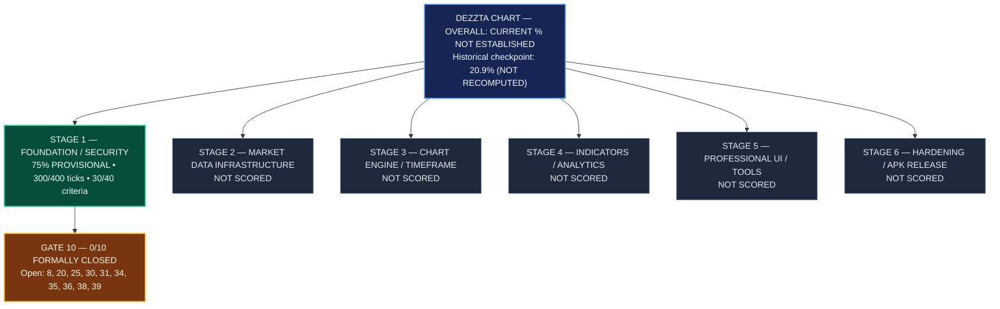

# DEZZTA CHART — Work Cycle Batch 20
**Date:** 18 November 2026  
**Repository:** `deszztagd377-pixel/dezzta-chart`  
**Audited branch:** `phase-2/market-data-foundation`  
**Audited HEAD:** `43d5b4bc50c2ef9047caa5e11e18b1b7fc494b22`  
**Parent:** `362ff6ed2a492383fc0d9ee2ce2f284146004b3d`  
**Cost:** ZERO COST • no Termux • no billing • no paid services • no production promotion

## 1. Colored project progress indicator

| Area | Current verified state |
|---|---|
| Stage 1 | 🟩 **75% provisional** — 300/400 ticks, 30/40 criteria |
| Gate 10 | 🟥 **0/10 formally closed** |
| Open criteria | 🟨 **8, 20, 25, 30, 31, 34, 35, 36, 38, 39** |
| Stages 2–6 | ⚪ **NOT SCORED** |
| Overall project | 🔵 **CURRENT % NOT ESTABLISHED** |
| Historical overall | 🟨 **20.9% — HISTORICAL ONLY, NOT RECOMPUTED** |

The overall percentage cannot be recomputed until the M1–M8 weights and criterion-to-deliverable mapping are approved and scored. No weights or progress credit are invented.

## 2. WebSocket work — exact scope and current blocker

### Repository protocol tests

Batch 19 added `backend/tests/test_vercel_ws_protocol.py`. The exact-HEAD CI run executed backend pytest successfully, including these in-process ASGI checks:

1. WebSocket handshake, ready/session ID, ping/pong, matching session ID and sequence.
2. Invalid message returns a bounded error and closes with 1003.
3. Oversized message returns a bounded error and closes with 1009.
4. Twelve messages inside ten seconds are accepted; the next message is rate-limited and closes with 1013.
5. Health response explicitly reports `synthetic-only` and `production_data_connected=false`.

### What this proves — and does not prove

- 🟩 **Verified in CI:** application-level ASGI protocol behavior.
- 🟨 **Previously owner-observed:** protected browser WSS handshake and synthetic ping/pong on an earlier READY preview; protected HTTP health also returned 200 on an earlier preview.
- 🟥 **Not verified on current HEAD:** a current deployed WSS handshake, current browser round-trip, foreground 330-second observation, platform-originated duration close, Android WebView transport, effective Fluid Compute read-back, or cross-instance production fan-out.
- Gate 36 therefore remains **OPEN**. Synthetic POC remains isolated and must never be connected to production market data or account traffic.

### Deployment constraint

For exact HEAD `43d5b4b`, both Vercel project status contexts currently report **FAILURE** with the provider's `build-rate-limit` restriction. This is a provider-side deployment restriction, not evidence of a source compile failure. No retry loop, manual redeploy, paid upgrade, billing activation, SSO weakening, or production promotion was attempted. Older READY previews are not treated as deployments of this HEAD.

**Decision:** keep Vercel deployment attempts paused until the provider status changes naturally. Continue local/CI protocol hardening without spending deployment quota. Cloudflare remains read-only until Free plan, subscription status and billable usage are independently confirmed; no Workers/Pages/Durable Objects resources are created in this cycle.

## 3. Frontend dependency-audit blocker — fresh upstream review

### Exact-HEAD CI result

GitHub Actions run [44289290240](https://github.com/deszztagd377-pixel/dezzta-chart/actions/runs/44289290240) completed with **FAILURE only at the final frontend dependency-audit enforcement step**. The following steps passed: frontend unit tests, production build, source and built-bundle credential scans, Android host preflight and immutable publisher tests, backend pytest, synthetic outbox benchmark, backend dependency audit, backend container build, Redis/persistent-volume smoke test, Trivy scan and report export/upload.

CodeQL [44289290157](https://github.com/deszztagd377-pixel/dezzta-chart/actions/runs/44289290157) and full Git-history secret audit [44289290459](https://github.com/deszztagd377-pixel/dezzta-chart/actions/runs/44289290459) completed successfully.

### Root cause

The final enforcement step still sees five High findings through development-only `picomatch@4.0.7`, advisory [GHSA-fc5q-39xc-vjpf](https://github.com/advisories/GHSA-fc5q-39xc-vjpf) / CVE-2026-112366. The root lockfile shows the package as `dev: true`, through development tooling. That reduces runtime exposure but is **not a remediation**.

### New upstream candidate review

A fresh GitHub upstream search surfaced additional proposals, including:

- [picomatch PR #273](https://github.com/micromatch/picomatch/pull/273) — focused rewrite for star-literal repeated extglobs; its description reports extensive equivalence and regression testing.
- [picomatch PR #267](https://github.com/micromatch/picomatch/pull/267) — single-branch wildcard extglob handling.
- [picomatch PR #261](https://github.com/micromatch/picomatch/pull/261) — broader bounded ambiguity checks with fail-closed behavior.

These are **unmerged upstream proposals**, not a published patched package. Their test claims are not independently reproduced in this repository. They may have differing semantic and compatibility trade-offs. The GitHub advisory still lists no patched version. Therefore:

- Do not install an unmerged fork or Git URL.
- Do not add a lockfile override based only on a PR description.
- Do not downgrade to 4.0.4; it does not remediate this later advisory.
- Do not suppress the audit, change the threshold, or replace it with production-only audit.
- Keep the final audit enforcement fail-closed and reassess when a maintainer-reviewed release is published.

This is the correct security decision even though it leaves CI red. A false green would be worse than a visible, accurately diagnosed blocker.

## 4. Gate 10 — consolidated action register

| Criterion | Repository evidence retained | External acceptance still required |
|---:|---|---|
| 8 | Source/bundle/history secret scans | Owner-controlled runtime secret injection and leakage checks |
| 20 | Identity, revocation and entitlement code/tests | Approved zero-cost identity setup and real sign-in/revocation/denial checks |
| 25 | Redis ACL/TLS and persistence CI smoke test | Existing owner-controlled Redis host, TLS, ACL, restart/failure proof |
| 30 | Encrypted snapshot/decrypt/full-restore integration tests | Fresh owner-target restore, integrity and post-restore read/write proof |
| 31 | Encrypted backup/recovery code and tests | Off-host copy, separately controlled key, retention and restore drill |
| 34 | Persistent-volume CI smoke test | Existing-host mount, ownership, disk-pressure and restart durability |
| 35 | Container build and health/fail-closed tests | Existing-host HTTPS/certificate and runtime secret-source evidence |
| 36 | ASGI protocol tests and isolated synthetic WSS POC | Current deployed WSS, 330s observation, platform close attribution, Android client, Fluid read-back and fan-out |
| 38 | Concurrent metrics and input-hardening tests | Durable aggregation, retention, host access control and dashboard acceptance |
| 39 | Sanitized alert/recovery tests and runbook | Persistent alert, named escalation owner and completed recovery drill |

No criterion is closed by documentation or test coverage alone. Stage 1 remains 75% provisional; Gate 10 remains 0/10 formally closed.

## 5. Engineering order — no circular work

1. **WebSocket:** keep the POC isolated; extend deterministic protocol/lifecycle regression tests and browser-state correctness. Do not spend Vercel quota while rate-limited.
2. **Dependency audit:** monitor upstream for a maintainer-reviewed release; validate any candidate against the full regression suite before touching the lockfile.
3. **Gate 10:** advance the owner-controlled zero-cost acceptance items where existing resources are available; do not provision paid or unverified infrastructure.
4. **Cloudflare:** read-only until Free plan and $0 billing state are confirmed; then design quotas and fail-closed limits before any resource creation.
5. **Progress:** award no Stage 1 ticks until criterion evidence and acceptance are complete. Keep overall current percentage unestablished until the weighted ledger is approved.

## 6. Cost, device and repository controls

- ZERO COST: no billing, paid plan, managed provider, market-data subscription, paid monitoring, or production hosting activation.
- No Termux required for this audit/documentation cycle. If a future task genuinely requires Termux, explain why before asking the owner to do anything.
- No manual edits or repair instructions are delegated to the owner.
- Active branch only: `phase-2/market-data-foundation`; `main` untouched.
- No deployment retries, SSO bypass, public exposure, or production data connection.

**Batch 20 result:** provider and dependency blockers are isolated with updated upstream evidence; the existing WebSocket protocol suite is confirmed in the backend CI path; no unsafe dependency patch or quota-consuming deployment was attempted. No Stage 1 tick or Gate 10 closure is claimed.
